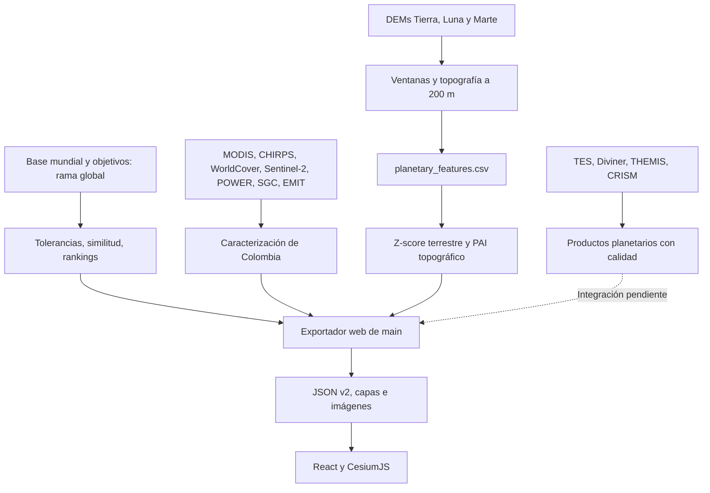

# GeoAnalog — auditoría técnica, científica y funcional

**Equipo:** Maxwellianos, según la identificación proporcionada por el solicitante.  
**Destino:** contexto documental para preparar la presentación ante los jurados de NASA International Space Apps Challenge 2026.  
**Fecha de corte:** 15 de noviembre de 2026, America/Bogota.  
**Repositorio:** <https://github.com/Mabeltranpe1/NASA_SPACE_APPS_2026>.  
**Alcance autorizado y realizado:** inspección, consultas de Git, comprobaciones en memoria y creación de este documento. No se cambiaron ramas, código, datos, dependencias, infraestructura ni historial. No se ejecutaron descargas científicas ni despliegues.

## 0. Cómo interpretar este informe

Este documento reúne evidencias del árbol de trabajo, otras ramas disponibles localmente, productos científicos y documentación oficial. Es autocontenido para interpretar los métodos y los resultados principales. Los anexos incorporan tablas numéricas, catálogos regionales y referencias de reproducción. No reproduce los centenares de miles de registros de entrada ni sustituye los archivos científicos originales.

Las referencias abreviadas siguientes identifican **versiones diferentes**, que no deben mezclarse al redactar la presentación:

| Clave | Referencia Git | Commit corto | Significado |
|---|---|---|---|
| A | `HEAD`, `recovery/original-project`, `origin/feature/planetary-analysis` | `aaf4ebb` | Árbol auditado en la raíz: caracterización colombiana ampliada, DEM y productos EMIT, SGC, TES, Diviner, THEMIS y CRISM; web anterior con datos sintéticos. |
| B | `origin/main` | `58313dc` | Versión integrada de la web 0.4.2 y base global de 163.998 celdas en 43 regiones; integración descriptiva de Colombia. |
| C | `origin/feature/compare_analysis` | `cc8f849` | Comparador global de Marco, composición equivalente y ampliación comprimida a 691.035 celdas/727 regiones; ranking de 200 lugares. |
| D | `feature/planetary-analysis` local | `1580561` | Referencia local antigua, coincidente con el release 0.2.0; no es la punta de la rama planetaria remota almacenada. |
| E | `recovery/github-src` | `a8cdd15` | Recuperación de ocho scripts científicos colocados originalmente en la raíz. |
| N | Repositorio anidado `NASA_SPACE_APPS_2026/`, rama `feature/planetary-analysis` | `513ada5` | Copia anterior con su propio `.git`; el repositorio exterior la registra como gitlink. |

Una referencia como **A `src/extract_features.py:59–193`** significa ruta y líneas de ese commit. Para consultar sin cambiar de rama: `git show aaf4ebb:src/extract_features.py`. En GitHub se puede usar `https://github.com/Mabeltranpe1/NASA_SPACE_APPS_2026/blob/aaf4ebb/src/extract_features.py#L59-L193`. Los números de línea de los CSV incluyen una cabecera en la primera línea salvo comentarios iniciales. Las puntas completas se registran en los anexos.

**Niveles de evidencia:**

- **Verificado por recálculo:** se volvió a calcular desde datos disponibles y se contrastó con el producto guardado.
- **Artefacto inspeccionado:** existe un CSV, JSON, raster o imagen que respalda el dato; su existencia no prueba validación externa ni reproducción integral desde la misión.
- **Implementado en código:** se inspeccionó la lógica; no implica haber probado toda la aplicación en un navegador o haber ejecutado sus descargas.
- **Documentado:** consta en documentación o en el contexto del solicitante, sin toda la cadena ejecutable disponible.
- **Provisional, parcial o propuesto:** no debe convertirse en un resultado definitivo en la presentación.

Las comprobaciones de concordancia verifican consistencia computacional. **No equivalen a validar geológicamente un análogo, demostrar una concentración mineral, confirmar hielo ni certificar un lugar para una base espacial.** Los índices son puntuaciones definidas por el equipo, no probabilidades de equivalencia física.

## 1. Resumen ejecutivo

GeoAnalog combina una búsqueda internacional de candidatos terrestres con una caracterización detallada de seis ventanas colombianas y una interfaz de exploración Tierra–Luna–Marte. La contribución cuantitativa más directamente reproducible en A es el análisis topográfico de **18 ventanas nominales de 10 × 10 km**: seis terrestres, seis marcianas y seis lunares. Sus 18 DEM tienen 50 × 50 celdas a 200 m y 100 % de elevaciones válidas. Se verificaron estadísticas físicas, una matriz simétrica de 18 × 18 y **72 pares Tierra–objetivo extraterrestre**.

El PAI topográfico encuentra, dentro de los seis candidatos colombianos, Tatacoa–Pathfinder **92,02119**, Tatacoa–Gale **84,15752** y Tatacoa–Jezero **83,87904**. La Guajira encabeza Phoenix **87,62343**, Viking 1 **86,50315** y Viking 2 **87,13699**. Para los objetivos lunares los mejores PAI oscilan entre **24,00652 y 55,95991**. Son semejanzas de relieve a esta escala, sin temperatura, geología o mineralogía en la ecuación. La Guajira requiere especial cautela: WorldCover indica **47,92280 % de agua** dentro de la ventana ambiental y no se aplica una máscara terrestre al PAI.

La contribución global de C incluye una base comprimida comprobada de **691.035 celdas, 727 regiones y 14 columnas**, además de un ranking de **100 lugares para la Luna y 100 para Marte**. Los puntajes globales son mucho más bajos que el PAI colombiano porque incluyen restricciones ambientales fuertes: el primer candidato lunar tiene media **0,0485** y el primero marciano **0,1959**. No es contradictorio: los métodos y variables son distintos. Los valores de las 200 medias se reprodujeron desde las características guardadas con error máximo **0,0000498652**, compatible con su redondeo a cuatro decimales. No se reconstruyó durante esta auditoría toda la selección de candidatos desde los archivos orbitales globales.

La web de B tiene un tercer alcance: elimina del puntaje variables fuera del rango terrestre por cuerpo celeste. Excluye ambas variables térmicas para la Luna y la amplitud térmica para Marte en el JSON inspeccionado. Por ello puede mostrar puntajes cercanos a 1, como **0,9926** para el mejor caso de Mons Mouton, sin afirmar equivalencia térmica completa. La web de A todavía consume un JSON con **`synthetic: true`**, 10 celdas y 3 objetivos. No debe presentarse ese archivo como el producto científico global.

En A ya existen resultados adicionales que un documento de contexto anterior todavía marcaba como pendientes: geología SGC, mineralogía EMIT, inercia térmica TES, estadística de facetas Diviner, temperaturas de brillo THEMIS e indicadores CRISM. Su calidad es desigual y permanecen separados del PAI y de la web integrada. Se verificaron los datos nativos locales de TES, las 36 escenas THEMIS y los productos CRISM disponibles, además de agregaciones EMIT y Diviner. Phoenix tiene tres rechazos CRISM por incompatibilidad de referencia geométrica; THEMIS conserva el estado **`pilot_band_unverified`**.

**Conclusión operativa:** existe un prototipo científico con productos reales y una visualización integrada en otra rama, pero no una única versión que contenga simultáneamente toda la ciencia actualizada, la base mundial ampliada y la interfaz final. La presentación debe nombrar la versión y el alcance de cada resultado.

## 2. Proyecto, pregunta científica y relación con el reto

El reto se titula **“Identify Earth Locations that Analog the Permanent Moon Base Locations and Mars”**. Su contenido está conservado en A `docs/NASA Space Apps Challenge.pdf`, seis páginas, impresión del 14/11/2026. Se extrajo su texto para comprobar objetivos, contexto y consideraciones. La URL obtenida del PDF corresponde a [la página oficial del reto](https://www.spaceappschallenge.org/2026/challenges/permanent-moon-base-locations-and-mars/); su consulta web devolvió 502 en esta auditoría, por lo que la evidencia textual utilizada es la copia local y no una certificación del estado actual del portal.

La pregunta que el código permite responder es: **¿qué ventanas terrestres seleccionadas o celdas de las bases disponibles se aproximan a determinados objetivos lunares y marcianos bajo unas variables, escalas y pesos explícitos?** El proyecto también caracteriza sus condiciones ambientales y materiales como apoyo para escoger lugares de investigación o ensayo. El código no calcula autorización de acceso, seguridad de campo, riesgo volcánico operativo, viabilidad de una misión, habitabilidad humana ni selección oficial de bases.

El reto admite analogías parciales, procesos y ambientes locales. Su texto recomienda buscar más allá de análogos conocidos; no prohíbe utilizarlos como controles. En B/C `src/screen_global.py:90–95` algunos comentarios denominan ciertas zonas “challenge: avoid”. Esa exclusión es una decisión del equipo, más restrictiva que la formulación conservada en el PDF.

## 3. Arquitectura del software y estado de integración

### 3.1 Componentes

| Componente | Implementación y responsabilidad | Estado observado |
|---|---|---|
| Caracterización detallada | A `src/resample.py`, `src/process_planetary.py`, `src/extract_features.py`, `src/similarity.py` | DEM → estadísticas → matriz/PAI; resultados reproducibles localmente. |
| Ambiente y materiales colombianos | A `src/extract_climate.py`, `src/extract_geology.py`, familia EMIT; CSV ambientales y espectrales exportados de GEE | Productos existentes; GEE no está conservado como scripts ejecutables versionados en los árboles revisados. |
| Ciencia planetaria adicional | A familias TES, Diviner, THEMIS y CRISM | Salidas con controles de calidad explícitos; no alimentan el PAI. |
| Base mundial | B/C `src/download_earth.py`, `src/build_earth.py`, `src/build_database.py`, `src/terrain_common.py`, `src/screen_global.py` | Base original y ampliación comprimida; trazabilidad y rutas de ejecución necesitan consolidación. |
| Comparador global | B/C `src/compare.py`, `src/make_results.py`, `src/seasons.py`; C `src/composition.py`, `src/make_top_analogos.py` | Índice explicable, rankings, sensibilidad a pesos y calendario heurístico. |
| Exportación web integrada | B `src/export_web.py`, datos JSON v2 | Comparación mundial, mapas de puntuación, 71 sitios exportados y caracterización descriptiva de seis sitios colombianos. |
| Exportación alternativa | C `src/export_web.py` → `analogos.json` | Contrato distinto al `comparisons.json` que consume la app principal. |
| Frontend | React, TypeScript, Vite, CesiumJS, GIBS y NASA Trek | Navegación, selección, imágenes, límites físicos e idioma; distintas generaciones según la rama. |
| Hospedaje | Terraform Azure Static Web Apps + GitHub Actions | Configuración declarada; no se verificó la cuenta Azure ni se desplegó. |

La arquitectura es principalmente **procesamiento científico por lotes + publicación de artefactos estáticos + frontend**. No se encontró un backend propio desplegado con API de análisis, base de datos transaccional, autenticación de usuarios ni ejecución científica bajo demanda. Las llamadas a NASA, SGC, Earthdata, MCD y servicios de imágenes pertenecen a adquisición o visualización externa.

### 3.2 Flujo de información



Las flechas hacia el exportador representan la implementación de B, no una integración completa disponible en A. B `src/export_web.py:272–344` incorpora topografía, ambiente, índices Sentinel-2, disponibilidad EMIT y mejores PAI de Colombia **como descripción**. No lee los nuevos CSV de mineralogía procesada, SGC, TES, Diviner, THEMIS o CRISM. Incluso mantiene el estado mineralógico “pendiente”.

En C `src/export_web.py:280–300`, el contrato alternativo contiene `features`, `composition_method`, `rock_types`, `sites`, `overall`, `regions` y `reference_photos`; la app principal espera `version`, `targets`, `sites[].results` y metadatos de `comparisons.json`. La existencia de `web/src/data/analogos.ts` y `web/scripts/copy-data-images.mjs` no demuestra que la interfaz principal consuma el nuevo contrato. No son exportadores intercambiables.

## 4. Metodología científica y matemática

### 4.1 Topografía detallada: selección espacial y remuestreo

En A se usan cuadrados nominales de 10.000 m de lado y 200 m por celda: **50 × 50 = 2.500 elevaciones** por ventana. Las fuentes terrestres se mantienen en su proyección UTM; Marte usa una proyección azimutal equidistante local con radios tomados del CRS de origen; la Luna conserva el sistema estereográfico polar sur del DEM. Se aplica promedio espacial mediante `rasterio.warp.reproject` y `Resampling.average`.

- Tierra: A `src/resample.py:26–108`, validación de CRS proyectado en metros y rechazo de resolución de entrada más gruesa que 200 m. El centro se toma de las extensiones del raster original; el código no vuelve a comprobarlo contra el punto anunciado.
- Marte: A `src/process_planetary.py:174–236`; longitudes 0–360° se convierten a −180–180°, CRS local con semiejes del archivo fuente, centro proyectado `(0,0)`.
- Luna: A `src/process_planetary.py:243–323`; verificación de proyección métrica y extensión mínima de 10 km; selección mediante Site01/04/07/11/20/23.
- Procesamiento común: A `src/process_planetary.py:73–159`; lectura por banda, límite de memoria de warp de 128 MB, aplicación de escala y offset del GeoTIFF, mínimo de cobertura 90 %, NoData −9999 y etiquetas de procedencia.

La armonización del tamaño de píxel favorece comparaciones, pero **no iguala la resolución efectiva, precisión vertical ni información independiente de los instrumentos**. Los [DEM LOLA del PGDA](https://pgda.gsfc.nasa.gov/products/78) son superficies interpoladas a 5 m y tienen productos de incertidumbre asociados que GeoAnalog no propaga al PAI. Una malla de 200 m tampoco resuelve piedras, grietas, pendientes de ruedas ni peligros de aterrizaje a escala métrica.

### 4.2 Variables topográficas

Sea `z` la elevación en metros y `Δx = Δy = 200 m`. Las implementaciones están en A `src/extract_features.py:32–193`.

| Magnitud | Fórmula implementada | Unidad y observaciones |
|---|---|---|
| Elevación relativa | `z_rel = z − media(z)` | m; solo para visualización. |
| Relieve local | `max(z) − min(z)` | m; sensible a extremos. |
| Relieve robusto | `P90(z) − P10(z)` | m; variable del PAI. |
| Desviación de elevación | `sqrt(media((z−media(z))²))` | m; `ddof=0`. |
| Pendiente | `θ = atan(sqrt(gx²+gy²)) · 180/π` | grados; `numpy.gradient` sobre distancias métricas. |
| TRI | `sqrt(Σ_vecindad_3×3 (z_i − z_c)²)` | m; el término central es cero; variante tipo Riley con ocho vecinos efectivos. |
| TPI | `z_c − media(z_ocho_vecinos)` | m; el PAI utiliza su desviación estándar regional. |
| Aspecto | `(atan2(−gx,gy) · 180/π + 360) mod 360` | grados respecto al norte de cuadrícula; las filas aumentan hacia el sur. Planos y vecindarios incompletos quedan ausentes. |
| Clases de pendiente | `<5°`, `5°≤θ<15°`, `≥15°` | % de pendientes válidas, no de toda la extensión original. |

Los filtros 3 × 3 requieren vecindarios completos; se excluye una celda de borde. En los DEM sin huecos se usan **48 × 48 = 2.304** posiciones para pendiente/TRI/TPI por ventana. Hay **45.000** elevaciones y **41.472** posiciones interiores entre los 18 archivos; no son observaciones estadísticamente independientes. El tamaño de la ventana de vecindad es 600 m de ancho de soporte raster y 400 m entre los centros extremos.

### 4.3 Planetary Analog Index de Colombia

Implementación: A `src/similarity.py:28–47,77–124,133–166,259–315`.

Se usan seis variables:

| Variable | Peso |
|---|---:|
| `relief_p90_p10_m` | 0,15 |
| `elevation_std_m` | 0,15 |
| `slope_mean_deg` | 0,15 |
| `slope_p90_deg` | 0,15 |
| `tri_mean_m` | 0,15 |
| `tpi_std_m` | 0,25 |

Para cada variable `j`, la media `μ_j` y desviación poblacional `σ_j` se calculan **solo en las seis regiones terrestres**. Las variables con `σ_j≤10⁻¹⁰` se excluyen y los pesos activos se renormalizan.

```text
u_ij = (x_ij − μ_j,Tierra) / σ_j,Tierra
d(a,b) = sqrt(Σ_j w_j · (u_aj − u_bj)²), con Σ_j w_j = 1
PAI(a,b) = 100 / (1 + d(a,b))
```

Es una distancia euclídea ponderada seguida de una transformación monótona. Es simétrica, adimensional y da 100 a vectores idénticos. **Un PAI de 92 no significa un 92 % de equivalencia planetaria.** La elevación absoluta no entra, lo cual evita comparar directamente ceros verticales de cuerpos diferentes. Temperatura, clima, mineralogía y geología tampoco entran.

La correlación entre las seis variables terrestres es muy alta: el menor coeficiente fuera de diagonal es aproximadamente 0,961 y algunos redondean a 1,000. Hay redundancia entre pendiente, TRI y relieve. Además, la escala estadística depende de seis candidatos escogidos previamente. Añadir o cambiar una región puede alterar todos los PAI aunque las ventanas planetarias permanezcan iguales. No hay calibración frente a análogos independientes, intervalo de incertidumbre, validación espacial externa ni análisis de sensibilidad de este PAI en A. Los pesos son decisiones exploratorias.

### 4.4 Comparador de A: modelo de demostración

A `src/compare.py:44–85,202–272` usa siete variables y `RobustScaler` ajustado conjuntamente a Tierra y objetivos: `(x−mediana)/IQR`. Aplica `log(1+precip_mm)` antes de escalar. Sus pesos son elevación 0,5; pendiente 1; rugosidad 1; temperatura media 1,5; rango térmico 1; albedo 1; precipitación 1. La métrica es:

```text
s_j = exp(−|δ_j|)
d = sqrt(Σ_j w_j δ_j² / Σ_j w_j), sobre variables disponibles
score = exp(−d)
```

Los valores faltantes eliminan pesos por celda. Esta versión no exige un porcentaje mínimo de cobertura y puede favorecer celdas incompletas. El exportador y JSON de A proceden de las muestras declaradas sintéticas. **Este `score` no es el PAI** de `src/similarity.py`.

### 4.5 Comparador global B/C: tolerancias físicas y cobertura

B/C `src/compare.py:44–107,230–319` amplía a nueve variables e incorpora escalado por tolerancias como opción predeterminada. Conserva el escalado robusto como alternativa. La fórmula exponencial anterior sigue siendo válida, pero `δ_j=(g_j(x_a)−g_j(x_b))/τ_j`, con `g=log1p` para precipitación e identidad para el resto.

| Variable | Tolerancia `τ` | Peso predeterminado |
|---|---:|---:|
| Elevación | 1.000 m | 0,5 |
| Pendiente | 5° | 1 |
| Rugosidad local | 5 m | 1 |
| Temperatura media superficial | 30 K | 1,5 |
| Indicador de amplitud térmica | 30 K | 1 |
| Albedo | 0,10 | 1 |
| Precipitación | 1 en `ln(1+mm/año)` | 1 |
| NDVI | 0,10 | 1 |
| Contraste de emisividad | 0,03 | 1 |

El encabezado histórico todavía describe `roughness` como adimensional; `src/terrain_common.py` y las tolerancias la implementan en **metros**, como desviación local de elevaciones. La cobertura se mide por la fracción del peso activo disponible; por defecto se exige 1,0. No representa fracción de área de un DEM.

Los rankings de B `src/make_results.py:30` desactivan elevación; C `src/make_results.py:33` añade peso **0,5 para `em_contrast`**. La fórmula no debe reproducirse con los pesos genéricos si se desea recuperar esos resultados. B/C `src/compare.py:440–464` ordena el ranking general primero por **número de condiciones con similitud media ≥0,5** y después por puntaje medio. Por eso una fila con menor `mean_score` puede ocupar el primer puesto. No es un error de ordenación.

La sensibilidad multiplica pesos por factores uniformes en `[0,5;1,5]` con semilla fija; informa fracción de ejecuciones en el top N. Evalúa sensibilidad a preferencias, **no error instrumental, probabilidad de validez ni incertidumbre geológica**. A usa 200 ejecuciones en el JSON sintético; B usa 100 y top 500 en el JSON integrado.

### 4.6 Base global y descubrimiento de candidatos

B/C `src/build_earth.py` construye celdas angulares de 0,05°. El tamaño norte–sur terrestre es aproximadamente 5,6 km, pero el ancho disminuye con el coseno de la latitud. Las celdas polares no son cuadrados de 5,5 km de lado. Se usan NASADEM y Copernicus GLO-90 para relieve y productos MODIS, IMERG y ASTER para superficie. La documentación global conserva 2023 como año de trabajo; ASTER utiliza enero y julio de 2015. El archivo consolidado no lleva periodo y versión por registro, por lo que no puede certificarse una única fecha observacional para toda la base.

El relieve global se remuestrea por suavizado y `scipy.ndimage.zoom`, no mediante la misma reproyección del módulo detallado. La rugosidad es `sqrt(E[z²]−E[z]²)` en 3 × 3, no el TRI de Riley. Los huecos se rellenan temporalmente con la media antes de filtrar y se remascaran en el centro; los vecinos pueden conservar efectos del relleno. B `src/terrain_common.py:23–57`. Las celdas mayoritariamente acuáticas se eliminan, pero en Copernicus se usa `elevación==0` como aproximación al agua: puede confundir tierra a cota cero y no es una máscara hidrológica general. B `src/build_earth.py:115–125,147–150`.

El screening global usa temperatura, amplitud, albedo, precipitación y NDVI; no aplica relieve ni emisividad en esa primera fase. Agrupa áreas de 2 × 2°, exige 50 celdas válidas y ordena por percentil 90 del puntaje. La máscara inicial de tierra comprueba temperatura y albedo finitos; no es una clasificación terrestre independiente. Se limita la repetición geográfica y se etiqueta proximidad a análogos conocidos. B `src/screen_global.py:37–55,70–87,111–155`.

C añade selección de teselas, países aproximados con Natural Earth y áreas de 2 × 2°; `outputs/grid_search/tiles.py:12–23` asigna país por un centroide y usa el país más cercano si no hay contención. Las etiquetas no acreditan que todos los píxeles pertenezcan a una jurisdicción. Los scripts de `outputs/grid_search/` contienen rutas absolutas `/root/...` y entradas intermedias externas, lo que limita su reproducción fuera del entorno original.

En C el ranking por objetivo procura cinco regiones separadas por 800 km; el top 200 busca 100 por cuerpo, una por región y separadas al menos 300 km dentro de cada lista. Se excluye el piso sombreado de Shackleton del promedio lunar general. C `src/make_results.py:33–50,64–83`; `src/make_top_analogos.py:18–49`. Hay controles conocidos y candidatos poco documentados, pero la etiqueta `known=no` es heurística; no demuestra novedad científica mundial.

### 4.7 Compatibilidad de las variables térmicas globales

Las siguientes definiciones están implementadas, aunque el nombre común `temp_range_K` puede sugerir una equivalencia que no existe:

| Cuerpo | Media | `temp_range_K` real | Referencia B |
|---|---|---|---|
| Tierra | Media de muestras MODIS día y noche de los archivos disponibles | Máximo diurno disponible menos la media anterior | `src/build_earth.py:222–229` |
| Luna | Media de `temp_avg` de facetas PRP seleccionadas por centro | Media de `temp_max−temp_avg` | `src/build_moon_targets.py:161–177` |
| Marte | Media de la tabla de temperatura superficial MCD sobre estación y hora | Máximo de la tabla menos su media | `src/build_mars_targets.py:111–154` |

No son el mismo estimador de máxima menos mínima diaria. El PRP tiene una temperatura anual a 2 cm y una máxima superficial; su resta mezcla profundidad y estadístico. La media MCD es de un modelo y pondera uniformemente las muestras de longitud solar/hora, sin demostrar ponderación por duración orbital. El módulo Diviner ampliado de A mantiene nombres físicos más precisos y no crea ese índice. La amplitud global exige redefinición o, al menos, explicación visible antes de presentarla como equivalencia térmica.

En C `src/build_earth.py:241–295` se corrige la precipitación polar con MERRA-2 `PRECTOTCORR` para `|lat|≥60°`. Se convierte de kg m⁻² s⁻¹ a mm/mes multiplicando por segundos del mes. B usa IMERG sin ese reemplazo. El CSV comprimido conserva la actualización polar; el CSV sin comprimir antiguo no está sincronizado. Tampoco se aplica esa corrección en el `src/seasons.py` heredado.

### 4.8 Clima, ambiente y espectros colombianos

**NASA POWER.** A `src/extract_climate.py:23–56,63–174` consulta 2021-01-01 a 2025-12-31: T2M, máximas/mínimas, humedad relativa, presión, viento a 10 m, irradiación solar y humedad relativa del suelo. Se sustituyen valores de relleno por ausentes, se guardan series y se agregan medias/extremos/percentiles. Las seis series tienen 1.826 fechas y no contienen huecos en las columnas inspeccionadas. La irradiación se conserva en `kW-hr/m^2/day` —energía por área y día—; no es potencia instantánea. Las [resoluciones de POWER](https://power.larc.nasa.gov/docs/tutorials/service-data-request/api/) son mucho más gruesas que las ventanas de 10 km. Ruiz y Santa Isabel comparten los mismos valores meteorológicos guardados; no deben interpretarse como estaciones de cumbre. El porcentaje de completitud usa un denominador fijo `1826×8`, válido para este intervalo pero frágil si cambian fechas o parámetros.

**Ambiente GEE.** Los CSV están disponibles, pero la cadena ejecutable no está versionada. A `docs/GeoAnalog_CONTEXTO_TECNICO.md:344–355` documenta: MOD11A1 con QA obligatorio, escala 0,02 K y conversión a °C; NDVI MOD13Q1 con `SummaryQA=0` y factor 0,0001; WorldCover 2021; precipitación CHIRPS diaria 2021–2025 dividida por cinco. La amplitud MODIS local es la media de diferencias de pares día/noche válidos; por ello no tiene que coincidir con restar las dos medias marginales. La cobertura WorldCover representa 2021, no una serie de cinco años.

**Sentinel-2 GEE.** A documentación `:416–437` describe L2A armonizado de 2025, escenas con nubes <80 %, SCL 4/5, al menos cinco observaciones válidas, mediana temporal por banda y estadísticas a 20 m. Para suelo se usa NDVI<0,2. Bandas: B2, B3, B4, B5, B6, B7, B8, B8A, B11 y B12; reflectancia adimensional con factor 0,0001. La implementación externa no se pudo reejecutar ni verificar píxel por píxel. Las fórmulas documentadas son:

```text
NDVI = (B8−B4)/(B8+B4)
BSI  = ((B11+B4)−(B8+B2))/((B11+B4)+(B8+B2))
IOR  = B4/B2
HMR  = B11/B12
```

IOR y HMR son contrastes espectrales amplios, no concentraciones minerales. La reflectancia de un compuesto por medianas de bandas puede no corresponder a una adquisición simultánea. El NDVI calculado sobre el subconjunto de suelo tampoco equivale al NDVI regional MODIS. Los porcentajes espectrales se interpretan según su denominador documentado: ventana total, no únicamente superficie terrestre ni píxeles válidos.

### 4.9 Geología SGC

A `src/extract_geology.py:21–23,38–115` consulta las unidades cronoestratigráficas del Atlas Geológico de Colombia 2023, escala declarada 1:500.000, capa 733. Usa la extensión del DEM, reproyecta polígonos, repara geometrías y calcula intersecciones. Agrupa unidades por atributos y distingue porcentaje de ventana frente a porcentaje cartografiado; también informa exceso de superposición. Detecta respuestas truncadas del servicio.

Hay 16 combinaciones región–unidad y seis registros de cobertura. La Guajira está cartografiada en 53,00429 %; las otras ventanas en 100 %. Eso concuerda de manera aproximada con la presencia de agua, pero “no cartografiado” no equivale automáticamente a océano. La escala cartográfica no permite certificar litología en cada celda de 200 m ni sustituir un reconocimiento de campo. El [servicio SGC consultado](https://srvags.sgc.gov.co/arcgis/rest/services/Mapa_Geologico_Colombia/Mapa_Geologico_Colombia_V2023/MapServer/733) ofrece polígonos y GeoJSON, y declara límite de 10.000 registros.

### 4.10 Mineralogía EMIT

A `src/search_emit.py`, `src/download_emit.py` y `src/extract_mineralogy.py` trabajan con EMITL2BMIN v001, instrumento EMIT de NASA en la ISS. El inventario encuentra 96 gránulos sumados entre las seis búsquedas regionales; **no implica 96 adquisiciones únicas independientes**, porque dos regiones cercanas pueden compartir escena. Se seleccionaron tres por región; los manifiestos registran seis NetCDF por región, mineralogía e incertidumbre por cada adquisición.

El código localiza centros de píxel nativos en la ventana y conserva dos grupos espectrales. A `src/extract_mineralogy.py:100–107,119–170` exige identificador conocido, profundidad válida, profundidad de banda ≥0,02, ajuste almacenado ≥0,20 y profundidad ≥2×incertidumbre. El ajuste almacenado se multiplica por dos para reportarlo; la convención está respaldada por [el tutorial oficial EMIT, sección de incertidumbres](https://nasa.github.io/LPDAAC-Data-Resources/external/Working_with_EMIT_L2B_Mineralogy.html). No se aplica máscara L2A de nubes ni máscara marina; ambas banderas se guardan explícitamente como falsas.

Las 222 filas mineralógicas regionales son **coincidencias con entradas de biblioteca espectral**, no porcentajes en masa ni área exclusiva. Sus porcentajes cuentan observaciones aceptadas o válidas, con posibles revisitas y superposición. Los dos grupos pueden coexistir en el mismo píxel. Los porcentajes de bins de 200 m tocados son diagnósticos de distribución de centros, no cobertura de área geométrica.

El tutorial de NASA advierte que materiales adicionales a los diez grupos objetivo requieren validación adicional. En las salidas aparecen coincidencias de biblioteca de perclorato de magnesio, mezclas y vegetación seca. **No es defendible anunciar descubrimiento de percloratos o reservas minerales en Colombia con estas salidas.** Deben mantenerse los nombres completos de biblioteca y el estado `provisional` o `partial_provisional`; Puracé solo tiene dos adquisiciones con observaciones válidas por grupo.

### 4.11 CRISM: indicadores espectrales marcianos

A `src/extract_crism.py:26–33` selecciona nueve parámetros: OLINDEX3, LCPINDEX2, HCPINDEX2, BD530_2, D2300, BD2210_2, BD1900_2, SINDEX2 y CINDEX2. Son indicadores de absorción o forma espectral asociados con determinados materiales. Un valor positivo no prueba un mineral inequívoco ni su abundancia.

La adquisición usa ODE y productos MTRDR/MRDR4. El procesamiento lee etiquetas PDS, nombres de bandas, escalas, offset y valores especiales. Interseca la ventana del DEM con las celdas nativas del producto y pondera por área proyectada; acepta los parámetros con cobertura válida ≥80 %. A `src/extract_crism.py:140–208,257–286`. Los extremos son mínimos/máximos de valores incluidos, no intervalos de incertidumbre.

Se rechazan mapas no esféricos o planetográficos hasta validar su transformación. Eso afecta las tres escenas dirigidas de Phoenix, pese a que los archivos están descargados. Pathfinder tiene un mosaico sin píxeles válidos, dos escenas calificadas y otra con cobertura insuficiente. El CSV primario incluye nueve filas explícitas de ausencia para Phoenix, y 54 observaciones calificadas de parámetros en cinco regiones. Hay parámetros repetidos por región porque el primario conserva escenas; no representa una única medición regional fusionada.

### 4.12 TES: inercia térmica de Marte

A `src/extract_thermal_mars.py` utiliza MGS TES TIMAP v1.0, mapas 2007, periodo consignado 1999–2004. Lee IMG PDS3 y máscaras de interpolación mediante memmap; valida dimensiones, orden de bytes, proyección, radios y tamaños de archivo. Trabaja con celdas nativas de 0,05°, aproximadamente 2,964 km norte–sur en la esfera de radio 3.396 km. La anchura este–oeste depende de la latitud.

La inercia térmica es una propiedad física habitualmente expresada como `I=sqrt(k·ρ·c)`, unidad **J m⁻² K⁻¹ s⁻¹/²**; GeoAnalog lee el producto derivado, no estima `k`, `ρ` y `c` ni ajusta un modelo termofísico. Interseca celdas con cuadrados LAEA nominales de 100 km² y usa media y dispersión ponderadas por área. Excluye valores fuera de 5–5.000 y píxeles marcados como interpolados. A `:79–169`. Usa 80 % como umbral exploratorio de cobertura. El registro diurno de Phoenix queda en **79,60697 %**, por debajo del umbral; no debe redondearse a 80 para declararlo aceptado.

La diferencia de inercia diurna y nocturna no es diferencia de temperaturas. Son productos/inversiones distintas con sus propios sesgos y soportes; una diferencia no representa automáticamente error instrumental ni variación diaria de una constante del material.

### 4.13 Diviner: recurso térmico lunar y estabilidad modelada

A `src/extract_thermal_moon.py:106–151,171–253` utiliza PRP v2.0: convierte vértices de facetas nativas, comprueba coherencia con centros, reproyecta a área equivalente y pondera las intersecciones con las ventanas LOLA. Distingue temperatura anual media a 2 cm, máxima superficial anual y profundidad modelada de estabilidad de hielo. Procesa el archivo por bloques de 100.000 registros; valida tamaño de 210 bytes por registro y 2.880.000 registros más cabecera.

Las ventanas intersectan **5.079 facetas**; los resúmenes indican cobertura geométrica del 100 %. La proporción modelada de hielo estable en superficie es **1,22878 % en Shackleton Rim** y cero en las otras cinco ventanas. El código `−32768` de profundidad se interpreta como más allá del límite reportado de **2,8738 m**, no como profundidad cero ni como ausencia de hielo. La media de profundidades finitas es condicional al subconjunto correspondiente.

**Estabilidad termofísica modelada no demuestra presencia de hielo.** Además, la coalineación con el marco lunar ME/DE421 se declara como asumida en el producto. La agregación por área horizontal no es área real inclinada de la ladera. La nueva rutina es más cuidadosa que seleccionar facetas solo por centro, pero esa diferencia también impide mezclar sin control sus promedios con los del comparador global.

### 4.14 THEMIS: temperaturas de brillo piloto

A `src/download_themis.py` selecciona hasta tres candidatos diurnos y tres nocturnos por región. `src/extract_thermal_themis.py:69–159,243–348` verifica etiquetas PDS, escala, offset, valores especiales, referencia geométrica e iluminación. La escala se aplica una sola vez. La cobertura se calcula con intersección de píxeles nativos. Los promedios regionales se calculan por escena y después con **igual peso entre escenas aceptadas**, separando grupos de banda.

Hay 36 escenas descargadas, 31 con estado `ok`, tres sin píxeles válidos, una sin intersección y una con cobertura baja. Los 12 resúmenes región–iluminación conservan **`pilot_band_unverified`**. La clasificación por incidencia en un punto de referencia no garantiza las mismas condiciones sobre toda la ventana. Se guardan estación solar, fecha y discrepancias cuando están disponibles.

Las medias diurnas y nocturnas provienen de adquisiciones distintas, con estaciones y horas diferentes; algunas nocturnas superan las diurnas del conjunto. **No se debe restarlas para publicar amplitud diurna ni interpretarlas como una climatología regional validada.** Son temperaturas de brillo radiométricas; su equivalencia con temperatura cinética exige banda, emisividad y condiciones de observación verificadas.

### 4.15 Composición equivalente y óxidos de literatura

C `src/composition.py:70–147` ajusta una recta `em_contrast=a+b·CF` con dos anclajes: mediana ASTER de Islandia para basalto (`CF=8,25 µm`) y Rub al Khali para arena de cuarzo (`CF=7,45 µm`). La Puna es una comprobación adicional fuera del ajuste. Para cada objetivo se asigna un CF de literatura o contexto litológico y se calcula `σ_em=|b|·σ_CF`. La incertidumbre reportada de 0,0263–0,0394 es del orden de la tolerancia 0,03 del comparador.

No es una medición ASTER sobre la Luna o Marte ni una recuperación directa de espectros Diviner/TES en cada objetivo. Hay extrapolación para algunos CF y supuestos sobre efectos térmicos y meteorización espacial. La incertidumbre no se propaga al ranking: se reduce su peso a 0,5. C `docs/COMPOSICION.md:56–87` lo reconoce.

C `src/export_web.py:285–292` también exporta composiciones típicas de tipos de roca, expresadas en óxidos de literatura. **No son análisis químicos medidos en las coordenadas elegidas.** Deben distinguirse tanto de `em_contrast` como de los indicadores CRISM y de las coincidencias EMIT.

### 4.16 Calendario heurístico de campañas

B/C `src/seasons.py:43–85` combina temperatura mensual terrestre, precipitación y duración astronómica aproximada del día. Calcula `sim_temp=exp(−|T_más_fría−T_objetivo|/30)` y `sim_dry=exp(−ln(1+12·P_mes))`; `month_score=sqrt(sim_temp·sim_dry)`. El target es la media térmica de los sitios de ese cuerpo. No considera acceso, permisos, logística, nubosidad para operaciones, radiación, seguridad o rendimiento de equipos. El muestreo de IMERG heredado y la falta de comprobación de doce meses ordenados limitan su uso, especialmente en regiones polares.

## 5. Tecnologías, dependencias y reproducibilidad

| Capa | Tecnologías observadas | Observaciones de auditoría |
|---|---|---|
| Análisis | Python, NumPy, pandas, SciPy, scikit-learn | scikit-learn se utiliza para escalado; no se encontró entrenamiento de modelos de aprendizaje automático. |
| Rasters y geometría | Rasterio/GDAL, PyProj/PROJ, Shapely | Sistemas planetarios explícitos; intersecciones nativas en módulos recientes. |
| Formatos científicos | GeoTIFF, PDS3/PDS4 IMG/LBL/XML/TAB, NetCDF, HDF4/HDF5, CSV, GeoJSON | Lectores especializados; la disponibilidad de motores HDF4/NetCDF debe preservarse. |
| Adquisición | requests, urllib/urllib3, earthaccess; API POWER, ODE, ArcGIS, MCD, STAC | Manifiestos y reintentos en descargas recientes; acceso Earthdata puede requerir cuenta. |
| Figuras | Matplotlib; Pillow en B para imágenes | 18 figuras científicas de seis paneles y matriz PAI; mapas y galería en otras ramas. |
| Web A | React/ReactDOM `^19.3.1`, Cesium `^1.147.0`, Vite `^8.3.6`, TypeScript `~7.0.2`, oxlint | Valores declarados en `web/package.json`, no versiones instaladas comprobadas. |
| Entrega | Node 24 en GitHub Actions, npm lockfile, Azure Static Web Apps, Terraform `>=1.9`, azurerm `~>5.14` | Workflow de lint/build/despliegue, sin pruebas científicas en CI. |

El intérprete local auditado es **Python 3.14.6**, aunque README y `environment.yml` indican Python 3.12. Versiones instaladas observadas: NumPy 2.5.4, pandas 3.1.1, SciPy 1.18.1, scikit-learn 1.9.1, Rasterio 1.5.2, PyProj 3.8.0, Shapely 2.2.0, xarray 2026.9.0, netCDF4 1.7.5.1.post1, requests 2.34.2 y earthaccess 0.19.0. `pytest` no está instalado en este entorno. Estas versiones describen esta auditoría, no una especificación reproducible de producción.

A `requirements.txt:4–13` no declara SciPy, PyProj, requests, earthaccess, Shapely ni netCDF4, aunque los scripts los importan. B amplía el listado a SciPy, PyProj, requests, h5py, pyhdf, earthaccess, Pillow y Shapely, pero no declara explícitamente el motor netCDF4 de la mineralogía nueva. C conserva un `environment.yml` con prefijo de entorno personal Linux y sin todas las dependencias necesarias. Los paquetes Python no están fijados por versión. GeoPandas, folium y Jupyter se declaran, pero no intervienen directamente en los scripts Python auditados; no hay notebooks científicos de análisis versionados más allá de `.gitkeep`.

Hay scripts con trabajo en el nivel superior del módulo (`src/resample.py`, `src/extract_features.py`, `src/similarity.py`, `src/extract_climate.py`, `src/search_emit.py`, `src/download_emit.py`). Importarlos puede escribir resultados o lanzar acceso de red/autenticación. Por eso la auditoría no los importó indiscriminadamente ni ejecutó pipelines que sobrescriben artefactos. No hay un orquestador único con manifestación de entradas, versiones, parámetros, checksums y salidas para toda la ciencia.

## 6. Regiones estudiadas y dimensión internacional

### 6.1 Colombia: seis ventanas detalladas

| ID | Contexto geográfico | Latitud | Longitud este, grados firmados |
|---|---|---:|---:|
| `Tatacoa` | Huila, región de la Tatacoa | 3,23000 | −75,17000 |
| `La_Guajira` | Sector costero/dunas de Taroa | 12,43653 | −71,60899 |
| `Nevado_del_Ruiz` | Entorno volcánico altoandino | 4,89500 | −75,32200 |
| `Volcan_Purace` | Entorno del volcán Puracé | 2,30950 | −76,39480 |
| `La_Candelaria` | Boyacá, entorno de la Candelaria | 5,53680 | −73,61630 |
| `Nevado_Santa_Isabel` | Entorno volcánico/glaciar altoandino | 4,81800 | −75,36500 |

Son puntos de trabajo de A `src/extract_climate.py:35–41` y `src/extract_geology.py:24–30`; no límites administrativos, mediciones de cumbre ni autorización de campañas. El catálogo web puede usar otro punto nominal y asociarlo a la celda más cercana, por lo que hay que conservar geometría y procedencia de cada ficha.

### 6.2 Luna y Marte: dos selecciones distintas

A analiza Marte en Jezero, Gale, Phoenix, Pathfinder, Viking 1 y Viking 2. A `src/process_planetary.py:45–51` guarda sus coordenadas. En la Luna usa Connecting Ridge, Shackleton Rim, Peak Near Shackleton, De Gerlache Rim, Leibnitz Beta Plateau y Malapert Massif. Los centros derivados de sus DEM se incluyen en los anexos térmicos.

B/C compara seis objetivos lunares: borde de Shackleton, borde de de Gerlache, borde de Haworth, borde de Faustini, cima de Mons Mouton y piso sombreado de Shackleton. Sus regiones son anillos o discos, no los mismos cuadrados de A. Marte incluye nueve discos de radio 10 km: Jezero, Gale, Elysium Planitia, Meridiani Planum, Gusev, Chryse/Viking 1, Utopia/Viking 2, Vastitas Borealis/Phoenix y Arcadia Planitia. Pathfinder no pertenece a ese catálogo global. Se incluyen las coordenadas y valores en anexos; no se debe unir por nombres parecidos sin reconciliar geometría y marco de referencia.

### 6.3 Regiones fuera de Colombia

La base B tiene 43 regiones, incluidas Northern Andes y conocidas como controles. C conserva esas 43 en el CSV antiguo y amplía a 727 en el comprimido. Se verificó igualdad de coordenadas únicas: no hay duplicados latitud/longitud dentro de cada base. La ampliación agrega 684 identificadores regionales, muchos construidos como cuadrículas geográficas de 2 × 2°.

Las 43 regiones base son: `northern_andes`, `dry_valleys`, `antarctic_plateau`, `devon_island`, `axel_heiberg`, `north_greenland`, `svalbard`, `iceland_highlands`, `kamchatka`, `atacama`, `puna`, `uyuni_altiplano`, `qaidam_tibet`, `ladakh`, `pamir`, `taklamakan`, `gobi`, `lut_iran`, `rub_al_khali`, `danakil`, `tibesti`, `namib`, `pilbara`, `mojave_death_valley`, `utah_mdrs`, `mauna_kea_hawaii`, `teide_tenerife`, `rio_tinto`, `fezzan_libya`, `egypt_western_desert`, `tanezrouft_sahara`, `changtang_tibet`, `transantarctic_mts`, `prince_charles_mts`, `tenere_niger`, `nubian_desert_sudan`, `djourab_chad`, `adrar_mauritania`, `kumtag_lop_nur`, `badain_jaran`, `dasht_margo`, `victoria_island`, `ellesmere_north`.

Esto abarca Antártida, Ártico canadiense y Groenlandia; América andina y Norteamérica; Sahara y desiertos africanos; península arábiga, Irán, Afganistán, Pakistán, Asia central y mesetas de Asia; Australia; islas volcánicas y otros ambientes. El anexo del catálogo registra **las 727 regiones con sus cajas, número de celdas, DEM y etiqueta de control**, evitando reducir el trabajo del equipo a Colombia o atribuir nombres municipales no respaldados.

## 7. Fuentes de información y clasificación para Space Apps

“Usado” significa evidencia en scripts y/o productos, con la versión concreta indicada. Las fuentes de mapas y fotografías se distinguen de las variables numéricas que entran al comparador. Una agencia puede contribuir conjuntamente con otra: por ejemplo HRSC/MOLA combina ESA y NASA; ASTER y GPM también tienen participación japonesa. Clasificar un producto en NASA Data no elimina ese crédito.

### 7.1 NASA Data

| Recurso oficial / responsabilidad | Misión o instrumento; variables y uso real | Evidencia y URL |
|---|---|---|
| NASADEM HGT v001, NASA/LP DAAC | Reprocesamiento SRTM; elevación terrestre, pendientes y relieve de Colombia y base global | A `src/resample.py`; B `src/download_earth.py:49–52`, `src/build_earth.py:108–112`; [catálogo oficial de distribución GEE](https://developers.google.com/earth-engine/datasets/catalog/NASA_NASADEM_HGT_001). |
| MOD11A1 v061, NASA/LP DAAC | Terra MODIS, LST día/noche diaria a ~1 km; ambiente colombiano | A CSV y contexto `:350–352`; [catálogo MOD11A1](https://developers.google.com/earth-engine/datasets/catalog/MODIS_061_MOD11A1). |
| MOD13Q1 v061, NASA/LP DAAC | Terra MODIS, NDVI 16 días ~250 m; vegetación de las seis ventanas | A CSV y contexto `:353`; [catálogo MOD13Q1](https://developers.google.com/earth-engine/datasets/catalog/MODIS_061_MOD13Q1). |
| MOD11C3 v061, NASA/LP DAAC | Terra MODIS mensual CMG 0,05°; media superficial e indicador de amplitud global | B/C `src/build_earth.py:222–229`; [guía oficial de productos MOD11](https://modis-land.gsfc.nasa.gov/pdf/MOD11_User_Guide_V61.pdf), [DOI del producto](https://doi.org/10.5067/MODIS/MOD11C3.061). |
| MCD43C3 v061, NASA/LP DAAC | Terra/Aqua MODIS; albedo white-sky de onda corta, muestras del día 15 de cada mes | B `src/download_earth.py:61–73`, `src/build_earth.py:232–237`; [catálogo MCD43C3](https://developers.google.com/earth-engine/datasets/catalog/MODIS_061_MCD43C3). |
| MOD13C2 v061, NASA/LP DAAC | Terra MODIS mensual 0,05°; NDVI global | B/C `src/build_earth.py`, [registro federal suministrado por NASA](https://catalog.data.gov/dataset/modis-terra-vegetation-indices-monthly-l3-global-0-05deg-cmg-v061), [DOI](https://doi.org/10.5067/MODIS/MOD13C2.061). |
| GPM IMERG mensual v07, NASA GES DISC/JAXA y socios | Precipitación mm/h convertida a mm/mes y mm/año; aridez global | B `src/build_earth.py:240–257`, C `:244–295`; [catálogo IMERG mensual](https://developers.google.com/earth-engine/datasets/catalog/NASA_GPM_L3_IMERG_MONTHLY_V07). |
| MERRA-2 flujo mensual, NASA GMAO/GES DISC | Reanálisis; `PRECTOTCORR`, reemplazo de precipitación polar en C | C `src/build_earth.py:241–295`; [colección M2TMNXFLX oficial](https://data.nasa.gov/dataset/merra-2-tavgm-2d-flx-nx-2dmonthly-meantime-averagedsingle-levelassimilationsurface-flux-di-45304). |
| ASTER Global Emissivity Dataset, NASA/JPL y METI Japón | Emisividades bandas térmicas 10–14; contraste de tipo de roca global, enero/julio de 2015 | B `src/build_earth.py:284–300`, C `src/composition.py`; [portal ASTER GED JPL](https://asterweb.jpl.nasa.gov/ged.asp). Identificador local `AG5KMMOH`; la versión exacta no está preservada de forma suficiente para afirmarla aquí. |
| NASA POWER, NASA LaRC | Meteorología derivada/reanalizada y energía solar; ocho parámetros diarios en seis puntos | A `src/extract_climate.py`; [POWER](https://power.larc.nasa.gov/), [documentación API](https://power.larc.nasa.gov/docs/tutorials/service-data-request/api/). |
| EMIT L2B Estimated Mineral Identification and Band Depth and Uncertainty 60 m v001, NASA/JPL/LP DAAC | EMIT/ISS, identificación espectral y calidad; caracterización mineralógica colombiana provisional | A familia EMIT; [DOI oficial](https://doi.org/10.5067/EMIT/EMITL2BMIN.001), [tutorial y advertencias científicas](https://nasa.github.io/LPDAAC-Data-Resources/external/Working_with_EMIT_L2B_Mineralogy.html). |
| LOLA de sitios polares, NASA GSFC PGDA | LRO/LOLA; DEM 5 m nominal de seis sitios y reducción a 200 m | A `src/process_planetary.py:59–65,243–319`, GeoTIFF y `data/raw/moon/README`; [PGDA producto 78](https://pgda.gsfc.nasa.gov/products/78). |
| LOLA GDR polar LDEM 80 m y LDAM 1.000 m, NASA/PDS | LRO/LOLA, topografía y reflectancia/albedo lunar del comparador global | B/C `src/build_moon_targets.py:45–50,129–154`; [archivo LOLA](https://pds-geosciences.wustl.edu/missions/lro/lola.htm). La reflectancia lunar y albedo terrestre/marciano requieren comprobar compatibilidad fotométrica. |
| Diviner Polar Resource Products, NASA/UCLA/PDS | LRO/Diviner, temperatura anual a 2 cm, máxima superficial y estabilidad modelada del hielo | A `src/extract_thermal_moon.py`, B `src/build_moon_targets.py`; [Diviner PDS](https://pds-geosciences.wustl.edu/missions/lro/diviner.htm), [archivo PRP](https://pds-geosciences.wustl.edu/lro/urn-nasa-pds-lro_diviner_derived1/data_derived_prp/). A verifica etiqueta PRP v2.0. |
| Mars MGS MOLA – MEX HRSC Blended DEM Global 200 m v2, USGS Astrogeology | NASA MGS/MOLA + ESA Mars Express/HRSC; topografía marciana | A `src/process_planetary.py:40–51`, B/C `src/build_mars_targets.py`; [ficha USGS](https://astrogeology.usgs.gov/search/map/mars_mgs_mola_mex_hrsc_blended_dem_global_200m), [GeoTIFF original](https://planetarymaps.usgs.gov/mosaic/Mars/HRSC_MOLA_Blend/Mars_HRSC_MOLA_BlendDEM_Global_200mp_v2.tif). La ficha devolvió 403; el archivo local y sus etiquetas se inspeccionaron. |
| MGS TES albedo y TIMAP, NASA/PDS | Thermal Emission Spectrometer; albedo global y mapas derivados de inercia térmica marciana | B `src/build_mars_targets.py:50,99–104`; A `src/extract_thermal_mars.py`; [archivo TES](https://pds-geosciences.wustl.edu/missions/mgs/tes.html), [DOI TIMAP consignado en código](https://doi.org/10.17189/1519489). El DOI no se resolvió con la herramienta web; las etiquetas PDS locales sí se validaron. |
| 2001 Mars Odyssey THEMIS IRPBT, NASA/ASU/PDS | Temperatura de brillo; muestra piloto de 36 escenas | A familia THEMIS; [THEMIS PDS](https://pds-geosciences.wustl.edu/missions/odyssey/themis.html), [ODE REST](https://oderest.rsl.wustl.edu/live2/). |
| MRO CRISM MTRDR/MRDR4, NASA/APL/PDS | Nueve parámetros de resumen espectral; cinco regiones con observaciones calificadas | A familia CRISM; [CRISM PDS](https://pds-geosciences.wustl.edu/missions/mro/crism.htm), [ODE Mars](https://ode.rsl.wustl.edu/mars/). URLs concretas de escena en manifiestos. |
| NASA GIBS, Worldview Snapshot y NASA Trek | Cartografía visual: Blue Marble, VIIRS NOAA-20, ASTER sombreado, LST MODIS, LRO WAC, Viking MDIM 2.1 y MOLA sombreado | A/B `web/src/map/gibs.ts`, `web/src/planet/bodies.ts`, `web/src/components/DetailImage.tsx`; [GIBS API](https://nasa-gibs.github.io/gibs-api-docs/), [Worldview](https://worldview.earthdata.nasa.gov/), [NASA Trek](https://trek.nasa.gov/). No son el cálculo del PAI. |
| NASA Image and Video Library y Scientific Visualization Studio | Fotografías y visualización para la galería, con créditos; apoyo narrativo | B `src/export_gallery.py:36–125`, `data/gallery_sources.json`, `web/public/data/gallery.json`; [biblioteca NASA](https://images.nasa.gov/), [SVS](https://svs.gsfc.nasa.gov/). No entran en puntuaciones. |

### 7.2 Space Agency Partner & Other Data

| Recurso / institución | Variables y aplicación real | Evidencia y URL |
|---|---|---|
| Copernicus DEM GLO-90, programa Copernicus/ESA/UE y proveedores | Elevación terrestre, cobertura fuera de NASADEM y ampliación internacional | B/C `src/download_earth.py:120–165`, `src/build_earth.py:115–125`; [colección oficial Copernicus DEM](https://dataspace.copernicus.eu/explore-data/data-collections/copernicus-contributing-missions/collections-description/COP-DEM), distribución usada `https://copernicus-dem-90m.s3.amazonaws.com/`. |
| Sentinel-2 MSI L2A armonizado, ESA/Copernicus | Reflectancia e índices de suelo de Colombia, 2025; producto numérico externo en GEE | A CSV espectral y contexto `:416–437`; [catálogo oficial de distribución](https://developers.google.com/earth-engine/datasets/catalog/COPERNICUS_S2_SR_HARMONIZED). |
| ESA WorldCover v200, consorcio ESA | Cobertura terrestre 2021 a 10 m; 11 clases, porcentaje acuático y exposición de superficie | A CSV ambiental y contexto `:354`; [WorldCover](https://developers.google.com/earth-engine/datasets/catalog/ESA_WorldCover_v200). |
| CHIRPS v2 diario, Climate Hazards Center/UCSB y colaboradores | Lluvia diaria con satélite y estaciones, 0,05°; precipitación anual media colombiana | A CSV ambiental y contexto `:355`; [CHIRPS](https://developers.google.com/earth-engine/datasets/catalog/UCSB-CHG_CHIRPS_DAILY). |
| Atlas Geológico de Colombia 2023, Servicio Geológico Colombiano | Polígonos de unidades cronoestratigráficas y litología; intersección con seis ventanas | A `src/extract_geology.py`; [capa 733](https://srvags.sgc.gov.co/arcgis/rest/services/Mapa_Geologico_Colombia/Mapa_Geologico_Colombia_V2023/MapServer/733). |
| Mars Climate Database, LMD y colaboradores | Temperatura superficial **modelada**, tabla estación × hora; objetivos globales de Marte | B/C `src/build_mars_targets.py:111–154`; [MCD v6.2, interfaz consultada](https://www-mars.lmd.jussieu.fr/mcd_python/). No es un producto de temperatura observado por THEMIS. |
| USGS Gazetteer of Planetary Nomenclature | Nombres, centros y diámetros usados para regiones lunares globales | B `src/build_moon_targets.py:57–71`; [Gazetteer](https://planetarynames.wr.usgs.gov/). Las geometrías adoptadas siguen siendo decisiones de código. |
| Microsoft Planetary Computer, datos Sentinel-2 ESA | STAC y renderizado de imágenes cercanas de la app; escenas 2021–2025 y control de nubes/verano | B `src/export_images.py:53–219`; [catálogo Planetary Computer](https://planetarycomputer.microsoft.com/catalog), [API STAC](https://planetarycomputer.microsoft.com/api/stac/v1). Landsat se probó como alternativa, pero la documentación de B indica fallo y no uso efectivo en esa etapa. |
| Natural Earth | Países aproximados y selección de teselas en expansión global | C `outputs/grid_search/tiles.py:12–29`; [Natural Earth](https://www.naturalearthdata.com/). Shapefile referido fuera del repositorio; versión no consignada. |
| OpenStreetMap mediante GIBS; Google Earth | Etiquetas cartográficas y apertura de coordenadas para inspección | A `web/src/map/gibs.ts:88–98`, `web/src/App.tsx:36`; [OpenStreetMap](https://www.openstreetmap.org/), [Google Earth](https://earth.google.com/). Visualización, sin extracción numérica acreditada para el índice. |

### 7.3 Recursos mencionados que no se deben declarar como datasets analizados

RECURSOS y el contexto mencionan LEND, Mini-RF, CRaTER, SHARAD, Sentinel-1 SAR, Sentinel-3, RADARSAT/RCM, ALOS/PALSAR, M³, G-Portal JAXA y el tutorial SAR de CSA. No se encontró una cadena de procesamiento o resultados específicos que permita declararlos usados en el análisis científico actual. WorldCover puede derivar de Sentinel-1 y Sentinel-2, pero usar ese mapa no acredita haber procesado SAR propio. Las referencias de Kaguya o rovers en la composición equivalente son respaldo contextual de literatura, no ingestión demostrada de sus archivos instrumentales.

La documentación de B todavía dice “EMIT pendiente”; A demuestra productos posteriores. Deben actualizarse las afirmaciones para la presentación sin atribuir esos productos a la web que aún no los importa. Se verificaron en línea varias fichas primarias; las URL no consultadas individualmente se ofrecen como referencias institucionales o rutas documentadas, sin afirmar disponibilidad actual garantizada.

## 8. Resultados cuantitativos verificables y forma de citarlos

Los anexos numéricos forman parte del informe. Incluyen topografía de las 18 ventanas; matriz y ranking PAI; ambiente, clima, espectros y geología colombianos; EMIT; CRISM; TES, Diviner y THEMIS; objetivos globales y composición; top 200; mejores resultados globales heredados y calendario; catálogo de 727 regiones e inventarios.

### 8.1 Resultados colombianos principales

| Objetivo | Mejor candidato dentro de los seis | PAI |
|---|---|---:|
| Gale | Tatacoa | 84,15752 |
| Jezero | Tatacoa | 83,87904 |
| Pathfinder | Tatacoa | 92,02119 |
| Phoenix | La Guajira | 87,62343 |
| Viking 1 | La Guajira | 86,50315 |
| Viking 2 | La Guajira | 87,13699 |
| Connecting Ridge | La Candelaria | 55,95991 |
| De Gerlache Rim | Volcán Puracé | 48,64029 |
| Leibnitz Beta Plateau | Volcán Puracé | 53,54678 |
| Malapert Massif | Volcán Puracé | 46,53239 |
| Peak Near Shackleton | La Candelaria | 53,81568 |
| Shackleton Rim | Nevado del Ruiz | 24,00652 |

Fuente: A `data/results/analog_ranking.csv:2–73`; cálculo en `src/similarity.py`. Reproducido contra la matriz guardada. Las temperaturas y materiales no explican estos puntajes porque no participan en la ecuación.

Tatacoa tiene pendiente media **2,17971°**, TRI medio **22,56462 m** y 95,31250 % de pendientes válidas <5°. La Guajira tiene pendiente media **0,65947°** y 99,73958 % de pendientes <5°, con contaminación marina que puede elevar artificialmente su apariencia de planicie. Los ambientes volcánicos tienen pendientes regionales más altas; sus coincidencias lunares siguen siendo limitadas. En particular, ser el mejor de seis no convierte el PAI 24 de Ruiz–Shackleton en una analogía fuerte.

En los datos ambientales, Tatacoa registra **1.449,64570 mm/año**, NDVI MODIS **0,45288** y solo **17,00114 %** de suelo desnudo/vegetación escasa en la ventana. La etiqueta popular “desierto” no puede reemplazar estas observaciones regionales ni justificar aridez marciana equivalente. La Candelaria muestra **1.125,66225 mm/año** y NDVI **0,54214**. Estas discrepancias deben explicarse como soporte espacial y condiciones terrestres reales.

### 8.2 Resultados internacionales principales

| Cuerpo y ranking C | Región candidata | Latitud, longitud | Media de score | Mejor objetivo | Score del mejor objetivo |
|---|---|---|---:|---|---:|
| Luna 1 | `greenland_82n_038w` | 82,075; −36,225 | 0,0485 | de Gerlache rim | 0,0619 |
| Luna 2 | `ellesmere_north` | 81,575; −70,375 | 0,0461 | de Gerlache rim | 0,0580 |
| Luna 3 | `changtang_tibet` | 34,575; 82,775 | 0,0433 | de Gerlache rim | 0,0566 |
| Marte 1 | `egypt_western_desert` | 25,325; 29,625 | 0,1959 | Chryse Planitia/Viking 1 | 0,2235 |
| Marte 2 | `libya_24n_014e` | 24,425; 15,025 | 0,1802 | Meridiani Planum | 0,2119 |
| Marte 3 | `sudan_20n_034e` | 21,375; 35,225 | 0,1488 | Meridiani Planum | 0,1768 |

Fuente: C `data/top200_analogos.csv`, 200 registros. En la lista lunar las medias van de 0,0113 a 0,0485; en Marte de 0,0834 a 0,1959. Se aplica separación geográfica y orden por condiciones/puntaje, no selección de un único máximo absoluto mundial. Los resultados heredados B/C `results_*_overall.csv` contienen 1.000 filas por cuerpo, pero pertenecen a bases o etapas anteriores y no están sincronizados con todos los nuevos candidatos. Sus primeras filas no deben combinarse como si fueran una única ejecución con el top 200.

### 8.3 Resultados nuevos de materiales y temperatura

- **SGC:** 16 filas región–unidad, seis ventanas, sin exceso de superposición reportado. Tatacoa es 100 % unidad `n4n6-Sc` a la escala del mapa; Ruiz y Puracé están dominados por unidades andesíticas. No son muestras de laboratorio.
- **EMIT:** 36 filas de calidad escena–grupo, 305 coincidencias escena–material y 222 agregados región–material; diez resúmenes regionales de grupo `provisional` y dos de Puracé `partial_provisional`. La aceptación varía desde 1,35199 % hasta 67,54496 % según región y grupo. No es concentración.
- **CRISM:** 12 filas de manifiesto, 11 productos listos y uno limitado por tamaño/presupuesto; ocho productos aceptados por la geometría del extractor —uno sin datos válidos— y tres errores de Phoenix. Se guardan 72 filas de parámetros; 54 calificadas. El primario tiene 63 filas porque incluye ausencias explícitas y varias escenas calificadas en Pathfinder.
- **TES:** 148 celdas nativas intersectadas entre seis ventanas. Medias diurnas de 221,28502 a 386,24236 TIU; nocturnas de 109,87121 a 398,20110 TIU. Phoenix diurno tiene cobertura baja y se mantiene como tal.
- **Diviner:** 5.079 facetas; medias anuales a 2 cm entre 95,72153 y 146,40081 K; medias regionales de máximas superficiales entre 209,36000 y 271,67765 K. No son temperaturas del aire ni extremos absolutos de toda la Luna.
- **THEMIS:** 31/36 escenas con estado `ok`; 12 resúmenes piloto con banda no verificada. Sus medias de temperatura de brillo van de 159,00573 a 214,32357 K. No son un ciclo día/noche emparejado.

## 9. Contribuciones del equipo acreditadas por Git

La atribución describe autoría registrada y acciones de integración. Un commit no prueba autoría exclusiva, participación presencial, nacionalidad, horas trabajadas ni propiedad de cada decisión científica. El nombre Maxwellianos procede del solicitante. No se encontró evidencia para describir la composición nacional del equipo.

| Identidad registrada | Evidencia de contribución | Componentes y alcance |
|---|---|---|
| `santiago-851` | `a8cdd15`, `27a17dc`, `513ada5`, `a14faf8`, `fea0a91`, `942141c`, `b21cba2`, `aaf4ebb` | Ocho commits sin merges: scripts y resultados de seis ventanas colombianas y 12 planetarias; PAI; POWER, GEE documentado, EMIT, SGC, TES, Diviner, THEMIS y CRISM. `aaf4ebb` añade la recuperación y extracción CRISM. La cadena se asocia a Santiago mediante documentación del repositorio; no se completa su apellido. |
| `MarcoBeltranPérez` | `a822358`, `809976d`, `7013359`, `582a60f`, `95f3604`, `23cdc69`, `50951c1`, `cc8f849` | Once commits sin merges: comparador, adquisición terrestre, base internacional, objetivos lunares/marcianos, relieve a 200 m, composición equivalente, exportador alternativo, búsqueda mundial y top 200. Las regiones globales no deben atribuirse automáticamente al responsable de Colombia. |
| `Marco Antonio Beltrán Pérez` | `53894a8` | Un commit inicial. Se conserva la identidad de Git; el parecido de nombre con la anterior no se usa para certificar una identidad civil. |
| `Ssalazarp420` | `34c41bd`, `5ca2e17`, `6271da0`, `64e0bca`, `c512ff6`, `66443de`, `06914d1`, `9f26bb4`, `4d3ed33`, `1599512`, `e7b21b9`, `159db0e` y releases | 35 commits sin merges: estructura, frontend, Cesium, comparación visual, ES/EN, recorrido guiado, infraestructura, CI, integración de ciencia de compañeros, exportación web, Sentinel-2 y galería. No se atribuyen los datos de otros autores a quien los integró. |
| `Sebastian Salazar` | Commits de merge de PR, por ejemplo `b5e09d5`, `029110f`, `849d080` | Coordinación e integración mediante merges. La relación con el alias `Ssalazarp420` es consistente con el historial, pero aquí se conservan los nombres registrados sin inferir responsabilidades no documentadas. |

El historial disponible contiene **91 commits alcanzables** y **55 commits sin merges**. Las cantidades anteriores son conteos de Git sobre todas las referencias locales disponibles; no métricas de esfuerzo. B integra trabajo de Santiago mediante `06914d1`, y de Marco mediante los merges `80349d3` y `571ed7e`; posteriormente las dos ramas científicas avanzan de forma independiente. Los anexos detallan todas las puntas revisadas.

Las “contribuciones internacionales” de este informe se refieren al **alcance geográfico fuera de Colombia**: bases y candidatos de América, África, Asia, Europa/islas, Australia y regiones polares, junto con ciencia lunar y marciana. No se afirma que los integrantes residan o hayan trabajado físicamente en esos lugares.

## 10. Fortalezas e innovación respaldadas

1. **Comparación basada en variables explícitas:** el PAI y el comparador global tienen ecuaciones, pesos e insumos inspeccionables; no se limitan a parecido fotográfico.
2. **Contribución colombiana concreta:** seis ventanas con topografía, ambiente, clima, espectros, geología y resultados mineralógicos de calidad marcada.
3. **Alcance internacional cuantificado:** 43 regiones en la versión integrada y 727 en la ampliación, con un ranking espacialmente diversificado de 200 lugares.
4. **Cuidado creciente de la geometría:** proyecciones planetarias, intersecciones de píxeles/facetas nativos y control de cobertura en los módulos nuevos.
5. **Explicabilidad:** similitudes por variable, mejores/peores coincidencias, sensibilidad a pesos y límites físicos permanentes en la interfaz.
6. **Uso combinado de datos abiertos y recursos de socios:** NASA, ESA/Copernicus, SGC, CHIRPS, MCD, USGS y servicios de visualización con procedencia diferenciada.
7. **Productos verificables y reutilizables:** CSV, GeoTIFF, GeoJSON, PNG y JSON; no dependen exclusivamente de una demostración visual.

Estas fortalezas no prueban novedad metodológica en la literatura, prioridad mundial de descubrimiento ni una evaluación científica por NASA. La innovación defendible es la integración y aplicación del enfoque por el equipo.

## 11. Errores, incompatibilidades y riesgos detectados

| Prioridad | Hallazgo respaldado | Consecuencia | Evidencia |
|---|---|---|---|
| P0 presentación | Tres familias de puntajes con distintas variables y escalas | Afirmar “X % de similitud planetaria” sin definir método induce a error | A `src/similarity.py`; A/B/C `src/compare.py`; B `src/export_web.py:200–226`. |
| P0 presentación | Web A usa JSON sintético | La rama actual no exhibe los resultados reales globales | A `web/public/data/comparisons.json`: `synthetic=true`, 10 celdas, 3 objetivos. |
| P0 reproducción | C agrega `.csv.gz` de 691.035 celdas pero los scripts leen `.csv` de 163.998 | El comando predeterminado no reconstruye la ampliación ni el top 200 | C `src/make_results.py:54`, `src/make_top_analogos.py:19`, `src/composition.py:66`; solo 23/200 coordenadas del top aparecen en el CSV antiguo y 200/200 en el comprimido. |
| P0 científico | Guajira incluye agua y no tiene máscara marina en PAI/EMIT | Planitud y materiales pueden describir una ventana mixta | A CSV ambiental, `src/extract_features.py:61–85`, `src/extract_mineralogy.py:161`. |
| P0 científico | Temperaturas e indicadores de rango heterogéneos | La distancia térmica no es una comparación físicamente uniforme | B `src/build_earth.py:222–229`, `src/build_moon_targets.py:170–177`, `src/build_mars_targets.py:152–154`. |
| P0 científico | Identificaciones EMIT fuera de objetivos principales y sin máscara L2A/marina | Riesgo de proclamar minerales o recursos sin validación | A `src/extract_mineralogy.py:100–170`; advertencias de LP DAAC. |
| P1 integración | Ciencia adicional A no está conectada al exportador B | La presentación puede atribuir a la app capacidades que son solo análisis de archivos | B `src/export_web.py:272–344`; CSV nuevos de A. |
| P1 integración | Contratos `analogos.json` y `comparisons.json` incompatibles | Copiar el exportador alternativo no integra automáticamente la web | C `src/export_web.py:280–300`; A/B `web/src/data/comparisons.ts`. |
| P1 calidad | THEMIS tiene banda no verificada y muestra no emparejada | No permite climatología ni amplitud día–noche validada | A `themis_thermal_features.csv`, `src/extract_thermal_themis.py:322–343`. |
| P1 calidad | Phoenix CRISM rechazado por referencia geométrica | No hay caracterización mineralógica CRISM calificada de Phoenix | A `src/extract_crism.py:157–158`, `crism_scene_quality.csv`. |
| P1 estadística | Seis variables PAI casi colineales, solo seis candidatos de referencia | Doble ponderación del mismo patrón y sensibilidad al catálogo elegido | A CSV de normalización y correlación recalculada. |
| P1 inferencia | Incertidumbre CF→emisividad comparable a tolerancia pero no propagada | El ranking trata estimaciones como valores exactos | C `src/composition.py:119–147`, `docs/COMPOSICION.md:56–87`. |
| P1 datos | Rankings, catálogo ampliado, datos de temporadas y JSON no proceden de una única ejecución sincronizada | Conteos y ganadores pueden referirse a muestras distintas | B/C productos y fechas de commits; anexos. |
| P1 dependencias | Entornos incompletos, versiones Python divergentes y paquetes sin fijar | Un clon limpio no reproduce necesariamente el trabajo | A/B/C archivos de entorno y motor netCDF4 explícito. |
| P1 portabilidad | Scripts de búsqueda ampliada con rutas `/root/` y shapefiles/intermedios externos | La expansión no es reproducible únicamente con un comando del repositorio | C `outputs/grid_search/*.py`. |
| P1 Git | Gitlink anidado sin `.gitmodules` en el árbol A | Un clon convencional no recupera por sí solo la copia anidada | A `git ls-tree HEAD NASA_SPACE_APPS_2026`; N con `.git` propio. |
| P2 operación | Ejecuciones y escrituras al importar scripts | Un uso como biblioteca puede alterar resultados o iniciar red | A scripts de remuestreo, extracción, PAI y adquisición EMIT. |
| P2 operación | Excepciones amplias imprimen errores y continúan | Se pueden exportar tablas parciales con mensajes finales de éxito | A `src/extract_features.py:291–346`, `src/extract_climate.py:180–249`, `src/process_planetary.py`. |
| P2 geoespacial | Algoritmos de remuestreo y rugosidad distintos entre ramas | “200 m” no hace intercambiables TRI, desviación local ni soportes | A `src/extract_features.py`, B/C `src/terrain_common.py`. |
| P2 geoespacial | Cota cero como agua y relleno de huecos por media en base global | Sesgo posible en costas, depresiones y vecindarios de NoData | B `src/build_earth.py:115–125`; `src/terrain_common.py:23–57`. |
| P2 climatología | Calendario hereda IMERG polar y no la corrección MERRA-2 de C | Meses recomendados pueden quedar desactualizados o sesgados | C `src/build_earth.py:244–295` frente a `src/seasons.py:56–85`. |
| P2 interfaz | Reponderación se reconstruye desde similitudes redondeadas | No es exacta al último decimal; un cero pierde información y se limita a 10⁻¹² | A `web/src/data/comparisons.ts:88–99`; B equivalente `:125–141`; exportadores redondean. |
| P2 interfaz | La reordenación del navegador usa los sitios exportados, no todas las celdas originales | Cambiar pesos no ejecuta una nueva búsqueda global completa | A/B `rankForTarget`; JSON con subconjunto de sitios. |
| P2 cartografía | Cesium usa elipsoides y mosaicos; relieve es principalmente textura cartográfica | “Globo 3D” no equivale a terreno de alta resolución navegable para seguridad de operaciones | A/B `PlanetGlobe.tsx`, `web/src/planet/bodies.ts`; sin proveedor propio de terreno DEM. |
| P2 documentación | README, contexto y RECURSOS describen etapas anteriores | Puede haber simultáneamente instrucciones de dos globos y app nueva de globo único, o mineralogía “pendiente” ya procesada | A README/contexto frente a B App y CSV nuevos. |

No se corrigieron estos problemas: la única escritura autorizada es este informe.

## 12. Limitaciones científicas, técnicas y funcionales

**Físicas:** la Tierra no reproduce gravedad lunar/marciana, vacío lunar, atmósfera marciana tenue, radiación, ciclos térmicos, envejecimiento del regolito ni condiciones de polvo extraterrestre. Las similitudes sirven para dimensiones o ensayos concretos. No hay modelos operacionales que traduzcan el puntaje a éxito de movilidad, construcción, aterrizaje o ISRU.

**Espaciales:** ventanas, anillos, discos y celdas angulares tienen soportes diferentes. Las proyecciones, datum vertical, planetocentrismo/planetografismo y marcos lunares requieren documentación precisa. No debe sustituirse un CRS planetario por EPSG:4326 terrestre. Remuestreo no elimina sesgos de instrumento ni crea resolución. Las seis ventanas colombianas no representan exhaustivamente Colombia.

**Temporales:** se mezclan topografía derivada de diferentes épocas, ambiente 2021–2025, WorldCover 2021, Sentinel-2 2025, ASTER 2015, información global documentada alrededor de 2023, TES 1999–2004, PRP modelado y escenas THEMIS/CRISM heterogéneas. No hay una simultaneidad observacional general. Las respuestas de APIs futuras pueden cambiar.

**Estadísticas:** selección previa y selección por mejores puntajes introducen sesgos; hay autocorrelación espacial, revisitas, variables redundantes y muestras incompletas. No hay validación de campo, conjunto independiente de verdad terreno, calibración interinstrumental completa, propagación Monte Carlo de errores ni intervalos de confianza de analogía. “Top 100” es un ranking condicionado al catálogo y restricciones, no una prueba de que no existan mejores lugares fuera de él.

**Geología y recursos:** SGC tiene escala regional; índices ópticos y CRISM no son química cuantitativa; EMIT conserva coincidencias de biblioteca provisionales; las mezclas de óxidos del exportador son de literatura. El modelo lunar de estabilidad de hielo no confirma detección o volumen explotable. No se evalúan agua accesible, subsuelo, biofirmas, cuevas o tubos de lava mediante resultados específicos.

**Reproducción:** datos brutos pesados no se incluyen de manera uniforme en Git; las credenciales de Earthdata son externas; faltan scripts GEE y manifiestos completos de algunas fuentes, lockfile científico y parámetros por ejecución. El estado remoto se tomó de referencias ya almacenadas: no se hizo `fetch`, por lo que no se afirma haber auditado commits publicados después de esas puntas.

**Funcionalidad:** se inspeccionaron código y contratos, pero no se realizó compilación web ni sesión E2E de navegador. `web/node_modules` no estaba disponible en la raíz; no se instalaron dependencias ni se generaron `dist`/cachés. Tampoco se verificó el despliegue Azure, su disponibilidad, WebGL, accesibilidad completa, comportamiento móvil o respuesta de todas las capas remotas. La URL de despliegue documentada es `https://icy-flower-03890400f.5.azurestaticapps.net`; su mención no certifica la versión servida actualmente.

## 13. Recomendaciones priorizadas

| Prioridad | Acción futura recomendada | Criterio concreto de terminado |
|---|---|---|
| P0 | Elegir una versión científica y web para la entrega y documentar el commit | Manifestación única que enumere código, entradas, parámetros y JSON mostrado. |
| P0 | Etiquetar cada índice y su alcance en discurso y app | PAI topográfico, score global y score de dimensiones comparables no se presentan como una misma medida. |
| P0 | Sincronizar lectura de `.csv.gz` y regenerar productos globales | 691.035 celdas/727 regiones verificadas en la ejecución; todos los candidatos del top aparecen en la entrada efectiva. |
| P0 | Resolver soporte acuático de Guajira y volver a evaluar sensibilidad | Polígono de tierra trazable, nueva cobertura y comparación del ranking con/sin máscara. |
| P0 | Mantener EMIT y THEMIS como provisionales hasta resolver calidad | Máscaras, revisión de espectros/bandas y validación independiente, sin anunciar percloratos ni climatología no demostrados. |
| P1 | Unificar un esquema de datos versionado y validado | Exportador, JSON y consumidor comprobados con tests de contrato, sin campos ambiguos ni archivos sintéticos por defecto en entrega real. |
| P1 | Definir magnitudes térmicas físicamente comparables | Misma profundidad/estadístico/ventana temporal o exclusiones justificadas y visibles; MCD rotulado como modelo. |
| P1 | Validar PAI y simplificar variables redundantes | Sensibilidad a candidatos/pesos/resolución, controles conocidos, correlaciones y validación externa; intervalos del ranking. |
| P1 | Resolver geometría CRISM de Phoenix y separar escenas | Transformación validada para el producto concreto; sin convertir ausencia en cero ni descartar el control conservador. |
| P1 | Conservar GEE y procedencia de cada dataset | Scripts `.js`, IDs, fechas, QA, geometría, unidades, licencias, checksums y versiones del producto. |
| P1 | Fijar entorno científico y eliminar rutas personales | Entorno coherente probado sin instalaciones implícitas; HDF4/NetCDF disponibles; rutas relativas configurables. |
| P2 | Modularizar scripts y gestionar salidas parciales | `main()` protegido, retorno de estado, reporte explícito de fallos, no sobrescritura accidental al importar. |
| P2 | Integrar ciencia ampliada con la web | Fichas con calidad y procedencia que distingan observación, modelo y estimación de literatura. |
| P2 | Pruebas de operación y presentación | Build/lint, pruebas de contrato, navegador, capas caídas, móvil y accesibilidad; demostrar datos reales de la versión entregada. |
| P2 | Evaluar escenarios científicos de uso | Ensayos concretos de instrumentos, movilidad o materiales con validación de especialistas y permisos locales. |

Son recomendaciones; ninguna implica una modificación ya realizada ni autorización para ejecutarlas.

## 14. Verificaciones realizadas durante la auditoría

| Comprobación | Método y resultado | Límite de la evidencia |
|---|---|---|
| DEM locales | Lectura de 18 GeoTIFF y recálculo independiente de siete estadísticas clave por ventana; todos 50×50, 200 m, 2.500 elevaciones y 2.304 vecindarios completos. Error máximo **4,921875×10⁻⁶** frente al CSV | No se reconstruyeron todos los DEM desde los originales de misión. |
| Matriz PAI | Recálculo vectorizado de estandarización y 324 valores; error máximo **0**, simetría exacta y diagonal 100 en la comparación numérica | No valida la selección de variables o candidatos. |
| Top 200 | Lectura del gzip en memoria; 200/200 coordenadas presentes, 100 regiones por cuerpo; medias recalculadas desde los nueve atributos y pesos correctos. Error máximo **4,9865143×10⁻⁵** | No se repitió el screening mundial ni la adquisición de todas las teselas. |
| TES | Lectura nativa de cuatro IMG/etiquetas, incluidas máscaras; recálculo de las seis ventanas. Error máximo numérico **4,9863962×10⁻⁷** | El error de observación del instrumento no se estimó. |
| Diviner | Reagregación de 5.079 facetas guardadas sobre geometrías derivadas de DEM. Error máximo **4,7246023×10⁻⁹** en campos comparados | No se volvió a filtrar el archivo completo de 2,88 millones de facetas desde el inicio. |
| THEMIS | Relectura local y procesamiento en memoria de las 36 escenas; mismos estados y estadísticas comparadas, error máximo **0** | Persiste la incertidumbre de banda y del muestreo temporal. |
| CRISM | Relectura de los 11 productos locales listos: ocho procesados por el extractor y tres rechazos esperados de Phoenix; error máximo **0** en cobertura/media/desviación comparadas | “Procesado” incluye un producto sin píxeles válidos. |
| EMIT | Reagregación de las tablas de escena para las 222 filas regionales; error máximo **5,0×10⁻⁷** en conteos/porcentajes/medias comparadas | No se reextrajeron todos los NetCDF nativos; no certifica identificación de materiales. |
| POWER | Seis series de 1.826 días, desde 2021-01-01 hasta 2025-12-31, sin valores ausentes inspeccionados | Se verificaron archivos existentes, no nuevas consultas a NASA. |
| Tests A | `python -B tests/test_compare.py`: **10/10** pasan | Datos ficticios para comportamiento matemático; no validación planetaria. |
| Tests B y C | Carga en memoria de cada `src/compare.py` y su archivo de tests del mismo commit: **13/13** pasan en cada versión | Sin checkout, sin pytest instalado ni ejecución de toda la suite de exportadores. |
| Sintaxis | AST de **69 blobs Python únicos** en puntas de ramas: sin errores de sintaxis | No es análisis estático de tipos ni cobertura de ejecución. |
| Seguridad | Barrido por patrones de **725 blobs únicos de hasta 2 MB** en las puntas disponibles; sin coincidencias de tokens de GitHub, claves Google, claves privadas ni asignaciones literales simples de secretos | No es certificación de ausencia de secretos en todo el historial borrado, binarios, credenciales locales o servicios desplegados. No se imprimieron credenciales. |
| Figuras | Inspección visual de matriz PAI y figura de La Guajira; coherencia general, agua extensa y números superpuestos en la matriz | No se inspeccionó visualmente cada imagen de todas las ramas. |
| PDF y fuentes | Extracción del PDF local de seis páginas y consultas a fichas primarias | Algunas URL devuelven 403/404/502 o no son accesibles a la herramienta; se declara cuando afecta evidencia. |

Las verificaciones usan `python -B`, código de inspección en memoria y consultas `git show`, `ls-tree`, `log`, `shortlog` y `for-each-ref`; no generaron scripts auxiliares del repositorio. No se ejecutaron las funciones principales que descargan o escriben productos científicos. Los errores máximos anteriores reúnen magnitudes con unidades distintas: expresan concordancia de archivos, no una incertidumbre física común.

La suite de B incluye cuatro pruebas de exportación web, cuatro de imágenes y cinco de galería adicionales a las 13 del comparador. Se inspeccionaron sus funciones y finalidad, pero no se ejecutaron al completo: algunas crean archivos de prueba y requieren dependencias o datos de otras ramas. No existe cobertura acreditada de pruebas para las rutinas científicas nuevas de A, ni porcentaje de cobertura medido.

## 15. Auditoría de seguridad, rendimiento y mantenimiento

**Seguridad observada.** La aplicación visual usa servicios públicos sin claves propias. El workflow referencia `secrets.AZURE_STATIC_WEB_APPS_API_TOKEN` y `secrets.GITHUB_TOKEN`; no contiene sus valores. Earthaccess solicita autenticación fuera del código. Los `.gitignore` excluyen varias credenciales/estados, pero no prueban que nunca se hayan publicado. El estado Terraform local requiere control de acceso y las descargas científicas pueden guardar rutas personales en manifiestos. No se accedió a credenciales de cuentas, configuración privada de Azure ni archivos de autenticación del usuario.

**Adquisición.** Descargadores CRISM/THEMIS tienen timeouts, reintentos, streaming, manifiestos y límites por archivo/ejecución. CRISM limita archivos a 750 MiB y descargas nuevas a 2.500 MiB; THEMIS a 100 MiB por archivo y 1.500 MiB por ejecución; recuperadores tienen sus propios presupuestos. Estos límites no son garantías de ancho de banda total: reintentos y transferencias fallidas pueden aumentar tráfico. La existencia de `files_ready` certifica el estado de archivos de esa ejecución, no calidad científica.

**Rendimiento.** El uso de bandas raster, ventanas, memmap, bloques Diviner y geometría vectorizada evita cargar algunos productos planetarios completos. En cambio, los rankings globales construyen tablas de pares: 691.035×15 implica hasta **10.365.525 pares** antes de filtros, con numerosas columnas duplicadas. Ordenaciones completas y sensibilidad repetida elevan memoria/CPU. El parámetro `top` recorta el resultado pero no evita calcular todos los puntajes por objetivo. No se midieron tiempos de ejecución comparables ni memoria máxima durante un pipeline mundial completo.

**Mantenimiento.** Hay implementaciones paralelas de normalización, relieve, selección y exportación; algunas diferencias son científicamente deliberadas y otras reflejan evolución de ramas. No deben deduplicarse sin respetar definiciones. La documentación es abundante pero conserva estados históricos. Se necesita una entrada de ejecución y contrato de procedencia estables, junto con versiones de algoritmo. No se encontraron suites que validen cruces de meridiano, marcos planetográficos, transformaciones en polos, constantes PDS y propagación de máscaras de forma sistemática.

**Infraestructura.** `.github/workflows/deploy-web.yml` ejecuta npm ci, lint y build antes de publicar; Terraform declara un grupo de recursos y Static Web App Free por defecto. Eso no acredita una suscripción sin otros cargos ni que los previews o la app estén operativos. No hay pruebas científicas en ese workflow. No se ejecutó Terraform ni se solicitó aprobación para nube porque esta tarea es documental.

## 16. Inventario de ramas y cobertura de la revisión

Se enumeraron todas las ramas locales y referencias remotas almacenadas, los 91 commits alcanzables, contribuciones, diferencias de árboles y archivos relevantes mediante consultas de lectura. No se hizo `fetch` y no se cambió de rama. A contiene **171 entradas** versionadas; B **421**; C **242**. El repositorio anidado N tiene referencias remotas más antiguas que las del exterior, por lo que no debe confundirse con una fuente actualizada.

Se revisaron la arquitectura, configuraciones y documentación; todos los módulos científicos por sus operaciones, formatos, parámetros y rutas principales; el comparador en sus tres versiones; contratos, selección, puntuación y capas de frontend; infraestructura y CI; tablas de resultados y catálogos; pruebas disponibles y evolución relevante en Git. El barrido sintáctico cubrió también variantes históricas presentes en las puntas.

La inspección detallada de imágenes se limitó a dos productos locales y la revisión de sus generadores. No se pretende una inspección visual manual de todas las imágenes de galería, cada fila de los archivos brutos masivos o cada estado remoto de una API. Los anexos inventarían archivos, conteos y hashes para localizar y ampliar comprobaciones sin repetir la auditoría desde cero.

## 17. Estado real de implementación para la presentación

| Capacidad | Estado defendible al corte |
|---|---|
| Extraer y comparar topografía de seis candidatos colombianos con doce ventanas planetarias | Implementado y recalculado en A. |
| PAI integrado de topografía, clima, geología y mineralogía | No implementado: el PAI actual es solo topográfico. |
| Caracterización ambiental, POWER y espectros colombianos | CSV reales existentes; POWER con series completas; GEE documentado pero sin scripts versionados. |
| Geología y EMIT colombianos | Productos existentes en A; EMIT provisional; no integrados en la web B. |
| TES y Diviner de ventanas planetarias | Productos existentes y recálculos comprobados, con interpretación física y cobertura explícitas. |
| THEMIS validado y ciclo térmico regional | Parcial: piloto, banda sin verificar y muestras no emparejadas. |
| CRISM completo en los seis sitios marcianos | Parcial: cinco regiones con observaciones calificadas; Phoenix sin geometría admitida. |
| Mineralogía lunar medida para las ventanas | No se encontró procesamiento M³ u otro producto equivalente; CF global es una estimación contextual. |
| Búsqueda internacional y rankings | Implementados en B/C; ampliación de C comprobada como artefacto, con desajustes de rutas y reproducibilidad. |
| Web con datos globales reales y Colombia como caso de estudio | Implementada en B, JSON v2 con 163.998 celdas de origen y 71 sitios exportados; build/E2E no ejecutados aquí. |
| Web que incorpora toda la ampliación de 727 regiones y ciencia nueva A | No acreditada. |
| Modelos de aprendizaje automático, evaluación de habitabilidad, detección confirmada de recursos, validación de campo | Sin implementación/resultados que respalden esas afirmaciones. |

**Redacción utilizable:** “GeoAnalog explora analogías parciales entre regiones terrestres y objetivos lunares y marcianos mediante datos abiertos, métricas explicables y visualizaciones. El equipo combinó una búsqueda internacional con una caracterización detallada de seis regiones colombianas. Sus resultados están condicionados por escala, calidad y variables comparables; los productos mineralógicos y térmicos en desarrollo se presentan con sus limitaciones.”

**Afirmaciones que requieren corregirse antes de usarse:** “encontramos el lugar más parecido de toda la Tierra”, “92 % idéntico a Marte”, “detectamos percloratos/hielo explotable”, “NASA aprobó estos análogos”, “la aplicación ya integra todos los datasets”, “el globo demuestra seguridad de aterrizaje” y “el ranking es un resultado de inteligencia artificial entrenada”. No están respaldadas por la evidencia auditada.

## 18. Anexos de evidencia

Los anexos siguientes se construyen directamente a partir de los archivos y objetos Git identificados. Los números conservan punto decimal para facilitar lectura por otro asistente o software. `—` significa ausente o no aplicable, nunca cero. En cada tabla se identifica la versión; las diferencias de geometría y método explicadas antes siguen vigentes.

### 18.1 Referencias Git completas y ramas disponibles

| Referencia | Commit completo |
| --- | --- |
| feature/planetary-analysis | 15805610f8b61049a46dbd62e8537f9e57da17dd |
| recovery/github-src | a8cdd153a000f4ac3c5c30da118a12214d806f21 |
| recovery/original-project | aaf4ebb411e2005b159f90e7c078c81f8d93be6e |
| origin | 58313dc9db0c9a7a58f9d12ace0bd9a0ce30e6ba |
| origin/develop | b58172530bcc7af595dc0f5c3e983b076e059513 |
| origin/feature/compare_analysis | cc8f8490ccd3546e0bbbd4e1e60f1986f109181e |
| origin/feature/comparison-view | 64e0bcae6ae4d05faa935387897a43a492ece19c |
| origin/feature/english | 6db7ad0c04f4b8c4cfa35c13fff2c81677650506 |
| origin/feature/guided-tour | c512ff6a4a7d2189c45ce4fa24aaa9bf4addacb0 |
| origin/feature/planetary-analysis | aaf4ebb411e2005b159f90e7c078c81f8d93be6e |
| origin/feature/python-env | b1ae7b3bbfa78095f84aaa7a1b79f92cff0bd8db |
| origin/feature/twin-globes | 6271da087e6f6de8dacaf70ddfb793a8d56f4614 |
| origin/feature/web-real-data | e72b9af0a3e745a05e8fef71f4f7b6033b683aba |
| origin/main | 58313dc9db0c9a7a58f9d12ace0bd9a0ce30e6ba |

Repositorio anidado N: `513ada5593274b71549984ac9c3ab13aeb6b73d2`; su gitlink coincide con esa punta. Estado de los dos árboles limpio al comenzar la auditoría. No se actualizó ninguna referencia.

### 18.2 Topografía de las 18 ventanas: elevación y relieve

Fuente: **A `data/features/planetary_features.csv`**.

| planet | region | resolution_m | valid_coverage_pct | elevation_min_m | elevation_max_m | elevation_mean_m | elevation_median_m | elevation_std_m | local_relief_m | relief_p90_p10_m |
| --- | --- | --- | --- | --- | --- | --- | --- | --- | --- | --- |
| earth | La_Candelaria | 200 | 100 | 2100.7876 | 2860.73242 | 2366.85077 | 2359.52747 | 153.9792 | 759.94482 | 418.97878 |
| earth | La_Guajira | 200 | 100 | -6.7125 | 56.82812 | 10.63574 | 1.03688 | 14.25317 | 63.54063 | 34.10956 |
| earth | Nevado_del_Ruiz | 200 | 100 | 3505.48633 | 5267.68994 | 4466.84193 | 4437.39673 | 358.34105 | 1762.20361 | 980.04106 |
| earth | Nevado_Santa_Isabel | 200 | 100 | 3538.42993 | 4926.24512 | 4327.70108 | 4360.57007 | 257.27771 | 1387.81519 | 670.39976 |
| earth | Tatacoa | 200 | 100 | 375.23874 | 512.71564 | 433.03681 | 429.29344 | 29.21469 | 137.4769 | 77.88781 |
| earth | Volcan_Purace | 200 | 100 | 3151.22632 | 4618.36133 | 3937.51749 | 3922.90381 | 276.88899 | 1467.13501 | 750.43618 |
| mars | Gale | 200 | 100 | -4541.94434 | -4109.95801 | -4464.11345 | -4480.4895 | 61.70453 | 431.98633 | 101.60166 |
| mars | Jezero | 200 | 100 | -2670.7395 | -2391.29932 | -2547.15511 | -2561.1449 | 61.59744 | 279.44019 | 169.39932 |
| mars | Pathfinder | 200 | 100 | -3848.91797 | -3566.07349 | -3680.33784 | -3679.82788 | 19.55624 | 282.84448 | 38.39763 |
| mars | Phoenix | 200 | 100 | -4166 | -4072.79224 | -4120.57359 | -4120.02173 | 24.69694 | 93.20776 | 68.30786 |
| mars | Viking_1 | 200 | 100 | -3648.54688 | -3609.4668 | -3632.80371 | -3634.01086 | 7.51026 | 39.08008 | 18.37642 |
| mars | Viking_2 | 200 | 100 | -4581.16553 | -4448.04248 | -4512.22447 | -4512.34082 | 21.08336 | 133.12305 | 53.57075 |
| moon | Connecting_Ridge | 200 | 100 | 528.21979 | 1956.58057 | 1404.18512 | 1441.51971 | 286.06118 | 1428.36078 | 782.06886 |
| moon | De_Gerlache_Rim | 200 | 100 | -202.5253 | 1811.50085 | 1033.29244 | 1041.64777 | 436.2265 | 2014.02615 | 1138.53159 |
| moon | Leibnitz_Beta_Plateau | 200 | 100 | 4328.21387 | 6459.146 | 5963.67019 | 6052.37695 | 354.65063 | 2130.93213 | 768.74463 |
| moon | Malapert_Massif | 200 | 100 | 3157.96875 | 5171.36963 | 4388.15835 | 4481.61816 | 455.93863 | 2013.40088 | 1189.86758 |
| moon | Peak_Near_Shackleton | 200 | 100 | 391.24786 | 1646.92944 | 1124.82295 | 1166.0174 | 281.44051 | 1255.68158 | 785.95433 |
| moon | Shackleton_Rim | 200 | 100 | -2196.15771 | 1733.69543 | 448.49373 | 871.96826 | 1065.35664 | 3929.85315 | 2771.84203 |

### 18.3 Topografía: pendiente y textura

Fuente: **A `data/features/planetary_features.csv`**.

| planet | region | slope_mean_deg | slope_median_deg | slope_std_deg | slope_max_deg | slope_p90_deg | flat_terrain_pct | moderate_terrain_pct | steep_terrain_pct | tri_mean_m | tri_std_m | tri_p90_m | tpi_mean_m | tpi_std_m | tpi_abs_mean_m |
| --- | --- | --- | --- | --- | --- | --- | --- | --- | --- | --- | --- | --- | --- | --- | --- |
| earth | La_Candelaria | 9.58461 | 9.12705 | 4.31213 | 26.07066 | 15.594 | 12.71701 | 75.21701 | 12.06597 | 92.98506 | 34.24975 | 138.75764 | -0.26203 | 14.1411 | 11.1285 |
| earth | La_Guajira | 0.65947 | 0.36578 | 0.887 | 6.1386 | 1.76664 | 99.73958 | 0.26042 | 0 | 7.38358 | 8.9995 | 18.69224 | 0.02222 | 2.38737 | 1.27291 |
| earth | Nevado_del_Ruiz | 16.75431 | 15.94139 | 7.29751 | 42.27676 | 26.86595 | 3.03819 | 41.88368 | 55.07812 | 163.48794 | 67.05306 | 259.91175 | 0.94333 | 21.95268 | 16.46628 |
| earth | Nevado_Santa_Isabel | 13.70199 | 13.13439 | 6.56434 | 39.03589 | 22.59207 | 7.8559 | 52.73438 | 39.40972 | 136.6577 | 56.01551 | 210.97008 | 0.28201 | 21.29379 | 16.88866 |
| earth | Tatacoa | 2.17971 | 1.94639 | 1.34156 | 8.56037 | 3.95262 | 95.3125 | 4.6875 | 0 | 22.56462 | 11.96539 | 39.76324 | 0.0277 | 4.75026 | 3.41701 |
| earth | Volcan_Purace | 12.99448 | 12.41429 | 5.77704 | 32.33571 | 21.00037 | 7.11806 | 59.67882 | 33.20312 | 125.66453 | 49.26697 | 194.08846 | 0.91924 | 17.98132 | 13.72211 |
| mars | Gale | 2.17262 | 1.49921 | 1.92052 | 10.43103 | 4.96686 | 90.14757 | 9.85243 | 0 | 19.94937 | 16.18957 | 42.94967 | -0.14925 | 2.42588 | 1.62406 |
| mars | Jezero | 2.14797 | 1.9551 | 1.24148 | 7.73246 | 3.82876 | 96.96181 | 3.03819 | 0 | 20.22453 | 9.98835 | 33.65823 | -0.06874 | 2.77464 | 2.04411 |
| mars | Pathfinder | 1.86976 | 1.25445 | 2.34409 | 21.70393 | 3.58945 | 94.44444 | 4.6441 | 0.91146 | 18.20781 | 21.32335 | 33.28022 | -0.0205 | 3.8767 | 2.083 |
| mars | Phoenix | 0.61425 | 0.55258 | 0.34434 | 1.74479 | 1.1434 | 100 | 0 | 0 | 5.44554 | 2.8386 | 9.82017 | 0.00123 | 0.40909 | 0.31484 |
| mars | Viking_1 | 0.33989 | 0.29198 | 0.20209 | 1.16204 | 0.60812 | 100 | 0 | 0 | 3.00862 | 1.66686 | 5.11852 | 0.00096 | 0.21637 | 0.16876 |
| mars | Viking_2 | 2.09191 | 1.96752 | 1.14593 | 7.02392 | 3.63387 | 98.4375 | 1.5625 | 0 | 19.29468 | 9.00012 | 31.13296 | 0.06889 | 2.28624 | 1.75749 |
| moon | Connecting_Ridge | 10.57361 | 9.78132 | 5.1996 | 24.73538 | 18.33993 | 14.40972 | 62.06597 | 23.52431 | 94.68433 | 44.61458 | 163.10984 | 0.54008 | 6.05821 | 4.2594 |
| moon | De_Gerlache_Rim | 15.07354 | 14.72775 | 5.6472 | 27.43105 | 23.2337 | 3.64583 | 48.09028 | 48.26389 | 134.88927 | 50.29886 | 210.61379 | 0.97377 | 5.49213 | 3.97659 |
| moon | Leibnitz_Beta_Plateau | 11.69008 | 10.72612 | 5.73029 | 25.83624 | 20.94967 | 9.67882 | 65.88542 | 24.43576 | 104.53965 | 50.28718 | 186.84783 | 1.0261 | 5.43931 | 4.27054 |
| moon | Malapert_Massif | 15.91135 | 16.73898 | 6.14872 | 27.66649 | 23.71401 | 4.81771 | 34.63542 | 60.54688 | 142.67541 | 55.17544 | 215.60348 | 1.25903 | 4.9353 | 3.57128 |
| moon | Peak_Near_Shackleton | 10.48747 | 10.37939 | 4.70783 | 22.58691 | 16.79983 | 12.84722 | 69.87847 | 17.27431 | 92.74286 | 40.48762 | 147.37398 | 0.97719 | 4.28118 | 3.49701 |
| moon | Shackleton_Rim | 23.97213 | 29.05332 | 8.98152 | 35.14669 | 32.57964 | 2.03993 | 21.22396 | 76.73611 | 225.82725 | 86.58462 | 312.71839 | 0.55401 | 6.71176 | 4.03095 |

### 18.4 Parámetros completos de normalización del PAI

Fuente: **A `data/results/normalization_parameters.csv`**.

| Unnamed: 0 | mean | std | active |
| --- | --- | --- | --- |
| relief_p90_p10_m | 488.64219167 | 347.18314571 | True |
| elevation_std_m | 181.659135 | 127.82386187 | True |
| slope_mean_deg | 9.31242833 | 5.97258739 | True |
| slope_p90_deg | 15.295275 | 9.41134838 | True |
| tri_mean_m | 91.45723833 | 58.04961907 | True |
| tpi_std_m | 13.75108667 | 7.66327202 | True |

### 18.5 Vectores normalizados del PAI

Fuente: **A `data/results/normalized_features.csv`**.

| region_id | relief_p90_p10_m | elevation_std_m | slope_mean_deg | slope_p90_deg | tri_mean_m | tpi_std_m |
| --- | --- | --- | --- | --- | --- | --- |
| earth_La_Candelaria | -0.20065321 | -0.21654748 | 0.04557182 | 0.03174094 | 0.02631924 | 0.05089384 |
| earth_La_Guajira | -1.30920132 | -1.3096613 | -1.44877886 | -1.43748105 | -1.44830681 | -1.4828805 |
| earth_Nevado_del_Ruiz | 1.41538803 | 1.38222952 | 1.24600633 | 1.2294386 | 1.2408471 | 1.07024693 |
| earth_Nevado_Santa_Isabel | 0.52352071 | 0.59158418 | 0.73495143 | 0.77531876 | 0.77865217 | 0.98426668 |
| earth_Tatacoa | -1.18310577 | -1.19261336 | -1.19424261 | -1.20521041 | -1.18678847 | -1.17454093 |
| earth_Volcan_Purace | 0.75405155 | 0.74500843 | 0.61649189 | 0.60619316 | 0.58927676 | 0.55201399 |
| mars_Gale | -1.11480219 | -0.93843671 | -1.1954297 | -1.09744264 | -1.23184044 | -1.47785523 |
| mars_Jezero | -0.91952295 | -0.93927451 | -1.19955689 | -1.21837111 | -1.22710036 | -1.43234465 |
| mars_Pathfinder | -1.29685029 | -1.26817397 | -1.24613804 | -1.24379892 | -1.26184167 | -1.28853402 |
| mars_Phoenix | -1.21069913 | -1.22795691 | -1.45635012 | -1.50370323 | -1.48169273 | -1.74103133 |
| mars_Viking_1 | -1.35451786 | -1.36241287 | -1.50228666 | -1.56057925 | -1.52367267 | -1.76617985 |
| mars_Viking_2 | -1.25314678 | -1.25622691 | -1.2089431 | -1.23907909 | -1.24311855 | -1.49607722 |
| moon_Connecting_Ridge | 0.84516392 | 0.81676491 | 0.21116169 | 0.3235089 | 0.05559195 | -1.00386319 |
| moon_De_Gerlache_Rim | 1.87189213 | 1.99154807 | 0.96459228 | 0.84349497 | 0.74818806 | -1.07773242 |
| moon_Leibnitz_Beta_Plateau | 0.80678582 | 1.35335838 | 0.39809408 | 0.60080605 | 0.22536602 | -1.08462503 |
| moon_Malapert_Massif | 2.01975642 | 2.14576129 | 1.10486817 | 0.89453016 | 0.8823171 | -1.15039459 |
| moon_Peak_Near_Shackleton | 0.85635533 | 0.78061618 | 0.19673913 | 0.15986604 | 0.02214694 | -1.23575238 |
| moon_Shackleton_Rim | 6.57635564 | 6.91340014 | 2.45449764 | 1.83654502 | 2.31474407 | -0.91857977 |

### 18.6 Matriz PAI completa: 18 × 18

Fuente: **A `data/results/similarity_matrix.csv`**.

| region_id | earth_La_Candelaria | earth_La_Guajira | earth_Nevado_del_Ruiz | earth_Nevado_Santa_Isabel | earth_Tatacoa | earth_Volcan_Purace | mars_Gale | mars_Jezero | mars_Pathfinder | mars_Phoenix | mars_Viking_1 | mars_Viking_2 | moon_Connecting_Ridge | moon_De_Gerlache_Rim | moon_Leibnitz_Beta_Plateau | moon_Malapert_Massif | moon_Peak_Near_Shackleton | moon_Shackleton_Rim |
| --- | --- | --- | --- | --- | --- | --- | --- | --- | --- | --- | --- | --- | --- | --- | --- | --- | --- | --- |
| earth_La_Candelaria | 100 | 41.81261 | 43.49637 | 55.68066 | 46.31171 | 58.96971 | 45.39013 | 45.72893 | 44.64058 | 40.5898 | 39.62172 | 43.79804 | 55.95991 | 41.43462 | 51.07693 | 39.59551 | 53.81568 | 19.56852 |
| earth_La_Guajira | 41.81261 | 100 | 27.32894 | 31.4261 | 80.82574 | 32.8038 | 80.27903 | 79.33462 | 85.9491 | 87.62343 | 86.50315 | 87.13699 | 38.0555 | 29.75851 | 35.4003 | 28.83746 | 38.80292 | 16.5115 |
| earth_Nevado_del_Ruiz | 43.49637 | 27.32894 | 100 | 63.97534 | 29.10477 | 62.01903 | 28.96464 | 29.16061 | 28.43096 | 26.93291 | 26.44153 | 28.16909 | 43.64903 | 46.61998 | 44.63681 | 45.67926 | 41.48155 | 24.00652 |
| earth_Nevado_Santa_Isabel | 55.68066 | 31.4261 | 63.97534 | 100 | 33.88921 | 79.07936 | 33.44334 | 33.65849 | 32.97344 | 30.75287 | 30.16957 | 32.50338 | 48.12963 | 43.85959 | 47.34724 | 42.294 | 45.45273 | 21.48045 |
| earth_Tatacoa | 46.31171 | 80.82574 | 29.10477 | 33.88921 | 100 | 35.40572 | 84.15752 | 83.87904 | 92.02119 | 74.4929 | 72.32348 | 85.69405 | 40.78276 | 31.3092 | 37.67356 | 30.26914 | 41.43434 | 16.91472 |
| earth_Volcan_Purace | 58.96971 | 32.8038 | 62.01903 | 79.07936 | 35.40572 | 100 | 35.14824 | 35.43817 | 34.40936 | 32.20119 | 31.51141 | 34.00057 | 54.68698 | 48.64029 | 53.54678 | 46.53239 | 51.24277 | 22.03899 |
| mars_Gale | 45.39013 | 80.27903 | 28.96464 | 33.44334 | 84.15752 | 35.14824 | 100 | 91.58719 | 84.4365 | 78.43404 | 74.64005 | 87.30131 | 41.77407 | 31.99232 | 38.68388 | 30.92989 | 42.67482 | 17.13856 |
| mars_Jezero | 45.72893 | 79.33462 | 29.16061 | 33.65849 | 83.87904 | 35.43817 | 91.58719 | 100 | 82.76623 | 77.85919 | 73.67992 | 84.6473 | 42.19025 | 32.2477 | 38.92736 | 31.16814 | 43.13518 | 17.24501 |
| mars_Pathfinder | 44.64058 | 85.9491 | 28.43096 | 32.97344 | 92.02119 | 34.40936 | 84.4365 | 82.76623 | 100 | 78.32776 | 76.53056 | 90.37596 | 39.69545 | 30.68283 | 36.78701 | 29.69096 | 40.37494 | 16.73114 |
| mars_Phoenix | 40.5898 | 87.62343 | 26.93291 | 30.75287 | 74.4929 | 32.20119 | 78.43404 | 77.85919 | 78.32776 | 100 | 92.25977 | 82.72398 | 37.96772 | 29.81474 | 35.38313 | 28.91317 | 38.86603 | 16.57393 |
| mars_Viking_1 | 39.62172 | 86.50315 | 26.44153 | 30.16957 | 72.32348 | 31.51141 | 74.64005 | 73.67992 | 76.53056 | 92.25977 | 100 | 80.10414 | 36.87548 | 29.12594 | 34.43764 | 28.26558 | 37.71281 | 16.34955 |
| mars_Viking_2 | 43.79804 | 87.13699 | 28.16909 | 32.50338 | 85.69405 | 34.00057 | 87.30131 | 84.6473 | 90.37596 | 82.72398 | 80.10414 | 100 | 39.80258 | 30.80646 | 36.92093 | 29.82479 | 40.62082 | 16.77309 |
| moon_Connecting_Ridge | 55.95991 | 38.0555 | 43.64903 | 48.12963 | 40.78276 | 54.68698 | 41.77407 | 42.19025 | 39.69545 | 37.96772 | 36.87548 | 39.80258 | 100 | 57.10662 | 79.54323 | 53.61489 | 88.20731 | 22.1395 |
| moon_De_Gerlache_Rim | 41.43462 | 29.75851 | 46.61998 | 43.85959 | 31.3092 | 48.64029 | 31.99232 | 32.2477 | 30.68283 | 29.81474 | 29.12594 | 30.80646 | 57.10662 | 100 | 63.54047 | 89.34986 | 55.9769 | 26.35443 |
| moon_Leibnitz_Beta_Plateau | 51.07693 | 35.4003 | 44.63681 | 47.34724 | 37.67356 | 53.54678 | 38.68388 | 38.92736 | 36.78701 | 35.38313 | 34.43764 | 36.92093 | 79.54323 | 63.54047 | 100 | 59.36404 | 76.27737 | 23.04164 |
| moon_Malapert_Massif | 39.59551 | 28.83746 | 45.67926 | 42.294 | 30.26914 | 46.53239 | 30.92989 | 31.16814 | 29.69096 | 28.91317 | 28.26558 | 29.82479 | 53.61489 | 89.34986 | 59.36404 | 100 | 52.78581 | 27.07929 |
| moon_Peak_Near_Shackleton | 53.81568 | 38.80292 | 41.48155 | 45.45273 | 41.43434 | 51.24277 | 42.67482 | 43.13518 | 40.37494 | 38.86603 | 37.71281 | 40.62082 | 88.20731 | 55.9769 | 76.27737 | 52.78581 | 100 | 22.01433 |
| moon_Shackleton_Rim | 19.56852 | 16.5115 | 24.00652 | 21.48045 | 16.91472 | 22.03899 | 17.13856 | 17.24501 | 16.73114 | 16.57393 | 16.34955 | 16.77309 | 22.1395 | 26.35443 | 23.04164 | 27.07929 | 22.01433 | 100 |

### 18.7 Ranking PAI completo: 72 pares

Fuente: **A `data/results/analog_ranking.csv`**.

| target | candidate | distance | PAI |
| --- | --- | --- | --- |
| mars_Gale | earth_Tatacoa | 0.18825 | 84.15752 |
| mars_Gale | earth_La_Guajira | 0.24566 | 80.27903 |
| mars_Gale | earth_La_Candelaria | 1.20312 | 45.39013 |
| mars_Gale | earth_Volcan_Purace | 1.84509 | 35.14824 |
| mars_Gale | earth_Nevado_Santa_Isabel | 1.99013 | 33.44334 |
| mars_Gale | earth_Nevado_del_Ruiz | 2.45249 | 28.96464 |
| mars_Jezero | earth_Tatacoa | 0.19219 | 83.87904 |
| mars_Jezero | earth_La_Guajira | 0.26048 | 79.33462 |
| mars_Jezero | earth_La_Candelaria | 1.1868 | 45.72893 |
| mars_Jezero | earth_Volcan_Purace | 1.82182 | 35.43817 |
| mars_Jezero | earth_Nevado_Santa_Isabel | 1.97102 | 33.65849 |
| mars_Jezero | earth_Nevado_del_Ruiz | 2.42928 | 29.16061 |
| mars_Pathfinder | earth_Tatacoa | 0.08671 | 92.02119 |
| mars_Pathfinder | earth_La_Guajira | 0.16348 | 85.9491 |
| mars_Pathfinder | earth_La_Candelaria | 1.24011 | 44.64058 |
| mars_Pathfinder | earth_Volcan_Purace | 1.90619 | 34.40936 |
| mars_Pathfinder | earth_Nevado_Santa_Isabel | 2.03274 | 32.97344 |
| mars_Pathfinder | earth_Nevado_del_Ruiz | 2.51729 | 28.43096 |
| mars_Phoenix | earth_La_Guajira | 0.14125 | 87.62343 |
| mars_Phoenix | earth_Tatacoa | 0.34241 | 74.4929 |
| mars_Phoenix | earth_La_Candelaria | 1.46367 | 40.5898 |
| mars_Phoenix | earth_Volcan_Purace | 2.10548 | 32.20119 |
| mars_Phoenix | earth_Nevado_Santa_Isabel | 2.25173 | 30.75287 |
| mars_Phoenix | earth_Nevado_del_Ruiz | 2.71293 | 26.93291 |
| mars_Viking_1 | earth_La_Guajira | 0.15603 | 86.50315 |
| mars_Viking_1 | earth_Tatacoa | 0.38268 | 72.32348 |
| mars_Viking_1 | earth_La_Candelaria | 1.52387 | 39.62172 |
| mars_Viking_1 | earth_Volcan_Purace | 2.17345 | 31.51141 |
| mars_Viking_1 | earth_Nevado_Santa_Isabel | 2.3146 | 30.16957 |
| mars_Viking_1 | earth_Nevado_del_Ruiz | 2.78193 | 26.44153 |
| mars_Viking_2 | earth_La_Guajira | 0.14762 | 87.13699 |
| mars_Viking_2 | earth_Tatacoa | 0.16694 | 85.69405 |
| mars_Viking_2 | earth_La_Candelaria | 1.28321 | 43.79804 |
| mars_Viking_2 | earth_Volcan_Purace | 1.94113 | 34.00057 |
| mars_Viking_2 | earth_Nevado_Santa_Isabel | 2.0766 | 32.50338 |
| mars_Viking_2 | earth_Nevado_del_Ruiz | 2.54999 | 28.16909 |
| moon_Connecting_Ridge | earth_La_Candelaria | 0.78699 | 55.95991 |
| moon_Connecting_Ridge | earth_Volcan_Purace | 0.82859 | 54.68698 |
| moon_Connecting_Ridge | earth_Nevado_Santa_Isabel | 1.07772 | 48.12963 |
| moon_Connecting_Ridge | earth_Nevado_del_Ruiz | 1.291 | 43.64903 |
| moon_Connecting_Ridge | earth_Tatacoa | 1.45202 | 40.78276 |
| moon_Connecting_Ridge | earth_La_Guajira | 1.62774 | 38.0555 |
| moon_De_Gerlache_Rim | earth_Volcan_Purace | 1.05591 | 48.64029 |
| moon_De_Gerlache_Rim | earth_Nevado_del_Ruiz | 1.145 | 46.61998 |
| moon_De_Gerlache_Rim | earth_Nevado_Santa_Isabel | 1.28 | 43.85959 |
| moon_De_Gerlache_Rim | earth_La_Candelaria | 1.41344 | 41.43462 |
| moon_De_Gerlache_Rim | earth_Tatacoa | 2.19395 | 31.3092 |
| moon_De_Gerlache_Rim | earth_La_Guajira | 2.36038 | 29.75851 |
| moon_Leibnitz_Beta_Plateau | earth_Volcan_Purace | 0.86753 | 53.54678 |
| moon_Leibnitz_Beta_Plateau | earth_La_Candelaria | 0.95783 | 51.07693 |
| moon_Leibnitz_Beta_Plateau | earth_Nevado_Santa_Isabel | 1.11206 | 47.34724 |
| moon_Leibnitz_Beta_Plateau | earth_Nevado_del_Ruiz | 1.2403 | 44.63681 |
| moon_Leibnitz_Beta_Plateau | earth_Tatacoa | 1.65438 | 37.67356 |
| moon_Leibnitz_Beta_Plateau | earth_La_Guajira | 1.82484 | 35.4003 |
| moon_Malapert_Massif | earth_Volcan_Purace | 1.14904 | 46.53239 |
| moon_Malapert_Massif | earth_Nevado_del_Ruiz | 1.18918 | 45.67926 |
| moon_Malapert_Massif | earth_Nevado_Santa_Isabel | 1.3644 | 42.294 |
| moon_Malapert_Massif | earth_La_Candelaria | 1.52554 | 39.59551 |
| moon_Malapert_Massif | earth_Tatacoa | 2.30369 | 30.26914 |
| moon_Malapert_Massif | earth_La_Guajira | 2.46771 | 28.83746 |
| moon_Peak_Near_Shackleton | earth_La_Candelaria | 0.85819 | 53.81568 |
| moon_Peak_Near_Shackleton | earth_Volcan_Purace | 0.95149 | 51.24277 |
| moon_Peak_Near_Shackleton | earth_Nevado_Santa_Isabel | 1.20009 | 45.45273 |
| moon_Peak_Near_Shackleton | earth_Nevado_del_Ruiz | 1.41071 | 41.48155 |
| moon_Peak_Near_Shackleton | earth_Tatacoa | 1.41346 | 41.43434 |
| moon_Peak_Near_Shackleton | earth_La_Guajira | 1.57713 | 38.80292 |
| moon_Shackleton_Rim | earth_Nevado_del_Ruiz | 3.16554 | 24.00652 |
| moon_Shackleton_Rim | earth_Volcan_Purace | 3.53741 | 22.03899 |
| moon_Shackleton_Rim | earth_Nevado_Santa_Isabel | 3.6554 | 21.48045 |
| moon_Shackleton_Rim | earth_La_Candelaria | 4.11025 | 19.56852 |
| moon_Shackleton_Rim | earth_Tatacoa | 4.91201 | 16.91472 |
| moon_Shackleton_Rim | earth_La_Guajira | 5.05638 | 16.5115 |

El PNG `data/results/similarity_matrix.png` visualiza esta matriz. Los 18 PNG `data/figures/{planet}_{region}_analysis.png` muestran elevación, elevación relativa, pendiente, TRI, TPI y aspecto. No hay incertidumbres de medición representadas en estas figuras.

### 18.8 Ambiente colombiano: temperatura, lluvia y cobertura

Fuente: **A `data/features/environmental_features.csv`**.

| annual_precipitation_mm | area_km2 | bare_ground_pct | built_up_pct | cropland_pct | grassland_pct | landcover_year | latitude | longitude | lst_day_mean_c | lst_day_observations_mean | lst_night_mean_c | lst_night_observations_mean | mangrove_pct | moss_lichen_pct | ndvi_mean | paired_observations_mean | period_end_exclusive | period_start | planet | region | shrubland_pct | snow_ice_pct | thermal_range_mean_c | tree_cover_pct | water_pct | wetland_pct |
| --- | --- | --- | --- | --- | --- | --- | --- | --- | --- | --- | --- | --- | --- | --- | --- | --- | --- | --- | --- | --- | --- | --- | --- | --- | --- | --- |
| 1449.64570068 | 99.45109741 | 17.00113546 | 0.10623979 | 0.58137432 | 63.49202321 | 2021 | 3.23 | -75.17 | 35.91822114 | 117.79525539 | 25.9418302 | 2.87206916 | 0 | 0 | 0.45287637 | 1 | 2026-01-01 | 2021-01-01 | earth | Tatacoa | 1.75435208 | 0 | 8.82481514 | 17.06447082 | 0.00040431 | 0 |
| 301.96108757 | 99.53711696 | 28.46802691 | 0.00130967 | 0.00151116 | 4.50581325 | 2021 | 12.43653 | -71.60899 | 33.41788136 | 323.9222875 | 26.59370364 | 27.61268947 | 0.50037735 | 0 | 0.16855234 | 7.77593265 | 2026-01-01 | 2021-01-01 | earth | La_Guajira | 17.39405913 | 0 | 6.03870758 | 0.01833537 | 47.9228004 | 1.18776677 |
| 2083.35241768 | 99.45417399 | 52.5892161 | 0.09786314 | 0.00507897 | 32.11665476 | 2021 | 4.895 | -75.322 | 15.75828396 | 81.34612957 | -0.55841266 | 12.44630316 | 0 | 0 | 0.38542067 | 1.23519636 | 2026-01-01 | 2021-01-01 | earth | Nevado_del_Ruiz | 0.02675794 | 14.20204178 | 10.03750459 | 0.89224329 | 0.04224813 | 0.02789589 |
| 1861.19680481 | 99.45908973 | 14.05347386 | 0 | 0.00295478 | 75.3027844 | 2021 | 2.3095 | -76.3948 | 16.72251468 | 59.43213384 | 1.85866522 | 19.87772254 | 0 | 0.01858671 | 0.55972916 | 1.47382254 | 2026-01-01 | 2021-01-01 | earth | Volcan_Purace | 3.23694227 | 0 | 11.20011179 | 7.38323769 | 0.00191928 | 0.00010101 |
| 1125.66225155 | 99.42578995 | 9.97305019 | 1.10402806 | 0.40959281 | 66.18155576 | 2021 | 5.5368 | -73.6163 | 24.8539016 | 270.28472195 | 10.82526626 | 14.50392706 | 0 | 0 | 0.54213624 | 1.0140616 | 2026-01-01 | 2021-01-01 | earth | La_Candelaria | 0.12126115 | 0 | 7.8010924 | 22.20899626 | 0.00151576 | 0 |
| 2078.43558914 | 99.45471901 | 13.56449729 | 0 | 0.00010106 | 82.37989929 | 2021 | 4.818 | -75.365 | 17.32187788 | 99.50991267 | -0.2379104 | 13.14959484 | 0 | 0 | 0.4685609 | 1.28000622 | 2026-01-01 | 2021-01-01 | earth | Nevado_Santa_Isabel | 0.06278801 | 3.09512278 | 7.76959577 | 0.31655012 | 0.5425383 | 0.03850315 |

### 18.9 Clima NASA POWER completo

Fuente: **A `data/features/climate_features.csv`**.

| region | planet | latitude | longitude | climate_period_start | climate_period_end | air_temperature_mean_c | air_temperature_daily_max_mean_c | air_temperature_daily_min_mean_c | air_temperature_max_c | air_temperature_min_c | air_thermal_range_mean_c | relative_humidity_mean_pct | surface_pressure_mean_kpa | wind_speed_mean_ms | wind_speed_p95_ms | solar_radiation_daily_mean | solar_radiation_unit | surface_soil_wetness_mean | valid_observations_pct | climate_source |
| --- | --- | --- | --- | --- | --- | --- | --- | --- | --- | --- | --- | --- | --- | --- | --- | --- | --- | --- | --- | --- |
| Tatacoa | earth | 3.23 | -75.17 | 20210101 | 20251231 | 20.33373 | 25.41581 | 16.59541 | 32.73 | 12.63 | 8.82041 | 80.55176 | 86.10685 | 2.58157 | 3.79 | 4.5348 | kW-hr/m^2/day | 0.69562 | 100 | NASA POWER |
| La_Guajira | earth | 12.43653 | -71.60899 | 20210101 | 20251231 | 27.7591 | 29.1321 | 26.80197 | 33.35 | 23.86 | 2.33014 | 80.31886 | 100.89906 | 7.95406 | 10.75 | 5.76279 | kW-hr/m^2/day | 0.50564 | 100 | NASA POWER |
| Nevado_del_Ruiz | earth | 4.895 | -75.322 | 20210101 | 20251231 | 16.43417 | 21.07995 | 13.01029 | 25.35 | 9.15 | 8.06966 | 86.86031 | 78.93777 | 0.96431 | 1.46 | 4.48418 | kW-hr/m^2/day | 0.81906 | 100 | NASA POWER |
| Volcan_Purace | earth | 2.3095 | -76.3948 | 20210101 | 20251231 | 14.83502 | 19.50105 | 11.32041 | 24.17 | 6.95 | 8.18064 | 85.81622 | 77.09041 | 2.51417 | 4.53 | 4.11093 | kW-hr/m^2/day | 0.78031 | 100 | NASA POWER |
| La_Candelaria | earth | 5.5368 | -73.6163 | 20210101 | 20251231 | 15.75817 | 20.86711 | 11.66137 | 27.05 | 5.9 | 9.20573 | 83.58104 | 77.83528 | 1.4525 | 2.46 | 4.55927 | kW-hr/m^2/day | 0.76837 | 100 | NASA POWER |
| Nevado_Santa_Isabel | earth | 4.818 | -75.365 | 20210101 | 20251231 | 16.43417 | 21.07995 | 13.01029 | 25.35 | 9.15 | 8.06966 | 86.86031 | 78.93777 | 0.96431 | 1.46 | 4.48418 | kW-hr/m^2/day | 0.81906 | 100 | NASA POWER |

### 18.10 Sentinel-2: bandas, índices y calidad

Fuente: **A `data/features/spectral_features.csv`**.

| B11_mean | B11_stdDev | B12_mean | B12_stdDev | B2_mean | B2_stdDev | B3_mean | B3_stdDev | B4_mean | B4_stdDev | B5_mean | B5_stdDev | B6_mean | B6_stdDev | B7_mean | B7_stdDev | B8A_mean | B8A_stdDev | B8_mean | B8_stdDev | analysis_scale_m | bare_soil_index | bare_soil_index_mean | bare_soil_index_stdDev | hydroxyl_ratio_mean | hydroxyl_ratio_stdDev | image_count | iron_oxide_ratio_mean | iron_oxide_ratio_stdDev | latitude | longitude | low_vegetation_valid_pct | ndvi_s2 | ndvi_s2_mean | ndvi_s2_stdDev | planet | region | source | spectral_coverage_pct | spectral_period_end_exclusive | spectral_period_start |
| --- | --- | --- | --- | --- | --- | --- | --- | --- | --- | --- | --- | --- | --- | --- | --- | --- | --- | --- | --- | --- | --- | --- | --- | --- | --- | --- | --- | --- | --- | --- | --- | --- | --- | --- | --- | --- | --- | --- | --- | --- |
| 0.31413121 | 0.02695418 | 0.25750784 | 0.02620679 | 0.13038576 | 0.02211254 | 0.16377143 | 0.02308428 | 0.18310999 | 0.0268506 | 0.21303717 | 0.02837959 | 0.233254 | 0.03069477 | 0.24462094 | 0.03121334 | 0.25942478 | 0.0292858 | 0.2384781 | 0.02933187 | 20 | 0.07649631 | 0.14937294 | 0.03009487 | 1.22345636 | 0.06200822 | 45 | 1.42144998 | 0.20729997 | 3.23 | -75.17 | 26.74116791 | 0.40103688 | 0.13249994 | 0.03856691 | earth | Tatacoa | Sentinel-2 L2A | 100 | 2026-01-01 | 2025-01-01 |
| 0.48376273 | 0.10535724 | 0.37596491 | 0.09596235 | 0.14681184 | 0.03169921 | 0.22950263 | 0.0447142 | 0.28746798 | 0.06243437 | 0.3320335 | 0.06653214 | 0.34624746 | 0.06776362 | 0.36281022 | 0.06858292 | 0.37205505 | 0.07135987 | 0.35120163 | 0.06707927 | 20 | 0.20473738 | 0.21228355 | 0.04638242 | 1.3121247 | 0.14599707 | 333 | 1.96724106 | 0.19095545 | 12.43653 | -71.60899 | 44.57496837 | 0.12736471 | 0.1006124 | 0.06188209 | earth | La_Guajira | Sentinel-2 L2A | 53.41466359 | 2026-01-01 | 2025-01-01 |
| 0.18537008 | 0.04069375 | 0.16704664 | 0.03000692 | 0.13771903 | 0.04208514 | 0.15713507 | 0.04728527 | 0.17506867 | 0.05031653 | 0.18170236 | 0.04969632 | 0.18431242 | 0.04813681 | 0.18462073 | 0.0463829 | 0.17855955 | 0.04199933 | 0.1809068 | 0.04510177 | 20 | 0.06041618 | 0.06560689 | 0.05968159 | 1.10444869 | 0.09379947 | 53 | 1.28820468 | 0.16534294 | 4.895 | -75.322 | 42.64176568 | 0.20572847 | 0.02188562 | 0.05014286 | earth | Nevado_del_Ruiz | Sentinel-2 L2A | 79.58187235 | 2026-01-01 | 2025-01-01 |
| 0.22234952 | 0.03536209 | 0.17399897 | 0.02297202 | 0.12666418 | 0.0372425 | 0.1343866 | 0.03647374 | 0.15001737 | 0.03593543 | 0.16363564 | 0.03555137 | 0.17678915 | 0.03604762 | 0.18457543 | 0.03652788 | 0.19406316 | 0.03761683 | 0.18605135 | 0.03711015 | 20 | -0.02143785 | 0.09215741 | 0.06325688 | 1.27647307 | 0.10926567 | 73 | 1.20736831 | 0.12800599 | 2.3095 | -76.3948 | 2.15851632 | 0.49769325 | 0.11033814 | 0.0687599 | earth | Volcan_Purace | Sentinel-2 L2A | 72.36877217 | 2026-01-01 | 2025-01-01 |
| 0.3020232 | 0.04284913 | 0.23475056 | 0.03473492 | 0.09266498 | 0.02343668 | 0.12518085 | 0.03078732 | 0.15038504 | 0.03599718 | 0.17317091 | 0.03714774 | 0.19480819 | 0.03971417 | 0.20313213 | 0.03983432 | 0.20698437 | 0.03796591 | 0.1972843 | 0.03859089 | 20 | 0.00756293 | 0.22160489 | 0.049869 | 1.28965962 | 0.06359695 | 70 | 1.63443 | 0.18189739 | 5.5368 | -73.6163 | 10.83927548 | 0.50381015 | 0.13866613 | 0.0446318 | earth | La_Candelaria | Sentinel-2 L2A | 99.99555374 | 2026-01-01 | 2025-01-01 |
| 0.20662352 | 0.03682423 | 0.18166298 | 0.02901865 | 0.08694594 | 0.03726313 | 0.10025884 | 0.04463886 | 0.11513814 | 0.04991511 | 0.12403512 | 0.05012066 | 0.1308057 | 0.04969372 | 0.13550084 | 0.04795705 | 0.14094103 | 0.04308214 | 0.13784678 | 0.04558694 | 20 | 0.12302786 | 0.19340535 | 0.08107199 | 1.13719596 | 0.07512371 | 52 | 1.32602881 | 0.1180018 | 4.818 | -75.365 | 14.17865716 | 0.37560276 | 0.10454466 | 0.06948516 | earth | Nevado_Santa_Isabel | Sentinel-2 L2A | 98.0079114 | 2026-01-01 | 2025-01-01 |

### 18.11 SGC: cobertura cartográfica

Fuente: **A `data/features/geological_coverage.csv`**.

| region | planet | window_source | study_area_km2 | mapped_area_km2 | mapped_pct | unmapped_pct | overlap_excess_km2 | unit_count | status | source | source_url |
| --- | --- | --- | --- | --- | --- | --- | --- | --- | --- | --- | --- |
| Tatacoa | earth | processed_dem_bounds | 100 | 100 | 100 | 0 | 0 | 1 | ok | SGC - Atlas Geologico de Colombia 2023, 1:500000 | https://srvags.sgc.gov.co/arcgis/rest/services/Mapa_Geologico_Colombia/Mapa_Geologico_Colombia_V2023/MapServer/733 |
| La_Guajira | earth | processed_dem_bounds | 100 | 53.004291 | 53.004291 | 46.995709 | 0 | 4 | ok | SGC - Atlas Geologico de Colombia 2023, 1:500000 | https://srvags.sgc.gov.co/arcgis/rest/services/Mapa_Geologico_Colombia/Mapa_Geologico_Colombia_V2023/MapServer/733 |
| Nevado_del_Ruiz | earth | processed_dem_bounds | 100 | 100 | 100 | 0 | 0 | 3 | ok | SGC - Atlas Geologico de Colombia 2023, 1:500000 | https://srvags.sgc.gov.co/arcgis/rest/services/Mapa_Geologico_Colombia/Mapa_Geologico_Colombia_V2023/MapServer/733 |
| Volcan_Purace | earth | processed_dem_bounds | 100 | 100 | 100 | 0 | 0 | 2 | ok | SGC - Atlas Geologico de Colombia 2023, 1:500000 | https://srvags.sgc.gov.co/arcgis/rest/services/Mapa_Geologico_Colombia/Mapa_Geologico_Colombia_V2023/MapServer/733 |
| La_Candelaria | earth | processed_dem_bounds | 100 | 100 | 100 | 0 | 0 | 2 | ok | SGC - Atlas Geologico de Colombia 2023, 1:500000 | https://srvags.sgc.gov.co/arcgis/rest/services/Mapa_Geologico_Colombia/Mapa_Geologico_Colombia_V2023/MapServer/733 |
| Nevado_Santa_Isabel | earth | processed_dem_bounds | 100 | 100 | 100 | 0 | 0 | 4 | ok | SGC - Atlas Geologico de Colombia 2023, 1:500000 | https://srvags.sgc.gov.co/arcgis/rest/services/Mapa_Geologico_Colombia/Mapa_Geologico_Colombia_V2023/MapServer/733 |

### 18.12 SGC: unidades y proporciones

Fuente: **A `data/features/geological_features.csv`**.

| region | unit_symbol | description | geological_age | unit_code | area_km2 | pct_study_area | pct_mapped_area |
| --- | --- | --- | --- | --- | --- | --- | --- |
| Tatacoa | n4n6-Sc | Arenitas líticas con intercalaciones de arcillolitas de color gris verdoso y conglomerados | Serravaliano-Mesiniano | 163 | 100 | 100 | 100 |
| La_Guajira | N1-Sm | Calizas intercaladas con arenitas calcáreas y arcillolitas limosas | Mioceno | 149 | 34.157316 | 34.157316 | 64.442549 |
| La_Guajira | Q2-m | Depósitos de gravas y arenas acumulados en playas, y de lodos ricos en materia orgánica asociados al desarrollo de manglares. | Holoceno | 192 | 8.128246 | 8.128246 | 15.335071 |
| La_Guajira | Q-e | Depósitos eólicos (dunas) y loes | Cuaternario | 183 | 7.183481 | 7.183481 | 13.552641 |
| La_Guajira | E2n2-Sm | Calizas arrecifales y arenosas que gradan a margas, shales, lodolitas y arenitas. | Eoceno-Burdigaliano | 127 | 3.535248 | 3.535248 | 6.669739 |
| Nevado_del_Ruiz | N2-Vi | Lavas e ignimbritas de composición andesítica | Plioceno | 170 | 68.808396 | 68.808396 | 68.808396 |
| Nevado_del_Ruiz | Q-Vi | Andesitas porfiríticas | Cuaternario | 179 | 30.157181 | 30.157181 | 30.157181 |
| Nevado_del_Ruiz | Q-p | Depósitos de ceniza y lapilli de composición andesítica | Cuaternario | 184 | 1.034423 | 1.034423 | 1.034423 |
| Volcan_Purace | Q-Vi | Andesitas porfiríticas | Cuaternario | 179 | 78.959584 | 78.959584 | 78.959584 |
| Volcan_Purace | N2-Vi | Lavas e ignimbritas de composición andesítica | Plioceno | 170 | 21.040416 | 21.040416 | 21.040416 |
| La_Candelaria | b2b6-Sm | Shales con yeso, cherts, calizas y arenitas. | Valanginiano-Albiano | 79 | 87.519529 | 87.519529 | 87.519529 |
| La_Candelaria | k1k6-Stm | Shales, calizas, fosforitas, cherts y cuarzoarenitas. Predominio de facies finas al norte del Cocuy y facies más arenosas al sur. | Cenomaniano-Maastrichtiano | 106 | 12.480471 | 12.480471 | 12.480471 |
| Nevado_Santa_Isabel | N2-Vi | Lavas e ignimbritas de composición andesítica | Plioceno | 170 | 60.256019 | 60.256019 | 60.256019 |
| Nevado_Santa_Isabel | Q-Vi | Andesitas porfiríticas | Cuaternario | 179 | 31.681583 | 31.681583 | 31.681583 |
| Nevado_Santa_Isabel | Q-p | Depósitos de ceniza y lapilli de composición andesítica | Cuaternario | 184 | 6.604643 | 6.604643 | 6.604643 |
| Nevado_Santa_Isabel | E2-Pi | Granodioritas que varían a cuarzodioritas y cuarzomonzonitas | Eoceno | 125 | 1.457755 | 1.457755 | 1.457755 |

Las áreas y porcentajes anteriores se calculan sobre la geometría del DEM; el GeoJSON de salida conserva las unidades recortadas. La ausencia de un registro de hielo o agua no acredita su inexistencia física.

### 18.13 EMIT: disponibilidad

Fuente: **A `data/features/emit_availability.csv`**.

| region | planet | latitude | longitude | emit_granules | emit_available | source |
| --- | --- | --- | --- | --- | --- | --- |
| Tatacoa | earth | 3.23 | -75.17 | 18 | True | NASA EMIT L2B |
| La_Guajira | earth | 12.43653 | -71.60899 | 33 | True | NASA EMIT L2B |
| Nevado_del_Ruiz | earth | 4.895 | -75.322 | 13 | True | NASA EMIT L2B |
| Volcan_Purace | earth | 2.3095 | -76.3948 | 5 | True | NASA EMIT L2B |
| La_Candelaria | earth | 5.5368 | -73.6163 | 16 | True | NASA EMIT L2B |
| Nevado_Santa_Isabel | earth | 4.818 | -75.365 | 11 | True | NASA EMIT L2B |

### 18.14 EMIT: manifiesto de selección

Fuente: **A `data/features/emit_downloads.csv`**.

| region | available_granules | selected_granules | local_nc_files | source |
| --- | --- | --- | --- | --- |
| Tatacoa | 18 | 3 | 6 | NASA EMIT L2B V001 |
| La_Guajira | 33 | 3 | 6 | NASA EMIT L2B V001 |
| Nevado_del_Ruiz | 13 | 3 | 6 | NASA EMIT L2B V001 |
| Volcan_Purace | 5 | 3 | 6 | NASA EMIT L2B V001 |
| La_Candelaria | 16 | 3 | 6 | NASA EMIT L2B V001 |
| Nevado_Santa_Isabel | 11 | 3 | 6 | NASA EMIT L2B V001 |

### 18.15 EMIT: cobertura y aceptación por región y grupo

Fuente: **A `data/features/mineralogical_coverage.csv`**.

| region | planet | spectral_group | scenes_seen | scenes_with_valid_observations | valid_observations | accepted_observations | raw_matched_observations | no_match_observations | accepted_pct_of_valid_observations | mean_valid_bins_touched_pct_200m | source | status |
| --- | --- | --- | --- | --- | --- | --- | --- | --- | --- | --- | --- | --- |
| Tatacoa | earth | 1 | 3 | 3 | 66061 | 2306 | 4093 | 61968 | 3.490713 | 91.906667 | NASA EMITL2BMIN.001 | provisional |
| Tatacoa | earth | 2 | 3 | 3 | 66061 | 23260 | 23298 | 42763 | 35.209882 | 91.906667 | NASA EMITL2BMIN.001 | provisional |
| La_Guajira | earth | 1 | 3 | 3 | 37535 | 25353 | 27338 | 10197 | 67.544958 | 52.906667 | NASA EMITL2BMIN.001 | provisional |
| La_Guajira | earth | 2 | 3 | 3 | 37535 | 25286 | 25287 | 12248 | 67.366458 | 52.906667 | NASA EMITL2BMIN.001 | provisional |
| Nevado_del_Ruiz | earth | 1 | 3 | 3 | 32330 | 12612 | 16907 | 15423 | 39.010207 | 44.626667 | NASA EMITL2BMIN.001 | provisional |
| Nevado_del_Ruiz | earth | 2 | 3 | 3 | 32330 | 2838 | 3501 | 28829 | 8.778225 | 44.626667 | NASA EMITL2BMIN.001 | provisional |
| Volcan_Purace | earth | 1 | 3 | 2 | 28589 | 12864 | 14512 | 14077 | 44.996327 | 59.74 | NASA EMITL2BMIN.001 | partial_provisional |
| Volcan_Purace | earth | 2 | 3 | 2 | 28589 | 9736 | 10375 | 18214 | 34.055056 | 59.74 | NASA EMITL2BMIN.001 | partial_provisional |
| La_Candelaria | earth | 1 | 3 | 3 | 59468 | 804 | 943 | 58525 | 1.351988 | 83.106667 | NASA EMITL2BMIN.001 | provisional |
| La_Candelaria | earth | 2 | 3 | 3 | 59468 | 1660 | 1847 | 57621 | 2.791417 | 83.106667 | NASA EMITL2BMIN.001 | provisional |
| Nevado_Santa_Isabel | earth | 1 | 3 | 3 | 40092 | 3984 | 6704 | 33388 | 9.937145 | 55.253333 | NASA EMITL2BMIN.001 | provisional |
| Nevado_Santa_Isabel | earth | 2 | 3 | 3 | 40092 | 1988 | 2231 | 37861 | 4.958595 | 55.253333 | NASA EMITL2BMIN.001 | provisional |

### 18.16 EMIT: calidad por adquisición y grupo

Fuente: **A `data/features/mineralogical_scene_quality.csv`**.

| region | scene | acquisition_utc | spectral_group | roi_pixel_observations | valid_observations | accepted_observations | no_match_observations | rejected_matched_observations | valid_bins_touched_pct_200m | l2a_cloud_mask_applied | marine_mask_applied | status |
| --- | --- | --- | --- | --- | --- | --- | --- | --- | --- | --- | --- | --- |
| Tatacoa | EMIT_L2B_MIN_001_20260117T185638_2601712_015 | 2026-01-17T18:56:38 | 1 | 24065 | 24065 | 1021 | 21629 | 1415 | 100 | False | False | ok |
| Tatacoa | EMIT_L2B_MIN_001_20260117T185638_2601712_015 | 2026-01-17T18:56:38 | 2 | 24065 | 24065 | 19674 | 4378 | 13 | 100 | False | False | ok |
| Tatacoa | EMIT_L2B_MIN_001_20260129T141925_2602909_017 | 2026-01-29T14:19:25 | 1 | 17867 | 17867 | 1245 | 16255 | 367 | 75.72 | False | False | ok |
| Tatacoa | EMIT_L2B_MIN_001_20260129T141925_2602909_017 | 2026-01-29T14:19:25 | 2 | 17867 | 17867 | 1290 | 16552 | 25 | 75.72 | False | False | ok |
| Tatacoa | EMIT_L2B_MIN_001_20260223T160246_2605411_028 | 2026-02-23T16:02:46 | 1 | 24129 | 24129 | 40 | 24084 | 5 | 100 | False | False | ok |
| Tatacoa | EMIT_L2B_MIN_001_20260223T160246_2605411_028 | 2026-02-23T16:02:46 | 2 | 24129 | 24129 | 2296 | 21833 | 0 | 100 | False | False | ok |
| La_Guajira | EMIT_L2B_MIN_001_20260726T160723_2620711_022 | 2026-07-26T16:07:23 | 1 | 13625 | 13625 | 13254 | 216 | 155 | 58.12 | False | False | ok |
| La_Guajira | EMIT_L2B_MIN_001_20260726T160723_2620711_022 | 2026-07-26T16:07:23 | 2 | 13625 | 13625 | 13288 | 336 | 1 | 58.12 | False | False | ok |
| La_Guajira | EMIT_L2B_MIN_001_20260730T143320_2621110_015 | 2026-07-30T14:33:20 | 1 | 626 | 626 | 0 | 626 | 0 | 2.92 | False | False | ok |
| La_Guajira | EMIT_L2B_MIN_001_20260730T143320_2621110_015 | 2026-07-30T14:33:20 | 2 | 626 | 626 | 0 | 626 | 0 | 2.92 | False | False | ok |
| La_Guajira | EMIT_L2B_MIN_001_20260730T143332_2621110_016 | 2026-07-30T14:33:32 | 1 | 23284 | 23284 | 12099 | 9355 | 1830 | 97.68 | False | False | ok |
| La_Guajira | EMIT_L2B_MIN_001_20260730T143332_2621110_016 | 2026-07-30T14:33:32 | 2 | 23284 | 23284 | 11998 | 11286 | 0 | 97.68 | False | False | ok |
| Nevado_del_Ruiz | EMIT_L2B_MIN_001_20260622T165243_2617311_043 | 2026-06-22T16:52:43 | 1 | 24354 | 24354 | 7998 | 12675 | 3681 | 100 | False | False | ok |
| Nevado_del_Ruiz | EMIT_L2B_MIN_001_20260622T165243_2617311_043 | 2026-06-22T16:52:43 | 2 | 24354 | 24354 | 1449 | 22623 | 282 | 100 | False | False | ok |
| Nevado_del_Ruiz | EMIT_L2B_MIN_001_20260626T151802_2617710_038 | 2026-06-26T15:18:02 | 1 | 6726 | 6726 | 4242 | 1926 | 558 | 28.32 | False | False | ok |
| Nevado_del_Ruiz | EMIT_L2B_MIN_001_20260626T151802_2617710_038 | 2026-06-26T15:18:02 | 2 | 6726 | 6726 | 1352 | 5021 | 353 | 28.32 | False | False | ok |
| Nevado_del_Ruiz | EMIT_L2B_MIN_001_20260626T151814_2617710_039 | 2026-06-26T15:18:14 | 1 | 1250 | 1250 | 372 | 822 | 56 | 5.56 | False | False | ok |
| Nevado_del_Ruiz | EMIT_L2B_MIN_001_20260626T151814_2617710_039 | 2026-06-26T15:18:14 | 2 | 1250 | 1250 | 37 | 1185 | 28 | 5.56 | False | False | ok |
| Volcan_Purace | EMIT_L2B_MIN_001_20251024T162513_2529711_038 | 2025-10-24T16:25:13 | 1 | 23946 | 0 | 0 | 0 | 0 | 0 | False | False | no_valid_observations |
| Volcan_Purace | EMIT_L2B_MIN_001_20251024T162513_2529711_038 | 2025-10-24T16:25:13 | 2 | 23946 | 0 | 0 | 0 | 0 | 0 | False | False | no_valid_observations |
| Volcan_Purace | EMIT_L2B_MIN_001_20251225T155545_2535911_018 | 2025-12-25T15:55:45 | 1 | 24068 | 24068 | 12684 | 9872 | 1512 | 100 | False | False | ok |
| Volcan_Purace | EMIT_L2B_MIN_001_20251225T155545_2535911_018 | 2025-12-25T15:55:45 | 2 | 24068 | 24068 | 9475 | 13978 | 615 | 100 | False | False | ok |
| Volcan_Purace | EMIT_L2B_MIN_001_20260827T150226_2623910_026 | 2026-08-27T15:02:26 | 1 | 4521 | 4521 | 180 | 4205 | 136 | 19.48 | False | False | ok |
| Volcan_Purace | EMIT_L2B_MIN_001_20260827T150226_2623910_026 | 2026-08-27T15:02:26 | 2 | 4521 | 4521 | 261 | 4236 | 24 | 19.48 | False | False | ok |
| La_Candelaria | EMIT_L2B_MIN_001_20260117T185725_2601712_019 | 2026-01-17T18:57:25 | 1 | 24143 | 24143 | 0 | 24143 | 0 | 100 | False | False | ok |
| La_Candelaria | EMIT_L2B_MIN_001_20260117T185725_2601712_019 | 2026-01-17T18:57:25 | 2 | 24143 | 24143 | 0 | 24143 | 0 | 100 | False | False | ok |
| La_Candelaria | EMIT_L2B_MIN_001_20260824T155002_2623610_020 | 2026-08-24T15:50:02 | 1 | 17114 | 17114 | 0 | 17114 | 0 | 72.8 | False | False | ok |
| La_Candelaria | EMIT_L2B_MIN_001_20260824T155002_2623610_020 | 2026-08-24T15:50:02 | 2 | 17114 | 17114 | 0 | 17114 | 0 | 72.8 | False | False | ok |
| La_Candelaria | EMIT_L2B_MIN_001_20260828T141505_2624009_015 | 2026-08-28T14:15:05 | 1 | 18211 | 18211 | 804 | 17268 | 139 | 76.52 | False | False | ok |
| La_Candelaria | EMIT_L2B_MIN_001_20260828T141505_2624009_015 | 2026-08-28T14:15:05 | 2 | 18211 | 18211 | 1660 | 16364 | 187 | 76.52 | False | False | ok |
| Nevado_Santa_Isabel | EMIT_L2B_MIN_001_20250901T131844_2524408_011 | 2025-09-01T13:18:44 | 1 | 972 | 972 | 219 | 646 | 107 | 4.32 | False | False | ok |
| Nevado_Santa_Isabel | EMIT_L2B_MIN_001_20250901T131844_2524408_011 | 2025-09-01T13:18:44 | 2 | 972 | 972 | 115 | 817 | 40 | 4.32 | False | False | ok |
| Nevado_Santa_Isabel | EMIT_L2B_MIN_001_20260215T190346_2604613_039 | 2026-02-15T19:03:46 | 1 | 14705 | 14705 | 39 | 14658 | 8 | 61.44 | False | False | ok |
| Nevado_Santa_Isabel | EMIT_L2B_MIN_001_20260215T190346_2604613_039 | 2026-02-15T19:03:46 | 2 | 14705 | 14705 | 122 | 14528 | 55 | 61.44 | False | False | ok |
| Nevado_Santa_Isabel | EMIT_L2B_MIN_001_20260622T165243_2617311_043 | 2026-06-22T16:52:43 | 1 | 24415 | 24415 | 3726 | 18084 | 2605 | 100 | False | False | ok |
| Nevado_Santa_Isabel | EMIT_L2B_MIN_001_20260622T165243_2617311_043 | 2026-06-22T16:52:43 | 2 | 24415 | 24415 | 1751 | 22516 | 148 | 100 | False | False | ok |

### 18.17 EMIT: catálogo completo de coincidencias regionales

Fuente: **A `data/features/mineralogical_features.csv`**, 222 filas. La tabla conserva nombres de biblioteca completos para evitar convertir mezclas, materiales no minerales o candidatos poco validados en detecciones confirmadas. Todas las filas proceden de `NASA EMITL2BMIN.001`. Porcentajes = observaciones, no composición química ni área exclusiva.

| region | spectral_group | mineral_id | mineral_name | scene_count_with_detection | detection_count | valid_observations | accepted_observations | detection_pct_of_valid_observations | detection_pct_of_accepted_observations | band_depth_mean | fit_corrected_mean | band_depth_uncertainty_mean | status |
| --- | --- | --- | --- | --- | --- | --- | --- | --- | --- | --- | --- | --- | --- |
| La_Candelaria | 1 | 8 | Goethite_Thin_Film WS222 W1R1Ba | 1 | 694 | 59468 | 804 | 1.167014 | 86.318408 | 0.054919 | 0.77004 | 0.010236 | provisional |
| La_Candelaria | 1 | 46 | nHematit+fg-Goethit 34B2+MPC W1R1Hb | 1 | 40 | 59468 | 804 | 0.067263 | 4.975124 | 0.047892 | 0.77902 | 0.009123 | provisional |
| La_Candelaria | 1 | 4 | Goethite0.02+Quartz GDS240 W1R1Ba | 1 | 37 | 59468 | 804 | 0.062218 | 4.60199 | 0.094489 | 0.939905 | 0.010891 | provisional |
| La_Candelaria | 1 | 47 | Nanohematite FBR93-34B2b ed1 W1R1Hb | 1 | 19 | 59468 | 804 | 0.03195 | 2.363184 | 0.058101 | 0.675542 | 0.013185 | provisional |
| La_Candelaria | 1 | 32 | Hematite FE2602 W1R1Bb | 1 | 6 | 59468 | 804 | 0.010089 | 0.746269 | 0.043464 | 0.654248 | 0.003887 | provisional |
| La_Candelaria | 1 | 28 | Fe-Hydroxide SU93-106 amorph W1R1Bb | 1 | 2 | 59468 | 804 | 0.003363 | 0.248756 | 0.05 | 0.629412 | 0.00917 | provisional |
| La_Candelaria | 1 | 40 | Basalt_weathered BR93-43 W1R1Bb | 1 | 2 | 59468 | 804 | 0.003363 | 0.248756 | 0.028431 | 0.65098 | 0.002062 | provisional |
| La_Candelaria | 1 | 20 | Cummingtonite HS294.3B W1R1Bc | 1 | 1 | 59468 | 804 | 0.001682 | 0.124378 | 0.037255 | 0.65098 | 0.001583 | provisional |
| La_Candelaria | 1 | 30 | Hematite GDS27 W1R1Ha | 1 | 1 | 59468 | 804 | 0.001682 | 0.124378 | 0.052941 | 0.698039 | 0.002638 | provisional |
| La_Candelaria | 1 | 43 | Hematite_Coatd_Qtz BR93-25B W1R1Bb | 1 | 1 | 59468 | 804 | 0.001682 | 0.124378 | 0.033333 | 0.607843 | 0.00456 | provisional |
| La_Candelaria | 1 | 45 | Nanohematite BR93-34B2 W1R1BbS | 1 | 1 | 59468 | 804 | 0.001682 | 0.124378 | 0.041176 | 0.666667 | 0.01337 | provisional |
| La_Candelaria | 2 | 232 | Calcite.7+Kaolwxl.3 AMX9 W1R1Ba | 1 | 611 | 59468 | 1660 | 1.027443 | 36.807229 | 0.048554 | 0.783004 | 0.00489 | provisional |
| La_Candelaria | 2 | 267 | Strontianite HS272.3B W1R1Bb | 1 | 298 | 59468 | 1660 | 0.50111 | 17.951807 | 0.0333 | 0.741321 | 0.005357 | provisional |
| La_Candelaria | 2 | 227 | Calcite+.33Muscov AMX5 Ruby W1R1Ba | 1 | 267 | 59468 | 1660 | 0.448981 | 16.084337 | 0.042116 | 0.766395 | 0.005341 | provisional |
| La_Candelaria | 2 | 99 | Plastic_Tarp GDS340 Blu_Wovn W1R1Fa | 1 | 127 | 59468 | 1660 | 0.21356 | 7.650602 | 0.094751 | 0.86923 | 0.004195 | provisional |
| La_Candelaria | 2 | 290 | Vermiculite GDS458 W1R1Hc | 1 | 122 | 59468 | 1660 | 0.205152 | 7.349398 | 0.029556 | 0.755159 | 0.006002 | provisional |
| La_Candelaria | 2 | 151 | Beidellite+Montmor GDS124 =b | 1 | 78 | 59468 | 1660 | 0.131163 | 4.698795 | 0.055807 | 0.769834 | 0.00319 | provisional |
| La_Candelaria | 2 | 215 | Calcite WS272 W1R1Ha | 1 | 47 | 59468 | 1660 | 0.079034 | 2.831325 | 0.053275 | 0.783146 | 0.005956 | provisional |
| La_Candelaria | 2 | 154 | Pyrophyllite PYS1A fine gr W1R1Ba | 1 | 21 | 59468 | 1660 | 0.035313 | 1.26506 | 0.089636 | 0.807096 | 0.003668 | provisional |
| La_Candelaria | 2 | 221 | Nontronite NG-1.a W1R1Bb | 1 | 18 | 59468 | 1660 | 0.030268 | 1.084337 | 0.047168 | 0.75512 | 0.002378 | provisional |
| La_Candelaria | 2 | 294 | CO2+O2+CH4 TRANSM ModtranZ20 r06crj3a= | 1 | 14 | 59468 | 1660 | 0.023542 | 0.843373 | 0.278431 | 0.714006 | 0.010804 | provisional |
| La_Candelaria | 2 | 100 | Plastic_Vinyl GDS372 White W1R1Fa | 1 | 12 | 59468 | 1660 | 0.020179 | 0.722892 | 0.038072 | 0.769608 | 0.004373 | provisional |
| La_Candelaria | 2 | 265 | Cronstedtite M3542 =bb_ | 1 | 12 | 59468 | 1660 | 0.020179 | 0.722892 | 0.057516 | 0.730392 | 0.009688 | provisional |
| La_Candelaria | 2 | 242 | Prehnite GDS613.a <60um =aa_ | 1 | 9 | 59468 | 1660 | 0.015134 | 0.542169 | 0.031808 | 0.743355 | 0.007926 | provisional |
| La_Candelaria | 2 | 291 | Vermiculite ALB4SA00 W1R1Hc | 1 | 6 | 59468 | 1660 | 0.010089 | 0.361446 | 0.060784 | 0.803268 | 0.006457 | provisional |
| La_Candelaria | 2 | 231 | Calcite.80wt+Kaol_CM9 GDS213 W1R1Ba | 1 | 4 | 59468 | 1660 | 0.006726 | 0.240964 | 0.057843 | 0.766667 | 0.005036 | provisional |
| La_Candelaria | 2 | 159 | Pyrophyl+Muscovite JH_PYRM1 W1R1Fb | 1 | 3 | 59468 | 1660 | 0.005045 | 0.180723 | 0.113072 | 0.882353 | 0.005272 | provisional |
| La_Candelaria | 2 | 126 | Calcite.33+Kaol.33+Mus AMXr2 W1R1Ba | 1 | 2 | 59468 | 1660 | 0.003363 | 0.120482 | 0.040196 | 0.741176 | 0.005464 | provisional |
| La_Candelaria | 2 | 216 | Calcite+Dolomite.5 AMX8 W1R1Bb | 1 | 2 | 59468 | 1660 | 0.003363 | 0.120482 | 0.044118 | 0.831373 | 0.003345 | provisional |
| La_Candelaria | 2 | 293 | Vermiculite WS681 W1R1Hc | 1 | 2 | 59468 | 1660 | 0.003363 | 0.120482 | 0.030392 | 0.709804 | 0.008207 | provisional |
| La_Candelaria | 2 | 136 | Nacrite GDS88 s06crj3a=c | 1 | 1 | 59468 | 1660 | 0.001682 | 0.060241 | 0.07451 | 0.713726 | 0.003014 | provisional |
| La_Candelaria | 2 | 177 | Muscovite+Chlorite CU91-253D W2R4Na | 1 | 1 | 59468 | 1660 | 0.001682 | 0.060241 | 0.045098 | 0.737255 | 0.005175 | provisional |
| La_Candelaria | 2 | 202 | Epidote GDS26.a 75-200um W1R1Bb | 1 | 1 | 59468 | 1660 | 0.001682 | 0.060241 | 0.056863 | 0.713726 | 0.00815 | provisional |
| La_Candelaria | 2 | 207 | Phlogopite HS23.3B W1R1Bb | 1 | 1 | 59468 | 1660 | 0.001682 | 0.060241 | 0.035294 | 0.745098 | 0.009246 | provisional |
| La_Candelaria | 2 | 241 | Witherite HS273.3B W1R1Ba | 1 | 1 | 59468 | 1660 | 0.001682 | 0.060241 | 0.072549 | 0.717647 | 0.007591 | provisional |
| La_Guajira | 1 | 40 | Basalt_weathered BR93-43 W1R1Bb | 2 | 7534 | 37535 | 25353 | 20.071933 | 29.716404 | 0.055878 | 0.872614 | 0.004059 | provisional |
| La_Guajira | 1 | 4 | Goethite0.02+Quartz GDS240 W1R1Ba | 2 | 7126 | 37535 | 25353 | 18.984947 | 28.107127 | 0.107608 | 0.975367 | 0.009062 | provisional |
| La_Guajira | 1 | 20 | Cummingtonite HS294.3B W1R1Bc | 2 | 5654 | 37535 | 25353 | 15.063274 | 22.301108 | 0.078551 | 0.877516 | 0.006241 | provisional |
| La_Guajira | 1 | 8 | Goethite_Thin_Film WS222 W1R1Ba | 2 | 3548 | 37535 | 25353 | 9.452511 | 13.994399 | 0.063289 | 0.847952 | 0.008523 | provisional |
| La_Guajira | 1 | 64 | Siderite HS271.3B W1R1Ba | 2 | 790 | 37535 | 25353 | 2.104702 | 3.116002 | 0.138722 | 0.838377 | 0.008515 | provisional |
| La_Guajira | 1 | 57 | Pitch_Limonite GDS104 Cu W1R1B? | 1 | 203 | 37535 | 25353 | 0.540829 | 0.800694 | 0.226823 | 0.889926 | 0.004528 | provisional |
| La_Guajira | 1 | 6 | Goethite MPCMA2-C M-Crsgrad2 W1R1Hb AREF | 1 | 116 | 37535 | 25353 | 0.309045 | 0.45754 | 0.119118 | 0.949763 | 0.00319 | provisional |
| La_Guajira | 1 | 52 | Renyolds_TnlSldgWet SM93-15w W1R1Ba | 2 | 106 | 37535 | 25353 | 0.282403 | 0.418096 | 0.123899 | 0.737773 | 0.001951 | provisional |
| La_Guajira | 1 | 10 | Pyrite LV95-6A Weath on Tail W1R1Bb | 1 | 50 | 37535 | 25353 | 0.133209 | 0.197215 | 0.464745 | 0.881255 | 0.195279 | provisional |
| La_Guajira | 1 | 41 | Basalt_fresh BR93-46B W1R1Bb | 2 | 48 | 37535 | 25353 | 0.127881 | 0.189327 | 0.084436 | 0.882026 | 0.003172 | provisional |
| La_Guajira | 1 | 67 | Copiapite GDS21 W1R1Bb | 2 | 37 | 37535 | 25353 | 0.098575 | 0.145939 | 0.434287 | 0.634022 | 0.113162 | provisional |
| La_Guajira | 1 | 36 | Magnetite_skarn BR93-5B W1R1Hb AREF | 2 | 24 | 37535 | 25353 | 0.06394 | 0.094663 | 0.07835 | 0.85049 | 0.004056 | provisional |
| La_Guajira | 1 | 22 | Actinolite HS22.3B W1R1Bb | 1 | 20 | 37535 | 25353 | 0.053284 | 0.078886 | 0.043039 | 0.764902 | 0.006172 | provisional |
| La_Guajira | 1 | 59 | Blue_Efflorscnt_Min SU93-300 W1R1Bb | 1 | 18 | 37535 | 25353 | 0.047955 | 0.070998 | 0.204793 | 0.799129 | 0.003369 | provisional |
| La_Guajira | 1 | 28 | Fe-Hydroxide SU93-106 amorph W1R1Bb | 2 | 17 | 37535 | 25353 | 0.045291 | 0.067053 | 0.051442 | 0.677739 | 0.00739 | provisional |
| La_Guajira | 1 | 5 | Goethite MPCMA2-B FineGr adj W1R1Bb | 1 | 15 | 37535 | 25353 | 0.039963 | 0.059165 | 0.157255 | 0.978562 | 0.006963 | provisional |
| La_Guajira | 1 | 9 | Goeth+qtz.5+Jarosite.5 AMX11 W1R1BbS | 1 | 12 | 37535 | 25353 | 0.03197 | 0.047332 | 0.184641 | 0.667974 | 0.010241 | provisional |
| La_Guajira | 1 | 25 | Jadeite HS343.3B W1R1Bb | 1 | 11 | 37535 | 25353 | 0.029306 | 0.043387 | 0.037077 | 0.646346 | 0.009504 | provisional |
| La_Guajira | 1 | 19 | Chlor+Goethite CU93-4B Phyl W1R1Ba | 1 | 9 | 37535 | 25353 | 0.023978 | 0.035499 | 0.11939 | 0.811765 | 0.007042 | provisional |
| La_Guajira | 1 | 7 | Goethite WS222 coarse grain W1R1H_ | 1 | 6 | 37535 | 25353 | 0.015985 | 0.023666 | 0.17549 | 0.815033 | 0.005826 | provisional |
| La_Guajira | 1 | 60 | Green_Slime SM93-14A Summitv W1R1Ba | 2 | 6 | 37535 | 25353 | 0.015985 | 0.023666 | 0.111765 | 0.651634 | 0.002035 | provisional |
| La_Guajira | 1 | 15 | Jarosite GDS99 K 200C Syn W1R1BaS | 1 | 1 | 37535 | 25353 | 0.002664 | 0.003944 | 0.147059 | 0.886275 | 0.001577 | provisional |
| La_Guajira | 1 | 45 | Nanohematite BR93-34B2 W1R1BbS | 1 | 1 | 37535 | 25353 | 0.002664 | 0.003944 | 0.094118 | 0.713726 | 0.010856 | provisional |
| La_Guajira | 1 | 47 | Nanohematite FBR93-34B2b ed1 W1R1Hb | 1 | 1 | 37535 | 25353 | 0.002664 | 0.003944 | 0.031373 | 0.580392 | 0.01063 | provisional |
| La_Guajira | 2 | 215 | Calcite WS272 W1R1Ha | 2 | 5523 | 37535 | 25286 | 14.714267 | 21.842126 | 0.166167 | 0.915198 | 0.008023 | provisional |
| La_Guajira | 2 | 148 | Perchlorate_Mg GDS851.2 220K | 2 | 5043 | 37535 | 25286 | 13.43546 | 19.943842 | 0.354507 | 0.854763 | 0.0451 | provisional |
| La_Guajira | 2 | 227 | Calcite+.33Muscov AMX5 Ruby W1R1Ba | 2 | 4062 | 37535 | 25286 | 10.8219 | 16.064225 | 0.11084 | 0.892476 | 0.007029 | provisional |
| La_Guajira | 2 | 193 | Prehnite+.75Chlorite AMIX | 2 | 3048 | 37535 | 25286 | 8.120421 | 12.054101 | 0.313692 | 0.834152 | 0.015355 | provisional |
| La_Guajira | 2 | 267 | Strontianite HS272.3B W1R1Bb | 2 | 1705 | 37535 | 25286 | 4.542427 | 6.742862 | 0.071355 | 0.879724 | 0.007937 | provisional |
| La_Guajira | 2 | 126 | Calcite.33+Kaol.33+Mus AMXr2 W1R1Ba | 2 | 1502 | 37535 | 25286 | 4.001599 | 5.940046 | 0.083801 | 0.904582 | 0.00683 | provisional |
| La_Guajira | 2 | 168 | Kaol+Musc_intimate CU93-5C W1R1Ha AREF | 2 | 992 | 37535 | 25286 | 2.642867 | 3.92312 | 0.125445 | 0.945015 | 0.003565 | provisional |
| La_Guajira | 2 | 287 | Portlandite GDS525 Ca(OH)2 W1R1Fa | 2 | 831 | 37535 | 25286 | 2.213934 | 3.286404 | 0.20828 | 0.870404 | 0.025556 | provisional |
| La_Guajira | 2 | 221 | Nontronite NG-1.a W1R1Bb | 2 | 498 | 37535 | 25286 | 1.326762 | 1.969469 | 0.044874 | 0.891984 | 0.002721 | provisional |
| La_Guajira | 2 | 220 | Siderite HS271.3B W1R1Ba | 2 | 430 | 37535 | 25286 | 1.145597 | 1.700546 | 0.137437 | 0.867615 | 0.008454 | provisional |
| La_Guajira | 2 | 191 | Prehnite+.50Chlorite AMIX | 2 | 349 | 37535 | 25286 | 0.929799 | 1.38021 | 0.278162 | 0.855306 | 0.01931 | provisional |
| La_Guajira | 2 | 265 | Cronstedtite M3542 =bb_ | 2 | 267 | 37535 | 25286 | 0.711336 | 1.05592 | 0.185834 | 0.852846 | 0.017797 | provisional |
| La_Guajira | 2 | 241 | Witherite HS273.3B W1R1Ba | 2 | 203 | 37535 | 25286 | 0.540829 | 0.802816 | 0.205921 | 0.871284 | 0.013688 | provisional |
| La_Guajira | 2 | 216 | Calcite+Dolomite.5 AMX8 W1R1Bb | 2 | 146 | 37535 | 25286 | 0.38897 | 0.577395 | 0.096441 | 0.868869 | 0.003989 | provisional |
| La_Guajira | 2 | 127 | Muscovite GDS113 Ruby W1R1Bb splib06 3348 | 2 | 145 | 37535 | 25286 | 0.386306 | 0.57344 | 0.073685 | 0.877728 | 0.006971 | provisional |
| La_Guajira | 2 | 177 | Muscovite+Chlorite CU91-253D W2R4Na | 2 | 114 | 37535 | 25286 | 0.303717 | 0.450842 | 0.05375 | 0.843068 | 0.00622 | provisional |
| La_Guajira | 2 | 242 | Prehnite GDS613.a <60um =aa_ | 2 | 99 | 37535 | 25286 | 0.263754 | 0.391521 | 0.104971 | 0.861438 | 0.013554 | provisional |
| La_Guajira | 2 | 167 | Kaol_Wxl+0.5Musc_Ruby AMX12 W1R1Ba | 2 | 61 | 37535 | 25286 | 0.162515 | 0.24124 | 0.074542 | 0.883446 | 0.003601 | provisional |
| La_Guajira | 2 | 294 | CO2+O2+CH4 TRANSM ModtranZ20 r06crj3a= | 2 | 58 | 37535 | 25286 | 0.154522 | 0.229376 | 0.5 | 0.839554 | 0.019955 | provisional |
| La_Guajira | 2 | 271 | Malachite HS254.3B W1R1Bb | 1 | 54 | 37535 | 25286 | 0.143866 | 0.213557 | 0.290414 | 0.835222 | 0.004241 | provisional |
| La_Guajira | 2 | 125 | Muscovite CU91-250A med Al W2R4NbS | 2 | 48 | 37535 | 25286 | 0.127881 | 0.189828 | 0.07357 | 0.881373 | 0.007925 | provisional |
| La_Guajira | 2 | 184 | Dolomite HS102.3B W1R1Hb | 1 | 32 | 37535 | 25286 | 0.085254 | 0.126552 | 0.066728 | 0.856495 | 0.00502 | provisional |
| La_Guajira | 2 | 192 | Prehnite+.67Chlorite AMIX | 2 | 21 | 37535 | 25286 | 0.055948 | 0.08305 | 0.263959 | 0.878058 | 0.014567 | provisional |
| La_Guajira | 2 | 189 | Chlorite_Serpentine BR93-22B W1R1Bb | 1 | 16 | 37535 | 25286 | 0.042627 | 0.063276 | 0.055025 | 0.854412 | 0.005083 | provisional |
| La_Guajira | 2 | 263 | Chrysotile ML99-12C Fine Fib W1R1Fb | 1 | 12 | 37535 | 25286 | 0.03197 | 0.047457 | 0.074837 | 0.855556 | 0.006673 | provisional |
| La_Guajira | 2 | 99 | Plastic_Tarp GDS340 Blu_Wovn W1R1Fa | 1 | 9 | 37535 | 25286 | 0.023978 | 0.035593 | 0.07146 | 0.84488 | 0.006512 | provisional |
| La_Guajira | 2 | 198 | Clinochlore_Fe SC-CCa-1.b =aa_ | 1 | 6 | 37535 | 25286 | 0.015985 | 0.023729 | 0.168954 | 0.835948 | 0.011836 | provisional |
| La_Guajira | 2 | 146 | Szomolnokite NMNH104303 UT | 1 | 4 | 37535 | 25286 | 0.010657 | 0.015819 | 0.272549 | 0.851961 | 0.029979 | provisional |
| La_Guajira | 2 | 100 | Plastic_Vinyl GDS372 White W1R1Fa | 2 | 3 | 37535 | 25286 | 0.007993 | 0.011864 | 0.109804 | 0.895425 | 0.00609 | provisional |
| La_Guajira | 2 | 194 | Aragonite GDS898 Moracco | 1 | 2 | 37535 | 25286 | 0.005328 | 0.00791 | 0.126471 | 0.829412 | 0.007364 | provisional |
| La_Guajira | 2 | 150 | Beidellite+Montmor GDS123 =b | 1 | 1 | 37535 | 25286 | 0.002664 | 0.003955 | 0.052941 | 0.701961 | 0.002996 | provisional |
| La_Guajira | 2 | 223 | Saponite SapCa-1.AcB W1R1Hb | 1 | 1 | 37535 | 25286 | 0.002664 | 0.003955 | 0.056863 | 0.901961 | 0.005771 | provisional |
| La_Guajira | 2 | 290 | Vermiculite GDS458 W1R1Hc | 1 | 1 | 37535 | 25286 | 0.002664 | 0.003955 | 0.060784 | 0.882353 | 0.009847 | provisional |
| Nevado_Santa_Isabel | 1 | 67 | Copiapite GDS21 W1R1Bb | 3 | 3041 | 40092 | 3984 | 7.585054 | 76.330321 | 0.222374 | 0.563676 | 0.010389 | provisional |
| Nevado_Santa_Isabel | 1 | 23 | Hypersthene NMNHC2368 W1R1Bb | 3 | 269 | 40092 | 3984 | 0.670957 | 6.752008 | 0.060369 | 0.531365 | 0.005755 | provisional |
| Nevado_Santa_Isabel | 1 | 8 | Goethite_Thin_Film WS222 W1R1Ba | 2 | 220 | 40092 | 3984 | 0.548738 | 5.522088 | 0.037389 | 0.684225 | 0.009415 | provisional |
| Nevado_Santa_Isabel | 1 | 32 | Hematite FE2602 W1R1Bb | 2 | 191 | 40092 | 3984 | 0.476404 | 4.794177 | 0.030777 | 0.620388 | 0.003505 | provisional |
| Nevado_Santa_Isabel | 1 | 43 | Hematite_Coatd_Qtz BR93-25B W1R1Bb | 1 | 122 | 40092 | 3984 | 0.3043 | 3.062249 | 0.023947 | 0.649116 | 0.00337 | provisional |
| Nevado_Santa_Isabel | 1 | 64 | Siderite HS271.3B W1R1Ba | 1 | 54 | 40092 | 3984 | 0.13469 | 1.355422 | 0.041176 | 0.71772 | 0.007101 | provisional |
| Nevado_Santa_Isabel | 1 | 56 | Azurite WS316 W1R1Ba | 2 | 49 | 40092 | 3984 | 0.122219 | 1.22992 | 0.082833 | 0.619448 | 0.002979 | provisional |
| Nevado_Santa_Isabel | 1 | 66 | Coquimbite GDS22 W1R1Bc | 1 | 28 | 40092 | 3984 | 0.069839 | 0.702811 | 0.02444 | 0.677871 | 0.005901 | provisional |
| Nevado_Santa_Isabel | 1 | 47 | Nanohematite FBR93-34B2b ed1 W1R1Hb | 1 | 2 | 40092 | 3984 | 0.004989 | 0.050201 | 0.026471 | 0.588235 | 0.008573 | provisional |
| Nevado_Santa_Isabel | 1 | 82 | Desert_Varnish GDS141 W1R1Ba | 1 | 2 | 40092 | 3984 | 0.004989 | 0.050201 | 0.02549 | 0.596078 | 0.000801 | provisional |
| Nevado_Santa_Isabel | 1 | 86 | Lazurite HS418.3B W1R1Bb | 1 | 2 | 40092 | 3984 | 0.004989 | 0.050201 | 0.07451 | 0.635294 | 0.003854 | provisional |
| Nevado_Santa_Isabel | 1 | 42 | Hematite_Coatd_Qtzt BR93-25A W1R1Hb AREF | 1 | 1 | 40092 | 3984 | 0.002494 | 0.0251 | 0.047059 | 0.686275 | 0.003046 | provisional |
| Nevado_Santa_Isabel | 1 | 52 | Renyolds_TnlSldgWet SM93-15w W1R1Ba | 1 | 1 | 40092 | 3984 | 0.002494 | 0.0251 | 0.05098 | 0.603922 | 0.00119 | provisional |
| Nevado_Santa_Isabel | 1 | 76 | Butlerite GDS25 W1R1Ba | 1 | 1 | 40092 | 3984 | 0.002494 | 0.0251 | 0.029412 | 0.658824 | 0.005374 | provisional |
| Nevado_Santa_Isabel | 1 | 77 | Bytownite HS106.3B Plagio W1R1Bc | 1 | 1 | 40092 | 3984 | 0.002494 | 0.0251 | 0.078431 | 0.576471 | 0.002885 | provisional |
| Nevado_Santa_Isabel | 2 | 97 | Grass_Golden_Dry GDS480 W1R1Fa | 2 | 1425 | 40092 | 1988 | 3.554325 | 71.68008 | 0.112065 | 0.96909 | 0.003144 | provisional |
| Nevado_Santa_Isabel | 2 | 242 | Prehnite GDS613.a <60um =aa_ | 3 | 234 | 40092 | 1988 | 0.583658 | 11.770624 | 0.04664 | 0.708162 | 0.005457 | provisional |
| Nevado_Santa_Isabel | 2 | 148 | Perchlorate_Mg GDS851.2 220K | 1 | 74 | 40092 | 1988 | 0.184575 | 3.722334 | 0.10991 | 0.752199 | 0.005197 | provisional |
| Nevado_Santa_Isabel | 2 | 270 | Azurite WS316 W1R1Ba | 2 | 66 | 40092 | 1988 | 0.164621 | 3.31992 | 0.080392 | 0.62454 | 0.002951 | provisional |
| Nevado_Santa_Isabel | 2 | 220 | Siderite HS271.3B W1R1Ba | 1 | 54 | 40092 | 1988 | 0.13469 | 2.716298 | 0.041176 | 0.71772 | 0.007101 | provisional |
| Nevado_Santa_Isabel | 2 | 294 | CO2+O2+CH4 TRANSM ModtranZ20 r06crj3a= | 1 | 27 | 40092 | 1988 | 0.067345 | 1.358149 | 0.306899 | 0.706463 | 0.012087 | provisional |
| Nevado_Santa_Isabel | 2 | 100 | Plastic_Vinyl GDS372 White W1R1Fa | 2 | 20 | 40092 | 1988 | 0.049885 | 1.006036 | 0.074314 | 0.772157 | 0.003428 | provisional |
| Nevado_Santa_Isabel | 2 | 215 | Calcite WS272 W1R1Ha | 2 | 15 | 40092 | 1988 | 0.037414 | 0.754527 | 0.055033 | 0.737778 | 0.005679 | provisional |
| Nevado_Santa_Isabel | 2 | 151 | Beidellite+Montmor GDS124 =b | 2 | 14 | 40092 | 1988 | 0.03492 | 0.704225 | 0.114426 | 0.768067 | 0.002617 | provisional |
| Nevado_Santa_Isabel | 2 | 265 | Cronstedtite M3542 =bb_ | 3 | 9 | 40092 | 1988 | 0.022448 | 0.452716 | 0.128758 | 0.702397 | 0.006107 | provisional |
| Nevado_Santa_Isabel | 2 | 96 | Dry_Long_Grass AV87-2 W1R1Ba | 1 | 7 | 40092 | 1988 | 0.01746 | 0.352113 | 0.091317 | 0.871148 | 0.003123 | provisional |
| Nevado_Santa_Isabel | 2 | 98 | Plywood GDS365 Fresh Pine W1R1Fa | 2 | 6 | 40092 | 1988 | 0.014966 | 0.301811 | 0.099346 | 0.836601 | 0.004008 | provisional |
| Nevado_Santa_Isabel | 2 | 202 | Epidote GDS26.a 75-200um W1R1Bb | 2 | 6 | 40092 | 1988 | 0.014966 | 0.301811 | 0.038235 | 0.688889 | 0.008758 | provisional |
| Nevado_Santa_Isabel | 2 | 214 | Magnesite+Hydroma HS47.3B W1R1Ba | 1 | 6 | 40092 | 1988 | 0.014966 | 0.301811 | 0.052941 | 0.707843 | 0.00408 | provisional |
| Nevado_Santa_Isabel | 2 | 216 | Calcite+Dolomite.5 AMX8 W1R1Bb | 1 | 6 | 40092 | 1988 | 0.014966 | 0.301811 | 0.068954 | 0.864052 | 0.002577 | provisional |
| Nevado_Santa_Isabel | 2 | 290 | Vermiculite GDS458 W1R1Hc | 2 | 6 | 40092 | 1988 | 0.014966 | 0.301811 | 0.044771 | 0.700654 | 0.004891 | provisional |
| Nevado_Santa_Isabel | 2 | 267 | Strontianite HS272.3B W1R1Bb | 1 | 4 | 40092 | 1988 | 0.009977 | 0.201207 | 0.044608 | 0.760784 | 0.003982 | provisional |
| Nevado_Santa_Isabel | 2 | 99 | Plastic_Tarp GDS340 Blu_Wovn W1R1Fa | 1 | 2 | 40092 | 1988 | 0.004989 | 0.100604 | 0.023529 | 0.709804 | 0.003013 | provisional |
| Nevado_Santa_Isabel | 2 | 221 | Nontronite NG-1.a W1R1Bb | 1 | 2 | 40092 | 1988 | 0.004989 | 0.100604 | 0.030392 | 0.715686 | 0.001779 | provisional |
| Nevado_Santa_Isabel | 2 | 250 | Analcime GDS1 Zeolite W1R1Ba | 1 | 2 | 40092 | 1988 | 0.004989 | 0.100604 | 0.085294 | 0.67451 | 0.001976 | provisional |
| Nevado_Santa_Isabel | 2 | 207 | Phlogopite HS23.3B W1R1Bb | 1 | 1 | 40092 | 1988 | 0.002494 | 0.050302 | 0.037255 | 0.741176 | 0.011334 | provisional |
| Nevado_Santa_Isabel | 2 | 232 | Calcite.7+Kaolwxl.3 AMX9 W1R1Ba | 1 | 1 | 40092 | 1988 | 0.002494 | 0.050302 | 0.070588 | 0.705882 | 0.003552 | provisional |
| Nevado_Santa_Isabel | 2 | 281 | Montmorill+Unleaded_Gas SWy W1R1Ba | 1 | 1 | 40092 | 1988 | 0.002494 | 0.050302 | 0.029412 | 0.666667 | 0.004419 | provisional |
| Nevado_del_Ruiz | 1 | 67 | Copiapite GDS21 W1R1Bb | 3 | 6647 | 32330 | 12612 | 20.559852 | 52.703774 | 0.29855 | 0.574015 | 0.01463 | provisional |
| Nevado_del_Ruiz | 1 | 8 | Goethite_Thin_Film WS222 W1R1Ba | 1 | 3864 | 32330 | 12612 | 11.951748 | 30.637488 | 0.041941 | 0.907306 | 0.006637 | provisional |
| Nevado_del_Ruiz | 1 | 23 | Hypersthene NMNHC2368 W1R1Bb | 3 | 797 | 32330 | 12612 | 2.465203 | 6.319378 | 0.057303 | 0.528634 | 0.009391 | provisional |
| Nevado_del_Ruiz | 1 | 43 | Hematite_Coatd_Qtz BR93-25B W1R1Bb | 1 | 576 | 32330 | 12612 | 1.781627 | 4.567079 | 0.024418 | 0.669826 | 0.003429 | provisional |
| Nevado_del_Ruiz | 1 | 40 | Basalt_weathered BR93-43 W1R1Bb | 1 | 277 | 32330 | 12612 | 0.856789 | 2.196321 | 0.038706 | 0.780562 | 0.001528 | provisional |
| Nevado_del_Ruiz | 1 | 32 | Hematite FE2602 W1R1Bb | 3 | 222 | 32330 | 12612 | 0.686669 | 1.760228 | 0.028908 | 0.64024 | 0.003466 | provisional |
| Nevado_del_Ruiz | 1 | 46 | nHematit+fg-Goethit 34B2+MPC W1R1Hb | 1 | 69 | 32330 | 12612 | 0.213424 | 0.547098 | 0.061836 | 0.968798 | 0.006044 | provisional |
| Nevado_del_Ruiz | 1 | 45 | Nanohematite BR93-34B2 W1R1BbS | 1 | 41 | 32330 | 12612 | 0.126817 | 0.325087 | 0.060928 | 0.957245 | 0.008505 | provisional |
| Nevado_del_Ruiz | 1 | 42 | Hematite_Coatd_Qtzt BR93-25A W1R1Hb AREF | 1 | 27 | 32330 | 12612 | 0.083514 | 0.214082 | 0.042048 | 0.760349 | 0.002955 | provisional |
| Nevado_del_Ruiz | 1 | 56 | Azurite WS316 W1R1Ba | 1 | 27 | 32330 | 12612 | 0.083514 | 0.214082 | 0.098039 | 0.646914 | 0.002781 | provisional |
| Nevado_del_Ruiz | 1 | 52 | Renyolds_TnlSldgWet SM93-15w W1R1Ba | 1 | 22 | 32330 | 12612 | 0.068048 | 0.174437 | 0.044029 | 0.667914 | 0.001664 | provisional |
| Nevado_del_Ruiz | 1 | 47 | Nanohematite FBR93-34B2b ed1 W1R1Hb | 1 | 10 | 32330 | 12612 | 0.030931 | 0.07929 | 0.037451 | 0.764314 | 0.008564 | provisional |
| Nevado_del_Ruiz | 1 | 66 | Coquimbite GDS22 W1R1Bc | 2 | 8 | 32330 | 12612 | 0.024745 | 0.063432 | 0.022794 | 0.628431 | 0.006165 | provisional |
| Nevado_del_Ruiz | 1 | 4 | Goethite0.02+Quartz GDS240 W1R1Ba | 1 | 7 | 32330 | 12612 | 0.021652 | 0.055503 | 0.071989 | 0.970868 | 0.006838 | provisional |
| Nevado_del_Ruiz | 1 | 86 | Lazurite HS418.3B W1R1Bb | 2 | 7 | 32330 | 12612 | 0.021652 | 0.055503 | 0.142297 | 0.718768 | 0.002236 | provisional |
| Nevado_del_Ruiz | 1 | 44 | Hematite_Coatd_Qtzt BR93-25C W1R1Hb AREF | 1 | 6 | 32330 | 12612 | 0.018559 | 0.047574 | 0.060784 | 0.872549 | 0.002989 | provisional |
| Nevado_del_Ruiz | 1 | 28 | Fe-Hydroxide SU93-106 amorph W1R1Bb | 1 | 2 | 32330 | 12612 | 0.006186 | 0.015858 | 0.048039 | 0.94902 | 0.005938 | provisional |
| Nevado_del_Ruiz | 1 | 49 | Jarosite_on_Qtzite BR93-34A2 W1R1Bb | 1 | 2 | 32330 | 12612 | 0.006186 | 0.015858 | 0.081373 | 0.929412 | 0.002641 | provisional |
| Nevado_del_Ruiz | 1 | 7 | Goethite WS222 coarse grain W1R1H_ | 1 | 1 | 32330 | 12612 | 0.003093 | 0.007929 | 0.082353 | 0.952941 | 0.00226 | provisional |
| Nevado_del_Ruiz | 2 | 242 | Prehnite GDS613.a <60um =aa_ | 3 | 1422 | 32330 | 2838 | 4.398392 | 50.105708 | 0.048831 | 0.718516 | 0.005741 | provisional |
| Nevado_del_Ruiz | 2 | 221 | Nontronite NG-1.a W1R1Bb | 1 | 602 | 32330 | 2838 | 1.862048 | 21.212121 | 0.046574 | 0.757456 | 0.001764 | provisional |
| Nevado_del_Ruiz | 2 | 148 | Perchlorate_Mg GDS851.2 220K | 3 | 382 | 32330 | 2838 | 1.181565 | 13.460183 | 0.096335 | 0.749769 | 0.005835 | provisional |
| Nevado_del_Ruiz | 2 | 97 | Grass_Golden_Dry GDS480 W1R1Fa | 1 | 270 | 32330 | 2838 | 0.835138 | 9.513742 | 0.089673 | 0.94658 | 0.003075 | provisional |
| Nevado_del_Ruiz | 2 | 270 | Azurite WS316 W1R1Ba | 1 | 108 | 32330 | 2838 | 0.334055 | 3.805497 | 0.082843 | 0.66289 | 0.002775 | provisional |
| Nevado_del_Ruiz | 2 | 100 | Plastic_Vinyl GDS372 White W1R1Fa | 1 | 14 | 32330 | 2838 | 0.043303 | 0.493305 | 0.029552 | 0.757423 | 0.003208 | provisional |
| Nevado_del_Ruiz | 2 | 99 | Plastic_Tarp GDS340 Blu_Wovn W1R1Fa | 1 | 9 | 32330 | 2838 | 0.027838 | 0.317125 | 0.033115 | 0.791285 | 0.00289 | provisional |
| Nevado_del_Ruiz | 2 | 206 | Jarosite SJ-1 H3O 10-20% W1R1Bb | 1 | 6 | 32330 | 2838 | 0.018559 | 0.211416 | 0.031699 | 0.833987 | 0.002721 | provisional |
| Nevado_del_Ruiz | 2 | 281 | Montmorill+Unleaded_Gas SWy W1R1Ba | 1 | 5 | 32330 | 2838 | 0.015466 | 0.17618 | 0.062353 | 0.689412 | 0.004629 | provisional |
| Nevado_del_Ruiz | 2 | 152 | Chalcedony CU91-6A W1R1Ba | 1 | 4 | 32330 | 2838 | 0.012372 | 0.140944 | 0.026471 | 0.840196 | 0.002744 | provisional |
| Nevado_del_Ruiz | 2 | 290 | Vermiculite GDS458 W1R1Hc | 1 | 4 | 32330 | 2838 | 0.012372 | 0.140944 | 0.029412 | 0.75 | 0.004187 | provisional |
| Nevado_del_Ruiz | 2 | 144 | HyBasaltGlassMLUT03-9CMarP&T | 1 | 3 | 32330 | 2838 | 0.009279 | 0.105708 | 0.026144 | 0.815686 | 0.002761 | provisional |
| Nevado_del_Ruiz | 2 | 265 | Cronstedtite M3542 =bb_ | 2 | 3 | 32330 | 2838 | 0.009279 | 0.105708 | 0.192157 | 0.713726 | 0.005363 | provisional |
| Nevado_del_Ruiz | 2 | 267 | Strontianite HS272.3B W1R1Bb | 1 | 3 | 32330 | 2838 | 0.009279 | 0.105708 | 0.032026 | 0.734641 | 0.003712 | provisional |
| Nevado_del_Ruiz | 2 | 141 | Montmorillonite SWy-1 W1R1Hb | 1 | 2 | 32330 | 2838 | 0.006186 | 0.070472 | 0.021569 | 0.801961 | 0.002543 | provisional |
| Nevado_del_Ruiz | 2 | 151 | Beidellite+Montmor GDS124 =b | 1 | 1 | 32330 | 2838 | 0.003093 | 0.035236 | 0.241176 | 0.827451 | 0.003053 | provisional |
| Tatacoa | 1 | 67 | Copiapite GDS21 W1R1Bb | 1 | 1242 | 66061 | 2306 | 1.880081 | 53.859497 | 0.315052 | 0.565631 | 0.086924 | provisional |
| Tatacoa | 1 | 20 | Cummingtonite HS294.3B W1R1Bc | 1 | 579 | 66061 | 2306 | 0.876463 | 25.108413 | 0.033079 | 0.888367 | 0.001628 | provisional |
| Tatacoa | 1 | 8 | Goethite_Thin_Film WS222 W1R1Ba | 1 | 174 | 66061 | 2306 | 0.263393 | 7.545533 | 0.047656 | 0.75835 | 0.008107 | provisional |
| Tatacoa | 1 | 46 | nHematit+fg-Goethit 34B2+MPC W1R1Hb | 1 | 98 | 66061 | 2306 | 0.148348 | 4.249783 | 0.085394 | 0.943417 | 0.007267 | provisional |
| Tatacoa | 1 | 40 | Basalt_weathered BR93-43 W1R1Bb | 1 | 49 | 66061 | 2306 | 0.074174 | 2.124892 | 0.035974 | 0.890196 | 0.001468 | provisional |
| Tatacoa | 1 | 23 | Hypersthene NMNHC2368 W1R1Bb | 2 | 41 | 66061 | 2306 | 0.062064 | 1.777971 | 0.107221 | 0.521569 | 0.014791 | provisional |
| Tatacoa | 1 | 47 | Nanohematite FBR93-34B2b ed1 W1R1Hb | 1 | 40 | 66061 | 2306 | 0.06055 | 1.734605 | 0.057255 | 0.622647 | 0.010244 | provisional |
| Tatacoa | 1 | 45 | Nanohematite BR93-34B2 W1R1BbS | 1 | 23 | 66061 | 2306 | 0.034816 | 0.997398 | 0.080392 | 0.719011 | 0.010062 | provisional |
| Tatacoa | 1 | 18 | Goethite CU91-252 coatedchip W1R1H_ | 1 | 22 | 66061 | 2306 | 0.033303 | 0.954033 | 0.027629 | 0.703209 | 0.002983 | provisional |
| Tatacoa | 1 | 4 | Goethite0.02+Quartz GDS240 W1R1Ba | 1 | 11 | 66061 | 2306 | 0.016651 | 0.477016 | 0.063458 | 0.943672 | 0.008375 | provisional |
| Tatacoa | 1 | 36 | Magnetite_skarn BR93-5B W1R1Hb AREF | 1 | 7 | 66061 | 2306 | 0.010596 | 0.303556 | 0.070028 | 0.982073 | 0.001541 | provisional |
| Tatacoa | 1 | 78 | Chalcopyrite HS431.3B W1R1Bb | 1 | 6 | 66061 | 2306 | 0.009083 | 0.260191 | 0.051961 | 0.600654 | 0.004927 | provisional |
| Tatacoa | 1 | 19 | Chlor+Goethite CU93-4B Phyl W1R1Ba | 1 | 4 | 66061 | 2306 | 0.006055 | 0.173461 | 0.034314 | 0.584314 | 0.003272 | provisional |
| Tatacoa | 1 | 41 | Basalt_fresh BR93-46B W1R1Bb | 1 | 3 | 66061 | 2306 | 0.004541 | 0.130095 | 0.022222 | 0.833987 | 0.001413 | provisional |
| Tatacoa | 1 | 7 | Goethite WS222 coarse grain W1R1H_ | 1 | 2 | 66061 | 2306 | 0.003028 | 0.08673 | 0.102941 | 0.976471 | 0.002869 | provisional |
| Tatacoa | 1 | 28 | Fe-Hydroxide SU93-106 amorph W1R1Bb | 1 | 2 | 66061 | 2306 | 0.003028 | 0.08673 | 0.080392 | 0.72549 | 0.006994 | provisional |
| Tatacoa | 1 | 56 | Azurite WS316 W1R1Ba | 1 | 2 | 66061 | 2306 | 0.003028 | 0.08673 | 0.043137 | 0.566667 | 0.004481 | provisional |
| Tatacoa | 1 | 64 | Siderite HS271.3B W1R1Ba | 1 | 1 | 66061 | 2306 | 0.001514 | 0.043365 | 0.098039 | 0.878431 | 0.005191 | provisional |
| Tatacoa | 2 | 215 | Calcite WS272 W1R1Ha | 2 | 10516 | 66061 | 23260 | 15.918621 | 45.210662 | 0.137604 | 0.900487 | 0.007156 | provisional |
| Tatacoa | 2 | 148 | Perchlorate_Mg GDS851.2 220K | 3 | 3795 | 66061 | 23260 | 5.744691 | 16.315563 | 0.133256 | 0.861354 | 0.017544 | provisional |
| Tatacoa | 2 | 265 | Cronstedtite M3542 =bb_ | 2 | 2251 | 66061 | 23260 | 3.407457 | 9.677558 | 0.180778 | 0.824075 | 0.009675 | provisional |
| Tatacoa | 2 | 216 | Calcite+Dolomite.5 AMX8 W1R1Bb | 2 | 1333 | 66061 | 23260 | 2.017832 | 5.730868 | 0.153197 | 0.904347 | 0.003574 | provisional |
| Tatacoa | 2 | 191 | Prehnite+.50Chlorite AMIX | 2 | 1325 | 66061 | 23260 | 2.005722 | 5.696475 | 0.191929 | 0.892277 | 0.015442 | provisional |
| Tatacoa | 2 | 242 | Prehnite GDS613.a <60um =aa_ | 3 | 883 | 66061 | 23260 | 1.336643 | 3.796217 | 0.095357 | 0.851447 | 0.010707 | provisional |
| Tatacoa | 2 | 227 | Calcite+.33Muscov AMX5 Ruby W1R1Ba | 1 | 786 | 66061 | 23260 | 1.189809 | 3.379192 | 0.074949 | 0.843047 | 0.005914 | provisional |
| Tatacoa | 2 | 192 | Prehnite+.67Chlorite AMIX | 1 | 775 | 66061 | 23260 | 1.173158 | 3.3319 | 0.195428 | 0.914004 | 0.013698 | provisional |
| Tatacoa | 2 | 100 | Plastic_Vinyl GDS372 White W1R1Fa | 1 | 323 | 66061 | 23260 | 0.488942 | 1.38865 | 0.101293 | 0.891689 | 0.006033 | provisional |
| Tatacoa | 2 | 193 | Prehnite+.75Chlorite AMIX | 1 | 270 | 66061 | 23260 | 0.408713 | 1.160791 | 0.225585 | 0.908482 | 0.01068 | provisional |
| Tatacoa | 2 | 126 | Calcite.33+Kaol.33+Mus AMXr2 W1R1Ba | 1 | 250 | 66061 | 23260 | 0.378438 | 1.074807 | 0.06531 | 0.898306 | 0.006572 | provisional |
| Tatacoa | 2 | 99 | Plastic_Tarp GDS340 Blu_Wovn W1R1Fa | 2 | 171 | 66061 | 23260 | 0.258852 | 0.735168 | 0.078431 | 0.847724 | 0.006036 | provisional |
| Tatacoa | 2 | 241 | Witherite HS273.3B W1R1Ba | 2 | 150 | 66061 | 23260 | 0.227063 | 0.644884 | 0.119346 | 0.831216 | 0.009992 | provisional |
| Tatacoa | 2 | 267 | Strontianite HS272.3B W1R1Bb | 1 | 97 | 66061 | 23260 | 0.146834 | 0.417025 | 0.075419 | 0.818435 | 0.006767 | provisional |
| Tatacoa | 2 | 290 | Vermiculite GDS458 W1R1Hc | 2 | 95 | 66061 | 23260 | 0.143806 | 0.408426 | 0.048442 | 0.820186 | 0.007792 | provisional |
| Tatacoa | 2 | 168 | Kaol+Musc_intimate CU93-5C W1R1Ha AREF | 1 | 73 | 66061 | 23260 | 0.110504 | 0.313844 | 0.133924 | 0.952028 | 0.003362 | provisional |
| Tatacoa | 2 | 294 | CO2+O2+CH4 TRANSM ModtranZ20 r06crj3a= | 1 | 39 | 66061 | 23260 | 0.059036 | 0.16767 | 0.470287 | 0.766818 | 0.013558 | provisional |
| Tatacoa | 2 | 167 | Kaol_Wxl+0.5Musc_Ruby AMX12 W1R1Ba | 1 | 26 | 66061 | 23260 | 0.039358 | 0.11178 | 0.103017 | 0.920814 | 0.003329 | provisional |
| Tatacoa | 2 | 221 | Nontronite NG-1.a W1R1Bb | 1 | 21 | 66061 | 23260 | 0.031789 | 0.090284 | 0.046405 | 0.890943 | 0.002485 | provisional |
| Tatacoa | 2 | 291 | Vermiculite ALB4SA00 W1R1Hc | 1 | 17 | 66061 | 23260 | 0.025734 | 0.073087 | 0.05917 | 0.869204 | 0.010778 | provisional |
| Tatacoa | 2 | 125 | Muscovite CU91-250A med Al W2R4NbS | 1 | 14 | 66061 | 23260 | 0.021193 | 0.060189 | 0.061625 | 0.903081 | 0.007342 | provisional |
| Tatacoa | 2 | 131 | Muscovite CU93-1 low-Al Phyl W2R4Nb | 1 | 14 | 66061 | 23260 | 0.021193 | 0.060189 | 0.052521 | 0.905322 | 0.008233 | provisional |
| Tatacoa | 2 | 287 | Portlandite GDS525 Ca(OH)2 W1R1Fa | 2 | 13 | 66061 | 23260 | 0.019679 | 0.05589 | 0.071644 | 0.875415 | 0.018799 | provisional |
| Tatacoa | 2 | 166 | Kaol.5+MuscCU91-250A AMX13 W1R1Bb | 1 | 8 | 66061 | 23260 | 0.01211 | 0.034394 | 0.125735 | 0.944608 | 0.003476 | provisional |
| Tatacoa | 2 | 177 | Muscovite+Chlorite CU91-253D W2R4Na | 1 | 7 | 66061 | 23260 | 0.010596 | 0.030095 | 0.045938 | 0.844258 | 0.005654 | provisional |
| Tatacoa | 2 | 213 | Calcite.8+Ca-Montmor.2 AMX15 W1R1BbS | 1 | 2 | 66061 | 23260 | 0.003028 | 0.008598 | 0.052941 | 0.896078 | 0.006413 | provisional |
| Tatacoa | 2 | 226 | Calcite+.50Ca-Mont AMX6 W1R1Bb | 1 | 2 | 66061 | 23260 | 0.003028 | 0.008598 | 0.080392 | 0.892157 | 0.006179 | provisional |
| Tatacoa | 2 | 142 | Montmorillonite_Fe GDS759A | 1 | 1 | 66061 | 23260 | 0.001514 | 0.004299 | 0.039216 | 0.831373 | 0.012987 | provisional |
| Tatacoa | 2 | 194 | Aragonite GDS898 Moracco | 1 | 1 | 66061 | 23260 | 0.001514 | 0.004299 | 0.098039 | 0.784314 | 0.005631 | provisional |
| Tatacoa | 2 | 214 | Magnesite+Hydroma HS47.3B W1R1Ba | 1 | 1 | 66061 | 23260 | 0.001514 | 0.004299 | 0.092157 | 0.921569 | 0.00547 | provisional |
| Tatacoa | 2 | 272 | Cyanide_Cadmium_Potassium W2R4Na RREF | 1 | 1 | 66061 | 23260 | 0.001514 | 0.004299 | 0.062745 | 0.862745 | 0.01081 | provisional |
| Volcan_Purace | 1 | 67 | Copiapite GDS21 W1R1Bb | 2 | 8677 | 28589 | 12864 | 30.350834 | 67.451803 | 0.432446 | 0.599935 | 0.022962 | partial_provisional |
| Volcan_Purace | 1 | 23 | Hypersthene NMNHC2368 W1R1Bb | 2 | 4169 | 28589 | 12864 | 14.582532 | 32.408271 | 0.128945 | 0.540714 | 0.016468 | partial_provisional |
| Volcan_Purace | 1 | 32 | Hematite FE2602 W1R1Bb | 1 | 14 | 28589 | 12864 | 0.04897 | 0.108831 | 0.02451 | 0.608964 | 0.004345 | partial_provisional |
| Volcan_Purace | 1 | 8 | Goethite_Thin_Film WS222 W1R1Ba | 1 | 4 | 28589 | 12864 | 0.013991 | 0.031095 | 0.030882 | 0.604902 | 0.007812 | partial_provisional |
| Volcan_Purace | 2 | 148 | Perchlorate_Mg GDS851.2 220K | 2 | 5390 | 28589 | 9736 | 18.853405 | 55.361545 | 0.11563 | 0.77469 | 0.006137 | partial_provisional |
| Volcan_Purace | 2 | 242 | Prehnite GDS613.a <60um =aa_ | 2 | 3520 | 28589 | 9736 | 12.312428 | 36.154478 | 0.0769 | 0.739533 | 0.005645 | partial_provisional |
| Volcan_Purace | 2 | 265 | Cronstedtite M3542 =bb_ | 2 | 825 | 28589 | 9736 | 2.885725 | 8.473706 | 0.112195 | 0.748677 | 0.006902 | partial_provisional |
| Volcan_Purace | 2 | 290 | Vermiculite GDS458 W1R1Hc | 1 | 1 | 28589 | 9736 | 0.003498 | 0.010271 | 0.027451 | 0.678431 | 0.004813 | partial_provisional |

### 18.18 TES: medias y calidad diurna/nocturna

Fuente: **A `data/features/thermal_mars_features.csv`**.

| region | latitude_planetocentric_deg | longitude_east_360_deg | study_area_km2 | native_pixel_ns_km | native_pixel_ew_km_approx | native_cells_intersecting | ti_day_valid_cells | ti_day_valid_area_pct | ti_day_mean_tiu | ti_day_std_tiu | ti_day_min_tiu | ti_day_max_tiu | ti_day_interpolated_area_pct | ti_day_invalid_area_pct | ti_day_coverage_flag | ti_night_valid_cells | ti_night_valid_area_pct | ti_night_mean_tiu | ti_night_std_tiu | ti_night_min_tiu | ti_night_max_tiu | ti_night_interpolated_area_pct | ti_night_invalid_area_pct | ti_night_coverage_flag |
| --- | --- | --- | --- | --- | --- | --- | --- | --- | --- | --- | --- | --- | --- | --- | --- | --- | --- | --- | --- | --- | --- | --- | --- | --- |
| Jezero | 18.4447 | 77.4508 | 100 | 2.963569 | 2.811329 | 16 | 16 | 100 | 301.777662 | 34.823784 | 272 | 417 | 0 | 0 | ok | 16 | 100 | 315.790548 | 13.702912 | 294 | 336 | 0 | 0 | ok |
| Gale | -4.59 | 137.44 | 100 | 2.963569 | 2.954064 | 16 | 16 | 100 | 272.56952 | 60.44919 | 126 | 339 | 0 | 0 | ok | 16 | 100 | 358.318464 | 28.113728 | 313 | 394 | 0 | 0 | ok |
| Phoenix | 68.22 | 234.25 | 100 | 2.963569 | 1.099614 | 50 | 41 | 79.606973 | 386.242364 | 189.286377 | 242 | 760 | 20.393027 | 0 | low_coverage | 49 | 98.185923 | 109.871206 | 33.322822 | 62 | 233 | 1.814077 | 0 | ok |
| Pathfinder | 19.095 | 326.747 | 100 | 2.963569 | 2.800506 | 16 | 15 | 92.984618 | 331.106817 | 35.665947 | 279 | 393 | 7.015382 | 0 | ok | 16 | 100 | 398.201105 | 9.03754 | 376 | 412 | 0 | 0 | ok |
| Viking_1 | 22.269 | 312.049 | 100 | 2.963569 | 2.742531 | 20 | 20 | 100 | 284.204333 | 24.732202 | 238 | 318 | 0 | 0 | ok | 20 | 100 | 287.52704 | 8.805954 | 262 | 308 | 0 | 0 | ok |
| Viking_2 | 47.668 | 134.28 | 100 | 2.963569 | 1.995743 | 30 | 27 | 92.82286 | 221.285016 | 32.66564 | 184 | 283 | 7.17714 | 0 | ok | 30 | 100 | 247.082085 | 15.459915 | 214 | 272 | 0 | 0 | ok |

### 18.19 TES: diferencia de inercias sobre soporte emparejado

Fuente: **A `data/features/thermal_mars_features.csv`**.

| region | ti_day_minus_night_paired_valid_cells | ti_day_minus_night_paired_valid_area_pct | ti_day_minus_night_paired_mean_tiu | ti_day_minus_night_paired_std_tiu | ti_day_minus_night_paired_min_tiu | ti_day_minus_night_paired_max_tiu |
| --- | --- | --- | --- | --- | --- | --- |
| Jezero | 16 | 100 | -14.012886 | 35.312889 | -53 | 99 |
| Gale | 16 | 100 | -85.748944 | 56.819509 | -251 | -37 |
| Phoenix | 40 | 77.792896 | 274.562774 | 209.735359 | 25 | 663 |
| Pathfinder | 15 | 92.984618 | -66.807673 | 33.2788 | -115 | -8 |
| Viking_1 | 20 | 100 | -3.322708 | 25.184902 | -61 | 30 |
| Viking_2 | 27 | 92.82286 | -24.490439 | 30.872791 | -81 | 26 |

### 18.20 Diviner: geometría, cobertura y temperatura

Fuente: **A `data/features/thermal_moon_features.csv`**.

| region | latitude | longitude_east_deg | study_area_km2 | native_facets_intersecting | mesh_coverage_pct | annual_avg_2cm_valid_area_pct | annual_max_surface_valid_area_pct | annual_avg_2cm_mean_k | annual_avg_2cm_std_k | annual_avg_2cm_min_k | annual_avg_2cm_max_k | annual_max_surface_mean_k | annual_max_surface_std_k | annual_max_surface_min_k | annual_max_surface_max_k | thermal_quality_status |
| --- | --- | --- | --- | --- | --- | --- | --- | --- | --- | --- | --- | --- | --- | --- | --- | --- |
| Connecting_Ridge | -89.46316283 | 222.51044708 | 99.99533447 | 881 | 100 | 100 | 100 | 122.77974135 | 25.33905667 | 63.214 | 186.478 | 243.02907581 | 28.0445675 | 169.119 | 321.106 | ok |
| Shackleton_Rim | -89.76681145 | 188.13010235 | 99.99889561 | 839 | 100 | 100 | 100 | 95.7215261 | 37.02645949 | 45.706 | 173.721 | 209.36000168 | 93.71261233 | 67.507 | 340.656 | ok |
| Peak_Near_Shackleton | -88.81100807 | 123.69006753 | 99.978194 | 880 | 100 | 100 | 100 | 127.96841734 | 29.03356913 | 36.164 | 175.954 | 242.98335156 | 32.40113666 | 52.76 | 307.854 | ok |
| De_Gerlache_Rim | -88.68341815 | 292.06789956 | 99.97332592 | 840 | 100 | 100 | 100 | 136.86539198 | 18.56026879 | 70.938 | 182.329 | 266.8827085 | 25.96262329 | 160.659 | 320.118 | ok |
| Leibnitz_Beta_Plateau | -85.42657728 | 31.74276115 | 99.68157712 | 800 | 100 | 100 | 100 | 124.05414383 | 18.37467209 | 68.689 | 168.133 | 249.6391599 | 26.51860703 | 161.111 | 314.91 | ok |
| Malapert_Massif | -85.99478468 | 359.76421623 | 99.7556446 | 839 | 100 | 100 | 100 | 146.40081039 | 25.46427533 | 73.529 | 194.508 | 271.67764964 | 30.36736137 | 168.719 | 326.025 | ok |

### 18.21 Diviner: estabilidad modelada de hielo

Fuente: **A `data/features/thermal_moon_features.csv`**.

| region | ice_depth_reported_area_pct | ice_depth_beyond_limit_area_pct | ice_surface_stable_model_area_pct | ice_depth_classified_area_pct | ice_depth_invalid_in_mesh_area_pct | ice_depth_coverage_status | ice_depth_finite_mean_m | ice_depth_finite_std_m | ice_depth_finite_min_m | ice_depth_finite_max_m |
| --- | --- | --- | --- | --- | --- | --- | --- | --- | --- | --- |
| Connecting_Ridge | 37.66683614 | 0 | 0 | 37.66683614 | 62.33316386 | low_coverage | 0.2579206 | 0.28469295 | 0.00667 | 1.19687 |
| Shackleton_Rim | 32.27324733 | 0 | 1.2287804 | 32.27324733 | 67.72675267 | low_coverage | 0.3303462 | 0.32219728 | 0 | 1.29353 |
| Peak_Near_Shackleton | 34.20329459 | 0 | 0 | 34.20329459 | 65.79670541 | low_coverage | 0.29930709 | 0.27986892 | 0.00667 | 1.25932 |
| De_Gerlache_Rim | 16.26743918 | 0 | 0 | 16.26743918 | 83.73256082 | low_coverage | 0.5177551 | 0.33157531 | 0.01335 | 1.49633 |
| Leibnitz_Beta_Plateau | 34.02440355 | 0 | 0 | 34.02440355 | 65.97559645 | low_coverage | 0.39182521 | 0.29729827 | 0.01335 | 1.29995 |
| Malapert_Massif | 8.63855071 | 0 | 0 | 8.63855071 | 91.36144929 | low_coverage | 0.45826222 | 0.32653111 | 0.01389 | 1.1877 |

### 18.22 THEMIS: catálogo de disponibilidad

Fuente: **A `data/features/themis_availability.csv`**.

| region | product_type | product_count | status | query_url |
| --- | --- | --- | --- | --- |
| Jezero | IRPBT4 | 110 | ok | https://oderest.rsl.wustl.edu/live2/?query=product&target=mars&ihid=ODY&iid=THEMIS&pt=IRPBT4&results=c&output=XML&loc=f&minlat=18.356812668593502&maxlat=18.5325873314065&westernlon=77.3581058300667&easternlon=77.5434941699333 |
| Jezero | IRPBT2 | 48 | ok | https://oderest.rsl.wustl.edu/live2/?query=product&target=mars&ihid=ODY&iid=THEMIS&pt=IRPBT2&results=c&output=XML&loc=f&minlat=18.356812668593502&maxlat=18.5325873314065&westernlon=77.3581058300667&easternlon=77.5434941699333 |
| Gale | IRPBT4 | 86 | ok | https://oderest.rsl.wustl.edu/live2/?query=product&target=mars&ihid=ODY&iid=THEMIS&pt=IRPBT4&results=c&output=XML&loc=f&minlat=-4.677887331406498&maxlat=-4.502112668593502&westernlon=137.35181893179842&easternlon=137.52818106820158 |
| Gale | IRPBT2 | 121 | ok | https://oderest.rsl.wustl.edu/live2/?query=product&target=mars&ihid=ODY&iid=THEMIS&pt=IRPBT2&results=c&output=XML&loc=f&minlat=-4.677887331406498&maxlat=-4.502112668593502&westernlon=137.35181893179842&easternlon=137.52818106820158 |
| Phoenix | IRPBT4 | 124 | ok | https://oderest.rsl.wustl.edu/live2/?query=product&target=mars&ihid=ODY&iid=THEMIS&pt=IRPBT4&results=c&output=XML&loc=f&minlat=68.1321126685935&maxlat=68.30788733140649&westernlon=234.01222172778236&easternlon=234.48777827221764 |
| Phoenix | IRPBT2 | 162 | ok | https://oderest.rsl.wustl.edu/live2/?query=product&target=mars&ihid=ODY&iid=THEMIS&pt=IRPBT2&results=c&output=XML&loc=f&minlat=68.1321126685935&maxlat=68.30788733140649&westernlon=234.01222172778236&easternlon=234.48777827221764 |
| Pathfinder | IRPBT4 | 67 | ok | https://oderest.rsl.wustl.edu/live2/?query=product&target=mars&ihid=ODY&iid=THEMIS&pt=IRPBT4&results=c&output=XML&loc=f&minlat=19.0071126685935&maxlat=19.182887331406498&westernlon=326.653945791958&easternlon=326.84005420804203 |
| Pathfinder | IRPBT2 | 79 | ok | https://oderest.rsl.wustl.edu/live2/?query=product&target=mars&ihid=ODY&iid=THEMIS&pt=IRPBT2&results=c&output=XML&loc=f&minlat=19.0071126685935&maxlat=19.182887331406498&westernlon=326.653945791958&easternlon=326.84005420804203 |
| Viking_1 | IRPBT4 | 74 | ok | https://oderest.rsl.wustl.edu/live2/?query=product&target=mars&ihid=ODY&iid=THEMIS&pt=IRPBT4&results=c&output=XML&loc=f&minlat=22.1811126685935&maxlat=22.356887331406497&westernlon=311.9539694616789&easternlon=312.14403053832103 |
| Viking_1 | IRPBT2 | 78 | ok | https://oderest.rsl.wustl.edu/live2/?query=product&target=mars&ihid=ODY&iid=THEMIS&pt=IRPBT2&results=c&output=XML&loc=f&minlat=22.1811126685935&maxlat=22.356887331406497&westernlon=311.9539694616789&easternlon=312.14403053832103 |
| Viking_2 | IRPBT4 | 98 | ok | https://oderest.rsl.wustl.edu/live2/?query=product&target=mars&ihid=ODY&iid=THEMIS&pt=IRPBT4&results=c&output=XML&loc=f&minlat=47.5801126685935&maxlat=47.7558873314065&westernlon=134.14927184080904&easternlon=134.41072815919097 |
| Viking_2 | IRPBT2 | 93 | ok | https://oderest.rsl.wustl.edu/live2/?query=product&target=mars&ihid=ODY&iid=THEMIS&pt=IRPBT2&results=c&output=XML&loc=f&minlat=47.5801126685935&maxlat=47.7558873314065&westernlon=134.14927184080904&easternlon=134.41072815919097 |

### 18.23 THEMIS: resumen de temperaturas de brillo piloto

Fuente: **A `data/features/themis_thermal_features.csv`**.

| region | planet | illumination | band_group | selected_scene_count | accepted_scene_count | brightness_scene_mean_k | brightness_between_scene_std_k | brightness_observed_min_k | brightness_observed_max_k | mean_scene_valid_area_pct | minimum_scene_valid_area_pct | solar_longitude_deg_list | observation_ids | summary_status | source |
| --- | --- | --- | --- | --- | --- | --- | --- | --- | --- | --- | --- | --- | --- | --- | --- |
| Jezero | mars | day_candidate | band_unverified | 3 | 3 | 195.85758063 | 2.11756612 | 184.8503418 | 204.63578796 | 93.69365911 | 81.08097732 | 190.957;151.032;115.574 | ia6514002pbt;ia5628002pbt;ia4742006pbt | pilot_band_unverified | Mars Odyssey THEMIS IRPBT (NASA PDS), pilot sample |
| Jezero | mars | night_candidate | band_unverified | 3 | 3 | 201.40298971 | 11.60898633 | 177.11297607 | 217.36769104 | 100 | 100 | 194.029;153.754;346.961 | I98234002;I97348005;I92987012 | pilot_band_unverified | Mars Odyssey THEMIS IRPBT (NASA PDS), pilot sample |
| Gale | mars | day_candidate | band_unverified | 3 | 2 | 196.82225514 | 9.16218312 | 179.81552124 | 211.74331665 | 94.6505002 | 89.30100041 | 206.085;116.449 | ia6824005pbt;ia4765002pbt | pilot_band_unverified | Mars Odyssey THEMIS IRPBT (NASA PDS), pilot sample |
| Gale | mars | night_candidate | band_unverified | 3 | 2 | 203.58577953 | 1.78554298 | 191.95680237 | 212.64837646 | 99.97886127 | 99.95772254 | 120.998;77.645 | ia4884001pbt;ia3710006pbt | pilot_band_unverified | Mars Odyssey THEMIS IRPBT (NASA PDS), pilot sample |
| Phoenix | mars | day_candidate | band_unverified | 3 | 2 | 190.44495754 | 11.75613612 | 175.44476318 | 205.61019897 | 100 | 100 | 156.114;131.365 | ia5747006pbt;ia5148002pbt | pilot_band_unverified | Mars Odyssey THEMIS IRPBT (NASA PDS), pilot sample |
| Phoenix | mars | night_candidate | band_unverified | 3 | 3 | 159.00573266 | 13.32556151 | 127.01602173 | 177.02140808 | 100 | 100 | 186.260;216.303;206.618 | ia6415002pbt;I98684002;I98491005 | pilot_band_unverified | Mars Odyssey THEMIS IRPBT (NASA PDS), pilot sample |
| Pathfinder | mars | day_candidate | band_unverified | 3 | 2 | 200.91622053 | 0.50760254 | 196.89868164 | 210.44308472 | 98.81172754 | 97.62345507 | 186.389;101.222 | ia6418006pbt;ia4359002pbt | pilot_band_unverified | Mars Odyssey THEMIS IRPBT (NASA PDS), pilot sample |
| Pathfinder | mars | night_candidate | band_unverified | 3 | 3 | 214.32357262 | 2.5289476 | 208.52139282 | 224.1675415 | 100 | 100 | 228.219;145.183;233.764 | ia7260002pbt;ia5488002pbt;I99024003 | pilot_band_unverified | Mars Odyssey THEMIS IRPBT (NASA PDS), pilot sample |
| Viking_1 | mars | day_candidate | band_unverified | 3 | 3 | 197.79736029 | 0.71243745 | 191.18617249 | 204.9906311 | 100 | 100 | 172.540;123.421;79.897 | ia6119002pbt;ia4946002pbt;ia3773005pbt | pilot_band_unverified | Mars Odyssey THEMIS IRPBT (NASA PDS), pilot sample |
| Viking_1 | mars | night_candidate | band_unverified | 3 | 3 | 199.03478191 | 10.50172483 | 175.89753723 | 211.70750427 | 100 | 100 | 228.890;2.992;294.972 | ia7273003pbt;ia1714014pbt;ia0210013pbt | pilot_band_unverified | Mars Odyssey THEMIS IRPBT (NASA PDS), pilot sample |
| Viking_2 | mars | day_candidate | band_unverified | 3 | 2 | 204.68378794 | 11.58924666 | 188.51721191 | 218.73828125 | 93.35108018 | 86.70216037 | 147.795;129.786 | ia5551002pbt;ia5108006pbt | pilot_band_unverified | Mars Odyssey THEMIS IRPBT (NASA PDS), pilot sample |
| Viking_2 | mars | night_candidate | band_unverified | 3 | 3 | 174.40352893 | 14.7016725 | 152.22772217 | 197.59550476 | 100 | 100 | 223.433;179.986;338.949 | ia7167006pbt;ia6281006pbt;ia1146011pbt | pilot_band_unverified | Mars Odyssey THEMIS IRPBT (NASA PDS), pilot sample |

### 18.24 THEMIS: 36 escenas y control de calidad

Fuente: **A `data/features/themis_scene_features.csv`**.

| region | pdsid | utc | solar_longitude_deg | incidence_deg | illumination_candidate | illumination_used | illumination_disagreement | band_group | valid_area_pct | native_valid_pixels | scale_applied | offset_applied | brightness_mean_k | brightness_std_k | brightness_min_k | brightness_max_k | quality_status |
| --- | --- | --- | --- | --- | --- | --- | --- | --- | --- | --- | --- | --- | --- | --- | --- | --- | --- |
| Jezero | ia6514002pbt | 2025-12-18T15:32:25.038Z | 190.957 | 80.209 | day_candidate | day_candidate | False | band_unverified | 100 | 10201 | 1 | 0 | 193.00067319 | 2.30691325 | 184.8503418 | 200.0425415 | ok |
| Jezero | ia5628002pbt | 2025-10-06T16:43:11.730Z | 151.032 | 76.484 | day_candidate | day_candidate | False | band_unverified | 100 | 10201 | 1 | 0 | 198.06365208 | 1.88445216 | 192.13528442 | 204.63578796 | ok |
| Jezero | ia4742006pbt | 2025-07-25T17:52:07.133Z | 115.574 | 75.987 | day_candidate | day_candidate | False | band_unverified | 81.08097732 | 8255 | 1 | 0 | 196.50841663 | 1.62017883 | 192.12084961 | 202.36161804 | ok |
| Jezero | i98234002pbt | 2024-02-05T22:07:12.619Z | 194.029 | 107.633 | night_candidate | night_candidate | False | band_unverified | 100 | 10202 | 1 | 0 | 207.7848995 | 2.22286567 | 201.56237793 | 214.40644836 | ok |
| Jezero | i97348005pbt | 2023-11-24T23:16:14.384Z | 153.754 | 100.601 | night_candidate | night_candidate | False | band_unverified | 100 | 10202 | 1 | 0 | 211.3118923 | 2.03185647 | 205.42300415 | 217.36769104 | ok |
| Jezero | i92987012pbt | 2022-11-30T20:38:03.436Z | 346.961 | 97.282 | night_candidate | night_candidate | False | band_unverified | 100 | 10201 | 1 | 0 | 185.11217734 | 2.08426963 | 177.11297607 | 192.13356018 | ok |
| Gale | ia6824005pbt | 2026-01-13T04:00:58.720Z | 206.085 | 77.075 | day_candidate | day_candidate | False | band_unverified | 100 | 10201 | 1 | 0 | 205.98443826 | 2.22379879 | 199.1635437 | 211.74331665 | ok |
| Gale | ia4765002pbt | 2025-07-27T15:12:29.100Z | 116.449 | 82.926 | day_candidate | day_candidate | False | band_unverified | 89.30100041 | 9047 | 1 | 0 | 187.66007201 | 2.52923865 | 179.81552124 | 195.59442139 | ok |
| Gale | ia4453002pbt | 2025-07-01T22:39:04.978Z | 104.703 | 82.772 | day_candidate | day_candidate | False | band_unverified | 0 | 0 | 1 | 0 | — | — | — | — | no_valid_pixels |
| Gale | ia4884001pbt | 2025-08-06T09:25:48.833Z | 120.998 | 100.393 | night_candidate | night_candidate | False | band_unverified | 99.95772254 | 10195 | 1 | 0 | 205.37132251 | 2.64500778 | 196.67599487 | 212.64837646 | ok |
| Gale | ia4285001pbt | 2025-06-18T01:43:36.748Z | 98.476 | 99.223 | night_candidate | night_candidate | False | band_unverified | 0 | 0 | 1 | 0 | — | — | — | — | no_valid_pixels |
| Gale | ia3710006pbt | 2025-05-01T19:22:19.870Z | 77.645 | 95.633 | night_candidate | night_candidate | False | band_unverified | 100 | 10201 | 1 | 0 | 201.80023656 | 3.05037357 | 191.95680237 | 210.07653809 | ok |
| Phoenix | ia5747006pbt | 2025-10-16T12:09:07.098Z | 156.114 | 79.19 | day_candidate | day_candidate | False | band_unverified | 100 | 10860 | 1 | 0 | 178.68882143 | 0.81950453 | 175.44476318 | 181.87089539 | ok |
| Phoenix | ia5148002pbt | 2025-08-28T04:27:20.357Z | 131.365 | 71.8 | day_candidate | day_candidate | False | band_unverified | 100 | 10866 | 1 | 0 | 202.20109366 | 0.79657533 | 199.40765381 | 205.61019897 | ok |
| Phoenix | ia4980003pbt | 2025-08-14T08:42:06.094Z | 124.755 | 77.014 | day_candidate | day_candidate | False | band_unverified | 0 | 0 | — | — | — | — | — | — | no_overlap |
| Phoenix | ia6415002pbt | 2025-12-10T12:25:28.322Z | 186.26 | 99.887 | night_candidate | night_candidate | False | band_unverified | 100 | 10863 | 1 | 0 | 173.3859865 | 1.10499621 | 169.05355835 | 177.02140808 | ok |
| Phoenix | i98684002pbt | 2024-03-13T22:51:21.387Z | 216.303 | 101.187 | night_candidate | night_candidate | False | band_unverified | 100 | 10867 | 1 | 0 | 141.26752018 | 2.82234559 | 127.01602173 | 152.10585022 | ok |
| Phoenix | i98491005pbt | 2024-02-27T01:42:10.252Z | 206.618 | 108.525 | night_candidate | night_candidate | False | band_unverified | 100 | 10864 | 1 | 0 | 162.36369129 | 1.32936391 | 156.15014648 | 167.33239746 | ok |
| Pathfinder | ia6418006pbt | 2025-12-10T17:50:27.410Z | 186.389 | 79.724 | day_candidate | day_candidate | False | band_unverified | 100 | 10201 | 1 | 0 | 200.40861799 | 1.16749117 | 196.89868164 | 210.44308472 | ok |
| Pathfinder | ia4646002pbt | 2025-07-17T20:10:17.277Z | 111.934 | 75.673 | day_candidate | day_candidate | False | band_unverified | 0 | 0 | 1 | 0 | — | — | — | — | no_valid_pixels |
| Pathfinder | ia4359002pbt | 2025-06-24T05:01:01.819Z | 101.222 | 75.953 | day_candidate | day_candidate | False | band_unverified | 97.62345507 | 9914 | 1 | 0 | 201.42382306 | 0.89590093 | 198.44848633 | 209.20530701 | ok |
| Pathfinder | ia7260002pbt | 2026-02-18T02:30:26.602Z | 228.219 | 105.39 | night_candidate | night_candidate | False | band_unverified | 100 | 10201 | 1 | 0 | 212.60753002 | 0.82137576 | 208.52139282 | 222.87612915 | ok |
| Pathfinder | ia5488002pbt | 2025-09-25T04:50:46.489Z | 145.183 | 96.479 | night_candidate | night_candidate | False | band_unverified | 100 | 10201 | 1 | 0 | 217.89908583 | 0.7223547 | 214.76861572 | 224.1675415 | ok |
| Pathfinder | i99024003pbt | 2024-04-10T23:14:32.647Z | 233.764 | 107.552 | night_candidate | night_candidate | False | band_unverified | 100 | 10201 | 1 | 0 | 212.46410202 | 0.78531446 | 208.71684265 | 221.90882874 | ok |
| Viking_1 | ia6119002pbt | 2025-11-16T03:00:32.409Z | 172.54 | 78.28 | day_candidate | day_candidate | False | band_unverified | 100 | 10201 | 1 | 0 | 197.32147339 | 0.95802701 | 191.18617249 | 204.9906311 | ok |
| Viking_1 | ia4946002pbt | 2025-08-11T13:01:51.785Z | 123.421 | 74.799 | day_candidate | day_candidate | False | band_unverified | 100 | 10201 | 1 | 0 | 197.26621374 | 0.76052025 | 194.35192871 | 200.97119141 | ok |
| Viking_1 | ia3773005pbt | 2025-05-06T23:01:22.014Z | 79.897 | 76.015 | day_candidate | day_candidate | False | band_unverified | 100 | 10201 | 1 | 0 | 198.80439373 | 0.69042178 | 195.90603638 | 202.12307739 | ok |
| Viking_1 | ia7273003pbt | 2026-02-19T04:10:37.135Z | 228.89 | 106.39 | night_candidate | night_candidate | False | band_unverified | 100 | 10201 | 1 | 0 | 207.64522277 | 0.82402858 | 201.68815613 | 211.70750427 | ok |
| Viking_1 | ia1714014pbt | 2024-11-18T10:12:35.774Z | 2.992 | 95.628 | night_candidate | night_candidate | False | band_unverified | 100 | 10201 | 1 | 0 | 184.24983975 | 1.14417816 | 175.89753723 | 191.04127502 | ok |
| Viking_1 | ia0210013pbt | 2024-07-17T14:53:11.184Z | 294.972 | 96.003 | night_candidate | night_candidate | False | band_unverified | 100 | 10201 | 1 | 0 | 205.20928322 | 0.81697139 | 199.89178467 | 210.40328979 | ok |
| Viking_2 | ia5551002pbt | 2025-09-30T08:43:04.949Z | 147.795 | 74.99 | day_candidate | day_candidate | False | band_unverified | 100 | 10201 | 1 | 0 | 193.09454128 | 0.99073188 | 188.51721191 | 197.06181335 | ok |
| Viking_2 | ia5108006pbt | 2025-08-24T21:46:20.677Z | 129.786 | 84.51 | day_candidate | day_candidate | False | band_unverified | 86.70216037 | 8800 | 1 | 0 | 216.2730346 | 0.72750765 | 213.16744995 | 218.73828125 | ok |
| Viking_2 | ia4796004pbt | 2025-07-30T05:12:42.824Z | 117.648 | 81.388 | day_candidate | day_candidate | False | band_unverified | 21.82794144 | 2250 | 1 | 0 | 220.2287294 | 0.599512 | 218.30245972 | 222.44264221 | low_coverage |
| Viking_2 | ia7167006pbt | 2026-02-10T10:34:23.760Z | 223.433 | 111.444 | night_candidate | night_candidate | False | band_unverified | 100 | 10201 | 1 | 0 | 169.75144218 | 1.13590031 | 164.95555115 | 173.57748413 | ok |
| Viking_2 | ia6281006pbt | 2025-11-29T11:44:23.396Z | 179.986 | 100.63 | night_candidate | night_candidate | False | band_unverified | 100 | 10201 | 1 | 0 | 194.27885514 | 1.02400467 | 190.60327148 | 197.59550476 | ok |
| Viking_2 | ia1146011pbt | 2024-10-02T15:54:59.869Z | 338.949 | 103.924 | night_candidate | night_candidate | False | band_unverified | 100 | 10201 | 1 | 0 | 159.18028948 | 1.53128002 | 152.22772217 | 164.37719727 | ok |

### 18.25 CRISM: disponibilidad de catálogo

Fuente: **A `data/features/crism_availability.csv`**.

| region | product_type | product_count | status | query_url |
| --- | --- | --- | --- | --- |
| Jezero | MTRDR | 7 | ok | https://oderest.rsl.wustl.edu/live2/?query=product&target=mars&ihid=MRO&iid=CRISM&pt=MTRDR&results=c&output=XML&loc=f&minlat=18.356812668593502&maxlat=18.5325873314065&westernlon=77.3581058300667&easternlon=77.5434941699333 |
| Jezero | MRDR4 | 4 | ok | https://oderest.rsl.wustl.edu/live2/?query=product&target=mars&ihid=MRO&iid=CRISM&pt=MRDR4&results=c&output=XML&loc=f&minlat=18.356812668593502&maxlat=18.5325873314065&westernlon=77.3581058300667&easternlon=77.5434941699333 |
| Gale | MTRDR | 9 | ok | https://oderest.rsl.wustl.edu/live2/?query=product&target=mars&ihid=MRO&iid=CRISM&pt=MTRDR&results=c&output=XML&loc=f&minlat=-4.677887331406498&maxlat=-4.502112668593502&westernlon=137.35181893179842&easternlon=137.52818106820158 |
| Gale | MRDR4 | 4 | ok | https://oderest.rsl.wustl.edu/live2/?query=product&target=mars&ihid=MRO&iid=CRISM&pt=MRDR4&results=c&output=XML&loc=f&minlat=-4.677887331406498&maxlat=-4.502112668593502&westernlon=137.35181893179842&easternlon=137.52818106820158 |
| Phoenix | MTRDR | 14 | ok | https://oderest.rsl.wustl.edu/live2/?query=product&target=mars&ihid=MRO&iid=CRISM&pt=MTRDR&results=c&output=XML&loc=f&minlat=68.1321126685935&maxlat=68.30788733140649&westernlon=234.01222172778236&easternlon=234.48777827221764 |
| Phoenix | MRDR4 | 0 | no_matches | https://oderest.rsl.wustl.edu/live2/?query=product&target=mars&ihid=MRO&iid=CRISM&pt=MRDR4&results=c&output=XML&loc=f&minlat=68.1321126685935&maxlat=68.30788733140649&westernlon=234.01222172778236&easternlon=234.48777827221764 |
| Pathfinder | MTRDR | 3 | ok | https://oderest.rsl.wustl.edu/live2/?query=product&target=mars&ihid=MRO&iid=CRISM&pt=MTRDR&results=c&output=XML&loc=f&minlat=19.0071126685935&maxlat=19.182887331406498&westernlon=326.653945791958&easternlon=326.84005420804203 |
| Pathfinder | MRDR4 | 4 | ok | https://oderest.rsl.wustl.edu/live2/?query=product&target=mars&ihid=MRO&iid=CRISM&pt=MRDR4&results=c&output=XML&loc=f&minlat=19.0071126685935&maxlat=19.182887331406498&westernlon=326.653945791958&easternlon=326.84005420804203 |
| Viking_1 | MTRDR | 3 | ok | https://oderest.rsl.wustl.edu/live2/?query=product&target=mars&ihid=MRO&iid=CRISM&pt=MTRDR&results=c&output=XML&loc=f&minlat=22.1811126685935&maxlat=22.356887331406497&westernlon=311.9539694616789&easternlon=312.14403053832103 |
| Viking_1 | MRDR4 | 4 | ok | https://oderest.rsl.wustl.edu/live2/?query=product&target=mars&ihid=MRO&iid=CRISM&pt=MRDR4&results=c&output=XML&loc=f&minlat=22.1811126685935&maxlat=22.356887331406497&westernlon=311.9539694616789&easternlon=312.14403053832103 |
| Viking_2 | MTRDR | 3 | ok | https://oderest.rsl.wustl.edu/live2/?query=product&target=mars&ihid=MRO&iid=CRISM&pt=MTRDR&results=c&output=XML&loc=f&minlat=47.5801126685935&maxlat=47.7558873314065&westernlon=134.14927184080904&easternlon=134.41072815919097 |
| Viking_2 | MRDR4 | 67 | ok | https://oderest.rsl.wustl.edu/live2/?query=product&target=mars&ihid=MRO&iid=CRISM&pt=MRDR4&results=c&output=XML&loc=f&minlat=47.5801126685935&maxlat=47.7558873314065&westernlon=134.14927184080904&easternlon=134.41072815919097 |

### 18.26 CRISM: manifiesto de adquisición

Fuente: **A `data/features/crism_downloads.csv`**.

| region | product_type | science_name | science_url | status | reason | error |
| --- | --- | --- | --- | --- | --- | --- |
| Jezero | MRDR4 | T1250_MRRSU_20N078_0327_4.IMG | https://pds-geosciences.wustl.edu/mro/mro-m-crism-5-rdr-multispectral-v1/mrocr_3201/mrdr/mc13/t1250_mrrsu_20n078_0327_4.img | files_ready | eligible | — |
| Gale | MRDR4 | T0902_MRRSU_05S138_0327_4.IMG | https://pds-geosciences.wustl.edu/mro/mro-m-crism-5-rdr-multispectral-v1/mrocr_3201/mrdr/mc23/t0902_mrrsu_05s138_0327_4.img | files_ready | eligible | — |
| Pathfinder | MRDR4 | T1300_MRRSU_20N328_0327_4.IMG | https://pds-geosciences.wustl.edu/mro/mro-m-crism-5-rdr-multispectral-v1/mrocr_3201/mrdr/mc11/t1300_mrrsu_20n328_0327_4.img | files_ready | eligible | — |
| Viking_1 | MRDR4 | T1297_MRRSU_20N313_0327_4.IMG | https://pds-geosciences.wustl.edu/mro/mro-m-crism-5-rdr-multispectral-v1/mrocr_3201/mrdr/mc10/t1297_mrrsu_20n313_0327_4.img | files_ready | eligible | — |
| Viking_2 | MRDR4 | T1694_MRRSU_50N183_0327_4.IMG | https://pds-geosciences.wustl.edu/mro/mro-m-crism-5-rdr-multispectral-v1/mrocr_3201/mrdr/mc02/t1694_mrrsu_50n183_0327_4.img | size_or_budget_limit | eligible | File exceeds allowed bytes (550,873,920) |
| Viking_2 | MRDR4 | T1687_MRRSU_50N137_0327_4.IMG | https://pds-geosciences.wustl.edu/mro/mro-m-crism-5-rdr-multispectral-v1/mrocr_3201/mrdr/mc07/t1687_mrrsu_50n137_0327_4.img | files_ready | eligible | — |
| Phoenix | MTRDR | FRT0001730A_07_SR168J_MTR3.IMG | https://pds-geosciences.wustl.edu/mro/mro-m-crism-5-rdr-mptargeted-v1/mrocr_4001/mtrdr/2010/2010_072/frt0001730a/frt0001730a_07_sr168j_mtr3.img | files_ready | eligible_exact_sibling | — |
| Pathfinder | MTRDR | FRT00004110_07_SR167J_MTR3.IMG | https://pds-geosciences.wustl.edu/mro/mro-m-crism-5-rdr-mptargeted-v1/mrocr_4001/mtrdr/2007/2007_029/frt00004110/frt00004110_07_sr167j_mtr3.img | files_ready | eligible_exact_sibling | — |
| Phoenix | MTRDR | FRT00016631_07_SR168J_MTR3.IMG | https://pds-geosciences.wustl.edu/mro/mro-m-crism-5-rdr-mptargeted-v1/mrocr_4001/mtrdr/2010/2010_039/frt00016631/frt00016631_07_sr168j_mtr3.img | files_ready | eligible_exact_sibling | — |
| Pathfinder | MTRDR | FRT000037C3_07_SR166J_MTR3.IMG | https://pds-geosciences.wustl.edu/mro/mro-m-crism-5-rdr-mptargeted-v1/mrocr_4001/mtrdr/2006/2006_355/frt000037c3/frt000037c3_07_sr166j_mtr3.img | files_ready | eligible_exact_sibling | — |
| Phoenix | MTRDR | FRT0000D5C4_07_SR168J_MTR3.IMG | https://pds-geosciences.wustl.edu/mro/mro-m-crism-5-rdr-mptargeted-v1/mrocr_4001/mtrdr/2008/2008_318/frt0000d5c4/frt0000d5c4_07_sr168j_mtr3.img | files_ready | eligible_exact_sibling | — |
| Pathfinder | MTRDR | FRT0001E38C_07_SR166J_MTR3.IMG | https://pds-geosciences.wustl.edu/mro/mro-m-crism-5-rdr-mptargeted-v1/mrocr_4001/mtrdr/2011/2011_143/frt0001e38c/frt0001e38c_07_sr166j_mtr3.img | files_ready | eligible_exact_sibling | — |

### 18.27 CRISM: calidad de productos

Fuente: **A `data/features/crism_scene_quality.csv`**.

| region | product_type | science_name | source_band_count | image_overlap_pct | native_pixel_x_m | native_pixel_y_m | status | error |
| --- | --- | --- | --- | --- | --- | --- | --- | --- |
| Jezero | MRDR4 | T1250_MRRSU_20N078_0327_4.IMG | 60 | 100 | 181.1424 | 181.1424 | processed | — |
| Gale | MRDR4 | T0902_MRRSU_05S138_0327_4.IMG | 60 | 100 | 181.26 | 181.26 | processed | — |
| Phoenix | — | FRT0001730A_07_SR168J_MTR3.IMG | — | — | — | — | error | Non-spherical/planetographic source requires validation |
| Phoenix | — | FRT00016631_07_SR168J_MTR3.IMG | — | — | — | — | error | Non-spherical/planetographic source requires validation |
| Phoenix | — | FRT0000D5C4_07_SR168J_MTR3.IMG | — | — | — | — | error | Non-spherical/planetographic source requires validation |
| Pathfinder | MRDR4 | T1300_MRRSU_20N328_0327_4.IMG | 60 | 100 | 181.1424 | 181.1424 | no_valid_data | — |
| Pathfinder | MTRDR | FRT00004110_07_SR167J_MTR3.IMG | 60 | 100 | 18 | 18 | processed | — |
| Pathfinder | MTRDR | FRT000037C3_07_SR166J_MTR3.IMG | 60 | 100 | 18 | 18 | processed | — |
| Pathfinder | MTRDR | FRT0001E38C_07_SR166J_MTR3.IMG | 60 | 76.91221222 | 18 | 18 | processed | — |
| Viking_1 | MRDR4 | T1297_MRRSU_20N313_0327_4.IMG | 60 | 100 | 181.1424 | 181.1424 | processed | — |
| Viking_2 | MRDR4 | T1687_MRRSU_50N137_0327_4.IMG | 60 | 100 | 180.6398 | 180.6398 | processed | — |

### 18.28 CRISM: todos los parámetros extraídos, incluidas observaciones no calificadas

Fuente: **A `data/features/crism_parameter_features.csv`**.

| region | science_name | parameter | interpretation | band_number | valid_area_pct | valid_pixel_count | scale | offset | parameter_mean | parameter_std | parameter_min | parameter_max | quality_status |
| --- | --- | --- | --- | --- | --- | --- | --- | --- | --- | --- | --- | --- | --- |
| Jezero | T1250_MRRSU_20N078_0327_4.IMG | OLINDEX3 | olivine spectral indicator | 16 | 100 | 3080 | 1 | 0 | 0.183093 | 0.03075897 | 0.01934463 | 0.31663948 | ok |
| Jezero | T1250_MRRSU_20N078_0327_4.IMG | LCPINDEX2 | low-Ca pyroxene indicator | 19 | 100 | 3080 | 1 | 0 | 0.00005627 | 0.01736534 | -0.05390951 | 0.04410917 | ok |
| Jezero | T1250_MRRSU_20N078_0327_4.IMG | HCPINDEX2 | high-Ca pyroxene indicator | 20 | 100 | 3080 | 1 | 0 | -0.01209023 | 0.0110226 | -0.04860422 | 0.02173591 | ok |
| Jezero | T1250_MRRSU_20N078_0327_4.IMG | BD530_2 | ferric/hematite-related absorption | 3 | 100 | 3080 | 1 | 0 | 0.16818666 | 0.00592531 | 0.14606485 | 0.19023377 | ok |
| Jezero | T1250_MRRSU_20N078_0327_4.IMG | D2300 | Fe/Mg-OH spectral indicator | 42 | 100 | 3080 | 1 | 0 | 0.00304806 | 0.00614582 | -0.02773525 | 0.02680312 | ok |
| Jezero | T1250_MRRSU_20N078_0327_4.IMG | BD2210_2 | Al-OH-related absorption | 35 | 100 | 3080 | 1 | 0 | 0.00731635 | 0.00807689 | -0.02834793 | 0.05174398 | ok |
| Jezero | T1250_MRRSU_20N078_0327_4.IMG | BD1900_2 | hydration-related absorption | 28 | 100 | 3080 | 1 | 0 | 0.00348884 | 0.00993255 | -0.09125325 | 0.08141568 | ok |
| Jezero | T1250_MRRSU_20N078_0327_4.IMG | SINDEX2 | hydrated sulfate spectral indicator | 44 | 100 | 3080 | 1 | 0 | 0.00425821 | 0.00790953 | -0.02786243 | 0.04804468 | ok |
| Jezero | T1250_MRRSU_20N078_0327_4.IMG | CINDEX2 | carbonate-related spectral indicator | 53 | 100 | 3080 | 1 | 0 | 0.03337333 | 0.12151954 | -0.42726642 | 0.90965652 | ok |
| Gale | T0902_MRRSU_05S138_0327_4.IMG | OLINDEX3 | olivine spectral indicator | 16 | 85.73622096 | 2673 | 1 | 0 | 0.12772034 | 0.02304932 | 0.04591756 | 0.24069378 | ok |
| Gale | T0902_MRRSU_05S138_0327_4.IMG | LCPINDEX2 | low-Ca pyroxene indicator | 19 | 85.73622096 | 2673 | 1 | 0 | 0.00574138 | 0.00418889 | -0.01648125 | 0.03726801 | ok |
| Gale | T0902_MRRSU_05S138_0327_4.IMG | HCPINDEX2 | high-Ca pyroxene indicator | 20 | 85.73622096 | 2673 | 1 | 0 | -0.0210478 | 0.00678441 | -0.04477534 | 0.00632357 | ok |
| Gale | T0902_MRRSU_05S138_0327_4.IMG | BD530_2 | ferric/hematite-related absorption | 3 | 85.73622096 | 2673 | 1 | 0 | 0.22002385 | 0.01695368 | 0.17507076 | 0.24538724 | ok |
| Gale | T0902_MRRSU_05S138_0327_4.IMG | D2300 | Fe/Mg-OH spectral indicator | 42 | 85.73622096 | 2673 | 1 | 0 | -0.00478605 | 0.00379584 | -0.0284349 | 0.01577372 | ok |
| Gale | T0902_MRRSU_05S138_0327_4.IMG | BD2210_2 | Al-OH-related absorption | 35 | 85.73622096 | 2673 | 1 | 0 | 0.00600034 | 0.00489469 | -0.03841636 | 0.02708426 | ok |
| Gale | T0902_MRRSU_05S138_0327_4.IMG | BD1900_2 | hydration-related absorption | 28 | 85.73622096 | 2673 | 1 | 0 | 0.00103189 | 0.00570258 | -0.02975902 | 0.03170326 | ok |
| Gale | T0902_MRRSU_05S138_0327_4.IMG | SINDEX2 | hydrated sulfate spectral indicator | 44 | 85.73622096 | 2673 | 1 | 0 | 0.01560695 | 0.00381344 | -0.00362605 | 0.0320072 | ok |
| Gale | T0902_MRRSU_05S138_0327_4.IMG | CINDEX2 | carbonate-related spectral indicator | 53 | 85.73622096 | 2673 | 1 | 0 | 0.02991882 | 0.03786969 | -0.08331849 | 0.18852517 | ok |
| Pathfinder | T1300_MRRSU_20N328_0327_4.IMG | OLINDEX3 | olivine spectral indicator | 16 | 0 | 0 | 1 | 0 | — | — | — | — | no_valid_pixels |
| Pathfinder | T1300_MRRSU_20N328_0327_4.IMG | LCPINDEX2 | low-Ca pyroxene indicator | 19 | 0 | 0 | 1 | 0 | — | — | — | — | no_valid_pixels |
| Pathfinder | T1300_MRRSU_20N328_0327_4.IMG | HCPINDEX2 | high-Ca pyroxene indicator | 20 | 0 | 0 | 1 | 0 | — | — | — | — | no_valid_pixels |
| Pathfinder | T1300_MRRSU_20N328_0327_4.IMG | BD530_2 | ferric/hematite-related absorption | 3 | 0 | 0 | 1 | 0 | — | — | — | — | no_valid_pixels |
| Pathfinder | T1300_MRRSU_20N328_0327_4.IMG | D2300 | Fe/Mg-OH spectral indicator | 42 | 0 | 0 | 1 | 0 | — | — | — | — | no_valid_pixels |
| Pathfinder | T1300_MRRSU_20N328_0327_4.IMG | BD2210_2 | Al-OH-related absorption | 35 | 0 | 0 | 1 | 0 | — | — | — | — | no_valid_pixels |
| Pathfinder | T1300_MRRSU_20N328_0327_4.IMG | BD1900_2 | hydration-related absorption | 28 | 0 | 0 | 1 | 0 | — | — | — | — | no_valid_pixels |
| Pathfinder | T1300_MRRSU_20N328_0327_4.IMG | SINDEX2 | hydrated sulfate spectral indicator | 44 | 0 | 0 | 1 | 0 | — | — | — | — | no_valid_pixels |
| Pathfinder | T1300_MRRSU_20N328_0327_4.IMG | CINDEX2 | carbonate-related spectral indicator | 53 | 0 | 0 | 1 | 0 | — | — | — | — | no_valid_pixels |
| Pathfinder | FRT00004110_07_SR167J_MTR3.IMG | OLINDEX3 | olivine spectral indicator | 14 | 100 | 316364 | 1 | 0 | 0.04381911 | 0.00876391 | -0.22732763 | 0.14000407 | ok |
| Pathfinder | FRT00004110_07_SR167J_MTR3.IMG | LCPINDEX2 | low-Ca pyroxene indicator | 17 | 100 | 316364 | 1 | 0 | -0.01181668 | 0.00291381 | -0.03529834 | 0.00206879 | ok |
| Pathfinder | FRT00004110_07_SR167J_MTR3.IMG | HCPINDEX2 | high-Ca pyroxene indicator | 18 | 100 | 316364 | 1 | 0 | -0.00894929 | 0.00234032 | -0.04080051 | 0.00705925 | ok |
| Pathfinder | FRT00004110_07_SR167J_MTR3.IMG | BD530_2 | ferric/hematite-related absorption | 3 | 100 | 316364 | 1 | 0 | 0.1817346 | 0.00575376 | 0.07715848 | 0.211008 | ok |
| Pathfinder | FRT00004110_07_SR167J_MTR3.IMG | D2300 | Fe/Mg-OH spectral indicator | 40 | 100 | 316364 | 1 | 0 | -0.00284778 | 0.00156228 | -0.01109595 | 0.00491177 | ok |
| Pathfinder | FRT00004110_07_SR167J_MTR3.IMG | BD2210_2 | Al-OH-related absorption | 33 | 100 | 316364 | 1 | 0 | 0.00235893 | 0.00118544 | -0.00315517 | 0.00777477 | ok |
| Pathfinder | FRT00004110_07_SR167J_MTR3.IMG | BD1900_2 | hydration-related absorption | 26 | 100 | 316364 | 1 | 0 | 0.00010601 | 0.00223814 | -0.00898323 | 0.00875496 | ok |
| Pathfinder | FRT00004110_07_SR167J_MTR3.IMG | SINDEX2 | hydrated sulfate spectral indicator | 42 | 100 | 316364 | 1 | 0 | 0.00401879 | 0.00158886 | -0.00199522 | 0.01282585 | ok |
| Pathfinder | FRT00004110_07_SR167J_MTR3.IMG | CINDEX2 | carbonate-related spectral indicator | 51 | 100 | 316364 | 1 | 0 | 0.09650676 | 0.01323489 | -0.00567013 | 0.16319747 | ok |
| Pathfinder | FRT000037C3_07_SR166J_MTR3.IMG | OLINDEX3 | olivine spectral indicator | 14 | 100 | 316364 | 1 | 0 | 4802.40146823 | 17078.01693035 | -0.00099302 | 65535 | ok |
| Pathfinder | FRT000037C3_07_SR166J_MTR3.IMG | LCPINDEX2 | low-Ca pyroxene indicator | 17 | 100 | 316364 | 1 | 0 | 4802.33880995 | 17078.03454987 | -0.03367566 | 65535 | ok |
| Pathfinder | FRT000037C3_07_SR166J_MTR3.IMG | HCPINDEX2 | high-Ca pyroxene indicator | 18 | 100 | 316364 | 1 | 0 | 4802.33848701 | 17078.03464068 | -0.04121721 | 65535 | ok |
| Pathfinder | FRT000037C3_07_SR166J_MTR3.IMG | BD530_2 | ferric/hematite-related absorption | 3 | 100 | 316364 | 1 | 0 | 4802.54688863 | 17077.97603811 | 0.09174635 | 65535 | ok |
| Pathfinder | FRT000037C3_07_SR166J_MTR3.IMG | D2300 | Fe/Mg-OH spectral indicator | 40 | 100 | 316364 | 1 | 0 | 4802.34166057 | 17078.03374828 | -0.0135015 | 65535 | ok |
| Pathfinder | FRT000037C3_07_SR166J_MTR3.IMG | BD2210_2 | Al-OH-related absorption | 33 | 100 | 316364 | 1 | 0 | 4802.34856041 | 17078.03180804 | -0.00178023 | 65535 | ok |
| Pathfinder | FRT000037C3_07_SR166J_MTR3.IMG | BD1900_2 | hydration-related absorption | 26 | 100 | 316364 | 1 | 0 | 4802.34807074 | 17078.03194574 | -0.00855441 | 65535 | ok |
| Pathfinder | FRT000037C3_07_SR166J_MTR3.IMG | SINDEX2 | hydrated sulfate spectral indicator | 42 | 100 | 316364 | 1 | 0 | 4802.3494499 | 17078.03155791 | -0.00344903 | 65535 | ok |
| Pathfinder | FRT000037C3_07_SR166J_MTR3.IMG | CINDEX2 | carbonate-related spectral indicator | 51 | 100 | 316364 | 1 | 0 | 4802.43717157 | 17078.00689057 | -0.0032707 | 65535 | ok |
| Pathfinder | FRT0001E38C_07_SR166J_MTR3.IMG | OLINDEX3 | olivine spectral indicator | 14 | 76.91221222 | 243428 | 1 | 0 | 19867.17620878 | 30121.22092347 | -0.18580046 | 65535 | low_coverage |
| Pathfinder | FRT0001E38C_07_SR166J_MTR3.IMG | LCPINDEX2 | low-Ca pyroxene indicator | 17 | 76.91221222 | 243428 | 1 | 0 | 19867.1271941 | 30121.25325219 | -0.04086226 | 65535 | low_coverage |
| Pathfinder | FRT0001E38C_07_SR166J_MTR3.IMG | HCPINDEX2 | high-Ca pyroxene indicator | 18 | 76.91221222 | 243428 | 1 | 0 | 19867.1334811 | 30121.24910546 | -0.04999859 | 65535 | low_coverage |
| Pathfinder | FRT0001E38C_07_SR166J_MTR3.IMG | BD530_2 | ferric/hematite-related absorption | 3 | 76.91221222 | 243428 | 1 | 0 | 19867.24627473 | 30121.17470992 | 0.12319028 | 65535 | low_coverage |
| Pathfinder | FRT0001E38C_07_SR166J_MTR3.IMG | D2300 | Fe/Mg-OH spectral indicator | 40 | 76.91221222 | 243428 | 1 | 0 | 19867.13299558 | 30121.24942569 | -0.01813048 | 65535 | low_coverage |
| Pathfinder | FRT0001E38C_07_SR166J_MTR3.IMG | BD2210_2 | Al-OH-related absorption | 33 | 76.91221222 | 243428 | 1 | 0 | 19867.13548167 | 30121.24778594 | -0.00899765 | 65535 | low_coverage |
| Pathfinder | FRT0001E38C_07_SR166J_MTR3.IMG | BD1900_2 | hydration-related absorption | 26 | 76.91221222 | 243428 | 1 | 0 | 19867.13403693 | 30121.24873884 | -0.0206617 | 65535 | low_coverage |
| Pathfinder | FRT0001E38C_07_SR166J_MTR3.IMG | SINDEX2 | hydrated sulfate spectral indicator | 42 | 76.91221222 | 243428 | 1 | 0 | 19867.1366818 | 30121.24699436 | -0.01035874 | 65535 | low_coverage |
| Pathfinder | FRT0001E38C_07_SR166J_MTR3.IMG | CINDEX2 | carbonate-related spectral indicator | 51 | 76.91221222 | 243428 | 1 | 0 | 19867.22502638 | 30121.18872475 | 0.00854108 | 65535 | low_coverage |
| Viking_1 | T1297_MRRSU_20N313_0327_4.IMG | OLINDEX3 | olivine spectral indicator | 16 | 88.22416306 | 2808 | 1 | 0 | 0.15828859 | 0.01467023 | 0.07478911 | 0.25269797 | ok |
| Viking_1 | T1297_MRRSU_20N313_0327_4.IMG | LCPINDEX2 | low-Ca pyroxene indicator | 19 | 88.22416306 | 2808 | 1 | 0 | 0.00991082 | 0.00306808 | -0.00620819 | 0.03758808 | ok |
| Viking_1 | T1297_MRRSU_20N313_0327_4.IMG | HCPINDEX2 | high-Ca pyroxene indicator | 20 | 88.22416306 | 2808 | 1 | 0 | -0.02504949 | 0.00355587 | -0.04258652 | -0.00445521 | ok |
| Viking_1 | T1297_MRRSU_20N313_0327_4.IMG | BD530_2 | ferric/hematite-related absorption | 3 | 88.22416306 | 2808 | 1 | 0 | 0.20081984 | 0.00323496 | 0.18177426 | 0.21282995 | ok |
| Viking_1 | T1297_MRRSU_20N313_0327_4.IMG | D2300 | Fe/Mg-OH spectral indicator | 42 | 88.22416306 | 2808 | 1 | 0 | -0.0067149 | 0.00324911 | -0.03236 | 0.00448953 | ok |
| Viking_1 | T1297_MRRSU_20N313_0327_4.IMG | BD2210_2 | Al-OH-related absorption | 35 | 88.22416306 | 2808 | 1 | 0 | 0.00378331 | 0.00474826 | -0.01534431 | 0.02355849 | ok |
| Viking_1 | T1297_MRRSU_20N313_0327_4.IMG | BD1900_2 | hydration-related absorption | 28 | 88.22416306 | 2808 | 1 | 0 | -0.00621631 | 0.00511948 | -0.04322763 | 0.01541611 | ok |
| Viking_1 | T1297_MRRSU_20N313_0327_4.IMG | SINDEX2 | hydrated sulfate spectral indicator | 44 | 88.22416306 | 2808 | 1 | 0 | 0.01841463 | 0.00392792 | 0.00271132 | 0.03369293 | ok |
| Viking_1 | T1297_MRRSU_20N313_0327_4.IMG | CINDEX2 | carbonate-related spectral indicator | 53 | 88.22416306 | 2808 | 1 | 0 | 0.0498407 | 0.04188895 | -0.15754712 | 0.20430548 | ok |
| Viking_2 | T1687_MRRSU_50N137_0327_4.IMG | OLINDEX3 | olivine spectral indicator | 16 | 100 | 2968 | 1 | 0 | 0.13286178 | 0.01218445 | 0.07461032 | 0.2072922 | ok |
| Viking_2 | T1687_MRRSU_50N137_0327_4.IMG | LCPINDEX2 | low-Ca pyroxene indicator | 19 | 100 | 2968 | 1 | 0 | 0.00102134 | 0.0029604 | -0.01658267 | 0.02358669 | ok |
| Viking_2 | T1687_MRRSU_50N137_0327_4.IMG | HCPINDEX2 | high-Ca pyroxene indicator | 20 | 100 | 2968 | 1 | 0 | -0.03748134 | 0.0033359 | -0.07095794 | -0.02567828 | ok |
| Viking_2 | T1687_MRRSU_50N137_0327_4.IMG | BD530_2 | ferric/hematite-related absorption | 3 | 100 | 2968 | 1 | 0 | 0.23624516 | 0.00280641 | 0.22765568 | 0.25178027 | ok |
| Viking_2 | T1687_MRRSU_50N137_0327_4.IMG | D2300 | Fe/Mg-OH spectral indicator | 42 | 100 | 2968 | 1 | 0 | -0.0031624 | 0.00297225 | -0.0208059 | 0.01272417 | ok |
| Viking_2 | T1687_MRRSU_50N137_0327_4.IMG | BD2210_2 | Al-OH-related absorption | 35 | 100 | 2968 | 1 | 0 | 0.00531282 | 0.00359997 | -0.01205052 | 0.02116557 | ok |
| Viking_2 | T1687_MRRSU_50N137_0327_4.IMG | BD1900_2 | hydration-related absorption | 28 | 100 | 2968 | 1 | 0 | 0.00210043 | 0.00461755 | -0.04782886 | 0.02289721 | ok |
| Viking_2 | T1687_MRRSU_50N137_0327_4.IMG | SINDEX2 | hydrated sulfate spectral indicator | 44 | 100 | 2968 | 1 | 0 | 0.01832691 | 0.00353024 | 0.00024981 | 0.03134834 | ok |
| Viking_2 | T1687_MRRSU_50N137_0327_4.IMG | CINDEX2 | carbonate-related spectral indicator | 53 | 100 | 2968 | 1 | 0 | 0.05403777 | 0.04409614 | -0.11300227 | 0.26825711 | ok |

El primario `data/features/mineralogical_mars_features.csv` conserva las 54 filas con `quality_status=ok` de la tabla anterior y añade nueve filas de Phoenix con `no_qualified_observation`; no incluye las otras observaciones no calificadas. Hay 63 filas en total. No se promedian las dos escenas calificadas de Pathfinder en un único indicador.

### 18.29 Objetivos globales completos de C

Fuente: **C `data/targets.csv`**.

| name | body | site_lat | site_lon | area | elev_m | slope_deg | roughness | temp_mean_K | temp_range_K | albedo | precip_mm | ndvi | em_contrast | n_dem_pixels | n_temp_points |
| --- | --- | --- | --- | --- | --- | --- | --- | --- | --- | --- | --- | --- | --- | --- | --- |
| Shackleton rim | Moon | -89.67 | 129.78 | rim 20.92 km | 916.3 | 14.87 | 44.36 | 124.89 | 134.94 | 0.3758 | 0 | 0 | 0.0245 | 7580 | 2351 |
| de Gerlache rim | Moon | -88.48 | -88.34 | rim 32.71 km | 248.1 | 11.97 | 35.1 | 125.3 | 127.29 | 0.3422 | 0 | 0 | 0.0245 | 18504 | 5743 |
| Haworth rim | Moon | -87.45 | -5.17 | rim 51.42 km | -60 | 10.54 | 30.91 | 78.11 | 151.47 | 0.333 | 0 | 0 | 0.0167 | 45696 | 14243 |
| Faustini rim | Moon | -87.18 | 84.31 | rim 42.48 km | 72.1 | 8.3 | 24.26 | 98.8 | 127.94 | 0.3579 | 0 | 0 | 0.0167 | 31188 | 9723 |
| Mons Mouton summit | Moon | -84.6 | 31 | disk 5.0 km | 5139.2 | 5.6 | 16.35 | 113.26 | 107.82 | 0.3204 | 0 | 0 | 0.0245 | 1976 | 612 |
| Shackleton floor (shadow) | Moon | -89.67 | 129.78 | disk 3.0 km | -2705.4 | 7.93 | 23.53 | 51.26 | 32.21 | 0.4176 | 0 | 0 | 0.0245 | 716 | 221 |
| Jezero crater (Perseverance) | Mars | 18.44 | 77.45 | disk 10 km | -2490.1 | 3.37 | 9.86 | 223.74 | 63.14 | 0.1744 | 0 | 0 | -0.0411 | — | — |
| Gale crater (Curiosity) | Mars | -4.59 | 137.44 | disk 10 km | -4367.5 | 3.52 | 10.24 | 222.48 | 69.95 | 0.2365 | 0 | 0 | -0.0148 | — | — |
| Elysium Planitia (InSight) | Mars | 4.5 | 135.62 | disk 10 km | -2620.7 | 0.29 | 0.87 | 222.78 | 67.02 | 0.2409 | 0 | 0 | -0.0017 | — | — |
| Meridiani Planum (Opportunity) | Mars | -1.95 | -5.53 | disk 10 km | -1380.6 | 1.33 | 3.87 | 227.1 | 71.16 | 0.1308 | 0 | 0 | -0.0017 | — | — |
| Gusev crater (Spirit) | Mars | -14.57 | 175.47 | disk 10 km | -1958.7 | 2.9 | 8.41 | 216.65 | 81.1 | 0.2225 | 0 | 0 | -0.028 | — | — |
| Chryse Planitia (Viking 1) | Mars | 22.27 | -47.95 | disk 10 km | -3630 | 0.42 | 1.22 | 220.47 | 59.89 | 0.2176 | 0 | 0 | -0.0017 | — | — |
| Utopia Planitia (Viking 2) | Mars | 47.64 | 134.29 | disk 10 km | -4510.6 | 2.14 | 6.25 | 195.55 | 75.96 | 0.2388 | 0 | 0 | 0.0377 | — | — |
| Vastitas Borealis (Phoenix) | Mars | 68.22 | -125.75 | disk 10 km | -4120 | 0.7 | 2.02 | 178.26 | 79.97 | 0.2024 | 0 | 0 | 0.0377 | — | — |
| Arcadia Planitia (human candidate) | Mars | 40 | -160 | disk 10 km | -3918.4 | 0.33 | 0.97 | 203.24 | 74.8 | 0.244 | 0 | 0 | 0.0245 | — | — |

### 18.30 Composición equivalente de los 15 objetivos

Fuente: **C `data/composition_targets.csv`**.

| name | lithology | cf_um | cf_sigma_um | em_contrast | em_contrast_sigma | evidence |
| --- | --- | --- | --- | --- | --- | --- |
| Shackleton rim | feldspathic highland (anorthositic) | 8.15 | 0.1 | 0.0245 | 0.0263 | Diviner highland CF ~8.1-8.2 um (Greenhagen 2010); Shackleton on SPA rim, plagioclase-rich (Kaguya) |
| de Gerlache rim | feldspathic highland (anorthositic) | 8.15 | 0.1 | 0.0245 | 0.0263 | Diviner highland CF ~8.1-8.2 um; same terrain as Shackleton |
| Haworth rim | feldspathic highland, some noritic SPA ejecta | 8.18 | 0.1 | 0.0167 | 0.0263 | Diviner highland CF; closer to SPA basin (more pyroxene) |
| Faustini rim | feldspathic highland, some noritic SPA ejecta | 8.18 | 0.1 | 0.0167 | 0.0263 | Diviner highland CF; closer to SPA basin (more pyroxene) |
| Mons Mouton summit | feldspathic massif (SPA rim) | 8.15 | 0.1 | 0.0245 | 0.0263 | Diviner highland CF; SPA rim massif |
| Shackleton floor (shadow) | feldspathic highland (cold trap) | 8.15 | 0.15 | 0.0245 | 0.0394 | No CF in permanent shadow (no sunlight); same rock as the rim, larger uncertainty (possible frost) |
| Jezero crater (Perseverance) | olivine-rich basalt + carbonates | 8.4 | 0.1 | -0.0411 | 0.0263 | TES/THEMIS olivine-rich Nili Fossae region; Perseverance: Seitah olivine cumulate, Maaz basalt |
| Gale crater (Curiosity) | basalt (olivine-bearing sand, mudstones) | 8.3 | 0.1 | -0.0148 | 0.0263 | TES Surface Type 1 nearby; Bagnold dunes olivine basalt (Curiosity) |
| Elysium Planitia (InSight) | basaltic lava under dust | 8.25 | 0.15 | -0.0017 | 0.0394 | Dust-covered in TES (high dust cover index); basaltic plains |
| Meridiani Planum (Opportunity) | basaltic sand + hematite | 8.25 | 0.1 | -0.0017 | 0.0263 | TES Surface Type 1 + hematite (Christensen 2000); Opportunity |
| Gusev crater (Spirit) | olivine basalt | 8.35 | 0.12 | -0.028 | 0.0315 | Spirit: Adirondack-class olivine basalt; moderately dusty |
| Chryse Planitia (Viking 1) | basaltic plains under dust | 8.25 | 0.15 | -0.0017 | 0.0394 | Moderately dusty in TES; basaltic soils (Viking) |
| Utopia Planitia (Viking 2) | Surface Type 2 (andesite-like / weathered basalt) | 8.1 | 0.12 | 0.0377 | 0.0315 | TES Surface Type 2 dominates the northern lowlands (Bandfield 2000; Wyatt & McSween 2002) |
| Vastitas Borealis (Phoenix) | Surface Type 2 (andesite-like / weathered basalt) | 8.1 | 0.12 | 0.0377 | 0.0315 | TES Surface Type 2 northern plains |
| Arcadia Planitia (human candidate) | Surface Type 2 under some dust | 8.15 | 0.15 | 0.0245 | 0.0394 | Northern lowlands (Type 2) with moderate dust |

B conserva los mismos valores físicos principales de los objetivos en `data/targets.csv`, pero `em_contrast` está vacío en las 15 filas. C incorpora las estimaciones de la tabla anterior. Es una diferencia de método y de insumo.

### 18.31 Top 200 internacional: todos los registros y variables

Fuente: **C `data/top200_analogos.csv`**. Se incluye el CSV completo de 200 filas y 39 columnas para conservar simultáneamente puntuaciones, materiales equivalentes, condiciones, coordenadas y valores físicos de candidatos y objetivos. `earth_roughness` y `site_roughness` están en metros; temperaturas en K, precipitación en mm/año y el resto de índices es adimensional. Las etiquetas `conditions_met` y `weakest` proceden del promedio entre objetivos; `sim_*` y `score_best_site` corresponden al mejor objetivo individual. La media lunar excluye el piso sombreado de Shackleton.

<details>
<summary>CSV íntegro del top 200</summary>

```csv

body,rank,earth_region,region_description,earth_lat,earth_lon,mean_score_all_sites,conditions_met,weakest,best_site,site_lat,site_lon,score_best_site,earth_slope_deg,earth_roughness,earth_temp_mean_K,earth_temp_range_K,earth_albedo,earth_precip_mm,earth_ndvi,earth_em_contrast,earth_elev_m,site_slope_deg,site_roughness,site_temp_mean_K,site_temp_range_K,site_albedo,site_precip_mm,site_ndvi,site_em_contrast,site_elev_m,sim_slope_deg,sim_roughness,sim_temp_mean_K,sim_temp_range_K,sim_albedo,sim_precip_mm,sim_ndvi,sim_em_contrast
Moon,1,greenland_82n_038w,Grid search Greenland: 3 of 4 tiles (top),82.075,-36.225,0.0485,4 of 8,precip_mm,de Gerlache rim,-88.48,-88.34,0.0619,10.17,31.04,255.07,32.59,0.391,116.7,-0.003,0.008,551.1,11.97,35.1,125.3,127.29,0.3422,0.0,0.0,0.0245,248.1,0.6977,0.444,0.0132,0.0426,0.6139,0.0085,0.9704,0.5769
Moon,2,ellesmere_north,"Found by the global screening: northern Ellesmere Island, Canada",81.575,-70.375,0.0461,4 of 8,precip_mm,de Gerlache rim,-88.48,-88.34,0.058,9.81,30.12,254.19,32.75,0.3907,158.0,-0.002,0.0103,500.1,11.97,35.1,125.3,127.29,0.3422,0.0,0.0,0.0245,248.1,0.6492,0.3694,0.0136,0.0428,0.6157,0.0063,0.9802,0.6229
Moon,3,changtang_tibet,Found by the global screening: very high cold desert plateau,34.575,82.775,0.0433,4 of 8,temp_mean_K,de Gerlache rim,-88.48,-88.34,0.0566,11.09,33.37,266.96,24.08,0.2812,87.2,0.026,0.0148,5612.6,11.97,35.1,125.3,127.29,0.3422,0.0,0.0,0.0245,248.1,0.8386,0.7075,0.0089,0.0321,0.5434,0.0113,0.7711,0.7237
Moon,4,pakistan_36n_072e,"Grid search Pakistan: 4 of 4 tiles (grid, top)",37.375,73.525,0.0432,4 of 8,temp_mean_K,de Gerlache rim,-88.48,-88.34,0.0564,11.1,33.67,267.85,30.85,0.4017,97.1,0.051,0.0082,4299.4,11.97,35.1,125.3,127.29,0.3422,0.0,0.0,0.0245,248.1,0.8403,0.7513,0.0086,0.0402,0.5516,0.0102,0.6005,0.5808
Moon,5,greenland_78n_070w,"Grid search Greenland: 2 of 4 tiles (grid, top)",78.775,-69.325,0.0429,4 of 8,precip_mm,de Gerlache rim,-88.48,-88.34,0.0554,11.06,33.45,254.3,31.1,0.3827,208.6,0.032,0.0205,121.6,11.97,35.1,125.3,127.29,0.3422,0.0,0.0,0.0245,248.1,0.8336,0.7189,0.0136,0.0405,0.667,0.0048,0.7261,0.8752
Moon,6,mongolia_46n_092e,"Grid search Mongolia: 2 of 4 tiles (grid, top)",46.625,92.125,0.0403,4 of 8,temp_mean_K,de Gerlache rim,-88.48,-88.34,0.053,11.86,34.98,271.17,30.21,0.3899,110.6,0.068,0.0062,2908.1,11.97,35.1,125.3,127.29,0.3422,0.0,0.0,0.0245,248.1,0.9782,0.9763,0.0077,0.0393,0.6206,0.009,0.5066,0.5434
Moon,7,greenland_80n_022w,Grid search Greenland: 1 of 4 tiles (grid),80.375,-21.675,0.0402,4 of 8,precip_mm,de Gerlache rim,-88.48,-88.34,0.0517,11.07,33.71,256.0,29.8,0.3833,255.0,0.013,0.0073,444.7,11.97,35.1,125.3,127.29,0.3422,0.0,0.0,0.0245,248.1,0.8353,0.7573,0.0128,0.0388,0.663,0.0039,0.8781,0.5636
Moon,8,mongolia_44n_096e,"Grid search Mongolia: 4 of 4 tiles (grid, top)",45.375,97.075,0.0396,4 of 8,temp_mean_K,de Gerlache rim,-88.48,-88.34,0.0528,12.12,37.52,267.51,27.25,0.3868,128.1,0.058,0.0177,3456.8,11.97,35.1,125.3,127.29,0.3422,0.0,0.0,0.0245,248.1,0.9704,0.6163,0.0087,0.0356,0.6402,0.0077,0.5599,0.7972
Moon,9,egypt_24n_032e,"Grid search Egypt: 4 of 4 tiles (grid, top)",25.525,33.025,0.0396,4 of 8,temp_mean_K,de Gerlache rim,-88.48,-88.34,0.0537,11.3,35.16,303.92,17.3,0.3185,0.7,0.109,0.004,573.0,11.97,35.1,125.3,127.29,0.3422,0.0,0.0,0.0245,248.1,0.8746,0.9881,0.0026,0.0256,0.789,0.5882,0.3362,0.5049
Moon,10,mongolia_48n_088e,Grid search Mongolia: 2 of 4 tiles (grid),49.325,89.125,0.0366,4 of 8,precip_mm,de Gerlache rim,-88.48,-88.34,0.0469,10.58,31.59,271.52,33.22,0.3002,201.6,0.06,0.039,2354.8,11.97,35.1,125.3,127.29,0.3422,0.0,0.0,0.0245,248.1,0.7573,0.4956,0.0076,0.0435,0.657,0.0049,0.5488,0.6167
Moon,11,kyrgyzstan_40n_074e,Grid search Kyrgyzstan: 2 of 4 tiles (grid),40.275,74.975,0.0352,4 of 8,temp_mean_K,de Gerlache rim,-88.48,-88.34,0.0469,12.69,38.35,271.2,24.68,0.3458,176.5,0.066,0.0157,3708.5,11.97,35.1,125.3,127.29,0.3422,0.0,0.0,0.0245,248.1,0.8659,0.522,0.0077,0.0327,0.9646,0.0056,0.5169,0.7458
Moon,12,argentina_50s_072w,"Grid search Argentina: 4 of 4 tiles (grid, named_patagonia)",-48.625,-71.975,0.034,4 of 8,precip_mm,de Gerlache rim,-88.48,-88.34,0.0412,8.95,25.87,270.32,19.06,0.2787,219.0,0.019,0.017,1445.4,11.97,35.1,125.3,127.29,0.3422,0.0,0.0,0.0245,248.1,0.5466,0.1579,0.008,0.0271,0.5299,0.0045,0.827,0.7788
Moon,13,argentina_32s_070w,"Grid search Argentina: 3 of 4 tiles (grid, top)",-31.425,-69.975,0.0316,4 of 8,temp_mean_K,Shackleton rim,-89.67,129.78,0.0428,13.97,43.08,273.69,21.65,0.2816,180.6,-0.042,0.023,5258.9,14.87,44.36,124.89,134.94,0.3758,0.0,0.0,0.0245,916.3,0.8353,0.7741,0.007,0.0229,0.3898,0.0055,0.657,0.9512
Moon,14,peru_18s_074w,"Grid search Peru: 1 of 4 tiles (grid, named_andes_peru_bolivia, top)",-16.225,-72.625,0.0293,4 of 8,temp_mean_K,de Gerlache rim,-88.48,-88.34,0.039,11.76,36.15,300.29,20.39,0.2844,84.2,0.061,0.0297,1504.5,11.97,35.1,125.3,127.29,0.3422,0.0,0.0,0.0245,248.1,0.9589,0.8106,0.0029,0.0283,0.561,0.0117,0.5434,0.8409
Moon,15,kamchatka,"Cold volcanic terrain, Russia",55.925,160.625,0.0278,4 of 8,precip_mm,de Gerlache rim,-88.48,-88.34,0.0341,9.88,29.52,265.15,28.05,0.3472,869.4,0.055,0.0023,1416.2,11.97,35.1,125.3,127.29,0.3422,0.0,0.0,0.0245,248.1,0.6584,0.3276,0.0095,0.0366,0.9512,0.0011,0.5769,0.4771
Moon,16,victoria_island,"Found by the global screening: polar desert of Victoria/Melville islands, Canada",75.875,-107.675,0.0385,3 of 8,precip_mm,de Gerlache rim,-88.48,-88.34,0.0471,9.06,28.02,257.07,30.99,0.4426,279.8,0.018,0.0008,126.6,11.97,35.1,125.3,127.29,0.3422,0.0,0.0,0.0245,248.1,0.5588,0.2427,0.0124,0.0404,0.3664,0.0036,0.8353,0.4538
Moon,17,mongolia_48n_096e,Grid search Mongolia: 1 of 4 tiles (grid),48.175,96.075,0.0367,3 of 8,precip_mm,de Gerlache rim,-88.48,-88.34,0.0454,9.5,28.2,268.08,33.2,0.3976,210.8,0.123,0.0145,2253.1,11.97,35.1,125.3,127.29,0.3422,0.0,0.0,0.0245,248.1,0.6102,0.2516,0.0086,0.0434,0.5746,0.0047,0.2923,0.7165
Moon,18,kumtag_lop_nur,"Found by the global screening: Kumtag desert and Lop Nur, China",43.875,91.675,0.0358,3 of 8,temp_mean_K,de Gerlache rim,-88.48,-88.34,0.0444,9.13,27.57,279.37,31.35,0.2765,107.2,0.164,0.0082,2016.3,11.97,35.1,125.3,127.29,0.3422,0.0,0.0,0.0245,248.1,0.5667,0.2218,0.0059,0.0408,0.5184,0.0092,0.194,0.5808
Moon,19,mongolia_42n_102e,Grid search Mongolia: 1 of 4 tiles (grid),43.625,103.775,0.0356,3 of 8,temp_mean_K,de Gerlache rim,-88.48,-88.34,0.0452,9.95,30.18,276.73,29.33,0.2795,135.0,0.148,0.0203,2457.6,11.97,35.1,125.3,127.29,0.3422,0.0,0.0,0.0245,248.1,0.6676,0.3738,0.0064,0.0382,0.5342,0.0074,0.2276,0.8694
Moon,20,algeria_26n_002e,"Grid search Algeria: 4 of 4 tiles (grid, top)",27.775,3.725,0.0354,3 of 8,temp_mean_K,de Gerlache rim,-88.48,-88.34,0.044,8.19,25.42,302.53,22.25,0.2862,12.5,0.141,0.032,656.9,11.97,35.1,125.3,127.29,0.3422,0.0,0.0,0.0245,248.1,0.4695,0.1443,0.0027,0.0302,0.5712,0.0741,0.2441,0.7788
Moon,21,puna,"High cold desert of Argentina, little known",-26.475,-67.975,0.0346,3 of 8,temp_mean_K,de Gerlache rim,-88.48,-88.34,0.0461,12.23,36.54,279.77,28.03,0.1447,91.6,0.059,0.0423,4910.9,11.97,35.1,125.3,127.29,0.3422,0.0,0.0,0.0245,248.1,0.9493,0.7498,0.0058,0.0366,0.1388,0.0108,0.5543,0.5525
Moon,22,libya_20n_024e,"Grid search Libya: 4 of 4 tiles (grid, top)",21.975,24.875,0.0344,3 of 8,temp_mean_K,de Gerlache rim,-88.48,-88.34,0.0448,10.04,30.51,305.89,18.81,0.1908,10.3,0.069,0.034,721.9,11.97,35.1,125.3,127.29,0.3422,0.0,0.0,0.0245,248.1,0.6798,0.3993,0.0024,0.0269,0.22,0.0885,0.5016,0.7286
Moon,23,egypt_22n_030e,"Grid search Egypt: 4 of 4 tiles (grid, top)",22.425,31.975,0.0343,3 of 8,temp_mean_K,Mons Mouton summit,-84.6,31.0,0.0438,7.09,22.75,307.46,17.06,0.2068,4.3,0.069,0.03,270.7,5.6,16.35,113.26,107.82,0.3204,0.0,0.0,0.0245,5139.2,0.7423,0.278,0.0015,0.0485,0.3211,0.1887,0.5016,0.8325
Moon,24,mongolia_50n_092e,Grid search Mongolia: 1 of 4 tiles (grid),50.725,92.725,0.033,3 of 8,precip_mm,de Gerlache rim,-88.48,-88.34,0.0413,9.94,29.85,272.7,39.0,0.3916,297.2,0.146,0.0022,1335.1,11.97,35.1,125.3,127.29,0.3422,0.0,0.0,0.0245,248.1,0.6663,0.3499,0.0073,0.0527,0.6102,0.0034,0.2322,0.4755
Moon,25,libya_22n_018e,"Grid search Libya: 4 of 4 tiles (grid, top)",22.525,18.975,0.0325,3 of 8,temp_mean_K,de Gerlache rim,-88.48,-88.34,0.0405,8.45,26.17,302.37,18.29,0.1964,24.5,0.069,0.0297,1094.7,11.97,35.1,125.3,127.29,0.3422,0.0,0.0,0.0245,248.1,0.4946,0.1676,0.0027,0.0264,0.2327,0.0392,0.5016,0.8409
Moon,26,dasht_margo,"Found by the global screening: Dasht-e Margo / Chagai, Afghanistan-Pakistan",29.075,62.775,0.0312,3 of 8,temp_mean_K,de Gerlache rim,-88.48,-88.34,0.0417,11.38,35.69,300.68,22.52,0.1471,36.0,0.055,0.0407,1479.2,11.97,35.1,125.3,127.29,0.3422,0.0,0.0,0.0245,248.1,0.8887,0.8887,0.0029,0.0304,0.1421,0.027,0.5769,0.5827
Moon,27,turkmenistan_34n_060e,Grid search Turkmenistan: 1 of 4 tiles (grid),35.525,61.375,0.0307,3 of 8,temp_mean_K,de Gerlache rim,-88.48,-88.34,0.0398,10.4,32.46,295.31,25.15,0.2912,109.0,0.081,0.0303,827.9,11.97,35.1,125.3,127.29,0.3422,0.0,0.0,0.0245,248.1,0.7305,0.5898,0.0035,0.0332,0.6005,0.0091,0.4449,0.8242
Moon,28,libya_28n_016e,"Grid search Libya: 4 of 4 tiles (grid, top)",29.275,16.225,0.0306,3 of 8,temp_mean_K,Mons Mouton summit,-84.6,31.0,0.0403,6.52,20.36,299.97,20.71,0.3207,39.2,0.13,0.023,438.1,5.6,16.35,113.26,107.82,0.3204,0.0,0.0,0.0245,5139.2,0.8319,0.4484,0.002,0.0548,0.997,0.0249,0.2725,0.9512
Moon,29,algeria_24n_008e,"Grid search Algeria: 4 of 4 tiles (grid, top)",25.225,8.225,0.0304,3 of 8,temp_mean_K,Mons Mouton summit,-84.6,31.0,0.0405,6.58,20.47,299.56,20.5,0.1323,28.6,0.047,0.0163,1720.9,5.6,16.35,113.26,107.82,0.3204,0.0,0.0,0.0245,5139.2,0.822,0.4387,0.002,0.0544,0.1524,0.0338,0.625,0.7608
Moon,30,mongolia_46n_108e,Grid search Mongolia: 2 of 4 tiles (grid),47.275,109.025,0.0301,3 of 8,precip_mm,de Gerlache rim,-88.48,-88.34,0.0363,8.65,25.67,275.37,34.13,0.3176,298.2,0.203,0.0122,1479.2,11.97,35.1,125.3,127.29,0.3422,0.0,0.0,0.0245,248.1,0.5148,0.1517,0.0067,0.0448,0.7819,0.0033,0.1313,0.6637
Moon,31,uzbekistan_40n_064e,"Grid search Uzbekistan: 4 of 4 tiles (grid, named_kyzylkum)",41.475,64.575,0.03,3 of 8,temp_mean_K,Mons Mouton summit,-84.6,31.0,0.0365,7.84,24.31,292.35,30.57,0.1212,94.2,0.025,0.0335,491.2,5.6,16.35,113.26,107.82,0.3204,0.0,0.0,0.0245,5139.2,0.6389,0.2035,0.0026,0.0762,0.1364,0.0105,0.7788,0.7408
Moon,32,egypt_22n_036e,Grid search Egypt: 1 of 4 tiles (grid),22.175,36.275,0.0295,3 of 8,temp_mean_K,de Gerlache rim,-88.48,-88.34,0.0367,8.41,26.13,305.2,16.94,0.1646,34.0,0.064,0.0247,432.5,11.97,35.1,125.3,127.29,0.3422,0.0,0.0,0.0245,248.1,0.4907,0.1663,0.0025,0.0253,0.1693,0.0286,0.5273,0.9934
Moon,33,turkmenistan_38n_054e,Grid search Turkmenistan: 2 of 4 tiles (grid),39.025,55.775,0.0285,3 of 8,temp_mean_K,de Gerlache rim,-88.48,-88.34,0.0355,9.17,27.68,293.36,22.68,0.2225,155.6,0.066,0.0207,504.3,11.97,35.1,125.3,127.29,0.3422,0.0,0.0,0.0245,248.1,0.5712,0.2267,0.0037,0.0306,0.3021,0.0064,0.5169,0.881
Moon,34,lut_iran,"Dasht-e Lut: hottest surface on Earth, yardangs",29.825,57.725,0.0285,3 of 8,temp_mean_K,de Gerlache rim,-88.48,-88.34,0.0367,10.53,31.67,297.27,23.39,0.1786,111.4,0.068,0.0107,2081.4,11.97,35.1,125.3,127.29,0.3422,0.0,0.0,0.0245,248.1,0.7498,0.5036,0.0032,0.0313,0.1948,0.0089,0.5066,0.6313
Moon,35,tunisia_34n_008e,Grid search Tunisia: 2 of 4 tiles (grid),34.175,8.925,0.0284,3 of 8,temp_mean_K,de Gerlache rim,-88.48,-88.34,0.0357,9.5,28.83,297.68,22.52,0.3222,131.7,0.115,0.015,554.4,11.97,35.1,125.3,127.29,0.3422,0.0,0.0,0.0245,248.1,0.6102,0.2854,0.0032,0.0304,0.8187,0.0075,0.3166,0.7286
Moon,36,united_states_of_america_40n_120w,Grid search United States of America: 2 of 4 tiles (grid),41.775,-118.025,0.0284,3 of 8,precip_mm,de Gerlache rim,-88.48,-88.34,0.0348,9.15,27.66,281.59,32.67,0.2807,327.0,0.167,0.0043,1835.1,11.97,35.1,125.3,127.29,0.3422,0.0,0.0,0.0245,248.1,0.5689,0.2258,0.0055,0.0427,0.5406,0.003,0.1882,0.51
Moon,37,uzbekistan_38n_066e,Grid search Uzbekistan: 1 of 4 tiles (grid),38.725,66.875,0.0279,3 of 8,precip_mm,de Gerlache rim,-88.48,-88.34,0.0349,9.85,30.14,280.42,29.3,0.3057,320.7,0.208,0.0008,2432.2,11.97,35.1,125.3,127.29,0.3422,0.0,0.0,0.0245,248.1,0.6544,0.3708,0.0057,0.0381,0.6942,0.0031,0.1249,0.4538
Moon,38,algeria_22n_004e,Grid search Algeria: 2 of 4 tiles (grid),23.275,5.825,0.0278,3 of 8,temp_mean_K,de Gerlache rim,-88.48,-88.34,0.0347,9.12,27.72,296.75,19.43,0.1431,101.0,0.067,0.009,2261.9,11.97,35.1,125.3,127.29,0.3422,0.0,0.0,0.0245,248.1,0.5655,0.2286,0.0033,0.0275,0.1366,0.0098,0.5117,0.5965
Moon,39,algeria_34n_004e,Grid search Algeria: 2 of 4 tiles (grid),34.825,4.625,0.0272,3 of 8,temp_mean_K,Mons Mouton summit,-84.6,31.0,0.033,7.9,23.83,294.55,22.11,0.2824,155.1,0.142,0.025,871.2,5.6,16.35,113.26,107.82,0.3204,0.0,0.0,0.0245,5139.2,0.6313,0.224,0.0024,0.0574,0.6839,0.0064,0.2417,0.9835
Moon,40,peru_12s_078w,Grid search Peru: 1 of 4 tiles (grid),-11.675,-77.175,0.0272,3 of 8,temp_mean_K,de Gerlache rim,-88.48,-88.34,0.0337,9.0,26.74,299.96,19.7,0.1371,89.7,0.062,0.0387,316.0,11.97,35.1,125.3,127.29,0.3422,0.0,0.0,0.0245,248.1,0.5521,0.1879,0.003,0.0277,0.1286,0.011,0.5379,0.6229
Moon,41,libya_30n_010e,Grid search Libya: 2 of 4 tiles (grid),31.875,11.125,0.0272,3 of 8,temp_mean_K,de Gerlache rim,-88.48,-88.34,0.0335,8.62,26.64,298.44,22.5,0.3008,147.6,0.124,0.0317,566.1,11.97,35.1,125.3,127.29,0.3422,0.0,0.0,0.0245,248.1,0.5117,0.1842,0.0031,0.0304,0.661,0.0067,0.2894,0.7866
Moon,42,turkmenistan_36n_064e,Grid search Turkmenistan: 2 of 4 tiles (grid),36.175,64.975,0.0271,3 of 8,temp_mean_K,de Gerlache rim,-88.48,-88.34,0.033,8.3,25.08,295.91,27.45,0.2833,174.8,0.138,0.031,860.8,11.97,35.1,125.3,127.29,0.3422,0.0,0.0,0.0245,248.1,0.48,0.1348,0.0034,0.0359,0.5549,0.0057,0.2516,0.8052
Moon,43,kazakhstan_42n_074e,Grid search Kazakhstan: 1 of 4 tiles (grid),43.125,75.375,0.0263,3 of 8,precip_mm,de Gerlache rim,-88.48,-88.34,0.0342,12.51,37.81,278.18,29.8,0.4107,307.6,0.277,0.0007,2344.2,11.97,35.1,125.3,127.29,0.3422,0.0,0.0,0.0245,248.1,0.8976,0.5816,0.0061,0.0388,0.5041,0.0032,0.0627,0.4523
Moon,44,kazakhstan_46n_074e,Grid search Kazakhstan: 1 of 4 tiles (grid),46.975,74.975,0.026,3 of 8,precip_mm,Mons Mouton summit,-84.6,31.0,0.0367,5.11,15.69,282.51,34.11,0.2761,315.5,0.042,0.0172,443.7,5.6,16.35,113.26,107.82,0.3204,0.0,0.0,0.0245,5139.2,0.9066,0.8763,0.0035,0.0857,0.6421,0.0032,0.657,0.784
Moon,45,united_states_of_america_48n_112w,Grid search United States of America: 2 of 4 tiles (grid),48.825,-111.375,0.0258,3 of 8,precip_mm,Mons Mouton summit,-84.6,31.0,0.0332,6.88,20.35,281.46,29.32,0.2821,277.3,0.245,0.001,1331.7,5.6,16.35,113.26,107.82,0.3204,0.0,0.0,0.0245,5139.2,0.7741,0.4493,0.0037,0.073,0.6818,0.0036,0.0863,0.4569
Moon,46,morocco_34n_004w,Grid search Morocco: 1 of 4 tiles (grid),34.725,-3.025,0.0255,3 of 8,temp_mean_K,Mons Mouton summit,-84.6,31.0,0.0309,7.86,23.68,295.37,21.07,0.278,198.6,0.152,0.0062,477.9,5.6,16.35,113.26,107.82,0.3204,0.0,0.0,0.0245,5139.2,0.6364,0.2308,0.0023,0.0555,0.6544,0.005,0.2187,0.5434
Moon,47,pakistan_24n_064e,Grid search Pakistan: 1 of 4 tiles (grid),25.575,65.925,0.0255,3 of 8,temp_mean_K,de Gerlache rim,-88.48,-88.34,0.0323,9.85,29.93,304.24,14.82,0.215,126.4,0.064,0.0313,193.6,11.97,35.1,125.3,127.29,0.3422,0.0,0.0,0.0245,248.1,0.6544,0.3556,0.0026,0.0235,0.2803,0.0078,0.5273,0.7972
Moon,48,sudan_18n_036e,Grid search Sudan: 2 of 4 tiles (grid),19.025,37.025,0.0254,3 of 8,temp_mean_K,Mons Mouton summit,-84.6,31.0,0.0312,7.89,23.87,305.65,18.15,0.1422,80.9,0.065,0.015,530.4,5.6,16.35,113.26,107.82,0.3204,0.0,0.0,0.0245,5139.2,0.6325,0.2222,0.0016,0.0503,0.1683,0.0122,0.522,0.7286
Moon,49,uzbekistan_40n_070e,Grid search Uzbekistan: 1 of 4 tiles (grid),40.075,70.075,0.025,3 of 8,temp_mean_K,Mons Mouton summit,-84.6,31.0,0.0317,7.02,21.2,287.53,27.47,0.2926,295.5,0.195,0.0042,1372.6,5.6,16.35,113.26,107.82,0.3204,0.0,0.0,0.0245,5139.2,0.7528,0.3791,0.003,0.0687,0.7573,0.0034,0.1423,0.5083
Moon,50,kazakhstan_42n_054e,"Grid search Kazakhstan: 4 of 4 tiles (grid, named_ustyurt)",42.725,54.375,0.0248,3 of 8,temp_mean_K,Mons Mouton summit,-84.6,31.0,0.0374,4.04,12.27,290.14,27.96,0.2753,158.8,0.062,0.0342,-2.6,5.6,16.35,113.26,107.82,0.3204,0.0,0.0,0.0245,5139.2,0.732,0.4422,0.0028,0.0698,0.637,0.0063,0.5379,0.7237
Moon,51,chile_56s_070w,Grid search Chile: 2 of 4 tiles (named_tierra_del_fuego),-54.575,-69.575,0.0235,3 of 8,precip_mm,de Gerlache rim,-88.48,-88.34,0.0294,10.88,33.69,267.2,11.0,0.3933,1111.0,-0.101,0.0012,581.5,11.97,35.1,125.3,127.29,0.3422,0.0,0.0,0.0245,248.1,0.8041,0.7543,0.0088,0.0207,0.5999,0.0009,0.3642,0.4599
Moon,52,pakistan_28n_066e,Grid search Pakistan: 1 of 4 tiles (grid),28.775,66.775,0.023,3 of 8,temp_mean_K,Mons Mouton summit,-84.6,31.0,0.0294,6.7,20.8,294.04,19.58,0.2758,303.0,0.158,0.0107,1930.5,5.6,16.35,113.26,107.82,0.3204,0.0,0.0,0.0245,5139.2,0.8025,0.4107,0.0024,0.0528,0.6402,0.0033,0.206,0.6313
Moon,53,argentina_46s_072w,Grid search Argentina: 4 of 4 tiles (named_patagonia),-44.975,-71.575,0.0216,3 of 8,precip_mm,de Gerlache rim,-88.48,-88.34,0.0267,10.31,30.46,276.83,14.65,0.3127,1100.4,0.154,0.0062,1433.5,11.97,35.1,125.3,127.29,0.3422,0.0,0.0,0.0245,248.1,0.7175,0.3953,0.0064,0.0234,0.7445,0.0009,0.2144,0.5434
Moon,54,peru_14s_072w,Grid search Peru: 2 of 4 tiles (named_andes_peru_bolivia),-13.925,-70.825,0.0194,3 of 8,precip_mm,Shackleton rim,-89.67,129.78,0.0258,14.16,43.57,272.62,9.1,0.3935,1413.1,0.004,0.0015,5380.2,14.87,44.36,124.89,134.94,0.3758,0.0,0.0,0.0245,916.3,0.8676,0.8538,0.0073,0.0151,0.8378,0.0007,0.9608,0.4646
Moon,55,uzbekistan_42n_058e,"Grid search Uzbekistan: 3 of 4 tiles (grid, named_ustyurt)",43.175,58.325,0.0192,3 of 8,temp_mean_K,Mons Mouton summit,-84.6,31.0,0.0324,1.17,3.59,291.39,33.31,0.3006,180.9,0.069,0.0417,100.1,5.6,16.35,113.26,107.82,0.3204,0.0,0.0,0.0245,5139.2,0.4123,0.0779,0.0026,0.0834,0.8204,0.0055,0.5016,0.5636
Moon,56,libya_28n_024e,Grid search Libya: 2 of 4 tiles (grid),29.225,25.625,0.0182,3 of 8,temp_mean_K,Mons Mouton summit,-84.6,31.0,0.0324,0.17,0.53,301.1,19.0,0.2943,45.8,0.064,0.017,-16.1,5.6,16.35,113.26,107.82,0.3204,0.0,0.0,0.0245,5139.2,0.3376,0.0423,0.0019,0.0518,0.7703,0.0214,0.5273,0.7788
Moon,57,mauritania_24n_012w,"Grid search Mauritania: 3 of 4 tiles (grid, top)",24.125,-11.775,0.0175,3 of 8,temp_mean_K,Mons Mouton summit,-84.6,31.0,0.0313,0.04,0.12,301.72,13.52,0.3379,45.7,0.049,0.042,207.4,5.6,16.35,113.26,107.82,0.3204,0.0,0.0,0.0245,5139.2,0.3289,0.0389,0.0019,0.0431,0.8395,0.0214,0.6126,0.558
Moon,58,mexico_30n_108w,Grid search Mexico: 2 of 4 tiles (grid),31.075,-106.925,0.0175,3 of 8,temp_mean_K,Mons Mouton summit,-84.6,31.0,0.0299,0.76,2.37,296.58,26.94,0.3615,162.5,0.066,0.0177,1182.5,5.6,16.35,113.26,107.82,0.3204,0.0,0.0,0.0245,5139.2,0.3798,0.0611,0.0022,0.0675,0.663,0.0061,0.5169,0.7972
Moon,59,kazakhstan_46n_062e,Grid search Kazakhstan: 1 of 4 tiles (grid),46.875,62.025,0.0171,3 of 8,temp_mean_K,Mons Mouton summit,-84.6,31.0,0.0299,0.21,0.64,284.93,32.15,0.2787,271.7,0.067,0.0338,47.0,5.6,16.35,113.26,107.82,0.3204,0.0,0.0,0.0245,5139.2,0.3403,0.0432,0.0033,0.0803,0.659,0.0037,0.5117,0.7334
Moon,60,australia_26s_112e,Grid search Australia: 1 of 4 tiles (grid),-24.425,113.575,0.0171,3 of 8,temp_mean_K,Mons Mouton summit,-84.6,31.0,0.0305,0.02,0.07,297.68,12.46,0.2931,71.8,0.061,0.0323,-2.6,5.6,16.35,113.26,107.82,0.3204,0.0,0.0,0.0245,5139.2,0.3276,0.0385,0.0021,0.0416,0.7611,0.0137,0.5434,0.7711
Moon,61,australia_32s_138e,Grid search Australia: 2 of 4 tiles (grid),-30.475,139.975,0.0171,3 of 8,temp_mean_K,Mons Mouton summit,-84.6,31.0,0.0301,0.01,0.03,296.97,21.27,0.3497,99.8,0.049,0.0147,0.7,5.6,16.35,113.26,107.82,0.3204,0.0,0.0,0.0245,5139.2,0.3269,0.0382,0.0022,0.0559,0.746,0.0099,0.6126,0.7213
Moon,62,australia_30s_136e,Grid search Australia: 2 of 4 tiles (grid),-28.475,137.625,0.0167,3 of 8,temp_mean_K,Mons Mouton summit,-84.6,31.0,0.0292,0.18,0.58,298.84,22.98,0.3103,120.0,0.065,0.022,-13.5,5.6,16.35,113.26,107.82,0.3204,0.0,0.0,0.0245,5139.2,0.3382,0.0427,0.0021,0.0591,0.9039,0.0083,0.522,0.92
Moon,63,chad_16n_016e,Grid search Chad: 2 of 4 tiles (grid),17.075,17.725,0.0162,3 of 8,temp_mean_K,Mons Mouton summit,-84.6,31.0,0.0281,0.41,1.28,305.64,17.66,0.3682,91.6,0.067,0.033,169.7,5.6,16.35,113.26,107.82,0.3204,0.0,0.0,0.0245,5139.2,0.3542,0.0491,0.0016,0.0495,0.62,0.0108,0.5117,0.7533
Moon,64,argentina_42s_066w,"Grid search Argentina: 2 of 4 tiles (grid, named_patagonia)",-40.375,-65.225,0.0155,3 of 8,temp_mean_K,Mons Mouton summit,-84.6,31.0,0.0271,0.0,0.0,289.22,15.38,0.2893,258.1,0.009,0.016,-72.5,5.6,16.35,113.26,107.82,0.3204,0.0,0.0,0.0245,5139.2,0.3263,0.038,0.0028,0.0459,0.7327,0.0039,0.9139,0.7533
Moon,65,australia_24s_128e,Grid search Australia: 1 of 4 tiles (grid),-23.525,128.975,0.0143,3 of 8,temp_mean_K,Mons Mouton summit,-84.6,31.0,0.0247,0.01,0.04,296.42,17.54,0.3697,292.4,-0.026,0.0193,409.6,5.6,16.35,113.26,107.82,0.3204,0.0,0.0,0.0245,5139.2,0.3269,0.0383,0.0022,0.0493,0.6108,0.0034,0.7711,0.8409
Moon,66,peru_16s_070w,Grid search Peru: 4 of 4 tiles (named_andes_peru_bolivia),-15.825,-68.525,0.0113,3 of 8,precip_mm,Shackleton rim,-89.67,129.78,0.0197,20.31,64.64,277.76,10.6,0.3285,1120.1,0.006,0.0043,5454.9,14.87,44.36,124.89,134.94,0.3758,0.0,0.0,0.0245,916.3,0.3369,0.0173,0.0061,0.0158,0.6231,0.0009,0.9418,0.51
Moon,67,niger_22n_010e,"Grid search Niger: 4 of 4 tiles (grid, top)",23.425,10.675,0.0351,2 of 8,temp_mean_K,Mons Mouton summit,-84.6,31.0,0.0448,7.27,22.84,302.74,16.58,0.2098,6.6,0.093,0.0363,970.6,5.6,16.35,113.26,107.82,0.3204,0.0,0.0,0.0245,5139.2,0.7161,0.2731,0.0018,0.0478,0.3309,0.1316,0.3946,0.6748
Moon,68,egypt_26n_028e,"Grid search Egypt: 4 of 4 tiles (grid, top)",26.025,28.125,0.0336,2 of 8,temp_mean_K,Mons Mouton summit,-84.6,31.0,0.0487,5.31,16.12,302.55,21.59,0.3168,6.4,0.104,0.032,331.8,5.6,16.35,113.26,107.82,0.3204,0.0,0.0,0.0245,5139.2,0.9436,0.955,0.0018,0.0565,0.9646,0.1351,0.3535,0.7788
Moon,69,niger_20n_008e,"Grid search Niger: 4 of 4 tiles (grid, top)",20.375,9.025,0.0335,2 of 8,temp_mean_K,de Gerlache rim,-88.48,-88.34,0.0415,8.15,24.97,303.44,17.23,0.2777,10.4,0.103,0.0927,874.9,11.97,35.1,125.3,127.29,0.3422,0.0,0.0,0.0245,248.1,0.4658,0.1319,0.0026,0.0255,0.5247,0.0877,0.357,0.103
Moon,70,niger_22n_012e,"Grid search Niger: 4 of 4 tiles (grid, top)",22.425,13.875,0.0333,2 of 8,temp_mean_K,Mons Mouton summit,-84.6,31.0,0.044,6.75,20.83,303.72,19.86,0.2774,4.5,0.107,0.108,756.8,5.6,16.35,113.26,107.82,0.3204,0.0,0.0,0.0245,5139.2,0.7945,0.4082,0.0017,0.0533,0.6505,0.1818,0.343,0.0618
Moon,71,morocco_28n_010w,Grid search Morocco: 2 of 4 tiles (grid),29.675,-8.875,0.0321,2 of 8,temp_mean_K,de Gerlache rim,-88.48,-88.34,0.0409,9.75,29.94,292.28,21.24,0.1969,67.1,0.118,0.0418,1569.9,11.97,35.1,125.3,127.29,0.3422,0.0,0.0,0.0245,248.1,0.6415,0.3563,0.0038,0.0292,0.2339,0.0147,0.3073,0.5618
Moon,72,tanezrouft_sahara,Found by the global screening: one of the emptiest parts of the Sahara,23.575,2.625,0.0319,2 of 8,temp_mean_K,de Gerlache rim,-88.48,-88.34,0.0421,10.39,32.69,305.24,16.74,0.1937,19.1,0.104,0.041,687.7,11.97,35.1,125.3,127.29,0.3422,0.0,0.0,0.0245,248.1,0.7291,0.6175,0.0025,0.0251,0.2265,0.0498,0.3535,0.5769
Moon,73,taklamakan,"Sand sea, China",38.575,84.875,0.0304,2 of 8,temp_mean_K,Mons Mouton summit,-84.6,31.0,0.0482,3.62,10.77,291.52,31.04,0.2772,22.9,0.059,0.0857,1185.3,5.6,16.35,113.26,107.82,0.3204,0.0,0.0,0.0245,5139.2,0.673,0.3276,0.0026,0.0774,0.6492,0.0418,0.5543,0.13
Moon,74,peru_16s_078w,"Grid search Peru: 1 of 4 tiles (grid, top)",-14.375,-76.075,0.0297,2 of 8,temp_mean_K,Mons Mouton summit,-84.6,31.0,0.0364,8.42,24.4,297.96,17.84,0.1587,40.2,0.06,0.0887,250.9,5.6,16.35,113.26,107.82,0.3204,0.0,0.0,0.0245,5139.2,0.5689,0.1999,0.0021,0.0498,0.1985,0.0243,0.5488,0.1177
Moon,75,somalia_10n_050e,Grid search Somalia: 2 of 4 tiles (grid),11.625,51.175,0.0294,2 of 8,temp_mean_K,de Gerlache rim,-88.48,-88.34,0.0373,9.31,29.18,301.38,10.0,0.2558,43.9,0.159,0.0093,609.1,11.97,35.1,125.3,127.29,0.3422,0.0,0.0,0.0245,248.1,0.5874,0.3061,0.0028,0.02,0.4215,0.0223,0.2039,0.6025
Moon,76,south_africa_30s_016e,Grid search South Africa: 2 of 4 tiles (grid),-28.125,17.025,0.0293,2 of 8,temp_mean_K,de Gerlache rim,-88.48,-88.34,0.0372,9.54,29.34,296.15,16.71,0.1649,66.6,0.136,0.0407,372.1,11.97,35.1,125.3,127.29,0.3422,0.0,0.0,0.0245,248.1,0.6151,0.316,0.0034,0.0251,0.1698,0.0148,0.2567,0.5827
Moon,77,algeria_32n_000e,Grid search Algeria: 2 of 4 tiles (grid),33.725,1.175,0.028,2 of 8,temp_mean_K,de Gerlache rim,-88.48,-88.34,0.035,9.68,28.62,291.58,22.36,0.2304,150.6,0.174,0.0418,1657.0,11.97,35.1,125.3,127.29,0.3422,0.0,0.0,0.0245,248.1,0.6325,0.2736,0.0039,0.0303,0.3269,0.0066,0.1755,0.5618
Moon,78,mexico_28n_116w,Grid search Mexico: 1 of 4 tiles (grid),29.625,-114.425,0.0275,2 of 8,temp_mean_K,de Gerlache rim,-88.48,-88.34,0.0351,10.16,31.03,297.58,22.52,0.2105,124.1,0.145,0.0362,429.1,11.97,35.1,125.3,127.29,0.3422,0.0,0.0,0.0245,248.1,0.6963,0.4431,0.0032,0.0304,0.2679,0.008,0.2346,0.6771
Moon,79,chad_18n_020e,"Grid search Chad: 3 of 4 tiles (grid, top)",19.025,21.875,0.0274,2 of 8,temp_mean_K,Mons Mouton summit,-84.6,31.0,0.0357,6.82,20.88,305.61,15.99,0.2903,29.6,0.099,0.1113,674.2,5.6,16.35,113.26,107.82,0.3204,0.0,0.0,0.0245,5139.2,0.7835,0.4041,0.0016,0.0468,0.7401,0.0327,0.3716,0.0554
Moon,80,argentina_38s_070w,Grid search Argentina: 2 of 4 tiles (grid),-37.425,-69.975,0.0272,2 of 8,temp_mean_K,de Gerlache rim,-88.48,-88.34,0.0349,10.75,32.29,288.68,26.3,0.1526,194.4,0.156,0.0218,1532.5,11.97,35.1,125.3,127.29,0.3422,0.0,0.0,0.0245,248.1,0.7835,0.5701,0.0043,0.0345,0.1502,0.0051,0.2101,0.9139
Moon,81,mexico_26n_114w,Grid search Mexico: 2 of 4 tiles (grid),26.975,-113.725,0.0267,2 of 8,temp_mean_K,de Gerlache rim,-88.48,-88.34,0.0324,8.16,24.73,298.08,17.66,0.1483,86.0,0.155,0.0137,279.1,11.97,35.1,125.3,127.29,0.3422,0.0,0.0,0.0245,248.1,0.4667,0.1257,0.0032,0.0259,0.1438,0.0115,0.2122,0.6977
Moon,82,kazakhstan_44n_068e,"Grid search Kazakhstan: 4 of 4 tiles (grid, named_betpak_dala)",44.125,68.025,0.0266,2 of 8,temp_mean_K,de Gerlache rim,-88.48,-88.34,0.0332,9.83,29.01,287.0,32.18,0.1894,282.0,0.179,0.0257,712.5,11.97,35.1,125.3,127.29,0.3422,0.0,0.0,0.0245,248.1,0.6518,0.2958,0.0046,0.042,0.217,0.0035,0.167,0.9608
Moon,83,argentina_44s_068w,"Grid search Argentina: 4 of 4 tiles (grid, named_patagonia)",-43.925,-66.825,0.0262,2 of 8,temp_mean_K,Mons Mouton summit,-84.6,31.0,0.0339,6.85,21.13,286.13,22.99,0.1754,218.7,0.131,0.019,224.1,5.6,16.35,113.26,107.82,0.3204,0.0,0.0,0.0245,5139.2,0.7788,0.3844,0.0031,0.0592,0.2346,0.0046,0.2698,0.8325
Moon,84,sudan_18n_032e,"Grid search Sudan: 3 of 4 tiles (grid, top)",18.425,32.575,0.0259,2 of 8,temp_mean_K,Mons Mouton summit,-84.6,31.0,0.0338,6.73,21.17,307.89,16.11,0.148,43.6,0.098,0.015,566.9,5.6,16.35,113.26,107.82,0.3204,0.0,0.0,0.0245,5139.2,0.7977,0.3814,0.0015,0.047,0.1784,0.0224,0.3753,0.7286
Moon,85,namibia_18s_012e,Grid search Namibia: 1 of 4 tiles (grid),-17.125,12.175,0.0249,2 of 8,temp_mean_K,de Gerlache rim,-88.48,-88.34,0.0312,9.0,27.96,304.35,16.21,0.1867,127.4,0.065,0.0473,512.0,11.97,35.1,125.3,127.29,0.3422,0.0,0.0,0.0245,248.1,0.5521,0.2398,0.0026,0.0247,0.2112,0.0078,0.522,0.4677
Moon,86,united_states_of_america_34n_108w,Grid search United States of America: 1 of 4 tiles (grid),34.825,-107.575,0.0249,2 of 8,temp_mean_K,Mons Mouton summit,-84.6,31.0,0.0312,7.0,22.24,287.76,29.6,0.1778,250.0,0.214,0.0232,2086.9,5.6,16.35,113.26,107.82,0.3204,0.0,0.0,0.0245,5139.2,0.7558,0.3079,0.003,0.0737,0.2403,0.004,0.1177,0.9576
Moon,87,mexico_24n_112w,Grid search Mexico: 1 of 4 tiles (grid),24.475,-111.875,0.0248,2 of 8,temp_mean_K,de Gerlache rim,-88.48,-88.34,0.0307,9.12,27.25,298.46,13.38,0.1383,105.4,0.196,0.0337,183.5,11.97,35.1,125.3,127.29,0.3422,0.0,0.0,0.0245,248.1,0.5655,0.208,0.0031,0.0224,0.1302,0.0094,0.1409,0.7359
Moon,88,south_africa_32s_020e,Grid search South Africa: 2 of 4 tiles (grid),-30.825,21.475,0.0247,2 of 8,temp_mean_K,Mons Mouton summit,-84.6,31.0,0.0298,8.07,24.62,293.36,19.64,0.1332,161.1,0.188,0.0108,1315.0,5.6,16.35,113.26,107.82,0.3204,0.0,0.0,0.0245,5139.2,0.6102,0.1913,0.0025,0.0529,0.1538,0.0062,0.1526,0.6334
Moon,89,somaliland_10n_046e,Grid search Somaliland: 2 of 4 tiles (grid),11.075,47.875,0.0239,2 of 8,temp_mean_K,de Gerlache rim,-88.48,-88.34,0.0297,9.0,27.65,304.93,10.73,0.2079,129.4,0.129,0.0043,163.2,11.97,35.1,125.3,127.29,0.3422,0.0,0.0,0.0245,248.1,0.5521,0.2254,0.0025,0.0205,0.2611,0.0077,0.2753,0.51
Moon,90,mongolia_44n_110e,Grid search Mongolia: 2 of 4 tiles (grid),45.175,111.525,0.0239,2 of 8,temp_mean_K,Mons Mouton summit,-84.6,31.0,0.039,2.36,7.06,279.05,30.99,0.3279,173.9,0.114,0.0247,1079.0,5.6,16.35,113.26,107.82,0.3204,0.0,0.0,0.0245,5139.2,0.5231,0.156,0.004,0.0772,0.9277,0.0057,0.3198,0.9934
Moon,91,algeria_28n_006e,"Grid search Algeria: 4 of 4 tiles (grid, top)",28.525,7.675,0.0238,2 of 8,temp_mean_K,Mons Mouton summit,-84.6,31.0,0.0424,0.8,2.47,300.68,23.48,0.3346,5.1,0.118,0.0397,522.7,5.6,16.35,113.26,107.82,0.3204,0.0,0.0,0.0245,5139.2,0.3829,0.0623,0.0019,0.0601,0.8676,0.1639,0.3073,0.6025
Moon,92,namibia_20s_014e,Grid search Namibia: 1 of 4 tiles (grid),-19.975,14.075,0.0237,2 of 8,temp_mean_K,de Gerlache rim,-88.48,-88.34,0.0304,10.64,32.42,300.98,14.98,0.1615,172.5,0.136,0.0167,1262.9,11.97,35.1,125.3,127.29,0.3422,0.0,0.0,0.0245,248.1,0.7664,0.5851,0.0029,0.0237,0.1641,0.0058,0.2567,0.7711
Moon,93,mexico_22n_102w,Grid search Mexico: 1 of 4 tiles (grid),22.325,-101.575,0.023,2 of 8,temp_mean_K,de Gerlache rim,-88.48,-88.34,0.0293,10.77,32.76,293.91,19.41,0.1539,247.2,0.22,0.0043,2609.3,11.97,35.1,125.3,127.29,0.3422,0.0,0.0,0.0245,248.1,0.7866,0.6263,0.0036,0.0274,0.1521,0.004,0.1108,0.51
Moon,94,mexico_28n_104w,Grid search Mexico: 1 of 4 tiles (grid),28.375,-103.175,0.0229,2 of 8,temp_mean_K,de Gerlache rim,-88.48,-88.34,0.0282,9.24,28.06,297.25,19.57,0.2046,295.9,0.166,0.0027,1250.2,11.97,35.1,125.3,127.29,0.3422,0.0,0.0,0.0245,248.1,0.5793,0.2446,0.0032,0.0276,0.2526,0.0034,0.1901,0.4835
Moon,95,mexico_30n_112w,Grid search Mexico: 2 of 4 tiles (grid),31.275,-110.525,0.0228,2 of 8,temp_mean_K,de Gerlache rim,-88.48,-88.34,0.0278,8.79,26.72,294.38,23.34,0.1672,265.6,0.232,0.0022,1659.6,11.97,35.1,125.3,127.29,0.3422,0.0,0.0,0.0245,248.1,0.5294,0.1871,0.0036,0.0313,0.1738,0.0038,0.0983,0.4755
Moon,96,mongolia_46n_114e,Grid search Mongolia: 2 of 4 tiles (grid),47.175,115.525,0.0225,2 of 8,precip_mm,Mons Mouton summit,-84.6,31.0,0.0351,3.07,9.11,277.5,30.52,0.3438,261.8,0.209,0.0017,969.2,5.6,16.35,113.26,107.82,0.3204,0.0,0.0,0.0245,5139.2,0.6029,0.235,0.0042,0.076,0.7914,0.0038,0.1237,0.4677
Moon,97,libya_28n_018e,"Grid search Libya: 2 of 4 tiles (grid, top)",29.175,19.625,0.0224,2 of 8,temp_mean_K,Mons Mouton summit,-84.6,31.0,0.0363,2.46,7.61,299.34,19.54,0.3875,55.8,0.118,0.0297,158.8,5.6,16.35,113.26,107.82,0.3204,0.0,0.0,0.0245,5139.2,0.5337,0.1741,0.002,0.0527,0.5112,0.0176,0.3073,0.8409
Moon,98,mauritania_20n_016w,Grid search Mauritania: 2 of 4 tiles (grid),21.675,-14.125,0.0223,2 of 8,temp_mean_K,Mons Mouton summit,-84.6,31.0,0.0342,3.77,11.54,304.93,15.23,0.2846,57.0,0.05,0.091,271.0,5.6,16.35,113.26,107.82,0.3204,0.0,0.0,0.0245,5139.2,0.6935,0.3821,0.0017,0.0457,0.6991,0.0172,0.6065,0.109
Moon,99,argentina_42s_072w,Grid search Argentina: 4 of 4 tiles (named_patagonia),-41.725,-70.375,0.0221,2 of 8,precip_mm,de Gerlache rim,-88.48,-88.34,0.027,9.24,27.71,282.99,25.27,0.1268,646.0,0.149,0.0052,1231.0,11.97,35.1,125.3,127.29,0.3422,0.0,0.0,0.0245,248.1,0.5793,0.2281,0.0052,0.0334,0.116,0.0015,0.2254,0.5255
Moon,100,sudan_14n_030e,Grid search Sudan: 2 of 4 tiles (grid),14.575,30.125,0.0218,2 of 8,temp_mean_K,de Gerlache rim,-88.48,-88.34,0.0271,9.14,28.28,307.65,16.69,0.2311,234.4,0.13,0.04,598.7,11.97,35.1,125.3,127.29,0.3422,0.0,0.0,0.0245,248.1,0.5678,0.2556,0.0023,0.0251,0.3292,0.0042,0.2725,0.5965
Mars,1,egypt_western_desert,"Found by the global screening: hyper-arid, bright desert",25.325,29.625,0.1959,5 of 8,temp_mean_K,Chryse Planitia (Viking 1),22.27,-47.95,0.2235,2.08,6.78,304.82,19.16,0.2743,0.7,0.069,0.0557,216.0,0.42,1.22,220.47,59.89,0.2176,0.0,0.0,-0.0017,-3630.0,0.7175,0.3289,0.0601,0.2573,0.5672,0.5882,0.5016,0.1476
Mars,2,libya_24n_014e,"Grid search Libya: 2 of 4 tiles (grid, top)",24.425,15.025,0.1802,5 of 8,temp_mean_K,Meridiani Planum (Opportunity),-1.95,-5.53,0.2119,2.08,6.49,303.32,19.62,0.2074,0.0,0.069,0.0957,593.5,1.33,3.87,227.1,71.16,0.1308,0.0,0.0,-0.0017,-1380.6,0.8607,0.5921,0.0788,0.1794,0.4649,1.0,0.5016,0.0389
Mars,3,sudan_20n_034e,"Grid search Sudan: 3 of 4 tiles (grid, top)",21.375,35.225,0.1488,5 of 8,temp_mean_K,Meridiani Planum (Opportunity),-1.95,-5.53,0.1768,0.57,1.66,307.88,19.96,0.1979,19.8,0.056,0.006,599.7,1.33,3.87,227.1,71.16,0.1308,0.0,0.0,-0.0017,-1380.6,0.859,0.6427,0.0677,0.1815,0.5112,0.0481,0.5712,0.7736
Mars,4,north_greenland,"Peary Land: ice-free polar desert, little known",81.925,-34.875,0.1335,5 of 8,precip_mm,Chryse Planitia (Viking 1),22.27,-47.95,0.1443,2.13,6.51,256.1,23.86,0.2848,140.0,-0.048,0.0012,205.1,0.42,1.22,220.47,59.89,0.2176,0.0,0.0,-0.0017,-3630.0,0.7103,0.3471,0.3049,0.3009,0.5107,0.0071,0.6188,0.9079
Mars,5,puna,"High cold desert of Argentina, little known",-25.025,-67.725,0.133,5 of 8,precip_mm,Chryse Planitia (Viking 1),22.27,-47.95,0.1533,0.75,2.28,288.59,21.21,0.2034,71.2,0.054,-0.0132,3474.0,0.42,1.22,220.47,59.89,0.2176,0.0,0.0,-0.0017,-3630.0,0.9361,0.809,0.1032,0.2755,0.8676,0.0139,0.5827,0.6816
Mars,6,mongolia_44n_102e,Grid search Mongolia: 2 of 4 tiles (grid),44.375,102.675,0.126,5 of 8,precip_mm,Meridiani Planum (Opportunity),-1.95,-5.53,0.1401,2.4,7.05,281.39,32.97,0.2055,118.8,0.065,0.0057,1772.8,1.33,3.87,227.1,71.16,0.1308,0.0,0.0,-0.0017,-1380.6,0.8073,0.5294,0.1637,0.28,0.4738,0.0083,0.522,0.7814
Mars,7,mongolia_48n_092e,Grid search Mongolia: 2 of 4 tiles (grid),48.225,92.425,0.1239,5 of 8,precip_mm,Gale crater (Curiosity),-4.59,137.44,0.1353,2.34,6.83,277.55,34.51,0.239,140.1,0.052,0.007,1258.9,3.52,10.24,222.48,69.95,0.2365,0.0,0.0,-0.0148,-4367.5,0.7898,0.5056,0.1595,0.3069,0.9753,0.0071,0.5945,0.4835
Mars,8,south_africa_30s_016e,Grid search South Africa: 2 of 4 tiles (grid),-28.575,17.925,0.1226,5 of 8,precip_mm,Meridiani Planum (Opportunity),-1.95,-5.53,0.1436,2.27,6.54,300.69,26.01,0.1519,71.8,0.025,0.0057,605.3,1.33,3.87,227.1,71.16,0.1308,0.0,0.0,-0.0017,-1380.6,0.8286,0.5863,0.086,0.222,0.8098,0.0137,0.7788,0.7814
Mars,9,changtang_tibet,Found by the global screening: very high cold desert plateau,34.075,82.325,0.1197,5 of 8,precip_mm,Meridiani Planum (Opportunity),-1.95,-5.53,0.1364,1.1,3.24,271.78,21.16,0.1477,152.4,0.047,0.0063,4947.4,1.33,3.87,227.1,71.16,0.1308,0.0,0.0,-0.0017,-1380.6,0.955,0.8816,0.2255,0.1889,0.8445,0.0065,0.625,0.7659
Mars,10,mongolia_46n_096e,Grid search Mongolia: 2 of 4 tiles (grid),46.325,96.275,0.1193,5 of 8,precip_mm,Gale crater (Curiosity),-4.59,137.44,0.1303,2.29,6.58,274.45,33.07,0.263,162.6,0.068,-0.0015,2254.4,3.52,10.24,222.48,69.95,0.2365,0.0,0.0,-0.0148,-4367.5,0.7819,0.4809,0.1769,0.2925,0.7672,0.0061,0.5066,0.6419
Mars,11,argentina_50s_072w,"Grid search Argentina: 4 of 4 tiles (grid, named_patagonia)",-48.625,-71.725,0.1168,5 of 8,precip_mm,Meridiani Planum (Opportunity),-1.95,-5.53,0.1283,2.17,6.35,270.65,19.69,0.1996,176.4,0.026,-0.0005,1528.6,1.33,3.87,227.1,71.16,0.1308,0.0,0.0,-0.0017,-1380.6,0.8454,0.609,0.2342,0.1798,0.5026,0.0056,0.7711,0.9608
Mars,12,egypt_24n_032e,"Grid search Egypt: 4 of 4 tiles (grid, top)",24.425,32.925,0.1023,5 of 8,ndvi,Meridiani Planum (Opportunity),-1.95,-5.53,0.1193,0.51,1.65,298.99,13.29,0.1577,0.7,0.482,0.004,89.4,1.33,3.87,227.1,71.16,0.1308,0.0,0.0,-0.0017,-1380.6,0.8487,0.6415,0.0911,0.1453,0.7641,0.5882,0.0081,0.827
Mars,13,uzbekistan_42n_058e,"Grid search Uzbekistan: 3 of 4 tiles (grid, named_ustyurt)",43.525,58.425,0.0994,5 of 8,precip_mm,Meridiani Planum (Opportunity),-1.95,-5.53,0.1147,0.72,2.27,285.96,22.34,0.1421,215.1,-0.023,0.0038,53.0,1.33,3.87,227.1,71.16,0.1308,0.0,0.0,-0.0017,-1380.6,0.8851,0.7261,0.1406,0.1965,0.8932,0.0046,0.7945,0.8325
Mars,14,kazakhstan_42n_052e,Grid search Kazakhstan: 2 of 4 tiles (grid),42.725,52.725,0.0966,5 of 8,precip_mm,Meridiani Planum (Opportunity),-1.95,-5.53,0.1106,0.62,1.85,288.12,25.64,0.1623,228.1,0.064,0.0068,-20.3,1.33,3.87,227.1,71.16,0.1308,0.0,0.0,-0.0017,-1380.6,0.8676,0.6676,0.1308,0.2193,0.7298,0.0044,0.5273,0.7533
Mars,15,kazakhstan_46n_076e,Grid search Kazakhstan: 1 of 4 tiles (grid),46.725,76.325,0.0933,5 of 8,precip_mm,Chryse Planitia (Viking 1),22.27,-47.95,0.1061,0.11,0.35,281.4,30.24,0.1883,304.9,0.047,0.0035,341.7,0.42,1.22,220.47,59.89,0.2176,0.0,0.0,-0.0017,-3630.0,0.9399,0.8403,0.1312,0.3722,0.746,0.0033,0.625,0.8409
Mars,16,sudan_20n_030e,"Grid search Sudan: 4 of 4 tiles (grid, top)",21.475,30.975,0.1818,4 of 8,temp_mean_K,Meridiani Planum (Opportunity),-1.95,-5.53,0.2192,1.73,5.36,305.94,17.94,0.1833,4.4,0.058,0.048,191.7,1.33,3.87,227.1,71.16,0.1308,0.0,0.0,-0.0017,-1380.6,0.9231,0.7423,0.0722,0.1697,0.5916,0.1852,0.5599,0.1908
Mars,17,libya_26n_016e,"Grid search Libya: 4 of 4 tiles (grid, top)",27.575,16.575,0.1678,4 of 8,temp_mean_K,Meridiani Planum (Opportunity),-1.95,-5.53,0.2075,0.49,1.54,303.62,20.66,0.142,10.2,0.069,0.0317,637.9,1.33,3.87,227.1,71.16,0.1308,0.0,0.0,-0.0017,-1380.6,0.8454,0.6275,0.078,0.1858,0.894,0.0893,0.5016,0.3285
Mars,18,libya_22n_020e,"Grid search Libya: 4 of 4 tiles (grid, top)",22.375,20.875,0.1642,4 of 8,temp_mean_K,Meridiani Planum (Opportunity),-1.95,-5.53,0.194,1.35,4.13,303.02,21.46,0.1995,11.8,0.062,0.0553,784.3,1.33,3.87,227.1,71.16,0.1308,0.0,0.0,-0.0017,-1380.6,0.996,0.9493,0.0796,0.1908,0.5031,0.0781,0.5379,0.1496
Mars,19,kumtag_lop_nur,"Found by the global screening: Kumtag desert and Lop Nur, China",42.025,90.825,0.1628,4 of 8,precip_mm,Meridiani Planum (Opportunity),-1.95,-5.53,0.1908,1.0,2.99,289.22,35.4,0.1815,24.3,0.05,0.0733,1185.5,1.33,3.87,227.1,71.16,0.1308,0.0,0.0,-0.0017,-1380.6,0.9361,0.8386,0.1261,0.3036,0.6023,0.0395,0.6065,0.0821
Mars,20,libya_22n_024e,"Grid search Libya: 4 of 4 tiles (grid, top)",22.175,24.675,0.1617,4 of 8,temp_mean_K,Elysium Planitia (InSight),4.5,135.62,0.1969,0.24,0.68,305.32,21.42,0.2782,6.6,0.066,0.069,554.7,0.29,0.87,222.78,67.02,0.2409,0.0,0.0,-0.0017,-2620.7,0.99,0.9627,0.0638,0.2187,0.6887,0.1316,0.5169,0.0947
Mars,21,algeria_26n_004e,"Grid search Algeria: 4 of 4 tiles (grid, top)",26.475,4.375,0.1617,4 of 8,temp_mean_K,Meridiani Planum (Opportunity),-1.95,-5.53,0.1861,1.54,4.68,306.62,22.86,0.2461,7.3,0.066,0.0743,436.4,1.33,3.87,227.1,71.16,0.1308,0.0,0.0,-0.0017,-1380.6,0.9589,0.8504,0.0706,0.1999,0.3157,0.1205,0.5169,0.0794
Mars,22,algeria_24n_008e,"Grid search Algeria: 4 of 4 tiles (grid, top)",25.725,9.425,0.1594,4 of 8,temp_mean_K,Chryse Planitia (Viking 1),22.27,-47.95,0.1865,0.93,2.89,303.33,22.29,0.2353,8.8,0.062,0.081,909.2,0.42,1.22,220.47,59.89,0.2176,0.0,0.0,-0.0017,-3630.0,0.903,0.7161,0.0632,0.2856,0.8378,0.102,0.5379,0.0635
Mars,23,libya_24n_022e,"Grid search Libya: 4 of 4 tiles (grid, top)",25.675,23.675,0.1556,4 of 8,temp_mean_K,Meridiani Planum (Opportunity),-1.95,-5.53,0.1841,1.02,3.06,304.68,23.22,0.1978,11.7,0.061,0.072,401.4,1.33,3.87,227.1,71.16,0.1308,0.0,0.0,-0.0017,-1380.6,0.9399,0.8504,0.0753,0.2023,0.5117,0.0787,0.5434,0.0857
Mars,24,taklamakan,"Sand sea, China",38.125,84.675,0.1546,4 of 8,precip_mm,Elysium Planitia (InSight),4.5,135.62,0.1821,0.39,1.21,290.87,32.67,0.2649,22.9,0.055,0.0803,1229.4,0.29,0.87,222.78,67.02,0.2409,0.0,0.0,-0.0017,-2620.7,0.9802,0.9343,0.1033,0.3182,0.7866,0.0418,0.5769,0.065
Mars,25,algeria_24n_004w,"Grid search Algeria: 4 of 4 tiles (grid, top)",25.025,-3.325,0.15,4 of 8,temp_mean_K,Chryse Planitia (Viking 1),22.27,-47.95,0.1774,0.53,1.59,305.45,20.79,0.21,9.8,0.052,0.0857,251.0,0.42,1.22,220.47,59.89,0.2176,0.0,0.0,-0.0017,-3630.0,0.9782,0.9287,0.0589,0.2716,0.9268,0.0926,0.5945,0.0543
Mars,26,pamir,"High cold desert of Tajikistan, little known",39.075,73.525,0.1396,4 of 8,precip_mm,Chryse Planitia (Viking 1),22.27,-47.95,0.1633,0.01,0.04,274.47,26.81,0.2215,85.6,-0.044,0.0062,3918.6,0.42,1.22,220.47,59.89,0.2176,0.0,0.0,-0.0017,-3630.0,0.9213,0.7898,0.1653,0.332,0.9618,0.0115,0.644,0.7685
Mars,27,dasht_margo,"Found by the global screening: Dasht-e Margo / Chagai, Afghanistan-Pakistan",28.975,62.875,0.1386,4 of 8,precip_mm,Meridiani Planum (Opportunity),-1.95,-5.53,0.165,1.58,4.46,305.07,23.65,0.164,29.4,0.063,0.0437,896.2,1.33,3.87,227.1,71.16,0.1308,0.0,0.0,-0.0017,-1380.6,0.9512,0.8887,0.0743,0.2052,0.7175,0.0329,0.5326,0.2202
Mars,28,djourab_chad,"Found by the global screening: Djourab / Borkou, Chad",19.575,19.175,0.1376,4 of 8,temp_mean_K,Chryse Planitia (Viking 1),22.27,-47.95,0.1612,0.62,1.87,305.61,19.15,0.2087,15.5,0.06,0.088,531.3,0.42,1.22,220.47,59.89,0.2176,0.0,0.0,-0.0017,-3630.0,0.9608,0.8781,0.0585,0.2572,0.9148,0.0606,0.5488,0.0503
Mars,29,sudan_18n_032e,"Grid search Sudan: 3 of 4 tiles (grid, top)",19.125,32.525,0.1366,4 of 8,precip_mm,Meridiani Planum (Opportunity),-1.95,-5.53,0.1619,0.83,2.58,306.27,13.29,0.1813,22.8,0.061,0.052,303.4,1.33,3.87,227.1,71.16,0.1308,0.0,0.0,-0.0017,-1380.6,0.9048,0.7726,0.0714,0.1453,0.6035,0.042,0.5434,0.167
Mars,30,libya_28n_024e,Grid search Libya: 2 of 4 tiles (grid),29.175,25.725,0.1337,4 of 8,precip_mm,Chryse Planitia (Viking 1),22.27,-47.95,0.1593,0.08,0.25,298.07,17.59,0.2522,44.3,0.043,0.011,-16.9,0.42,1.22,220.47,59.89,0.2176,0.0,0.0,-0.0017,-3630.0,0.9343,0.8237,0.0753,0.2441,0.7075,0.0221,0.6505,0.6549
Mars,31,turkmenistan_40n_060e,"Grid search Turkmenistan: 4 of 4 tiles (grid, named_karakum_darvaza, named_kyzylkum, top)",41.175,61.475,0.1319,4 of 8,precip_mm,Chryse Planitia (Viking 1),22.27,-47.95,0.1515,0.85,2.53,288.29,20.19,0.1911,69.6,0.056,0.028,136.7,0.42,1.22,220.47,59.89,0.2176,0.0,0.0,-0.0017,-3630.0,0.9176,0.7695,0.1043,0.2662,0.7672,0.0142,0.5712,0.3716
Mars,32,canada_80n_070w,"Grid search Canada: 4 of 4 tiles (grid, top)",81.925,-69.325,0.1311,4 of 8,precip_mm,Elysium Planitia (InSight),4.5,135.62,0.1469,1.23,3.67,252.45,31.95,0.3825,131.5,0.061,-0.0002,172.2,0.29,0.87,222.78,67.02,0.2409,0.0,0.0,-0.0017,-2620.7,0.8286,0.5712,0.3719,0.3107,0.2427,0.0075,0.5434,0.9512
Mars,33,peru_12s_078w,Grid search Peru: 1 of 4 tiles (grid),-11.325,-77.525,0.1303,4 of 8,precip_mm,Meridiani Planum (Opportunity),-1.95,-5.53,0.1533,1.17,3.37,299.52,16.0,0.1659,38.5,0.056,0.059,40.6,1.33,3.87,227.1,71.16,0.1308,0.0,0.0,-0.0017,-1380.6,0.9685,0.9048,0.0895,0.159,0.704,0.0253,0.5712,0.1322
Mars,34,mauritania_22n_008w,"Grid search Mauritania: 3 of 4 tiles (grid, top)",23.675,-7.375,0.1301,4 of 8,precip_mm,Meridiani Planum (Opportunity),-1.95,-5.53,0.1519,0.65,1.94,305.97,20.13,0.2042,29.2,0.042,0.0673,319.1,1.33,3.87,227.1,71.16,0.1308,0.0,0.0,-0.0017,-1380.6,0.8728,0.6798,0.0722,0.1825,0.48,0.0331,0.657,0.1003
Mars,35,lut_iran,"Dasht-e Lut: hottest surface on Earth, yardangs",30.925,59.325,0.13,4 of 8,precip_mm,Meridiani Planum (Opportunity),-1.95,-5.53,0.1551,1.27,3.68,305.82,26.54,0.1564,36.6,0.06,0.053,798.2,1.33,3.87,227.1,71.16,0.1308,0.0,0.0,-0.0017,-1380.6,0.9881,0.9627,0.0725,0.226,0.7741,0.0266,0.5488,0.1615
Mars,36,badain_jaran,"Found by the global screening: Badain Jaran desert, China",41.175,103.875,0.1293,4 of 8,precip_mm,Meridiani Planum (Opportunity),-1.95,-5.53,0.1491,2.02,6.05,290.01,33.21,0.1674,75.7,0.058,0.046,1140.9,1.33,3.87,227.1,71.16,0.1308,0.0,0.0,-0.0017,-1380.6,0.8711,0.6466,0.1228,0.2822,0.6935,0.013,0.5599,0.2039
Mars,37,mongolia_44n_090e,Grid search Mongolia: 1 of 4 tiles (grid),45.325,91.975,0.1289,4 of 8,precip_mm,Elysium Planitia (InSight),4.5,135.62,0.1438,1.39,4.13,282.37,37.09,0.2588,106.2,0.053,0.0292,1367.2,0.29,0.87,222.78,67.02,0.2409,0.0,0.0,-0.0017,-2620.7,0.8025,0.521,0.1372,0.3687,0.8361,0.0093,0.5886,0.357
Mars,38,peru_18s_072w,Grid search Peru: 2 of 4 tiles (named_andes_peru_bolivia),-16.925,-71.925,0.1264,4 of 8,precip_mm,Chryse Planitia (Viking 1),22.27,-47.95,0.1416,1.86,5.47,298.85,21.65,0.2615,43.4,0.055,0.072,1028.9,0.42,1.22,220.47,59.89,0.2176,0.0,0.0,-0.0017,-3630.0,0.7498,0.4274,0.0733,0.2795,0.6447,0.0225,0.5769,0.0857
Mars,39,mongolia_42n_098e,Grid search Mongolia: 1 of 4 tiles (grid),43.075,99.025,0.1257,4 of 8,precip_mm,Meridiani Planum (Opportunity),-1.95,-5.53,0.147,1.17,3.35,287.89,34.11,0.1434,79.1,0.065,0.0593,1242.7,1.33,3.87,227.1,71.16,0.1308,0.0,0.0,-0.0017,-1380.6,0.9685,0.9012,0.1318,0.2908,0.8816,0.0125,0.522,0.1309
Mars,40,turkmenistan_38n_060e,"Grid search Turkmenistan: 4 of 4 tiles (grid, named_karakum_darvaza, top)",38.475,60.525,0.1253,4 of 8,precip_mm,Elysium Planitia (InSight),4.5,135.62,0.1461,0.5,1.77,298.26,30.72,0.2845,51.3,0.067,0.0627,139.4,0.29,0.87,222.78,67.02,0.2409,0.0,0.0,-0.0017,-2620.7,0.9589,0.8353,0.0808,0.2982,0.6466,0.0191,0.5117,0.1169
Mars,41,turkmenistan_40n_056e,"Grid search Turkmenistan: 3 of 4 tiles (grid, named_karakum_darvaza)",40.475,57.025,0.1246,4 of 8,precip_mm,Elysium Planitia (InSight),4.5,135.62,0.143,0.76,2.24,291.96,27.42,0.2503,74.9,0.069,0.0453,3.7,0.29,0.87,222.78,67.02,0.2409,0.0,0.0,-0.0017,-2620.7,0.9103,0.7603,0.0997,0.2671,0.9103,0.0132,0.5016,0.2087
Mars,42,algeria_34n_006e,Grid search Algeria: 1 of 4 tiles (grid),34.025,6.025,0.1234,4 of 8,precip_mm,Chryse Planitia (Viking 1),22.27,-47.95,0.1461,0.01,0.03,296.35,16.51,0.2147,65.8,-0.038,0.0068,-29.6,0.42,1.22,220.47,59.89,0.2176,0.0,0.0,-0.0017,-3630.0,0.9213,0.7882,0.0797,0.2355,0.9714,0.015,0.6839,0.7533
Mars,43,turkmenistan_38n_064e,Grid search Turkmenistan: 2 of 4 tiles (grid),38.825,64.225,0.1224,4 of 8,precip_mm,Meridiani Planum (Opportunity),-1.95,-5.53,0.1406,1.6,5.02,293.38,24.88,0.1807,84.8,0.062,0.0303,226.9,1.33,3.87,227.1,71.16,0.1308,0.0,0.0,-0.0017,-1380.6,0.9474,0.7945,0.1098,0.2138,0.6071,0.0117,0.5379,0.3442
Mars,44,algeria_22n_004e,Grid search Algeria: 2 of 4 tiles (grid),22.625,4.575,0.1222,4 of 8,precip_mm,Chryse Planitia (Viking 1),22.27,-47.95,0.1417,0.77,2.3,305.68,21.04,0.2413,48.0,0.067,0.042,755.5,0.42,1.22,220.47,59.89,0.2176,0.0,0.0,-0.0017,-3630.0,0.9324,0.8057,0.0584,0.2739,0.789,0.0204,0.5117,0.233
Mars,45,peru_16s_078w,"Grid search Peru: 1 of 4 tiles (grid, top)",-14.025,-76.075,0.1207,4 of 8,precip_mm,Meridiani Planum (Opportunity),-1.95,-5.53,0.1372,2.31,6.82,303.31,20.19,0.2148,51.7,0.054,0.0567,332.8,1.33,3.87,227.1,71.16,0.1308,0.0,0.0,-0.0017,-1380.6,0.822,0.5543,0.0788,0.1829,0.4317,0.019,0.5827,0.1427
Mars,46,mauritania_24n_012w,"Grid search Mauritania: 3 of 4 tiles (grid, top)",25.225,-11.725,0.12,4 of 8,precip_mm,Chryse Planitia (Viking 1),22.27,-47.95,0.1412,0.24,0.72,302.96,16.4,0.2401,40.5,0.062,0.0703,358.4,0.42,1.22,220.47,59.89,0.2176,0.0,0.0,-0.0017,-3630.0,0.9646,0.9048,0.0639,0.2346,0.7985,0.0241,0.5379,0.0907
Mars,47,somaliland_10n_048e,Grid search Somaliland: 2 of 4 tiles (grid),11.275,49.175,0.1199,4 of 8,precip_mm,Chryse Planitia (Viking 1),22.27,-47.95,0.1404,0.68,2.02,306.68,11.1,0.249,44.5,0.105,-0.005,18.8,0.42,1.22,220.47,59.89,0.2176,0.0,0.0,-0.0017,-3630.0,0.9493,0.8521,0.0565,0.1966,0.7305,0.022,0.3499,0.8958
Mars,48,mauritania_20n_012w,"Grid search Mauritania: 4 of 4 tiles (grid, named_richat)",21.125,-11.225,0.1184,4 of 8,precip_mm,Elysium Planitia (InSight),4.5,135.62,0.1384,0.55,1.63,305.89,17.37,0.2574,34.9,0.066,0.0803,364.4,0.29,0.87,222.78,67.02,0.2409,0.0,0.0,-0.0017,-2620.7,0.9493,0.859,0.0626,0.1911,0.8479,0.0279,0.5169,0.065
Mars,49,morocco_28n_010w,Grid search Morocco: 2 of 4 tiles (grid),29.375,-8.775,0.1181,4 of 8,precip_mm,Meridiani Planum (Opportunity),-1.95,-5.53,0.137,2.3,7.05,303.02,21.48,0.1702,58.2,0.067,0.0513,906.5,1.33,3.87,227.1,71.16,0.1308,0.0,0.0,-0.0017,-1380.6,0.8237,0.5294,0.0796,0.1909,0.6744,0.0169,0.5117,0.1709
Mars,50,adrar_mauritania,"Found by the global screening: Adrar plateau, Mauritania",22.025,-15.525,0.116,4 of 8,precip_mm,Chryse Planitia (Viking 1),22.27,-47.95,0.1348,0.65,1.92,304.66,16.18,0.2307,48.5,0.066,0.0653,195.0,0.42,1.22,220.47,59.89,0.2176,0.0,0.0,-0.0017,-3630.0,0.955,0.8694,0.0604,0.2329,0.8772,0.0202,0.5169,0.1072
Mars,51,mauritania_26n_008w,Grid search Mauritania: 2 of 4 tiles (grid),27.075,-6.425,0.1156,4 of 8,precip_mm,Chryse Planitia (Viking 1),22.27,-47.95,0.134,0.5,1.49,304.44,21.46,0.2303,32.3,0.062,0.1043,325.1,0.42,1.22,220.47,59.89,0.2176,0.0,0.0,-0.0017,-3630.0,0.9841,0.9474,0.0609,0.2778,0.8807,0.03,0.5379,0.0292
Mars,52,mexico_26n_114w,Grid search Mexico: 2 of 4 tiles (grid),26.975,-113.075,0.1132,4 of 8,precip_mm,Chryse Planitia (Viking 1),22.27,-47.95,0.1323,0.25,0.76,297.76,14.28,0.177,80.2,0.063,0.0303,2.4,0.42,1.22,220.47,59.89,0.2176,0.0,0.0,-0.0017,-3630.0,0.9666,0.9121,0.0761,0.2186,0.6663,0.0123,0.5326,0.3442
Mars,53,namibia_20s_012e,Grid search Namibia: 2 of 4 tiles (grid),-19.025,12.525,0.113,4 of 8,precip_mm,Meridiani Planum (Opportunity),-1.95,-5.53,0.1299,1.78,5.23,296.04,15.28,0.1728,69.7,0.06,0.074,39.3,1.33,3.87,227.1,71.16,0.1308,0.0,0.0,-0.0017,-1380.6,0.9139,0.7619,0.1005,0.1553,0.657,0.0141,0.5488,0.0802
Mars,54,greenland_78n_068w,"Grid search Greenland: 2 of 4 tiles (grid, top)",79.025,-67.375,0.1116,4 of 8,precip_mm,Gale crater (Curiosity),-4.59,137.44,0.1218,2.09,6.61,255.62,32.1,0.3929,210.1,0.043,0.0017,139.0,3.52,10.24,222.48,69.95,0.2365,0.0,0.0,-0.0148,-4367.5,0.7513,0.4838,0.3313,0.2832,0.2093,0.0047,0.6505,0.5769
Mars,55,south_africa_32s_020e,Grid search South Africa: 2 of 4 tiles (grid),-30.325,21.175,0.1079,4 of 8,precip_mm,Meridiani Planum (Opportunity),-1.95,-5.53,0.1244,2.09,6.39,295.86,21.2,0.1554,108.4,0.13,0.0067,955.1,1.33,3.87,227.1,71.16,0.1308,0.0,0.0,-0.0017,-1380.6,0.859,0.6041,0.1011,0.1891,0.7819,0.0091,0.2725,0.7558
Mars,56,niger_18n_006e,Grid search Niger: 2 of 4 tiles (grid),19.925,7.225,0.1065,4 of 8,precip_mm,Elysium Planitia (InSight),4.5,135.62,0.124,0.52,1.55,306.69,18.45,0.2853,34.7,0.069,0.1107,478.9,0.29,0.87,222.78,67.02,0.2409,0.0,0.0,-0.0017,-2620.7,0.955,0.8728,0.061,0.1981,0.6415,0.028,0.5016,0.0236
Mars,57,turkmenistan_38n_052e,Grid search Turkmenistan: 2 of 4 tiles (grid),39.575,53.625,0.1059,4 of 8,precip_mm,Elysium Planitia (InSight),4.5,135.62,0.1232,0.15,0.48,293.04,24.6,0.2629,138.2,0.049,0.017,-27.4,0.29,0.87,222.78,67.02,0.2409,0.0,0.0,-0.0017,-2620.7,0.9724,0.925,0.0961,0.2432,0.8025,0.0072,0.6126,0.5362
Mars,58,australia_32s_138e,Grid search Australia: 2 of 4 tiles (grid),-30.675,139.975,0.1059,4 of 8,precip_mm,Elysium Planitia (InSight),4.5,135.62,0.1241,0.18,0.46,297.59,17.17,0.2804,104.3,0.066,0.0267,0.3,0.29,0.87,222.78,67.02,0.2409,0.0,0.0,-0.0017,-2620.7,0.9782,0.9213,0.0826,0.1898,0.6737,0.0095,0.5169,0.388
Mars,59,mongolia_44n_110e,Grid search Mongolia: 2 of 4 tiles (grid),44.625,110.025,0.1053,4 of 8,precip_mm,Elysium Planitia (InSight),4.5,135.62,0.1189,0.63,1.82,285.08,32.64,0.2417,143.5,0.069,0.0748,800.7,0.29,0.87,222.78,67.02,0.2409,0.0,0.0,-0.0017,-2620.7,0.9343,0.827,0.1253,0.3179,0.992,0.0069,0.5016,0.0781
Mars,60,kyrgyzstan_40n_076e,Grid search Kyrgyzstan: 2 of 4 tiles (grid),40.875,76.275,0.1047,4 of 8,precip_mm,Elysium Planitia (InSight),4.5,135.62,0.1173,1.42,4.32,268.21,33.49,0.4118,199.8,0.068,0.0043,3169.5,0.29,0.87,222.78,67.02,0.2409,0.0,0.0,-0.0017,-2620.7,0.7977,0.5016,0.22,0.327,0.181,0.005,0.5066,0.8187
Mars,61,victoria_island,"Found by the global screening: polar desert of Victoria/Melville islands, Canada",75.775,-107.875,0.1046,4 of 8,precip_mm,Elysium Planitia (InSight),4.5,135.62,0.1144,1.68,4.99,257.12,31.0,0.3608,279.1,0.049,-0.0012,13.9,0.29,0.87,222.78,67.02,0.2409,0.0,0.0,-0.0017,-2620.7,0.7573,0.4387,0.3183,0.301,0.3015,0.0036,0.6126,0.9835
Mars,62,pakistan_24n_064e,Grid search Pakistan: 1 of 4 tiles (grid),25.775,65.125,0.1043,4 of 8,precip_mm,Meridiani Planum (Opportunity),-1.95,-5.53,0.1198,1.55,4.73,306.23,18.65,0.1968,87.0,0.058,0.0533,228.5,1.33,3.87,227.1,71.16,0.1308,0.0,0.0,-0.0017,-1380.6,0.957,0.842,0.0715,0.1737,0.5169,0.0114,0.5599,0.1599
Mars,63,australia_28s_112e,Grid search Australia: 1 of 4 tiles (grid),-26.325,113.425,0.104,4 of 8,precip_mm,Meridiani Planum (Opportunity),-1.95,-5.53,0.12,1.32,4.01,297.78,15.46,0.1696,80.5,0.216,0.0043,22.0,1.33,3.87,227.1,71.16,0.1308,0.0,0.0,-0.0017,-1380.6,0.998,0.9724,0.0948,0.1562,0.6784,0.0123,0.1153,0.8187
Mars,64,canada_50n_112w,Grid search Canada: 2 of 4 tiles (grid),50.725,-111.475,0.1026,4 of 8,precip_mm,Chryse Planitia (Viking 1),22.27,-47.95,0.1126,1.63,5.07,281.95,29.91,0.2524,195.6,0.148,0.0013,730.9,0.42,1.22,220.47,59.89,0.2176,0.0,0.0,-0.0017,-3630.0,0.7851,0.463,0.1288,0.3681,0.7061,0.0051,0.2276,0.9048
Mars,65,united_states_of_america_38n_120w,Grid search United States of America: 1 of 4 tiles (grid),39.675,-118.725,0.1024,4 of 8,precip_mm,Chryse Planitia (Viking 1),22.27,-47.95,0.1167,0.27,0.84,290.89,35.59,0.1998,187.8,0.051,0.019,1185.1,0.42,1.22,220.47,59.89,0.2176,0.0,0.0,-0.0017,-3630.0,0.9704,0.9268,0.0956,0.4449,0.8369,0.0053,0.6005,0.5016
Mars,66,australia_32s_128e,Grid search Australia: 2 of 4 tiles (grid),-31.525,128.075,0.1011,4 of 8,precip_mm,Chryse Planitia (Viking 1),22.27,-47.95,0.1168,0.24,0.72,293.4,22.18,0.241,129.4,0.162,0.0062,124.6,0.42,1.22,220.47,59.89,0.2176,0.0,0.0,-0.0017,-3630.0,0.9646,0.9048,0.0879,0.2845,0.7914,0.0077,0.1979,0.7685
Mars,67,mexico_30n_108w,Grid search Mexico: 2 of 4 tiles (grid),31.725,-106.475,0.1007,4 of 8,precip_mm,Meridiani Planum (Opportunity),-1.95,-5.53,0.1163,1.18,3.48,296.04,23.72,0.1609,147.4,0.121,0.0067,1146.7,1.33,3.87,227.1,71.16,0.1308,0.0,0.0,-0.0017,-1380.6,0.9704,0.925,0.1005,0.2057,0.7401,0.0067,0.2982,0.7558
Mars,68,libya_30n_014e,"Grid search Libya: 3 of 4 tiles (grid, top)",31.775,15.275,0.1006,4 of 8,precip_mm,Elysium Planitia (InSight),4.5,135.62,0.118,0.01,0.03,300.55,19.07,0.2636,125.0,0.065,0.003,-3.2,0.29,0.87,222.78,67.02,0.2409,0.0,0.0,-0.0017,-2620.7,0.9455,0.8454,0.0748,0.2022,0.7969,0.0079,0.522,0.855
Mars,69,sudan_18n_038e,Grid search Sudan: 1 of 4 tiles (grid),18.325,38.075,0.0992,4 of 8,precip_mm,Meridiani Planum (Opportunity),-1.95,-5.53,0.1166,0.07,0.22,303.85,10.49,0.1549,97.4,0.113,0.0063,0.8,1.33,3.87,227.1,71.16,0.1308,0.0,0.0,-0.0017,-1380.6,0.7772,0.4819,0.0774,0.1323,0.7858,0.0102,0.323,0.7659
Mars,70,argentina_38s_070w,Grid search Argentina: 2 of 4 tiles (grid),-36.625,-68.825,0.0992,4 of 8,precip_mm,Meridiani Planum (Opportunity),-1.95,-5.53,0.1149,0.9,2.68,289.51,26.09,0.1393,170.3,0.147,0.0037,1152.2,1.33,3.87,227.1,71.16,0.1308,0.0,0.0,-0.0017,-1380.6,0.9176,0.7882,0.1249,0.2226,0.9185,0.0058,0.2299,0.8353
Mars,71,united_states_of_america_42n_120w,Grid search United States of America: 1 of 4 tiles (grid),42.675,-119.725,0.0985,4 of 8,precip_mm,Chryse Planitia (Viking 1),22.27,-47.95,0.111,0.44,1.37,284.4,37.28,0.2019,231.1,0.125,0.0045,1366.5,0.42,1.22,220.47,59.89,0.2176,0.0,0.0,-0.0017,-3630.0,0.996,0.9704,0.1187,0.4706,0.8547,0.0043,0.2865,0.8133
Mars,72,uzbekistan_36n_066e,Grid search Uzbekistan: 1 of 4 tiles (grid),37.075,67.075,0.0981,4 of 8,precip_mm,Elysium Planitia (InSight),4.5,135.62,0.1134,0.27,0.82,297.84,27.46,0.2684,141.0,0.049,0.0567,299.1,0.29,0.87,222.78,67.02,0.2409,0.0,0.0,-0.0017,-2620.7,0.996,0.99,0.0819,0.2675,0.7596,0.007,0.6126,0.1427
Mars,73,mexico_30n_116w,Grid search Mexico: 1 of 4 tiles (grid),31.825,-114.825,0.0972,4 of 8,precip_mm,Meridiani Planum (Opportunity),-1.95,-5.53,0.1138,0.11,0.34,299.33,17.35,0.1501,141.4,0.069,0.0183,3.1,1.33,3.87,227.1,71.16,0.1308,0.0,0.0,-0.0017,-1380.6,0.7835,0.4936,0.09,0.1663,0.8245,0.007,0.5016,0.5134
Mars,74,pakistan_30n_066e,Grid search Pakistan: 1 of 4 tiles (grid),30.425,66.625,0.097,4 of 8,precip_mm,Meridiani Planum (Opportunity),-1.95,-5.53,0.107,2.02,6.05,297.17,26.95,0.2469,169.6,0.066,0.045,1474.5,1.33,3.87,227.1,71.16,0.1308,0.0,0.0,-0.0017,-1380.6,0.8711,0.6466,0.0967,0.2291,0.3132,0.0059,0.5169,0.2108
Mars,75,argentina_42s_068w,"Grid search Argentina: 4 of 4 tiles (grid, named_patagonia)",-41.775,-67.875,0.097,4 of 8,precip_mm,Meridiani Planum (Opportunity),-1.95,-5.53,0.1108,0.86,2.59,283.43,26.35,0.1515,222.3,0.134,0.0062,1028.9,1.33,3.87,227.1,71.16,0.1308,0.0,0.0,-0.0017,-1380.6,0.9103,0.7741,0.1529,0.2245,0.813,0.0045,0.2618,0.7685
Mars,76,australia_30s_130e,Grid search Australia: 2 of 4 tiles (grid),-29.475,130.975,0.0959,4 of 8,precip_mm,Chryse Planitia (Viking 1),22.27,-47.95,0.1109,0.06,0.21,297.34,20.48,0.2239,127.8,0.069,0.0717,194.2,0.42,1.22,220.47,59.89,0.2176,0.0,0.0,-0.0017,-3630.0,0.9305,0.8171,0.0771,0.2688,0.9389,0.0078,0.5016,0.0866
Mars,77,angola_16s_012e,Grid search Angola: 1 of 4 tiles (grid),-15.875,12.175,0.0957,4 of 8,precip_mm,Meridiani Planum (Opportunity),-1.95,-5.53,0.1077,1.31,4.01,302.34,16.48,0.2222,127.9,0.065,0.0597,144.7,1.33,3.87,227.1,71.16,0.1308,0.0,0.0,-0.0017,-1380.6,0.996,0.9724,0.0814,0.1616,0.4009,0.0078,0.522,0.1292
Mars,78,australia_24s_112e,Grid search Australia: 1 of 4 tiles (grid),-22.175,113.975,0.0949,4 of 8,precip_mm,Meridiani Planum (Opportunity),-1.95,-5.53,0.1089,1.7,5.22,299.52,12.06,0.1657,88.6,0.251,-0.0067,241.7,1.33,3.87,227.1,71.16,0.1308,0.0,0.0,-0.0017,-1380.6,0.9287,0.7634,0.0895,0.1395,0.7054,0.0112,0.0813,0.8465
Mars,79,kazakhstan_44n_068e,"Grid search Kazakhstan: 4 of 4 tiles (grid, named_betpak_dala)",45.125,68.075,0.0946,4 of 8,precip_mm,Elysium Planitia (InSight),4.5,135.62,0.1085,0.22,0.66,287.5,32.06,0.2693,250.6,0.062,0.0118,130.1,0.29,0.87,222.78,67.02,0.2409,0.0,0.0,-0.0017,-2620.7,0.9861,0.9589,0.1156,0.3118,0.7528,0.004,0.5379,0.6376
Mars,80,mexico_24n_112w,Grid search Mexico: 1 of 4 tiles (grid),24.675,-111.025,0.0946,4 of 8,precip_mm,Meridiani Planum (Opportunity),-1.95,-5.53,0.1082,1.45,4.37,302.54,17.63,0.184,130.3,0.167,0.0027,202.5,1.33,3.87,227.1,71.16,0.1308,0.0,0.0,-0.0017,-1380.6,0.9763,0.9048,0.0809,0.1679,0.5874,0.0076,0.1882,0.8636
Mars,81,canada_78n_112w,Grid search Canada: 1 of 4 tiles (grid),78.475,-111.225,0.0943,4 of 8,precip_mm,Elysium Planitia (InSight),4.5,135.62,0.1067,0.8,2.42,254.65,29.77,0.4557,285.6,0.03,-0.0,46.1,0.29,0.87,222.78,67.02,0.2409,0.0,0.0,-0.0017,-2620.7,0.903,0.7334,0.3456,0.2889,0.1167,0.0035,0.7408,0.9449
Mars,82,argentina_46s_070w,"Grid search Argentina: 4 of 4 tiles (grid, named_patagonia)",-44.525,-68.725,0.0941,4 of 8,precip_mm,Meridiani Planum (Opportunity),-1.95,-5.53,0.1061,2.08,6.25,282.18,21.76,0.1537,228.1,0.163,0.0033,845.0,1.33,3.87,227.1,71.16,0.1308,0.0,0.0,-0.0017,-1380.6,0.8607,0.6213,0.1595,0.1927,0.7953,0.0044,0.1959,0.8465
Mars,83,argentina_48s_068w,"Grid search Argentina: 3 of 4 tiles (grid, named_patagonia)",-47.925,-67.375,0.094,4 of 8,precip_mm,Meridiani Planum (Opportunity),-1.95,-5.53,0.1044,1.25,3.8,282.43,22.31,0.2034,259.0,0.128,-0.0027,141.0,1.33,3.87,227.1,71.16,0.1308,0.0,0.0,-0.0017,-1380.6,0.9841,0.9861,0.1581,0.1963,0.4838,0.0038,0.278,0.9672
Mars,84,algeria_34n_002e,Grid search Algeria: 2 of 4 tiles (grid),34.925,2.825,0.0939,4 of 8,precip_mm,Elysium Planitia (InSight),4.5,135.62,0.1094,0.03,0.1,294.24,20.22,0.2813,197.7,0.017,0.0033,833.0,0.29,0.87,222.78,67.02,0.2409,0.0,0.0,-0.0017,-2620.7,0.9493,0.8573,0.0924,0.2101,0.6676,0.005,0.8437,0.8465
Mars,85,australia_30s_136e,Grid search Australia: 2 of 4 tiles (grid),-28.275,137.525,0.0936,4 of 8,precip_mm,Elysium Planitia (InSight),4.5,135.62,0.1111,0.08,0.27,298.07,20.09,0.3866,137.4,0.052,0.0047,-13.3,0.29,0.87,222.78,67.02,0.2409,0.0,0.0,-0.0017,-2620.7,0.9589,0.8869,0.0813,0.2092,0.2329,0.0072,0.5945,0.8079
Mars,86,australia_32s_136e,Grid search Australia: 2 of 4 tiles (grid),-31.425,136.725,0.0933,4 of 8,precip_mm,Chryse Planitia (Viking 1),22.27,-47.95,0.1082,0.22,0.72,296.73,12.67,0.2604,175.0,0.05,0.0177,88.4,0.42,1.22,220.47,59.89,0.2176,0.0,0.0,-0.0017,-3630.0,0.9608,0.9048,0.0787,0.2072,0.6518,0.0057,0.6065,0.5238
Mars,87,kazakhstan_42n_074e,Grid search Kazakhstan: 1 of 4 tiles (grid),43.875,75.575,0.093,4 of 8,precip_mm,Elysium Planitia (InSight),4.5,135.62,0.1031,1.3,3.92,285.99,35.59,0.272,253.6,0.152,0.0038,823.0,0.29,0.87,222.78,67.02,0.2409,0.0,0.0,-0.0017,-2620.7,0.8171,0.5434,0.1216,0.3508,0.7327,0.0039,0.2187,0.8325
Mars,88,kazakhstan_44n_064e,Grid search Kazakhstan: 2 of 4 tiles (grid),44.875,64.275,0.0923,4 of 8,precip_mm,Chryse Planitia (Viking 1),22.27,-47.95,0.1054,0.09,0.28,286.83,27.63,0.1862,170.8,0.231,0.007,107.4,0.42,1.22,220.47,59.89,0.2176,0.0,0.0,-0.0017,-3630.0,0.9361,0.8286,0.1095,0.3412,0.7305,0.0058,0.0993,0.7483
Mars,89,canada_50n_108w,Grid search Canada: 1 of 4 tiles (grid),50.775,-107.025,0.0908,4 of 8,precip_mm,Chryse Planitia (Viking 1),22.27,-47.95,0.0991,1.74,5.23,279.13,26.61,0.2433,258.8,0.202,-0.0,591.2,0.42,1.22,220.47,59.89,0.2176,0.0,0.0,-0.0017,-3630.0,0.768,0.4484,0.1415,0.3298,0.7734,0.0038,0.1327,0.9449
Mars,90,argentina_32s_068w,Grid search Argentina: 1 of 4 tiles (grid),-31.425,-67.675,0.0908,4 of 8,precip_mm,Chryse Planitia (Viking 1),22.27,-47.95,0.1047,0.11,0.33,295.94,20.6,0.2122,187.3,0.143,0.0037,588.7,0.42,1.22,220.47,59.89,0.2176,0.0,0.0,-0.0017,-3630.0,0.9399,0.8369,0.0808,0.2699,0.9474,0.0053,0.2393,0.8353
Mars,91,mexico_28n_106w,Grid search Mexico: 2 of 4 tiles (grid),29.475,-104.625,0.0904,4 of 8,precip_mm,Chryse Planitia (Viking 1),22.27,-47.95,0.1013,1.2,3.6,299.06,24.94,0.2374,207.0,0.122,0.0048,864.3,0.42,1.22,220.47,59.89,0.2176,0.0,0.0,-0.0017,-3630.0,0.8556,0.6213,0.0728,0.3119,0.8204,0.0048,0.2952,0.8052
Mars,92,namibia_24s_018e,Grid search Namibia: 1 of 4 tiles (grid),-23.975,18.125,0.0902,4 of 8,precip_mm,Meridiani Planum (Opportunity),-1.95,-5.53,0.1036,0.31,0.91,300.01,23.01,0.1842,178.5,0.143,0.006,1230.7,1.33,3.87,227.1,71.16,0.1308,0.0,0.0,-0.0017,-1380.6,0.8155,0.5532,0.088,0.2009,0.5863,0.0056,0.2393,0.7736
Mars,93,somalia_06n_048e,Grid search Somalia: 2 of 4 tiles (grid),7.975,49.625,0.0897,4 of 8,precip_mm,Chryse Planitia (Viking 1),22.27,-47.95,0.1008,1.53,4.62,302.72,7.76,0.247,130.4,0.184,0.0057,236.7,0.42,1.22,220.47,59.89,0.2176,0.0,0.0,-0.0017,-3630.0,0.8009,0.5066,0.0645,0.1759,0.7453,0.0076,0.1588,0.7814
Mars,94,united_states_of_america_34n_106w,Grid search United States of America: 1 of 4 tiles (grid),34.575,-105.975,0.0895,4 of 8,precip_mm,Chryse Planitia (Viking 1),22.27,-47.95,0.1003,0.81,2.57,288.98,29.3,0.2365,250.6,0.165,0.0072,1849.5,0.42,1.22,220.47,59.89,0.2176,0.0,0.0,-0.0017,-3630.0,0.925,0.7634,0.1019,0.3607,0.8278,0.004,0.192,0.7433
Mars,95,kazakhstan_46n_060e,Grid search Kazakhstan: 2 of 4 tiles (grid),46.675,60.225,0.0882,4 of 8,precip_mm,Meridiani Planum (Opportunity),-1.95,-5.53,0.1005,0.66,2.1,282.88,21.96,0.1476,308.9,0.112,0.0068,47.7,1.33,3.87,227.1,71.16,0.1308,0.0,0.0,-0.0017,-1380.6,0.8746,0.7019,0.1558,0.194,0.8454,0.0032,0.3263,0.7533
Mars,96,algeria_34n_002w,Grid search Algeria: 2 of 4 tiles (grid),35.575,-0.575,0.0869,4 of 8,precip_mm,Meridiani Planum (Opportunity),-1.95,-5.53,0.0976,1.25,3.73,296.11,22.97,0.2073,236.7,0.15,0.0065,98.2,1.33,3.87,227.1,71.16,0.1308,0.0,0.0,-0.0017,-1380.6,0.9841,0.9724,0.1002,0.2006,0.4653,0.0042,0.2231,0.7608
Mars,97,chile_54s_070w,Grid search Chile: 4 of 4 tiles (named_tierra_del_fuego),-52.025,-69.825,0.0863,4 of 8,precip_mm,Meridiani Planum (Opportunity),-1.95,-5.53,0.0971,1.76,5.3,278.33,19.97,0.1433,224.1,0.26,-0.0027,119.0,1.33,3.87,227.1,71.16,0.1308,0.0,0.0,-0.0017,-1380.6,0.9176,0.7513,0.1813,0.1815,0.8825,0.0044,0.0743,0.9672
Mars,98,mexico_22n_102w,Grid search Mexico: 1 of 4 tiles (grid),22.675,-101.525,0.0854,4 of 8,precip_mm,Meridiani Planum (Opportunity),-1.95,-5.53,0.0963,1.0,2.85,297.55,23.77,0.2045,225.9,0.174,0.0035,2059.4,1.33,3.87,227.1,71.16,0.1308,0.0,0.0,-0.0017,-1380.6,0.9361,0.8155,0.0955,0.206,0.4785,0.0044,0.1755,0.8409
Mars,99,somalia_02n_046e,Grid search Somalia: 2 of 4 tiles (grid),3.475,47.025,0.0837,4 of 8,precip_mm,Chryse Planitia (Viking 1),22.27,-47.95,0.0958,0.65,2.0,301.05,7.97,0.2518,192.6,0.151,0.0053,13.6,0.42,1.22,220.47,59.89,0.2176,0.0,0.0,-0.0017,-3630.0,0.955,0.8556,0.0682,0.1772,0.7103,0.0052,0.2209,0.7919
Mars,100,somaliland_08n_046e,Grid search Somaliland: 2 of 4 tiles (grid),8.425,46.925,0.0834,4 of 8,precip_mm,Chryse Planitia (Viking 1),22.27,-47.95,0.0942,1.1,3.25,302.06,10.86,0.2233,182.6,0.186,0.007,826.1,0.42,1.22,220.47,59.89,0.2176,0.0,0.0,-0.0017,-3630.0,0.8728,0.6663,0.0659,0.1951,0.9446,0.0054,0.1557,0.7483

```

</details>

### 18.32.B.moon Ranking heredado por región (B, moon)

Fuente: **B `data/results_moon_new_per_region.csv`**.

| region | rank | lat | lon | mean_score | sim_slope_deg | sim_roughness | sim_temp_mean_K | sim_temp_range_K | sim_albedo | sim_precip_mm | sim_ndvi | conditions_met | weakest |
| --- | --- | --- | --- | --- | --- | --- | --- | --- | --- | --- | --- | --- | --- |
| north_greenland | 1 | 82.475 | -34.025 | 0.0675 | 0.6147 | 0.3466 | 0.0086 | 0.0407 | 0.7044 | 0.1449 | 0.8106 | 3 of 7 | temp_mean_K |
| ellesmere_north | 696 | 81.225 | -71.825 | 0.0494 | 0.6033 | 0.3034 | 0.0091 | 0.0455 | 0.5755 | 0.014 | 0.8869 | 3 of 7 | temp_mean_K |
| changtang_tibet | 975 | 34.575 | 82.775 | 0.0391 | 0.622 | 0.325 | 0.0058 | 0.0328 | 0.5335 | 0.0113 | 0.7711 | 3 of 7 | temp_mean_K |
| pamir | 978 | 39.175 | 73.575 | 0.0381 | 0.6299 | 0.3519 | 0.005 | 0.0355 | 0.801 | 0.0115 | 0.5769 | 3 of 7 | temp_mean_K |
| puna | 1215 | -26.725 | -67.475 | 0.029 | 0.5229 | 0.23 | 0.0032 | 0.0322 | 0.5146 | 0.0092 | 0.5273 | 3 of 7 | temp_mean_K |
| kamchatka | 1217 | 55.925 | 160.625 | 0.0248 | 0.6114 | 0.3115 | 0.0062 | 0.0374 | 0.8467 | 0.0011 | 0.5769 | 3 of 7 | precip_mm |
| egypt_western_desert | 1231 | 25.175 | 29.925 | 0.0225 | 0.196 | 0.0201 | 0.0017 | 0.029 | 0.7995 | 0.5882 | 0.5117 | 3 of 7 | temp_mean_K |
| victoria_island | 2376 | 75.675 | -106.925 | 0.0445 | 0.5935 | 0.2973 | 0.0082 | 0.0417 | 0.3008 | 0.0132 | 0.827 | 2 of 7 | temp_mean_K |
| fezzan_libya | 2849 | 24.925 | 12.375 | 0.036 | 0.5627 | 0.2856 | 0.0019 | 0.0294 | 0.2375 | 1 | 0.3396 | 2 of 7 | temp_mean_K |
| kumtag_lop_nur | 3246 | 43.875 | 91.675 | 0.0321 | 0.5958 | 0.2782 | 0.0039 | 0.0418 | 0.509 | 0.0092 | 0.194 | 2 of 7 | temp_mean_K |
| tibesti | 3410 | 20.975 | 18.975 | 0.0303 | 0.6152 | 0.3277 | 0.0018 | 0.0264 | 0.6654 | 0.0433 | 0.3104 | 2 of 7 | temp_mean_K |
| tenere_niger | 3462 | 18.725 | 9.625 | 0.0297 | 0.5932 | 0.2845 | 0.0017 | 0.0253 | 0.5791 | 0.0538 | 0.2982 | 2 of 7 | temp_mean_K |
| dasht_margo | 3530 | 29.125 | 62.775 | 0.029 | 0.6176 | 0.3423 | 0.0021 | 0.0322 | 0.218 | 0.0207 | 0.5599 | 2 of 7 | temp_mean_K |
| tanezrouft_sahara | 3550 | 24.775 | 2.425 | 0.0287 | 0.5022 | 0.2159 | 0.0015 | 0.0302 | 0.8353 | 0.0741 | 0.2923 | 2 of 7 | temp_mean_K |
| taklamakan | 3604 | 38.575 | 84.875 | 0.0283 | 0.3219 | 0.0843 | 0.0026 | 0.0413 | 0.5126 | 0.0418 | 0.5543 | 2 of 7 | temp_mean_K |
| djourab_chad | 3620 | 19.425 | 18.625 | 0.0282 | 0.5062 | 0.2253 | 0.0016 | 0.0245 | 0.553 | 0.0559 | 0.3985 | 2 of 7 | temp_mean_K |
| lut_iran | 4021 | 29.825 | 57.725 | 0.0254 | 0.6362 | 0.3431 | 0.0021 | 0.032 | 0.1912 | 0.0089 | 0.5066 | 2 of 7 | temp_mean_K |
| gobi | 5771 | 42.025 | 102.975 | 0.0209 | 0.2052 | 0.0222 | 0.0029 | 0.0438 | 0.6039 | 0.0141 | 0.5769 | 2 of 7 | temp_mean_K |
| badain_jaran | 5971 | 41.425 | 103.275 | 0.0207 | 0.1952 | 0.0189 | 0.0029 | 0.048 | 0.5421 | 0.0161 | 0.5169 | 2 of 7 | temp_mean_K |
| nubian_desert_sudan | 6460 | 19.675 | 30.725 | 0.0196 | 0.2 | 0.0211 | 0.0016 | 0.0271 | 0.6451 | 0.0775 | 0.522 | 2 of 7 | temp_mean_K |
| adrar_mauritania | 7006 | 22.375 | -15.375 | 0.0163 | 0.1718 | 0.013 | 0.0017 | 0.0241 | 0.6186 | 0.0255 | 0.5016 | 2 of 7 | temp_mean_K |
| rub_al_khali | 13148 | 19.625 | 52.975 | 0.0238 | 0.489 | 0.2183 | 0.0014 | 0.0274 | 0.5773 | 0.0292 | 0.2592 | 1 of 7 | temp_mean_K |
| northern_andes | 27213 | -1.475 | -78.875 | 0.0168 | 0.593 | 0.3 | 0.0038 | 0.0254 | 0.0952 | 0.0009 | 0.2299 | 1 of 7 | precip_mm |

### 18.32.B.mars Ranking heredado por región (B, mars)

Fuente: **B `data/results_mars_new_per_region.csv`**.

| region | rank | lat | lon | mean_score | sim_slope_deg | sim_roughness | sim_temp_mean_K | sim_temp_range_K | sim_albedo | sim_precip_mm | sim_ndvi | conditions_met | weakest |
| --- | --- | --- | --- | --- | --- | --- | --- | --- | --- | --- | --- | --- | --- |
| egypt_western_desert | 1 | 25.325 | 29.625 | 0.2041 | 0.7889 | 0.5061 | 0.051 | 0.1797 | 0.5664 | 0.5882 | 0.5016 | 5 of 7 | temp_mean_K |
| north_greenland | 2 | 82.225 | -34.175 | 0.2788 | 0.7825 | 0.505 | 0.2504 | 0.2135 | 0.7236 | 0.101 | 0.7945 | 4 of 7 | precip_mm |
| fezzan_libya | 5 | 24.425 | 14.975 | 0.2118 | 0.8019 | 0.563 | 0.0529 | 0.1798 | 0.7933 | 1 | 0.4868 | 4 of 7 | temp_mean_K |
| kumtag_lop_nur | 33 | 42.025 | 90.925 | 0.175 | 0.802 | 0.5581 | 0.0858 | 0.3144 | 0.7202 | 0.0395 | 0.6005 | 4 of 7 | precip_mm |
| taklamakan | 37 | 38.225 | 84.025 | 0.174 | 0.7989 | 0.5354 | 0.0799 | 0.2764 | 0.5819 | 0.0461 | 0.5769 | 4 of 7 | precip_mm |
| tanezrouft_sahara | 1255 | 24.725 | 2.525 | 0.1554 | 0.7899 | 0.5193 | 0.0472 | 0.1916 | 0.6877 | 0.0704 | 0.5169 | 4 of 7 | temp_mean_K |
| changtang_tibet | 1286 | 34.825 | 83.625 | 0.1552 | 0.7986 | 0.5343 | 0.1563 | 0.2196 | 0.5866 | 0.0178 | 0.5169 | 4 of 7 | precip_mm |
| djourab_chad | 1603 | 19.575 | 19.175 | 0.1517 | 0.8001 | 0.5833 | 0.0497 | 0.1796 | 0.7576 | 0.0606 | 0.5488 | 4 of 7 | temp_mean_K |
| nubian_desert_sudan | 1634 | 19.625 | 30.575 | 0.1513 | 0.7951 | 0.5839 | 0.0475 | 0.18 | 0.621 | 0.0694 | 0.5488 | 4 of 7 | temp_mean_K |
| tibesti | 1988 | 20.975 | 18.625 | 0.1464 | 0.79 | 0.5185 | 0.0592 | 0.1851 | 0.6191 | 0.0373 | 0.5827 | 4 of 7 | precip_mm |
| dasht_margo | 1989 | 29.475 | 62.475 | 0.1463 | 0.8038 | 0.5526 | 0.054 | 0.2167 | 0.7924 | 0.0386 | 0.5543 | 4 of 7 | precip_mm |
| gobi | 2222 | 42.075 | 101.375 | 0.1431 | 0.8019 | 0.5626 | 0.0873 | 0.3359 | 0.7935 | 0.0179 | 0.6505 | 4 of 7 | precip_mm |
| badain_jaran | 2677 | 41.775 | 103.125 | 0.1377 | 0.804 | 0.5518 | 0.0866 | 0.3115 | 0.7469 | 0.0157 | 0.6005 | 4 of 7 | precip_mm |
| puna | 3027 | -25.775 | -67.975 | 0.135 | 0.7917 | 0.5188 | 0.0976 | 0.2386 | 0.654 | 0.0147 | 0.5434 | 4 of 7 | precip_mm |
| lut_iran | 3322 | 31.175 | 59.475 | 0.1335 | 0.7989 | 0.5384 | 0.0529 | 0.2161 | 0.5789 | 0.0266 | 0.7334 | 4 of 7 | precip_mm |
| pamir | 3338 | 39.125 | 73.475 | 0.1334 | 0.8032 | 0.546 | 0.1348 | 0.2229 | 0.7925 | 0.0109 | 0.7261 | 4 of 7 | precip_mm |
| adrar_mauritania | 5254 | 22.225 | -15.475 | 0.1199 | 0.7883 | 0.579 | 0.0533 | 0.1563 | 0.6587 | 0.0226 | 0.5016 | 4 of 7 | precip_mm |
| victoria_island | 8881 | 75.775 | -107.875 | 0.1503 | 0.7948 | 0.5242 | 0.2501 | 0.2667 | 0.2385 | 0.0138 | 0.6126 | 3 of 7 | precip_mm |
| ellesmere_north | 9422 | 81.525 | -71.925 | 0.138 | 0.7793 | 0.5033 | 0.2857 | 0.2896 | 0.1127 | 0.013 | 0.9418 | 3 of 7 | precip_mm |
| tenere_niger | 10243 | 18.775 | 9.425 | 0.1305 | 0.7964 | 0.5271 | 0.0531 | 0.1744 | 0.7044 | 0.033 | 0.2567 | 3 of 7 | precip_mm |
| northern_andes | 14363 | 12.225 | -72.125 | 0.0702 | 0.7984 | 0.5831 | 0.051 | 0.1201 | 0.6044 | 0.0044 | 0.162 | 3 of 7 | precip_mm |
| kamchatka | 14421 | 56.275 | 161.175 | 0.0599 | 0.7738 | 0.5584 | 0.1685 | 0.1977 | 0.5234 | 0.0012 | 0.1287 | 3 of 7 | precip_mm |
| rub_al_khali | 41838 | 20.425 | 50.225 | 0.1091 | 0.8026 | 0.5545 | 0.0474 | 0.1818 | 0.1424 | 0.0258 | 0.419 | 2 of 7 | precip_mm |

### 18.32.C.moon Ranking heredado por región (C, moon)

Fuente: **C `data/results_moon_new_per_region.csv`**.

| region | rank | lat | lon | mean_score | sim_slope_deg | sim_roughness | sim_temp_mean_K | sim_temp_range_K | sim_albedo | sim_precip_mm | sim_ndvi | sim_em_contrast | conditions_met | weakest |
| --- | --- | --- | --- | --- | --- | --- | --- | --- | --- | --- | --- | --- | --- | --- |
| ellesmere_north | 1 | 81.575 | -70.375 | 0.0461 | 0.6094 | 0.3309 | 0.0089 | 0.0438 | 0.6509 | 0.0063 | 0.9802 | 0.6969 | 4 of 8 | precip_mm |
| north_greenland | 16 | 82.075 | -34.875 | 0.0456 | 0.5946 | 0.2783 | 0.0084 | 0.0402 | 0.7187 | 0.0071 | 0.8521 | 0.8498 | 4 of 8 | precip_mm |
| changtang_tibet | 228 | 34.575 | 82.775 | 0.0433 | 0.622 | 0.325 | 0.0058 | 0.0328 | 0.5335 | 0.0113 | 0.7711 | 0.8097 | 4 of 8 | temp_mean_K |
| pamir | 454 | 37.625 | 73.825 | 0.042 | 0.602 | 0.2917 | 0.0052 | 0.0462 | 0.6241 | 0.0089 | 0.6977 | 0.8344 | 4 of 8 | temp_mean_K |
| kamchatka | 956 | 55.925 | 160.625 | 0.0278 | 0.6114 | 0.3115 | 0.0062 | 0.0374 | 0.8467 | 0.0011 | 0.5769 | 0.5338 | 4 of 8 | precip_mm |
| victoria_island | 1904 | 75.875 | -107.675 | 0.0385 | 0.595 | 0.282 | 0.0081 | 0.0413 | 0.3873 | 0.0036 | 0.8353 | 0.5077 | 3 of 8 | precip_mm |
| egypt_western_desert | 2041 | 25.525 | 30.125 | 0.0373 | 0.5073 | 0.2168 | 0.0017 | 0.0273 | 0.7201 | 0.4167 | 0.3867 | 0.6843 | 3 of 8 | temp_mean_K |
| kumtag_lop_nur | 2202 | 43.875 | 91.675 | 0.0358 | 0.5958 | 0.2782 | 0.0039 | 0.0418 | 0.509 | 0.0092 | 0.194 | 0.6498 | 3 of 8 | temp_mean_K |
| puna | 2304 | -26.475 | -67.975 | 0.0346 | 0.5947 | 0.2774 | 0.0038 | 0.0374 | 0.1362 | 0.0108 | 0.5543 | 0.5019 | 3 of 8 | temp_mean_K |
| tibesti | 2472 | 20.875 | 18.575 | 0.032 | 0.6158 | 0.3214 | 0.0019 | 0.0274 | 0.1723 | 0.0327 | 0.5326 | 0.6455 | 3 of 8 | temp_mean_K |
| dasht_margo | 2522 | 29.075 | 62.775 | 0.0312 | 0.6173 | 0.3145 | 0.0019 | 0.0311 | 0.1396 | 0.027 | 0.5769 | 0.5294 | 3 of 8 | temp_mean_K |
| lut_iran | 2672 | 29.825 | 57.725 | 0.0285 | 0.6362 | 0.3431 | 0.0021 | 0.032 | 0.1912 | 0.0089 | 0.5066 | 0.7063 | 3 of 8 | temp_mean_K |
| tenere_niger | 5415 | 18.875 | 9.575 | 0.0322 | 0.6287 | 0.3375 | 0.0016 | 0.0248 | 0.2468 | 0.0581 | 0.2671 | 0.6466 | 2 of 8 | temp_mean_K |
| tanezrouft_sahara | 5447 | 23.575 | 2.625 | 0.0319 | 0.6299 | 0.3277 | 0.0016 | 0.0257 | 0.2224 | 0.0498 | 0.3535 | 0.5241 | 2 of 8 | temp_mean_K |
| taklamakan | 5763 | 38.575 | 84.875 | 0.0304 | 0.3219 | 0.0843 | 0.0026 | 0.0413 | 0.5126 | 0.0418 | 0.5543 | 0.1181 | 2 of 8 | temp_mean_K |
| djourab_chad | 6423 | 19.425 | 18.625 | 0.0275 | 0.5062 | 0.2253 | 0.0016 | 0.0245 | 0.553 | 0.0559 | 0.3985 | 0.0202 | 2 of 8 | temp_mean_K |
| fezzan_libya | 6589 | 24.925 | 12.075 | 0.0271 | 0.508 | 0.2167 | 0.0019 | 0.0298 | 0.3398 | 0.5882 | 0.343 | 0.002 | 2 of 8 | temp_mean_K |
| badain_jaran | 7751 | 41.175 | 103.975 | 0.0246 | 0.2913 | 0.0634 | 0.0027 | 0.0434 | 0.1372 | 0.0122 | 0.5379 | 0.6254 | 2 of 8 | temp_mean_K |
| gobi | 8868 | 42.025 | 102.975 | 0.022 | 0.2052 | 0.0222 | 0.0029 | 0.0438 | 0.6039 | 0.0141 | 0.5769 | 0.0543 | 2 of 8 | temp_mean_K |
| nubian_desert_sudan | 10271 | 19.675 | 30.725 | 0.0193 | 0.2 | 0.0211 | 0.0016 | 0.0271 | 0.6451 | 0.0775 | 0.522 | 0.0169 | 2 of 8 | temp_mean_K |
| northern_andes | 10350 | -1.475 | -78.875 | 0.019 | 0.593 | 0.3 | 0.0038 | 0.0254 | 0.0952 | 0.0009 | 0.2299 | 0.5338 | 2 of 8 | precip_mm |
| adrar_mauritania | 10668 | 22.375 | -15.375 | 0.0175 | 0.1718 | 0.013 | 0.0017 | 0.0241 | 0.6186 | 0.0255 | 0.5016 | 0.0716 | 2 of 8 | temp_mean_K |
| rub_al_khali | 25013 | 19.625 | 52.975 | 0.0193 | 0.489 | 0.2183 | 0.0014 | 0.0274 | 0.5773 | 0.0292 | 0.2592 | 0.0019 | 1 of 8 | temp_mean_K |

### 18.32.C.mars Ranking heredado por región (C, mars)

Fuente: **C `data/results_mars_new_per_region.csv`**.

| region | rank | lat | lon | mean_score | sim_slope_deg | sim_roughness | sim_temp_mean_K | sim_temp_range_K | sim_albedo | sim_precip_mm | sim_ndvi | sim_em_contrast | conditions_met | weakest |
| --- | --- | --- | --- | --- | --- | --- | --- | --- | --- | --- | --- | --- | --- | --- |
| egypt_western_desert | 1 | 25.325 | 29.625 | 0.1959 | 0.7889 | 0.5061 | 0.051 | 0.1797 | 0.5664 | 0.5882 | 0.5016 | 0.2323 | 5 of 8 | temp_mean_K |
| north_greenland | 2 | 81.925 | -34.875 | 0.1335 | 0.7885 | 0.513 | 0.2587 | 0.2102 | 0.5099 | 0.0071 | 0.6188 | 0.5538 | 5 of 8 | precip_mm |
| puna | 3 | -25.025 | -67.725 | 0.133 | 0.8025 | 0.5754 | 0.0876 | 0.1924 | 0.7433 | 0.0139 | 0.5827 | 0.5166 | 5 of 8 | precip_mm |
| changtang_tibet | 5 | 34.075 | 82.325 | 0.1197 | 0.8022 | 0.5563 | 0.1534 | 0.1921 | 0.5276 | 0.0065 | 0.625 | 0.5072 | 5 of 8 | precip_mm |
| fezzan_libya | 16 | 24.375 | 14.875 | 0.1778 | 0.7961 | 0.5227 | 0.0534 | 0.1792 | 0.7397 | 0.5882 | 0.4584 | 0.0641 | 4 of 8 | temp_mean_K |
| kumtag_lop_nur | 24 | 42.025 | 90.825 | 0.1628 | 0.8019 | 0.5592 | 0.0858 | 0.3088 | 0.6593 | 0.0395 | 0.6065 | 0.1292 | 4 of 8 | precip_mm |
| taklamakan | 57 | 38.125 | 84.675 | 0.1546 | 0.7918 | 0.5852 | 0.0812 | 0.2819 | 0.6222 | 0.0418 | 0.5769 | 0.1023 | 4 of 8 | precip_mm |
| tibesti | 66 | 20.975 | 18.625 | 0.153 | 0.79 | 0.5185 | 0.0592 | 0.1851 | 0.6191 | 0.0373 | 0.5827 | 0.4681 | 4 of 8 | precip_mm |
| tanezrouft_sahara | 83 | 24.725 | 2.525 | 0.1523 | 0.7899 | 0.5193 | 0.0472 | 0.1916 | 0.6877 | 0.0704 | 0.5169 | 0.2224 | 4 of 8 | temp_mean_K |
| pamir | 964 | 39.075 | 73.525 | 0.1396 | 0.7405 | 0.4835 | 0.1402 | 0.2319 | 0.7922 | 0.0115 | 0.644 | 0.508 | 4 of 8 | precip_mm |
| dasht_margo | 1098 | 28.975 | 62.875 | 0.1386 | 0.7971 | 0.5354 | 0.0506 | 0.2087 | 0.5903 | 0.0329 | 0.5326 | 0.3465 | 4 of 8 | precip_mm |
| djourab_chad | 1244 | 19.575 | 19.175 | 0.1376 | 0.8001 | 0.5833 | 0.0497 | 0.1796 | 0.7576 | 0.0606 | 0.5488 | 0.0791 | 4 of 8 | temp_mean_K |
| gobi | 1577 | 42.975 | 101.725 | 0.1346 | 0.8024 | 0.5548 | 0.0959 | 0.3215 | 0.722 | 0.014 | 0.522 | 0.2151 | 4 of 8 | precip_mm |
| lut_iran | 2012 | 30.925 | 59.325 | 0.13 | 0.8035 | 0.5544 | 0.0493 | 0.2298 | 0.5592 | 0.0266 | 0.5488 | 0.2541 | 4 of 8 | precip_mm |
| badain_jaran | 2091 | 41.175 | 103.875 | 0.1293 | 0.7894 | 0.5194 | 0.0835 | 0.287 | 0.6053 | 0.013 | 0.5599 | 0.3209 | 4 of 8 | precip_mm |
| nubian_desert_sudan | 2348 | 19.625 | 30.575 | 0.1274 | 0.7951 | 0.5839 | 0.0475 | 0.18 | 0.621 | 0.0694 | 0.5488 | 0.038 | 4 of 8 | em_contrast |
| ellesmere_north | 2901 | 81.675 | -71.975 | 0.124 | 0.7887 | 0.5197 | 0.29 | 0.2419 | 0.1954 | 0.0063 | 0.9048 | 0.5582 | 4 of 8 | precip_mm |
| adrar_mauritania | 4404 | 22.025 | -15.525 | 0.116 | 0.8011 | 0.5835 | 0.0513 | 0.1627 | 0.7927 | 0.0202 | 0.5169 | 0.1687 | 4 of 8 | precip_mm |
| victoria_island | 5432 | 75.775 | -107.875 | 0.1046 | 0.7948 | 0.5242 | 0.2501 | 0.2667 | 0.2385 | 0.0036 | 0.6126 | 0.5812 | 4 of 8 | precip_mm |
| kamchatka | 6609 | 56.275 | 161.175 | 0.0649 | 0.7738 | 0.5584 | 0.1685 | 0.1977 | 0.5234 | 0.0012 | 0.1287 | 0.5729 | 4 of 8 | precip_mm |
| northern_andes | 6618 | 11.725 | -70.175 | 0.0619 | 0.7966 | 0.5829 | 0.0532 | 0.126 | 0.6089 | 0.0028 | 0.0679 | 0.5684 | 4 of 8 | precip_mm |
| tenere_niger | 22074 | 18.775 | 9.475 | 0.1331 | 0.7884 | 0.5116 | 0.0524 | 0.1709 | 0.6858 | 0.033 | 0.2645 | 0.4227 | 3 of 8 | precip_mm |
| rub_al_khali | 80763 | 20.275 | 50.375 | 0.0649 | 0.8021 | 0.5568 | 0.0473 | 0.1813 | 0.146 | 0.0244 | 0.4148 | 0.0019 | 2 of 8 | em_contrast |

### 18.33 Cinco regiones por objetivo, tabla internacional de C

Fuente: **C `data/results_per_target_top_regions.csv`**.

| target | body | region | region_rank | lat | lon | score | best_match | worst_match |
| --- | --- | --- | --- | --- | --- | --- | --- | --- |
| Arcadia Planitia (human candidate) | Mars | egypt_western_desert | 1 | 25.425 | 29.425 | 0.1928 | precip_mm | temp_mean_K |
| Arcadia Planitia (human candidate) | Mars | fezzan_libya | 2 | 25.875 | 14.325 | 0.183 | slope_deg | temp_mean_K |
| Arcadia Planitia (human candidate) | Mars | taklamakan | 3 | 38.025 | 84.675 | 0.1655 | slope_deg | precip_mm |
| Arcadia Planitia (human candidate) | Mars | kumtag_lop_nur | 4 | 42.025 | 90.825 | 0.1613 | slope_deg | precip_mm |
| Arcadia Planitia (human candidate) | Mars | changtang_tibet | 5 | 34.975 | 83.025 | 0.1552 | slope_deg | precip_mm |
| Chryse Planitia (Viking 1) | Mars | egypt_western_desert | 1 | 25.425 | 30.025 | 0.2433 | slope_deg | temp_mean_K |
| Chryse Planitia (Viking 1) | Mars | fezzan_libya | 2 | 25.875 | 14.325 | 0.2188 | slope_deg | temp_mean_K |
| Chryse Planitia (Viking 1) | Mars | taklamakan | 3 | 38.025 | 84.675 | 0.1964 | slope_deg | precip_mm |
| Chryse Planitia (Viking 1) | Mars | kumtag_lop_nur | 4 | 42.025 | 90.825 | 0.186 | slope_deg | precip_mm |
| Chryse Planitia (Viking 1) | Mars | nubian_desert_sudan | 5 | 19.925 | 30.325 | 0.1827 | albedo | temp_mean_K |
| Elysium Planitia (InSight) | Mars | egypt_western_desert | 1 | 25.425 | 30.025 | 0.2486 | slope_deg | temp_mean_K |
| Elysium Planitia (InSight) | Mars | fezzan_libya | 2 | 25.875 | 14.325 | 0.2231 | slope_deg | temp_mean_K |
| Elysium Planitia (InSight) | Mars | taklamakan | 3 | 38.025 | 84.675 | 0.1973 | slope_deg | precip_mm |
| Elysium Planitia (InSight) | Mars | kumtag_lop_nur | 4 | 42.025 | 90.825 | 0.1846 | slope_deg | precip_mm |
| Elysium Planitia (InSight) | Mars | nubian_desert_sudan | 5 | 19.925 | 30.325 | 0.1816 | albedo | temp_mean_K |
| Faustini rim | Moon | ellesmere_north | 1 | 81.575 | -70.675 | 0.0458 | ndvi | temp_mean_K |
| Faustini rim | Moon | north_greenland | 2 | 82.125 | -34.725 | 0.0454 | em_contrast | temp_mean_K |
| Faustini rim | Moon | changtang_tibet | 3 | 34.875 | 83.275 | 0.0426 | slope_deg | temp_mean_K |
| Faustini rim | Moon | pamir | 4 | 37.625 | 73.925 | 0.0409 | slope_deg | temp_mean_K |
| Faustini rim | Moon | egypt_western_desert | 5 | 25.625 | 29.425 | 0.0389 | albedo | temp_mean_K |
| Gale crater (Curiosity) | Mars | egypt_western_desert | 1 | 25.425 | 30.075 | 0.24 | slope_deg | temp_mean_K |
| Gale crater (Curiosity) | Mars | fezzan_libya | 2 | 26.525 | 13.025 | 0.2081 | slope_deg | temp_mean_K |
| Gale crater (Curiosity) | Mars | changtang_tibet | 3 | 34.875 | 83.525 | 0.1788 | slope_deg | precip_mm |
| Gale crater (Curiosity) | Mars | kumtag_lop_nur | 4 | 42.225 | 90.525 | 0.1721 | slope_deg | precip_mm |
| Gale crater (Curiosity) | Mars | tibesti | 5 | 19.675 | 18.825 | 0.1716 | slope_deg | temp_mean_K |
| Gusev crater (Spirit) | Mars | egypt_western_desert | 1 | 25.425 | 30.075 | 0.202 | slope_deg | temp_mean_K |
| Gusev crater (Spirit) | Mars | fezzan_libya | 2 | 26.525 | 13.025 | 0.1811 | slope_deg | temp_mean_K |
| Gusev crater (Spirit) | Mars | changtang_tibet | 3 | 34.875 | 83.525 | 0.165 | slope_deg | precip_mm |
| Gusev crater (Spirit) | Mars | kumtag_lop_nur | 4 | 42.225 | 90.525 | 0.1545 | roughness | precip_mm |
| Gusev crater (Spirit) | Mars | tibesti | 5 | 19.675 | 18.825 | 0.1533 | slope_deg | temp_mean_K |
| Haworth rim | Moon | ellesmere_north | 1 | 81.575 | -70.375 | 0.0328 | ndvi | temp_mean_K |
| Haworth rim | Moon | north_greenland | 2 | 81.875 | -34.875 | 0.0323 | roughness | temp_mean_K |
| Haworth rim | Moon | changtang_tibet | 3 | 34.575 | 82.775 | 0.0301 | em_contrast | temp_mean_K |
| Haworth rim | Moon | pamir | 4 | 37.625 | 73.825 | 0.0292 | em_contrast | temp_mean_K |
| Haworth rim | Moon | victoria_island | 5 | 75.875 | -107.675 | 0.0276 | ndvi | temp_mean_K |
| Jezero crater (Perseverance) | Mars | egypt_western_desert | 1 | 25.425 | 30.075 | 0.2247 | slope_deg | temp_mean_K |
| Jezero crater (Perseverance) | Mars | fezzan_libya | 2 | 26.525 | 13.025 | 0.1924 | slope_deg | em_contrast |
| Jezero crater (Perseverance) | Mars | changtang_tibet | 3 | 34.875 | 83.525 | 0.1806 | slope_deg | precip_mm |
| Jezero crater (Perseverance) | Mars | tibesti | 4 | 19.675 | 18.825 | 0.1711 | albedo | temp_mean_K |
| Jezero crater (Perseverance) | Mars | kumtag_lop_nur | 5 | 42.225 | 90.525 | 0.1656 | slope_deg | em_contrast |
| Meridiani Planum (Opportunity) | Mars | egypt_western_desert | 1 | 25.325 | 30.025 | 0.2345 | precip_mm | temp_mean_K |
| Meridiani Planum (Opportunity) | Mars | fezzan_libya | 2 | 26.525 | 13.025 | 0.2096 | slope_deg | temp_mean_K |
| Meridiani Planum (Opportunity) | Mars | kumtag_lop_nur | 3 | 42.025 | 90.825 | 0.1908 | slope_deg | precip_mm |
| Meridiani Planum (Opportunity) | Mars | taklamakan | 4 | 38.025 | 84.675 | 0.1876 | slope_deg | precip_mm |
| Meridiani Planum (Opportunity) | Mars | tibesti | 5 | 19.675 | 18.825 | 0.1859 | slope_deg | precip_mm |
| Mons Mouton summit | Moon | north_greenland | 1 | 81.875 | -34.975 | 0.0571 | ndvi | precip_mm |
| Mons Mouton summit | Moon | ellesmere_north | 2 | 81.425 | -70.775 | 0.0571 | ndvi | precip_mm |
| Mons Mouton summit | Moon | changtang_tibet | 3 | 34.875 | 83.225 | 0.0564 | slope_deg | temp_mean_K |
| Mons Mouton summit | Moon | egypt_western_desert | 4 | 25.475 | 29.525 | 0.0532 | em_contrast | temp_mean_K |
| Mons Mouton summit | Moon | pamir | 5 | 37.625 | 73.675 | 0.0514 | em_contrast | temp_mean_K |
| Shackleton floor (shadow) | Moon | north_greenland | 1 | 82.025 | -34.725 | 0.0325 | slope_deg | temp_mean_K |
| Shackleton floor (shadow) | Moon | ellesmere_north | 2 | 81.425 | -71.225 | 0.0324 | temp_range_K | temp_mean_K |
| Shackleton floor (shadow) | Moon | changtang_tibet | 3 | 34.775 | 82.275 | 0.0303 | em_contrast | temp_mean_K |
| Shackleton floor (shadow) | Moon | pamir | 4 | 37.525 | 74.175 | 0.0279 | slope_deg | temp_mean_K |
| Shackleton floor (shadow) | Moon | victoria_island | 5 | 75.925 | -107.775 | 0.0278 | slope_deg | temp_mean_K |
| Shackleton rim | Moon | ellesmere_north | 1 | 81.275 | -71.275 | 0.0569 | albedo | precip_mm |
| Shackleton rim | Moon | north_greenland | 2 | 81.875 | -34.825 | 0.0555 | slope_deg | precip_mm |
| Shackleton rim | Moon | pamir | 3 | 39.225 | 73.475 | 0.0549 | albedo | temp_mean_K |
| Shackleton rim | Moon | changtang_tibet | 4 | 34.675 | 82.825 | 0.0529 | em_contrast | temp_mean_K |
| Shackleton rim | Moon | kumtag_lop_nur | 5 | 43.525 | 90.125 | 0.0439 | albedo | precip_mm |
| Utopia Planitia (Viking 2) | Mars | egypt_western_desert | 1 | 25.375 | 30.075 | 0.1763 | precip_mm | temp_mean_K |
| Utopia Planitia (Viking 2) | Mars | fezzan_libya | 2 | 24.375 | 14.875 | 0.1664 | albedo | temp_mean_K |
| Utopia Planitia (Viking 2) | Mars | kumtag_lop_nur | 3 | 42.025 | 90.825 | 0.1507 | slope_deg | precip_mm |
| Utopia Planitia (Viking 2) | Mars | taklamakan | 4 | 38.675 | 84.875 | 0.1477 | slope_deg | precip_mm |
| Utopia Planitia (Viking 2) | Mars | changtang_tibet | 5 | 34.825 | 83.625 | 0.1461 | slope_deg | precip_mm |
| Vastitas Borealis (Phoenix) | Mars | egypt_western_desert | 1 | 25.425 | 29.425 | 0.1345 | precip_mm | temp_mean_K |
| Vastitas Borealis (Phoenix) | Mars | fezzan_libya | 2 | 24.425 | 14.975 | 0.1314 | precip_mm | temp_mean_K |
| Vastitas Borealis (Phoenix) | Mars | kumtag_lop_nur | 3 | 42.025 | 90.825 | 0.1265 | slope_deg | temp_mean_K |
| Vastitas Borealis (Phoenix) | Mars | taklamakan | 4 | 38.025 | 84.675 | 0.1242 | slope_deg | temp_mean_K |
| Vastitas Borealis (Phoenix) | Mars | changtang_tibet | 5 | 34.975 | 83.075 | 0.1227 | slope_deg | precip_mm |
| de Gerlache rim | Moon | ellesmere_north | 1 | 81.325 | -71.525 | 0.0595 | slope_deg | precip_mm |
| de Gerlache rim | Moon | north_greenland | 2 | 81.625 | -34.275 | 0.0586 | ndvi | precip_mm |
| de Gerlache rim | Moon | changtang_tibet | 3 | 34.575 | 82.775 | 0.0566 | slope_deg | temp_mean_K |
| de Gerlache rim | Moon | pamir | 4 | 38.575 | 73.525 | 0.055 | slope_deg | temp_mean_K |
| de Gerlache rim | Moon | kumtag_lop_nur | 5 | 43.825 | 91.775 | 0.0482 | em_contrast | temp_mean_K |

### 18.34 Screening global y temporadas: recuperación de resultados

**B `data/discovery_moon_new.csv`**, 25 áreas retenidas. Las tablas completas de screening conservan 2.000 áreas por cuerpo y versión.

| body | rank | south | west | best_score | mean_score | land_cells | temp_mean_K | temp_range_K | albedo | precip_mm | score_top10pct | known_analog | box_west_south_east_north |
| --- | --- | --- | --- | --- | --- | --- | --- | --- | --- | --- | --- | --- | --- |
| Moon | 95 | 82 | -34 | 0.0456 | 0.0353 | 1335 | 255.6492 | 28.3433 | 0.4195 | 19.824 | 0.0432 | — | -34 82 -32 84 |
| Moon | 129 | 80 | -28 | 0.0466 | 0.0334 | 1591 | 255.975 | 27.3042 | 0.4508 | 19.248 | 0.0424 | — | -28 80 -26 82 |
| Moon | 1086 | 76 | -44 | 0.0395 | 0.0349 | 1600 | 239.79 | 26.005 | 0.7896 | 0 | 0.0358 | — | -44 76 -42 78 |
| Moon | 1093 | 76 | -40 | 0.0391 | 0.0349 | 1600 | 240.6167 | 25.225 | 0.7863 | 0 | 0.0358 | — | -40 76 -38 78 |
| Moon | 1209 | 80 | -42 | 0.0394 | 0.0324 | 1600 | 245.8971 | 23.9992 | 0.7477 | 3.696 | 0.0345 | — | -42 80 -40 82 |

**B `data/seasons_moon.csv`**, 276 filas mensuales, 23 regiones. Mejor mes de cada región según la heurística, sin validación operativa:

| region | lat | lon | month | day_K | night_K | precip_mm | daylight_h | month_score |
| --- | --- | --- | --- | --- | --- | --- | --- | --- |
| adrar_mauritania | 22.375 | -15.375 | Jan | 300.7 | 286.22 | 0 | 10.768 | 0.044 |
| badain_jaran | 41.425 | 103.275 | Mar | 292.88 | 272.36 | 0.744 | 11.656 | 0.018 |
| changtang_tibet | 34.575 | 82.775 | Nov | 268.48 | 250.62 | 0.72 | 10.161 | 0.026 |
| dasht_margo | 29.125 | 62.775 | Sep | 315.2 | 293.98 | 0 | 12.172 | 0.039 |
| djourab_chad | 19.425 | 18.625 | Jan | 301.14 | 289.44 | 0 | 10.946 | 0.042 |
| egypt_western_desert | 25.175 | 29.925 | Jan | 301.24 | 283.86 | 0 | 10.592 | 0.046 |
| ellesmere_north | 81.225 | -71.825 | Sep | 260.42 | 260.2 | 0.72 | 14.026 | 0.022 |
| fezzan_libya | 24.925 | 12.375 | Jan | 295.52 | 278.16 | 0 | 10.608 | 0.05 |
| gobi | 42.025 | 102.975 | Oct | 300.26 | 279.7 | 0 | 10.843 | 0.049 |
| kamchatka | 55.925 | 160.625 | Jan | 247.96 | 245.3 | 77.376 | 7.306 | 0.003 |
| kumtag_lop_nur | 43.875 | 91.675 | Feb | 269.44 | 261.44 | 2.016 | 10.239 | 0.013 |
| lut_iran | 29.825 | 57.725 | Aug | 319.5 | 296.94 | 0 | 13.084 | 0.037 |
| north_greenland | 82.475 | -34.025 | Jan | 238.76 | 237.52 | 0 | 0 | 0.099 |
| northern_andes | -1.475 | -78.875 | Sep | 296.22 | 269.16 | 37.44 | 11.992 | 0.003 |
| nubian_desert_sudan | 19.675 | 30.725 | Jan | 303.48 | 287.38 | 0 | 10.931 | 0.043 |
| pamir | 39.175 | 73.575 | Mar | 280.52 | 256.54 | 0.744 | 11.683 | 0.023 |
| puna | -26.725 | -67.475 | Sep | 294.84 | 270.94 | 0.72 | 11.844 | 0.018 |
| rub_al_khali | 19.625 | 52.975 | Jun | 327.92 | 304.32 | 0 | 13.177 | 0.032 |
| taklamakan | 38.575 | 84.875 | Feb | 288.14 | 265.96 | 0 | 10.543 | 0.061 |
| tanezrouft_sahara | 24.775 | 2.425 | Feb | 305.7 | 288 | 0 | 11.161 | 0.043 |
| tenere_niger | 18.725 | 9.625 | Jan | 300.88 | 286.56 | 0 | 10.987 | 0.044 |
| tibesti | 20.975 | 18.975 | Jan | 298.52 | 284.44 | 0 | 10.854 | 0.045 |
| victoria_island | 75.675 | -106.925 | Feb | 237.56 | 236.94 | 0.672 | 2.865 | 0.033 |

**B `data/discovery_mars_new.csv`**, 25 áreas retenidas. Las tablas completas de screening conservan 2.000 áreas por cuerpo y versión.

| body | rank | south | west | best_score | mean_score | land_cells | temp_mean_K | temp_range_K | albedo | precip_mm | score_top10pct | known_analog | box_west_south_east_north |
| --- | --- | --- | --- | --- | --- | --- | --- | --- | --- | --- | --- | --- | --- |
| Mars | 8 | 80 | -28 | 0.3012 | 0.1287 | 1591 | 255.975 | 27.3042 | 0.4508 | 19.248 | 0.2203 | — | -28 80 -26 82 |
| Mars | 9 | 82 | -36 | 0.2556 | 0.1432 | 1320 | 255.5546 | 25.88 | 0.4148 | 21.42 | 0.2029 | — | -36 82 -34 84 |
| Mars | 21 | 24 | 14 | 0.1756 | 0.1392 | 1600 | 301.1813 | 20.4279 | 0.3834 | 1.488 | 0.1563 | — | 14 24 16 26 |
| Mars | 23 | 24 | 28 | 0.1671 | 0.1424 | 1600 | 301.9804 | 20.7554 | 0.3896 | 1.416 | 0.1543 | — | 28 24 30 26 |
| Mars | 25 | 24 | 32 | 0.1646 | 0.1404 | 1600 | 305.4183 | 19.88 | 0.2776 | 2.232 | 0.1541 | — | 32 24 34 26 |

**B `data/seasons_mars.csv`**, 276 filas mensuales, 23 regiones. Mejor mes de cada región según la heurística, sin validación operativa:

| region | lat | lon | month | day_K | night_K | precip_mm | daylight_h | month_score |
| --- | --- | --- | --- | --- | --- | --- | --- | --- |
| adrar_mauritania | 22.225 | -15.475 | Jan | 302.14 | 287.08 | 0 | 10.778 | 0.287 |
| badain_jaran | 41.775 | 103.125 | Mar | 294.76 | 271.6 | 0.744 | 11.652 | 0.118 |
| changtang_tibet | 34.825 | 83.625 | Oct | 280.82 | 259.1 | 0 | 11.108 | 0.458 |
| dasht_margo | 29.475 | 62.475 | Sep | 321.72 | 295.5 | 0 | 12.175 | 0.25 |
| djourab_chad | 19.575 | 19.175 | Jan | 304.6 | 284.7 | 0 | 10.937 | 0.299 |
| egypt_western_desert | 25.325 | 29.625 | Feb | 300.62 | 285.78 | 0 | 11.139 | 0.294 |
| ellesmere_north | 81.525 | -71.925 | Dec | 239.56 | 239.18 | 4.464 | 0 | 0.086 |
| fezzan_libya | 24.425 | 14.975 | Jan | 300.64 | 284.24 | 0 | 10.64 | 0.301 |
| gobi | 42.075 | 101.375 | Oct | 301.66 | 278.32 | 0 | 10.841 | 0.332 |
| kamchatka | 56.275 | 161.175 | May | 284.82 | 270.84 | 17.112 | 16.068 | 0.026 |
| kumtag_lop_nur | 42.025 | 90.925 | Oct | 303.44 | 277.9 | 0 | 10.843 | 0.335 |
| lut_iran | 31.175 | 59.475 | Sep | 324.82 | 299.22 | 0 | 12.187 | 0.235 |
| north_greenland | 82.225 | -34.175 | Feb | 239.46 | 237.96 | 0 | 0 | 0.652 |
| northern_andes | 12.225 | -72.125 | Apr | 310.08 | 298.5 | 2.16 | 12.272 | 0.046 |
| nubian_desert_sudan | 19.625 | 30.575 | Jan | 304.38 | 286.74 | 0 | 10.934 | 0.289 |
| pamir | 39.125 | 73.475 | Mar | 285.26 | 259.96 | 1.488 | 11.683 | 0.104 |
| puna | -25.775 | -67.975 | Oct | 301.72 | 271.66 | 0 | 12.618 | 0.372 |
| rub_al_khali | 20.425 | 50.225 | May | 322.3 | 302.7 | 0 | 12.967 | 0.221 |
| taklamakan | 38.225 | 84.025 | Feb | 288.08 | 265.56 | 0 | 10.562 | 0.411 |
| tanezrouft_sahara | 24.725 | 2.525 | Dec | 301.76 | 287.86 | 0 | 10.474 | 0.284 |
| tenere_niger | 18.775 | 9.425 | Jan | 301.8 | 283.76 | 0 | 10.984 | 0.304 |
| tibesti | 20.975 | 18.625 | Jan | 300.88 | 278.98 | 0 | 10.854 | 0.329 |
| victoria_island | 75.775 | -107.875 | Feb | 238.04 | 237.7 | 0.672 | 2.719 | 0.217 |

**C `data/discovery_moon_new.csv`**, 25 áreas retenidas. Las tablas completas de screening conservan 2.000 áreas por cuerpo y versión.

| body | rank | south | west | best_score | mean_score | land_cells | temp_mean_K | temp_range_K | albedo | precip_mm | score_top10pct | known_analog | box_west_south_east_north |
| --- | --- | --- | --- | --- | --- | --- | --- | --- | --- | --- | --- | --- | --- |
| Moon | 421 | 34 | 82 | 0.0317 | 0.0232 | 1600 | 270.5758 | 22.8542 | 0.2552 | 72.876 | 0.0268 | — | 82 34 84 36 |
| Moon | 494 | 80 | -70 | 0.0278 | 0.0231 | 1213 | 254.3217 | 28.2217 | 0.4437 | 205.156 | 0.0259 | — | -70 80 -68 82 |
| Moon | 552 | 80 | -72 | 0.0263 | 0.023 | 1584 | 253.9125 | 28.6742 | 0.4505 | 193.781 | 0.0253 | — | -72 80 -70 82 |
| Moon | 583 | 82 | -38 | 0.0273 | 0.021 | 1281 | 254.5242 | 22.6033 | 0.4762 | 200.5753 | 0.025 | — | -38 82 -36 84 |
| Moon | 647 | 80 | -26 | 0.0264 | 0.0224 | 1547 | 255.97 | 29.81 | 0.4222 | 208.7976 | 0.0246 | — | -26 80 -24 82 |

**C `data/seasons_moon.csv`**, 276 filas mensuales, 23 regiones. Mejor mes de cada región según la heurística, sin validación operativa:

| region | lat | lon | month | day_K | night_K | precip_mm | daylight_h | month_score |
| --- | --- | --- | --- | --- | --- | --- | --- | --- |
| adrar_mauritania | 22.375 | -15.375 | Jan | 300.7 | 286.22 | 0 | 10.768 | 0.044 |
| badain_jaran | 41.425 | 103.275 | Mar | 292.88 | 272.36 | 0.744 | 11.656 | 0.018 |
| changtang_tibet | 34.575 | 82.775 | Nov | 268.48 | 250.62 | 0.72 | 10.161 | 0.026 |
| dasht_margo | 29.125 | 62.775 | Sep | 315.2 | 293.98 | 0 | 12.172 | 0.039 |
| djourab_chad | 19.425 | 18.625 | Jan | 301.14 | 289.44 | 0 | 10.946 | 0.042 |
| egypt_western_desert | 25.175 | 29.925 | Jan | 301.24 | 283.86 | 0 | 10.592 | 0.046 |
| ellesmere_north | 81.575 | -70.375 | Mar | 244.18 | 242.66 | 4.189 | 9.316 | 0.013 |
| fezzan_libya | 24.925 | 12.375 | Jan | 295.52 | 278.16 | 0 | 10.608 | 0.05 |
| gobi | 42.025 | 102.975 | Oct | 300.26 | 279.7 | 0 | 10.843 | 0.049 |
| kamchatka | 55.925 | 160.625 | Jan | 247.96 | 245.3 | 77.376 | 7.306 | 0.003 |
| kumtag_lop_nur | 43.875 | 91.675 | Feb | 269.44 | 261.44 | 2.016 | 10.239 | 0.013 |
| lut_iran | 29.825 | 57.725 | Aug | 319.5 | 296.94 | 0 | 13.084 | 0.037 |
| north_greenland | 82.075 | -34.875 | Oct | 252.42 | 251.04 | 2.874 | 0 | 0.013 |
| northern_andes | -1.475 | -78.875 | Sep | 296.22 | 269.16 | 37.44 | 11.992 | 0.003 |
| nubian_desert_sudan | 19.675 | 30.725 | Jan | 303.48 | 287.38 | 0 | 10.931 | 0.043 |
| pamir | 39.175 | 73.575 | Mar | 280.52 | 256.54 | 0.744 | 11.683 | 0.023 |
| puna | -26.725 | -67.475 | Sep | 294.84 | 270.94 | 0.72 | 11.844 | 0.018 |
| rub_al_khali | 19.625 | 52.975 | Jun | 327.92 | 304.32 | 0 | 13.177 | 0.032 |
| taklamakan | 38.575 | 84.875 | Feb | 288.14 | 265.96 | 0 | 10.543 | 0.061 |
| tanezrouft_sahara | 24.775 | 2.425 | Feb | 305.7 | 288 | 0 | 11.161 | 0.043 |
| tenere_niger | 18.725 | 9.625 | Jan | 300.88 | 286.56 | 0 | 10.987 | 0.044 |
| tibesti | 20.975 | 18.975 | Jan | 298.52 | 284.44 | 0 | 10.854 | 0.045 |
| victoria_island | 75.875 | -107.675 | Jan | 237.52 | 238.88 | 9.813 | 0 | 0.009 |

**C `data/discovery_mars_new.csv`**, 25 áreas retenidas. Las tablas completas de screening conservan 2.000 áreas por cuerpo y versión.

| body | rank | south | west | best_score | mean_score | land_cells | temp_mean_K | temp_range_K | albedo | precip_mm | score_top10pct | known_analog | box_west_south_east_north |
| --- | --- | --- | --- | --- | --- | --- | --- | --- | --- | --- | --- | --- | --- |
| Mars | 1 | 24 | 14 | 0.1756 | 0.1392 | 1600 | 301.1813 | 20.4279 | 0.3834 | 1.488 | 0.1563 | — | 14 24 16 26 |
| Mars | 3 | 24 | 28 | 0.1671 | 0.1424 | 1600 | 301.9804 | 20.7554 | 0.3896 | 1.416 | 0.1543 | — | 28 24 30 26 |
| Mars | 4 | 24 | 32 | 0.1646 | 0.1404 | 1600 | 305.4183 | 19.88 | 0.2776 | 2.232 | 0.1541 | — | 32 24 34 26 |
| Mars | 8 | 26 | 8 | 0.162 | 0.1356 | 1600 | 302.8984 | 22.7625 | 0.3179 | 4.44 | 0.1478 | — | 8 26 10 28 |
| Mars | 23 | 36 | 84 | 0.1672 | 0.1169 | 1600 | 274.7212 | 26.9004 | 0.2515 | 43.992 | 0.1356 | — | 84 36 86 38 |

**C `data/seasons_mars.csv`**, 276 filas mensuales, 23 regiones. Mejor mes de cada región según la heurística, sin validación operativa:

| region | lat | lon | month | day_K | night_K | precip_mm | daylight_h | month_score |
| --- | --- | --- | --- | --- | --- | --- | --- | --- |
| adrar_mauritania | 22.225 | -15.475 | Jan | 302.14 | 287.08 | 0 | 10.778 | 0.287 |
| badain_jaran | 41.775 | 103.125 | Mar | 294.76 | 271.6 | 0.744 | 11.652 | 0.118 |
| changtang_tibet | 34.825 | 83.625 | Oct | 280.82 | 259.1 | 0 | 11.108 | 0.458 |
| dasht_margo | 29.475 | 62.475 | Sep | 321.72 | 295.5 | 0 | 12.175 | 0.25 |
| djourab_chad | 19.575 | 19.175 | Jan | 304.6 | 284.7 | 0 | 10.937 | 0.299 |
| egypt_western_desert | 25.325 | 29.625 | Feb | 300.62 | 285.78 | 0 | 11.139 | 0.294 |
| ellesmere_north | 81.675 | -71.975 | Mar | 239.14 | 239.62 | 4.472 | 9.282 | 0.086 |
| fezzan_libya | 24.425 | 14.975 | Jan | 300.64 | 284.24 | 0 | 10.64 | 0.301 |
| gobi | 42.075 | 101.375 | Oct | 301.66 | 278.32 | 0 | 10.841 | 0.332 |
| kamchatka | 56.275 | 161.175 | May | 284.82 | 270.84 | 17.112 | 16.068 | 0.026 |
| kumtag_lop_nur | 42.025 | 90.925 | Oct | 303.44 | 277.9 | 0 | 10.843 | 0.335 |
| lut_iran | 31.175 | 59.475 | Sep | 324.82 | 299.22 | 0 | 12.187 | 0.235 |
| north_greenland | 81.925 | -34.875 | Oct | 251.46 | 250.12 | 2.874 | 0 | 0.089 |
| northern_andes | 12.225 | -72.125 | Apr | 310.08 | 298.5 | 2.16 | 12.272 | 0.046 |
| nubian_desert_sudan | 19.625 | 30.575 | Jan | 304.38 | 286.74 | 0 | 10.934 | 0.289 |
| pamir | 39.125 | 73.475 | Mar | 285.26 | 259.96 | 1.488 | 11.683 | 0.104 |
| puna | -25.775 | -67.975 | Oct | 301.72 | 271.66 | 0 | 12.618 | 0.372 |
| rub_al_khali | 20.425 | 50.225 | May | 322.3 | 302.7 | 0 | 12.967 | 0.221 |
| taklamakan | 38.225 | 84.025 | Feb | 288.08 | 265.56 | 0 | 10.562 | 0.411 |
| tanezrouft_sahara | 24.725 | 2.525 | Dec | 301.76 | 287.86 | 0 | 10.474 | 0.284 |
| tenere_niger | 18.775 | 9.425 | Jan | 301.8 | 283.76 | 0 | 10.984 | 0.304 |
| tibesti | 20.975 | 18.625 | Jan | 300.88 | 278.98 | 0 | 10.854 | 0.329 |
| victoria_island | 75.775 | -107.875 | Jan | 237.64 | 238.7 | 9.732 | 0 | 0.06 |

### 18.35 Puntuaciones y exclusiones de la web integrada B

| id | name | excluded | best_score |
| --- | --- | --- | --- |
| shackleton | Shackleton rim | temp_mean_K, temp_range_K | 0.9327 |
| de-gerlache | de Gerlache rim | temp_mean_K, temp_range_K | 0.9215 |
| haworth | Haworth rim | temp_mean_K, temp_range_K | 0.9437 |
| faustini | Faustini rim | temp_mean_K, temp_range_K | 0.9049 |
| mons-mouton | Mons Mouton summit | temp_mean_K, temp_range_K | 0.9926 |
| shackleton-floor | Shackleton floor (shadow) | temp_mean_K, temp_range_K | 0.9457 |
| jezero | Jezero crater (Perseverance) | temp_range_K | 0.6405 |
| gale | Gale crater (Curiosity) | temp_range_K | 0.6929 |
| elysium | Elysium Planitia (InSight) | temp_range_K | 0.4961 |
| meridiani | Meridiani Planum (Opportunity) | temp_range_K | 0.4902 |
| gusev | Gusev crater (Spirit) | temp_range_K | 0.6243 |
| chryse | Chryse Planitia (Viking 1) | temp_range_K | 0.4854 |
| utopia | Utopia Planitia (Viking 2) | temp_range_K | 0.4339 |
| phoenix | Vastitas Borealis (Phoenix) | temp_range_K | 0.2935 |
| arcadia | Arcadia Planitia (human candidate) | temp_range_K | 0.4066 |

El JSON declara `synthetic=false`, `n_cells=163998`, `n_regions=43`, 71 sitios y 15 objetivos; fue generado en `2026-11-15T03:50:46+00:00`. Tiene 15 sitios de catálogo —seis con caracterización colombiana— y 56 candidatos de descubrimiento. La caracterización no interviene en esos scores. Los 15 archivos `web/public/data/heatmap/*.json` contienen hasta 2.500 puntos por objetivo; son subconjuntos destacados y no mapas de todas las celdas.

### 18.36 Catálogo mundial completo: 727 regiones

Fuente: **C `data/regions_catalog.csv`**, unido al conteo de celdas por región de **C `data/earth_all.csv.gz`**. Las cajas se expresan como longitud oeste/sur/este/norte en grados terrestres. `known=yes` es etiqueta de control del equipo, no inventario exhaustivo de literatura. Los nombres de cuadrícula son identificadores de búsqueda y no lugares validados en campo.

| name | west | south | east | north | dem | known | cells | why |
| --- | --- | --- | --- | --- | --- | --- | --- | --- |
| northern_andes | -80 | -5 | -66 | 13 | nasadem | no | 79791 | Colombia, Ecuador and Venezuela: first test region |
| dry_valleys | 160 | -78.5 | 164 | -76.5 | cop90 | yes | 2809 | McMurdo Dry Valleys, Antarctica: classic cold desert analog |
| antarctic_plateau | 122 | -76 | 125 | -74.5 | cop90 | yes | 1800 | Dome C area: coldest kind of place on Earth |
| devon_island | -91 | 75 | -88 | 76 | cop90 | yes | 917 | Haughton impact crater, Canada: classic polar analog |
| axel_heiberg | -93 | 79 | -88 | 80.5 | cop90 | yes | 2793 | Canadian high Arctic: cold springs, permafrost |
| north_greenland | -35 | 81.5 | -29 | 83 | cop90 | no | 3290 | Peary Land: ice-free polar desert, little known |
| svalbard | 13 | 78 | 17 | 80 | cop90 | yes | 2243 | Arctic volcanic and permafrost terrain |
| iceland_highlands | -19 | 64.3 | -16 | 65.3 | cop90 | yes | 1200 | Basalt lava deserts |
| kamchatka | 159 | 55 | 161.5 | 57 | cop90 | no | 2000 | Cold volcanic terrain, Russia |
| atacama | -70 | -25 | -67 | -22 | cop90 | yes | 3600 | Driest desert on Earth, high altitude |
| puna | -68 | -27.5 | -66 | -25 | cop90 | no | 2000 | High cold desert of Argentina, little known |
| uyuni_altiplano | -69 | -21.5 | -66.5 | -19.5 | cop90 | yes | 2000 | Bolivian altiplano and salt flats |
| qaidam_tibet | 90 | 36 | 93 | 38.5 | cop90 | yes | 3000 | Qaidam basin: high, cold, hyper-arid |
| ladakh | 77 | 33 | 79.5 | 35 | cop90 | yes | 2000 | Cold high desert of the Himalaya |
| pamir | 72.5 | 37.5 | 75 | 39.5 | cop90 | no | 2000 | High cold desert of Tajikistan, little known |
| taklamakan | 82 | 38 | 85 | 40 | cop90 | no | 2400 | Sand sea, China |
| gobi | 100 | 41 | 103 | 43 | cop90 | no | 2400 | Cold desert, Mongolia and China |
| lut_iran | 57 | 29.5 | 59.5 | 31.5 | cop90 | no | 2000 | Dasht-e Lut: hottest surface on Earth, yardangs |
| rub_al_khali | 50 | 19 | 53 | 21 | cop90 | no | 2400 | Empty Quarter: largest sand desert |
| danakil | 39.5 | 13 | 41.5 | 15 | cop90 | yes | 1457 | Dallol, Ethiopia: volcanic, salt, extreme chemistry |
| tibesti | 16.5 | 19.5 | 19 | 21.5 | cop90 | no | 2000 | Volcanic massif in the Sahara, Chad |
| namib | 14 | -25 | 16 | -23 | cop90 | yes | 1159 | Coastal hyper-arid desert |
| pilbara | 117 | -23 | 120 | -21 | cop90 | yes | 2400 | Very old iron-rich rocks, Australia |
| mojave_death_valley | -118 | 35 | -115.5 | 37.5 | cop90 | yes | 2500 | Classic NASA test area |
| utah_mdrs | -111.5 | 37.5 | -109.5 | 39.5 | cop90 | yes | 1600 | Mars Desert Research Station area |
| mauna_kea_hawaii | -156.2 | 19 | -154.8 | 20.3 | cop90 | yes | 357 | HI-SEAS basalt volcano |
| teide_tenerife | -17 | 28 | -16 | 28.7 | cop90 | yes | 73 | Volcanic high desert, ESA test site |
| rio_tinto | -7 | 37.4 | -6.2 | 38 | cop90 | yes | 192 | Acid iron-rich river, Spain: Mars chemistry analog |
| fezzan_libya | 12 | 24 | 15 | 27 | cop90 | no | 3600 | Found by the global screening: hyper-arid central Sahara |
| egypt_western_desert | 28 | 24 | 31 | 26 | cop90 | no | 2400 | Found by the global screening: hyper-arid, bright desert |
| tanezrouft_sahara | 0 | 23 | 3 | 25 | cop90 | no | 2400 | Found by the global screening: one of the emptiest parts of the Sahara |
| changtang_tibet | 82 | 33 | 85 | 35 | cop90 | no | 2400 | Found by the global screening: very high cold desert plateau |
| transantarctic_mts | 164 | -86 | 170 | -84 | cop90 | yes | 4800 | Found by the global screening: rock and ice near 85 S, colder than the Dry Valleys |
| prince_charles_mts | 62 | -74 | 66 | -72 | cop90 | yes | 3200 | Found by the global screening: East Antarctic mountains with ice-free rock |
| tenere_niger | 8 | 18 | 10 | 20 | cop90 | no | 1600 | Found by the global screening: Tenere sand and rock desert, Niger |
| nubian_desert_sudan | 30 | 18 | 32 | 20 | cop90 | no | 1600 | Found by the global screening: Nubian Desert, Sudan |
| djourab_chad | 18 | 18 | 20 | 20 | cop90 | no | 1400 | Found by the global screening: Djourab / Borkou, Chad |
| adrar_mauritania | -16 | 22 | -14 | 24 | cop90 | no | 1562 | Found by the global screening: Adrar plateau, Mauritania |
| kumtag_lop_nur | 90 | 42 | 92 | 44 | cop90 | no | 1600 | Found by the global screening: Kumtag desert and Lop Nur, China |
| badain_jaran | 102 | 40 | 104 | 42 | cop90 | no | 1200 | Found by the global screening: Badain Jaran desert, China |
| dasht_margo | 62 | 28 | 64 | 30 | cop90 | no | 1600 | Found by the global screening: Dasht-e Margo / Chagai, Afghanistan-Pakistan |
| victoria_island | -108 | 74 | -106 | 76 | cop90 | no | 758 | Found by the global screening: polar desert of Victoria/Melville islands, Canada |
| ellesmere_north | -72 | 80 | -70 | 82 | cop90 | no | 1497 | Found by the global screening: northern Ellesmere Island, Canada |
| chile_56s_070w | -70 | -56 | -68 | -54 | cop90 | no | 698 | Grid search Chile: 2 of 4 tiles (named_tierra_del_fuego) |
| argentina_56s_068w | -68 | -56 | -66 | -54 | cop90 | no | 596 | Grid search Argentina: 2 of 4 tiles (named_tierra_del_fuego) |
| argentina_56s_066w | -66 | -56 | -64 | -54 | cop90 | no | 86 | Grid search Argentina: 1 of 4 tiles (named_tierra_del_fuego) |
| chile_54s_070w | -70 | -54 | -68 | -52 | cop90 | no | 1100 | Grid search Chile: 4 of 4 tiles (named_tierra_del_fuego) |
| argentina_54s_068w | -68 | -54 | -66 | -52 | cop90 | no | 51 | Grid search Argentina: 1 of 4 tiles (named_tierra_del_fuego) |
| argentina_52s_074w | -74 | -52 | -72 | -50 | cop90 | no | 400 | Grid search Argentina: 1 of 4 tiles (grid) |
| argentina_52s_072w | -72 | -52 | -70 | -50 | cop90 | no | 800 | Grid search Argentina: 2 of 4 tiles (grid, named_patagonia) |
| argentina_52s_070w | -70 | -52 | -68 | -50 | cop90 | no | 454 | Grid search Argentina: 2 of 4 tiles (named_patagonia) |
| argentina_50s_072w | -72 | -50 | -70 | -48 | cop90 | no | 1600 | Grid search Argentina: 4 of 4 tiles (grid, named_patagonia) |
| argentina_50s_070w | -70 | -50 | -68 | -48 | cop90 | no | 1597 | Grid search Argentina: 4 of 4 tiles (grid, named_patagonia) |
| argentina_50s_068w | -68 | -50 | -66 | -48 | cop90 | no | 634 | Grid search Argentina: 3 of 4 tiles (named_patagonia) |
| argentina_48s_072w | -72 | -48 | -70 | -46 | cop90 | no | 1600 | Grid search Argentina: 4 of 4 tiles (grid, named_patagonia) |
| argentina_48s_070w | -70 | -48 | -68 | -46 | cop90 | no | 1600 | Grid search Argentina: 4 of 4 tiles (grid, named_patagonia) |
| argentina_48s_068w | -68 | -48 | -66 | -46 | cop90 | no | 1031 | Grid search Argentina: 3 of 4 tiles (grid, named_patagonia) |
| argentina_48s_066w | -66 | -48 | -64 | -46 | cop90 | no | 74 | Grid search Argentina: 1 of 4 tiles (named_patagonia) |
| argentina_46s_072w | -72 | -46 | -70 | -44 | cop90 | no | 1600 | Grid search Argentina: 4 of 4 tiles (named_patagonia) |
| argentina_46s_070w | -70 | -46 | -68 | -44 | cop90 | no | 1600 | Grid search Argentina: 4 of 4 tiles (grid, named_patagonia) |
| argentina_46s_068w | -68 | -46 | -66 | -44 | cop90 | no | 1160 | Grid search Argentina: 4 of 4 tiles (grid, named_patagonia) |
| argentina_46s_066w | -66 | -46 | -64 | -44 | cop90 | no | 227 | Grid search Argentina: 1 of 4 tiles (named_patagonia) |
| argentina_44s_072w | -72 | -44 | -70 | -42 | cop90 | no | 1600 | Grid search Argentina: 4 of 4 tiles (named_patagonia) |
| argentina_44s_070w | -70 | -44 | -68 | -42 | cop90 | no | 1600 | Grid search Argentina: 4 of 4 tiles (grid, named_patagonia) |
| argentina_44s_068w | -68 | -44 | -66 | -42 | cop90 | no | 1600 | Grid search Argentina: 4 of 4 tiles (grid, named_patagonia) |
| argentina_44s_066w | -66 | -44 | -64 | -42 | cop90 | no | 892 | Grid search Argentina: 3 of 4 tiles (grid, named_patagonia) |
| argentina_42s_072w | -72 | -42 | -70 | -40 | cop90 | no | 1600 | Grid search Argentina: 4 of 4 tiles (named_patagonia) |
| argentina_42s_070w | -70 | -42 | -68 | -40 | cop90 | no | 1600 | Grid search Argentina: 4 of 4 tiles (grid, named_patagonia) |
| argentina_42s_068w | -68 | -42 | -66 | -40 | cop90 | no | 1600 | Grid search Argentina: 4 of 4 tiles (grid, named_patagonia) |
| argentina_42s_066w | -66 | -42 | -64 | -40 | cop90 | no | 761 | Grid search Argentina: 2 of 4 tiles (grid, named_patagonia) |
| argentina_40s_070w | -70 | -40 | -68 | -38 | cop90 | no | 400 | Grid search Argentina: 1 of 4 tiles (grid) |
| argentina_40s_068w | -68 | -40 | -66 | -38 | cop90 | no | 400 | Grid search Argentina: 1 of 4 tiles (grid) |
| argentina_40s_066w | -66 | -40 | -64 | -38 | cop90 | no | 400 | Grid search Argentina: 1 of 4 tiles (grid) |
| argentina_38s_070w | -70 | -38 | -68 | -36 | cop90 | no | 800 | Grid search Argentina: 2 of 4 tiles (grid) |
| argentina_36s_070w | -70 | -36 | -68 | -34 | cop90 | no | 800 | Grid search Argentina: 2 of 4 tiles (grid) |
| chile_34s_072w | -72 | -34 | -70 | -32 | cop90 | no | 400 | Grid search Chile: 1 of 4 tiles (grid) |
| argentina_34s_070w | -70 | -34 | -68 | -32 | cop90 | no | 400 | Grid search Argentina: 1 of 4 tiles (grid) |
| south_africa_34s_020e | 20 | -34 | 22 | -32 | cop90 | no | 400 | Grid search South Africa: 1 of 4 tiles (grid) |
| australia_34s_136e | 136 | -34 | 138 | -32 | cop90 | no | 378 | Grid search Australia: 1 of 4 tiles (grid) |
| australia_34s_138e | 138 | -34 | 140 | -32 | cop90 | no | 400 | Grid search Australia: 1 of 4 tiles (grid) |
| chile_32s_072w | -72 | -32 | -70 | -30 | cop90 | no | 632 | Grid search Chile: 2 of 4 tiles (grid, top) |
| argentina_32s_070w | -70 | -32 | -68 | -30 | cop90 | no | 1200 | Grid search Argentina: 3 of 4 tiles (grid, top) |
| argentina_32s_068w | -68 | -32 | -66 | -30 | cop90 | no | 400 | Grid search Argentina: 1 of 4 tiles (grid) |
| south_africa_32s_018e | 18 | -32 | 20 | -30 | cop90 | no | 400 | Grid search South Africa: 1 of 4 tiles (grid) |
| south_africa_32s_020e | 20 | -32 | 22 | -30 | cop90 | no | 800 | Grid search South Africa: 2 of 4 tiles (grid) |
| south_africa_32s_022e | 22 | -32 | 24 | -30 | cop90 | no | 400 | Grid search South Africa: 1 of 4 tiles (grid) |
| australia_32s_116e | 116 | -32 | 118 | -30 | cop90 | no | 400 | Grid search Australia: 1 of 4 tiles (grid) |
| australia_32s_122e | 122 | -32 | 124 | -30 | cop90 | no | 400 | Grid search Australia: 1 of 4 tiles (grid) |
| australia_32s_124e | 124 | -32 | 126 | -30 | cop90 | no | 800 | Grid search Australia: 2 of 4 tiles (grid) |
| australia_32s_126e | 126 | -32 | 128 | -30 | cop90 | no | 800 | Grid search Australia: 2 of 4 tiles (grid) |
| australia_32s_128e | 128 | -32 | 130 | -30 | cop90 | no | 754 | Grid search Australia: 2 of 4 tiles (grid) |
| australia_32s_130e | 130 | -32 | 132 | -30 | cop90 | no | 638 | Grid search Australia: 2 of 4 tiles (grid) |
| australia_32s_132e | 132 | -32 | 134 | -30 | cop90 | no | 400 | Grid search Australia: 1 of 4 tiles (grid) |
| australia_32s_134e | 134 | -32 | 136 | -30 | cop90 | no | 400 | Grid search Australia: 1 of 4 tiles (grid) |
| australia_32s_136e | 136 | -32 | 138 | -30 | cop90 | no | 800 | Grid search Australia: 2 of 4 tiles (grid) |
| australia_32s_138e | 138 | -32 | 140 | -30 | cop90 | no | 800 | Grid search Australia: 2 of 4 tiles (grid) |
| australia_32s_140e | 140 | -32 | 142 | -30 | cop90 | no | 800 | Grid search Australia: 2 of 4 tiles (grid) |
| australia_32s_142e | 142 | -32 | 144 | -30 | cop90 | no | 800 | Grid search Australia: 2 of 4 tiles (grid) |
| south_africa_30s_016e | 16 | -30 | 18 | -28 | cop90 | no | 426 | Grid search South Africa: 2 of 4 tiles (grid) |
| south_africa_30s_018e | 18 | -30 | 20 | -28 | cop90 | no | 800 | Grid search South Africa: 2 of 4 tiles (grid) |
| south_africa_30s_020e | 20 | -30 | 22 | -28 | cop90 | no | 800 | Grid search South Africa: 2 of 4 tiles (grid) |
| south_africa_30s_022e | 22 | -30 | 24 | -28 | cop90 | no | 400 | Grid search South Africa: 1 of 4 tiles (grid) |
| australia_30s_116e | 116 | -30 | 118 | -28 | cop90 | no | 800 | Grid search Australia: 2 of 4 tiles (grid) |
| australia_30s_118e | 118 | -30 | 120 | -28 | cop90 | no | 400 | Grid search Australia: 1 of 4 tiles (grid) |
| australia_30s_120e | 120 | -30 | 122 | -28 | cop90 | no | 800 | Grid search Australia: 2 of 4 tiles (grid) |
| australia_30s_122e | 122 | -30 | 124 | -28 | cop90 | no | 800 | Grid search Australia: 2 of 4 tiles (grid) |
| australia_30s_124e | 124 | -30 | 126 | -28 | cop90 | no | 800 | Grid search Australia: 2 of 4 tiles (grid) |
| australia_30s_126e | 126 | -30 | 128 | -28 | cop90 | no | 800 | Grid search Australia: 2 of 4 tiles (grid) |
| australia_30s_128e | 128 | -30 | 130 | -28 | cop90 | no | 800 | Grid search Australia: 2 of 4 tiles (grid) |
| australia_30s_130e | 130 | -30 | 132 | -28 | cop90 | no | 800 | Grid search Australia: 2 of 4 tiles (grid) |
| australia_30s_132e | 132 | -30 | 134 | -28 | cop90 | no | 800 | Grid search Australia: 2 of 4 tiles (grid) |
| australia_30s_134e | 134 | -30 | 136 | -28 | cop90 | no | 800 | Grid search Australia: 2 of 4 tiles (grid) |
| australia_30s_136e | 136 | -30 | 138 | -28 | cop90 | no | 800 | Grid search Australia: 2 of 4 tiles (grid) |
| australia_30s_138e | 138 | -30 | 140 | -28 | cop90 | no | 800 | Grid search Australia: 2 of 4 tiles (grid) |
| australia_30s_140e | 140 | -30 | 142 | -28 | cop90 | no | 800 | Grid search Australia: 2 of 4 tiles (grid) |
| australia_30s_142e | 142 | -30 | 144 | -28 | cop90 | no | 800 | Grid search Australia: 2 of 4 tiles (grid) |
| namibia_28s_014e | 14 | -28 | 16 | -26 | cop90 | yes | 364 | Grid search Namibia: 1 of 4 tiles (grid, top); near Namib |
| namibia_28s_016e | 16 | -28 | 18 | -26 | cop90 | yes | 1200 | Grid search Namibia: 3 of 4 tiles (grid, top); near Namib |
| namibia_28s_018e | 18 | -28 | 20 | -26 | cop90 | yes | 800 | Grid search Namibia: 2 of 4 tiles (grid); near Namib |
| south_africa_28s_020e | 20 | -28 | 22 | -26 | cop90 | no | 800 | Grid search South Africa: 2 of 4 tiles (grid) |
| australia_28s_112e | 112 | -28 | 114 | -26 | cop90 | no | 124 | Grid search Australia: 1 of 4 tiles (grid) |
| australia_28s_114e | 114 | -28 | 116 | -26 | cop90 | no | 400 | Grid search Australia: 1 of 4 tiles (grid) |
| australia_28s_116e | 116 | -28 | 118 | -26 | cop90 | no | 800 | Grid search Australia: 2 of 4 tiles (grid) |
| australia_28s_118e | 118 | -28 | 120 | -26 | cop90 | no | 800 | Grid search Australia: 2 of 4 tiles (grid) |
| australia_28s_120e | 120 | -28 | 122 | -26 | cop90 | no | 800 | Grid search Australia: 2 of 4 tiles (grid) |
| australia_28s_122e | 122 | -28 | 124 | -26 | cop90 | no | 800 | Grid search Australia: 2 of 4 tiles (grid) |
| australia_28s_124e | 124 | -28 | 126 | -26 | cop90 | no | 800 | Grid search Australia: 2 of 4 tiles (grid) |
| australia_28s_126e | 126 | -28 | 128 | -26 | cop90 | no | 800 | Grid search Australia: 2 of 4 tiles (grid) |
| australia_28s_128e | 128 | -28 | 130 | -26 | cop90 | no | 800 | Grid search Australia: 2 of 4 tiles (grid) |
| australia_28s_130e | 130 | -28 | 132 | -26 | cop90 | yes | 800 | Grid search Australia: 2 of 4 tiles (grid); near Central Australia |
| australia_28s_132e | 132 | -28 | 134 | -26 | cop90 | yes | 800 | Grid search Australia: 2 of 4 tiles (grid); near Central Australia |
| australia_28s_134e | 134 | -28 | 136 | -26 | cop90 | yes | 800 | Grid search Australia: 2 of 4 tiles (grid); near Central Australia |
| australia_28s_136e | 136 | -28 | 138 | -26 | cop90 | no | 800 | Grid search Australia: 2 of 4 tiles (grid) |
| australia_28s_138e | 138 | -28 | 140 | -26 | cop90 | no | 800 | Grid search Australia: 2 of 4 tiles (grid) |
| australia_28s_140e | 140 | -28 | 142 | -26 | cop90 | no | 800 | Grid search Australia: 2 of 4 tiles (grid) |
| australia_28s_142e | 142 | -28 | 144 | -26 | cop90 | no | 800 | Grid search Australia: 2 of 4 tiles (grid) |
| australia_28s_144e | 144 | -28 | 146 | -26 | cop90 | no | 400 | Grid search Australia: 1 of 4 tiles (grid) |
| namibia_26s_014e | 14 | -26 | 16 | -24 | cop90 | yes | 58 | Grid search Namibia: 1 of 4 tiles (grid, top); near Namib |
| namibia_26s_016e | 16 | -26 | 18 | -24 | cop90 | yes | 800 | Grid search Namibia: 2 of 4 tiles (grid); near Namib |
| namibia_26s_018e | 18 | -26 | 20 | -24 | cop90 | yes | 800 | Grid search Namibia: 2 of 4 tiles (grid); near Namib |
| south_africa_26s_020e | 20 | -26 | 22 | -24 | cop90 | no | 800 | Grid search South Africa: 2 of 4 tiles (grid) |
| australia_26s_112e | 112 | -26 | 114 | -24 | cop90 | no | 198 | Grid search Australia: 1 of 4 tiles (grid) |
| australia_26s_114e | 114 | -26 | 116 | -24 | cop90 | yes | 775 | Grid search Australia: 2 of 4 tiles (grid); near Pilbara |
| australia_26s_116e | 116 | -26 | 118 | -24 | cop90 | yes | 800 | Grid search Australia: 2 of 4 tiles (grid); near Pilbara |
| australia_26s_118e | 118 | -26 | 120 | -24 | cop90 | yes | 800 | Grid search Australia: 2 of 4 tiles (grid); near Pilbara |
| australia_26s_120e | 120 | -26 | 122 | -24 | cop90 | yes | 800 | Grid search Australia: 2 of 4 tiles (grid); near Pilbara |
| australia_26s_122e | 122 | -26 | 124 | -24 | cop90 | no | 800 | Grid search Australia: 2 of 4 tiles (grid) |
| australia_26s_124e | 124 | -26 | 126 | -24 | cop90 | no | 800 | Grid search Australia: 2 of 4 tiles (grid) |
| australia_26s_126e | 126 | -26 | 128 | -24 | cop90 | no | 800 | Grid search Australia: 2 of 4 tiles (grid) |
| australia_26s_128e | 128 | -26 | 130 | -24 | cop90 | no | 800 | Grid search Australia: 2 of 4 tiles (grid) |
| australia_26s_130e | 130 | -26 | 132 | -24 | cop90 | yes | 800 | Grid search Australia: 2 of 4 tiles (grid); near Central Australia |
| australia_26s_132e | 132 | -26 | 134 | -24 | cop90 | yes | 800 | Grid search Australia: 2 of 4 tiles (grid); near Central Australia |
| australia_26s_134e | 134 | -26 | 136 | -24 | cop90 | yes | 800 | Grid search Australia: 2 of 4 tiles (grid); near Central Australia |
| australia_26s_136e | 136 | -26 | 138 | -24 | cop90 | no | 800 | Grid search Australia: 2 of 4 tiles (grid) |
| australia_26s_138e | 138 | -26 | 140 | -24 | cop90 | no | 800 | Grid search Australia: 2 of 4 tiles (grid) |
| australia_26s_140e | 140 | -26 | 142 | -24 | cop90 | no | 800 | Grid search Australia: 2 of 4 tiles (grid) |
| australia_26s_142e | 142 | -26 | 144 | -24 | cop90 | no | 400 | Grid search Australia: 1 of 4 tiles (grid) |
| namibia_24s_014e | 14 | -24 | 16 | -22 | cop90 | yes | 626 | Grid search Namibia: 2 of 4 tiles (grid, top); near Namib |
| namibia_24s_016e | 16 | -24 | 18 | -22 | cop90 | yes | 400 | Grid search Namibia: 1 of 4 tiles (grid); near Namib |
| namibia_24s_018e | 18 | -24 | 20 | -22 | cop90 | no | 400 | Grid search Namibia: 1 of 4 tiles (grid) |
| australia_24s_112e | 112 | -24 | 114 | -22 | cop90 | no | 86 | Grid search Australia: 1 of 4 tiles (grid) |
| australia_24s_114e | 114 | -24 | 116 | -22 | cop90 | yes | 800 | Grid search Australia: 2 of 4 tiles (grid); near Pilbara |
| australia_24s_116e | 116 | -24 | 118 | -22 | cop90 | yes | 400 | Grid search Australia: 1 of 4 tiles (grid); near Pilbara |
| australia_24s_118e | 118 | -24 | 120 | -22 | cop90 | yes | 400 | Grid search Australia: 1 of 4 tiles (grid); near Pilbara |
| australia_24s_120e | 120 | -24 | 122 | -22 | cop90 | yes | 800 | Grid search Australia: 2 of 4 tiles (grid); near Pilbara |
| australia_24s_122e | 122 | -24 | 124 | -22 | cop90 | no | 400 | Grid search Australia: 1 of 4 tiles (grid) |
| australia_24s_124e | 124 | -24 | 126 | -22 | cop90 | no | 400 | Grid search Australia: 1 of 4 tiles (grid) |
| australia_24s_126e | 126 | -24 | 128 | -22 | cop90 | no | 400 | Grid search Australia: 1 of 4 tiles (grid) |
| australia_24s_128e | 128 | -24 | 130 | -22 | cop90 | no | 400 | Grid search Australia: 1 of 4 tiles (grid) |
| australia_24s_136e | 136 | -24 | 138 | -22 | cop90 | no | 800 | Grid search Australia: 2 of 4 tiles (grid) |
| australia_24s_138e | 138 | -24 | 140 | -22 | cop90 | no | 400 | Grid search Australia: 1 of 4 tiles (grid) |
| namibia_22s_012e | 12 | -22 | 14 | -20 | cop90 | yes | 363 | Grid search Namibia: 2 of 4 tiles (grid, top); near Namib |
| namibia_22s_014e | 14 | -22 | 16 | -20 | cop90 | yes | 394 | Grid search Namibia: 1 of 4 tiles (grid); near Namib |
| australia_22s_114e | 114 | -22 | 116 | -20 | cop90 | yes | 49 | Grid search Australia: 2 of 4 tiles (grid); near Pilbara |
| australia_22s_116e | 116 | -22 | 118 | -20 | cop90 | yes | 533 | Grid search Australia: 2 of 4 tiles (grid); near Pilbara |
| australia_22s_118e | 118 | -22 | 120 | -20 | cop90 | yes | 395 | Grid search Australia: 1 of 4 tiles (grid); near Pilbara |
| namibia_20s_012e | 12 | -20 | 14 | -18 | cop90 | no | 491 | Grid search Namibia: 2 of 4 tiles (grid) |
| namibia_20s_014e | 14 | -20 | 16 | -18 | cop90 | no | 400 | Grid search Namibia: 1 of 4 tiles (grid) |
| peru_18s_074w | -74 | -18 | -72 | -16 | cop90 | no | 295 | Grid search Peru: 1 of 4 tiles (grid, named_andes_peru_bolivia, top) |
| peru_18s_072w | -72 | -18 | -70 | -16 | cop90 | no | 800 | Grid search Peru: 2 of 4 tiles (named_andes_peru_bolivia) |
| peru_18s_070w | -70 | -18 | -68 | -16 | cop90 | no | 800 | Grid search Peru: 2 of 4 tiles (named_andes_peru_bolivia) |
| bolivia_18s_068w | -68 | -18 | -66 | -16 | cop90 | no | 400 | Grid search Bolivia: 1 of 4 tiles (named_andes_peru_bolivia) |
| angola_18s_010e | 10 | -18 | 12 | -16 | cop90 | no | 84 | Grid search Angola: 1 of 4 tiles (grid) |
| namibia_18s_012e | 12 | -18 | 14 | -16 | cop90 | no | 400 | Grid search Namibia: 1 of 4 tiles (grid) |
| peru_16s_078w | -78 | -16 | -76 | -14 | cop90 | no | 31 | Grid search Peru: 1 of 4 tiles (grid, top) |
| peru_16s_076w | -76 | -16 | -74 | -14 | cop90 | no | 46 | Grid search Peru: 1 of 4 tiles (grid, top) |
| peru_16s_074w | -74 | -16 | -72 | -14 | cop90 | no | 1200 | Grid search Peru: 3 of 4 tiles (grid, named_andes_peru_bolivia) |
| peru_16s_072w | -72 | -16 | -70 | -14 | cop90 | no | 1600 | Grid search Peru: 4 of 4 tiles (named_andes_peru_bolivia) |
| peru_16s_070w | -70 | -16 | -68 | -14 | cop90 | no | 1600 | Grid search Peru: 4 of 4 tiles (named_andes_peru_bolivia) |
| bolivia_16s_068w | -68 | -16 | -66 | -14 | cop90 | no | 800 | Grid search Bolivia: 2 of 4 tiles (named_andes_peru_bolivia) |
| angola_16s_012e | 12 | -16 | 14 | -14 | cop90 | no | 382 | Grid search Angola: 1 of 4 tiles (grid) |
| peru_14s_078w | -78 | -14 | -76 | -12 | cop90 | no | 305 | Grid search Peru: 1 of 4 tiles (grid) |
| peru_14s_074w | -74 | -14 | -72 | -12 | cop90 | no | 400 | Grid search Peru: 1 of 4 tiles (named_andes_peru_bolivia) |
| peru_14s_072w | -72 | -14 | -70 | -12 | cop90 | no | 800 | Grid search Peru: 2 of 4 tiles (named_andes_peru_bolivia) |
| peru_14s_070w | -70 | -14 | -68 | -12 | cop90 | no | 800 | Grid search Peru: 2 of 4 tiles (named_andes_peru_bolivia) |
| bolivia_14s_068w | -68 | -14 | -66 | -12 | cop90 | no | 400 | Grid search Bolivia: 1 of 4 tiles (named_andes_peru_bolivia) |
| peru_12s_078w | -78 | -12 | -76 | -10 | cop90 | no | 154 | Grid search Peru: 1 of 4 tiles (grid) |
| peru_08s_082w | -82 | -8 | -80 | -6 | cop90 | no | 173 | Grid search Peru: 1 of 4 tiles (grid) |
| somalia_02n_046e | 46 | 2 | 48 | 4 | cop90 | no | 128 | Grid search Somalia: 2 of 4 tiles (grid) |
| somalia_04n_046e | 46 | 4 | 48 | 6 | cop90 | no | 800 | Grid search Somalia: 2 of 4 tiles (grid) |
| somalia_06n_046e | 46 | 6 | 48 | 8 | cop90 | no | 800 | Grid search Somalia: 2 of 4 tiles (grid) |
| somalia_06n_048e | 48 | 6 | 50 | 8 | cop90 | no | 665 | Grid search Somalia: 2 of 4 tiles (grid) |
| somaliland_08n_046e | 46 | 8 | 48 | 10 | cop90 | no | 800 | Grid search Somaliland: 2 of 4 tiles (grid) |
| somalia_08n_048e | 48 | 8 | 50 | 10 | cop90 | no | 800 | Grid search Somalia: 2 of 4 tiles (grid) |
| somalia_08n_050e | 50 | 8 | 52 | 10 | cop90 | no | 108 | Grid search Somalia: 1 of 4 tiles (grid) |
| somaliland_10n_042e | 42 | 10 | 44 | 12 | cop90 | yes | 118 | Grid search Somaliland: 1 of 4 tiles (grid); near Afar |
| somaliland_10n_046e | 46 | 10 | 48 | 12 | cop90 | no | 351 | Grid search Somaliland: 2 of 4 tiles (grid) |
| somaliland_10n_048e | 48 | 10 | 50 | 12 | cop90 | no | 554 | Grid search Somaliland: 2 of 4 tiles (grid) |
| somalia_10n_050e | 50 | 10 | 52 | 12 | cop90 | no | 442 | Grid search Somalia: 2 of 4 tiles (grid) |
| eritrea_12n_040e | 40 | 12 | 42 | 14 | cop90 | yes | 185 | Grid search Eritrea: 1 of 4 tiles (grid); near Danakil / Dallol |
| eritrea_12n_042e | 42 | 12 | 44 | 14 | cop90 | yes | 383 | Grid search Eritrea: 1 of 4 tiles (grid); near Danakil / Dallol |
| mali_14n_000e | 0 | 14 | 2 | 16 | cop90 | no | 400 | Grid search Mali: 1 of 4 tiles (grid) |
| mali_14n_002e | 2 | 14 | 4 | 16 | cop90 | no | 400 | Grid search Mali: 1 of 4 tiles (grid) |
| niger_14n_008e | 8 | 14 | 10 | 16 | cop90 | no | 400 | Grid search Niger: 1 of 4 tiles (grid) |
| niger_14n_010e | 10 | 14 | 12 | 16 | cop90 | no | 800 | Grid search Niger: 2 of 4 tiles (grid) |
| niger_14n_012e | 12 | 14 | 14 | 16 | cop90 | no | 800 | Grid search Niger: 2 of 4 tiles (grid) |
| chad_14n_014e | 14 | 14 | 16 | 16 | cop90 | no | 800 | Grid search Chad: 2 of 4 tiles (grid) |
| chad_14n_016e | 16 | 14 | 18 | 16 | cop90 | no | 800 | Grid search Chad: 2 of 4 tiles (grid) |
| chad_14n_018e | 18 | 14 | 20 | 16 | cop90 | no | 800 | Grid search Chad: 2 of 4 tiles (grid) |
| chad_14n_020e | 20 | 14 | 22 | 16 | cop90 | no | 400 | Grid search Chad: 1 of 4 tiles (grid) |
| sudan_14n_022e | 22 | 14 | 24 | 16 | cop90 | no | 400 | Grid search Sudan: 1 of 4 tiles (grid) |
| sudan_14n_024e | 24 | 14 | 26 | 16 | cop90 | no | 400 | Grid search Sudan: 1 of 4 tiles (grid) |
| sudan_14n_026e | 26 | 14 | 28 | 16 | cop90 | no | 800 | Grid search Sudan: 2 of 4 tiles (grid) |
| sudan_14n_028e | 28 | 14 | 30 | 16 | cop90 | no | 800 | Grid search Sudan: 2 of 4 tiles (grid) |
| sudan_14n_030e | 30 | 14 | 32 | 16 | cop90 | no | 800 | Grid search Sudan: 2 of 4 tiles (grid) |
| sudan_14n_032e | 32 | 14 | 34 | 16 | cop90 | no | 800 | Grid search Sudan: 2 of 4 tiles (grid) |
| sudan_14n_034e | 34 | 14 | 36 | 16 | cop90 | no | 400 | Grid search Sudan: 1 of 4 tiles (grid) |
| mauritania_16n_018w | -18 | 16 | -16 | 18 | cop90 | no | 47 | Grid search Mauritania: 1 of 4 tiles (grid) |
| mauritania_16n_016w | -16 | 16 | -14 | 18 | cop90 | no | 400 | Grid search Mauritania: 1 of 4 tiles (grid) |
| mauritania_16n_014w | -14 | 16 | -12 | 18 | cop90 | no | 400 | Grid search Mauritania: 1 of 4 tiles (grid) |
| mauritania_16n_012w | -12 | 16 | -10 | 18 | cop90 | no | 400 | Grid search Mauritania: 1 of 4 tiles (grid) |
| mauritania_16n_010w | -10 | 16 | -8 | 18 | cop90 | no | 400 | Grid search Mauritania: 1 of 4 tiles (grid) |
| mauritania_16n_008w | -8 | 16 | -6 | 18 | cop90 | no | 800 | Grid search Mauritania: 2 of 4 tiles (grid) |
| mali_16n_006w | -6 | 16 | -4 | 18 | cop90 | no | 800 | Grid search Mali: 2 of 4 tiles (grid) |
| mali_16n_004w | -4 | 16 | -2 | 18 | cop90 | no | 800 | Grid search Mali: 2 of 4 tiles (grid) |
| mali_16n_002w | -2 | 16 | 0 | 18 | cop90 | no | 800 | Grid search Mali: 2 of 4 tiles (grid) |
| mali_16n_000e | 0 | 16 | 2 | 18 | cop90 | no | 800 | Grid search Mali: 2 of 4 tiles (grid) |
| mali_16n_002e | 2 | 16 | 4 | 18 | cop90 | no | 800 | Grid search Mali: 2 of 4 tiles (grid) |
| niger_16n_004e | 4 | 16 | 6 | 18 | cop90 | no | 800 | Grid search Niger: 2 of 4 tiles (grid) |
| niger_16n_006e | 6 | 16 | 8 | 18 | cop90 | no | 800 | Grid search Niger: 2 of 4 tiles (grid) |
| niger_16n_008e | 8 | 16 | 10 | 18 | cop90 | no | 800 | Grid search Niger: 2 of 4 tiles (grid, top) |
| niger_16n_010e | 10 | 16 | 12 | 18 | cop90 | no | 800 | Grid search Niger: 2 of 4 tiles (grid) |
| niger_16n_012e | 12 | 16 | 14 | 18 | cop90 | no | 800 | Grid search Niger: 2 of 4 tiles (grid) |
| niger_16n_014e | 14 | 16 | 16 | 18 | cop90 | no | 800 | Grid search Niger: 2 of 4 tiles (grid) |
| chad_16n_016e | 16 | 16 | 18 | 18 | cop90 | no | 800 | Grid search Chad: 2 of 4 tiles (grid) |
| chad_16n_018e | 18 | 16 | 20 | 18 | cop90 | no | 800 | Grid search Chad: 2 of 4 tiles (grid) |
| chad_16n_020e | 20 | 16 | 22 | 18 | cop90 | no | 800 | Grid search Chad: 2 of 4 tiles (grid) |
| chad_16n_022e | 22 | 16 | 24 | 18 | cop90 | no | 800 | Grid search Chad: 2 of 4 tiles (grid) |
| sudan_16n_024e | 24 | 16 | 26 | 18 | cop90 | no | 800 | Grid search Sudan: 2 of 4 tiles (grid) |
| sudan_16n_026e | 26 | 16 | 28 | 18 | cop90 | no | 800 | Grid search Sudan: 2 of 4 tiles (grid) |
| sudan_16n_028e | 28 | 16 | 30 | 18 | cop90 | no | 800 | Grid search Sudan: 2 of 4 tiles (grid) |
| sudan_16n_030e | 30 | 16 | 32 | 18 | cop90 | no | 800 | Grid search Sudan: 2 of 4 tiles (grid) |
| sudan_16n_032e | 32 | 16 | 34 | 18 | cop90 | no | 800 | Grid search Sudan: 2 of 4 tiles (grid) |
| sudan_16n_034e | 34 | 16 | 36 | 18 | cop90 | no | 800 | Grid search Sudan: 2 of 4 tiles (grid) |
| sudan_16n_036e | 36 | 16 | 38 | 18 | cop90 | no | 800 | Grid search Sudan: 2 of 4 tiles (grid) |
| eritrea_16n_038e | 38 | 16 | 40 | 18 | cop90 | yes | 400 | Grid search Eritrea: 1 of 4 tiles (grid); near Danakil / Dallol |
| mauritania_18n_018w | -18 | 18 | -16 | 20 | cop90 | no | 146 | Grid search Mauritania: 1 of 4 tiles (grid) |
| mauritania_18n_016w | -16 | 18 | -14 | 20 | cop90 | no | 800 | Grid search Mauritania: 2 of 4 tiles (grid) |
| mauritania_18n_014w | -14 | 18 | -12 | 20 | cop90 | no | 800 | Grid search Mauritania: 2 of 4 tiles (grid) |
| mauritania_18n_012w | -12 | 18 | -10 | 20 | cop90 | no | 800 | Grid search Mauritania: 2 of 4 tiles (grid) |
| mauritania_18n_010w | -10 | 18 | -8 | 20 | cop90 | no | 800 | Grid search Mauritania: 2 of 4 tiles (grid) |
| mauritania_18n_008w | -8 | 18 | -6 | 20 | cop90 | no | 800 | Grid search Mauritania: 2 of 4 tiles (grid) |
| mali_18n_006w | -6 | 18 | -4 | 20 | cop90 | no | 800 | Grid search Mali: 2 of 4 tiles (grid) |
| mali_18n_004w | -4 | 18 | -2 | 20 | cop90 | no | 800 | Grid search Mali: 2 of 4 tiles (grid) |
| mali_18n_002w | -2 | 18 | 0 | 20 | cop90 | no | 800 | Grid search Mali: 2 of 4 tiles (grid) |
| mali_18n_000e | 0 | 18 | 2 | 20 | cop90 | no | 800 | Grid search Mali: 2 of 4 tiles (grid) |
| mali_18n_002e | 2 | 18 | 4 | 20 | cop90 | no | 800 | Grid search Mali: 2 of 4 tiles (grid) |
| algeria_18n_004e | 4 | 18 | 6 | 20 | cop90 | no | 1200 | Grid search Algeria: 3 of 4 tiles (grid, top) |
| niger_18n_006e | 6 | 18 | 8 | 20 | cop90 | no | 800 | Grid search Niger: 2 of 4 tiles (grid) |
| niger_18n_010e | 10 | 18 | 12 | 20 | cop90 | no | 1200 | Grid search Niger: 3 of 4 tiles (grid, top) |
| niger_18n_012e | 12 | 18 | 14 | 20 | cop90 | no | 1200 | Grid search Niger: 3 of 4 tiles (grid, top) |
| niger_18n_014e | 14 | 18 | 16 | 20 | cop90 | no | 800 | Grid search Niger: 2 of 4 tiles (grid) |
| chad_18n_016e | 16 | 18 | 18 | 20 | cop90 | no | 1000 | Grid search Chad: 3 of 4 tiles (grid, top) |
| chad_18n_020e | 20 | 18 | 22 | 20 | cop90 | no | 1200 | Grid search Chad: 3 of 4 tiles (grid, top) |
| chad_18n_022e | 22 | 18 | 24 | 20 | cop90 | no | 800 | Grid search Chad: 2 of 4 tiles (grid, top) |
| sudan_18n_024e | 24 | 18 | 26 | 20 | cop90 | no | 800 | Grid search Sudan: 2 of 4 tiles (grid) |
| sudan_18n_026e | 26 | 18 | 28 | 20 | cop90 | no | 1200 | Grid search Sudan: 3 of 4 tiles (grid, top) |
| sudan_18n_028e | 28 | 18 | 30 | 20 | cop90 | no | 800 | Grid search Sudan: 2 of 4 tiles (grid, top) |
| sudan_18n_032e | 32 | 18 | 34 | 20 | cop90 | no | 1200 | Grid search Sudan: 3 of 4 tiles (grid, top) |
| sudan_18n_034e | 34 | 18 | 36 | 20 | cop90 | no | 800 | Grid search Sudan: 2 of 4 tiles (grid) |
| sudan_18n_036e | 36 | 18 | 38 | 20 | cop90 | no | 514 | Grid search Sudan: 2 of 4 tiles (grid) |
| sudan_18n_038e | 38 | 18 | 40 | 20 | cop90 | no | 51 | Grid search Sudan: 1 of 4 tiles (grid) |
| morocco_20n_018w | -18 | 20 | -16 | 22 | cop90 | no | 386 | Grid search Morocco: 1 of 4 tiles (grid) |
| mauritania_20n_016w | -16 | 20 | -14 | 22 | cop90 | no | 800 | Grid search Mauritania: 2 of 4 tiles (grid) |
| mauritania_20n_014w | -14 | 20 | -12 | 22 | cop90 | no | 1200 | Grid search Mauritania: 3 of 4 tiles (grid, named_richat) |
| mauritania_20n_012w | -12 | 20 | -10 | 22 | cop90 | no | 1600 | Grid search Mauritania: 4 of 4 tiles (grid, named_richat) |
| mauritania_20n_010w | -10 | 20 | -8 | 22 | cop90 | no | 800 | Grid search Mauritania: 2 of 4 tiles (grid) |
| mauritania_20n_008w | -8 | 20 | -6 | 22 | cop90 | no | 800 | Grid search Mauritania: 2 of 4 tiles (grid) |
| mali_20n_006w | -6 | 20 | -4 | 22 | cop90 | no | 800 | Grid search Mali: 2 of 4 tiles (grid) |
| mali_20n_004w | -4 | 20 | -2 | 22 | cop90 | no | 800 | Grid search Mali: 2 of 4 tiles (grid) |
| mali_20n_002w | -2 | 20 | 0 | 22 | cop90 | no | 800 | Grid search Mali: 2 of 4 tiles (grid) |
| mali_20n_000e | 0 | 20 | 2 | 22 | cop90 | no | 800 | Grid search Mali: 2 of 4 tiles (grid) |
| algeria_20n_002e | 2 | 20 | 4 | 22 | cop90 | no | 800 | Grid search Algeria: 2 of 4 tiles (grid, top) |
| algeria_20n_004e | 4 | 20 | 6 | 22 | cop90 | no | 800 | Grid search Algeria: 2 of 4 tiles (grid) |
| algeria_20n_006e | 6 | 20 | 8 | 22 | cop90 | no | 1600 | Grid search Algeria: 4 of 4 tiles (grid, top) |
| niger_20n_008e | 8 | 20 | 10 | 22 | cop90 | no | 1600 | Grid search Niger: 4 of 4 tiles (grid, top) |
| niger_20n_010e | 10 | 20 | 12 | 22 | cop90 | no | 1600 | Grid search Niger: 4 of 4 tiles (grid, top) |
| niger_20n_012e | 12 | 20 | 14 | 22 | cop90 | no | 1600 | Grid search Niger: 4 of 4 tiles (grid, top) |
| niger_20n_014e | 14 | 20 | 16 | 22 | cop90 | no | 1200 | Grid search Niger: 3 of 4 tiles (grid, top) |
| chad_20n_016e | 16 | 20 | 18 | 22 | cop90 | no | 700 | Grid search Chad: 3 of 4 tiles (grid, top) |
| chad_20n_018e | 18 | 20 | 20 | 22 | cop90 | no | 1000 | Grid search Chad: 3 of 4 tiles (grid, top) |
| chad_20n_020e | 20 | 20 | 22 | 22 | cop90 | no | 1600 | Grid search Chad: 4 of 4 tiles (grid, top) |
| libya_20n_022e | 22 | 20 | 24 | 22 | cop90 | no | 1600 | Grid search Libya: 4 of 4 tiles (grid, top) |
| libya_20n_024e | 24 | 20 | 26 | 22 | cop90 | no | 1600 | Grid search Libya: 4 of 4 tiles (grid, top) |
| sudan_20n_026e | 26 | 20 | 28 | 22 | cop90 | no | 1600 | Grid search Sudan: 4 of 4 tiles (grid, top) |
| sudan_20n_028e | 28 | 20 | 30 | 22 | cop90 | no | 1600 | Grid search Sudan: 4 of 4 tiles (grid, top) |
| sudan_20n_030e | 30 | 20 | 32 | 22 | cop90 | no | 1600 | Grid search Sudan: 4 of 4 tiles (grid, top) |
| sudan_20n_032e | 32 | 20 | 34 | 22 | cop90 | no | 1600 | Grid search Sudan: 4 of 4 tiles (grid, top) |
| sudan_20n_034e | 34 | 20 | 36 | 22 | cop90 | no | 1200 | Grid search Sudan: 3 of 4 tiles (grid, top) |
| sudan_20n_036e | 36 | 20 | 38 | 22 | cop90 | no | 421 | Grid search Sudan: 2 of 4 tiles (grid) |
| mexico_22n_104w | -104 | 22 | -102 | 24 | cop90 | no | 400 | Grid search Mexico: 1 of 4 tiles (grid) |
| mexico_22n_102w | -102 | 22 | -100 | 24 | cop90 | no | 400 | Grid search Mexico: 1 of 4 tiles (grid) |
| morocco_22n_018w | -18 | 22 | -16 | 24 | cop90 | no | 193 | Grid search Morocco: 1 of 4 tiles (top) |
| western_sahara_22n_014w | -14 | 22 | -12 | 24 | cop90 | no | 1200 | Grid search Western Sahara: 3 of 4 tiles (grid, named_richat) |
| mauritania_22n_012w | -12 | 22 | -10 | 24 | cop90 | no | 1600 | Grid search Mauritania: 4 of 4 tiles (grid, named_richat, top) |
| mauritania_22n_010w | -10 | 22 | -8 | 24 | cop90 | no | 800 | Grid search Mauritania: 2 of 4 tiles (grid) |
| mauritania_22n_008w | -8 | 22 | -6 | 24 | cop90 | no | 1200 | Grid search Mauritania: 3 of 4 tiles (grid, top) |
| mali_22n_006w | -6 | 22 | -4 | 24 | cop90 | no | 1200 | Grid search Mali: 3 of 4 tiles (grid, top) |
| mali_22n_004w | -4 | 22 | -2 | 24 | cop90 | no | 1600 | Grid search Mali: 4 of 4 tiles (grid, top) |
| algeria_22n_002w | -2 | 22 | 0 | 24 | cop90 | no | 1600 | Grid search Algeria: 4 of 4 tiles (grid, top) |
| algeria_22n_000e | 0 | 22 | 2 | 24 | cop90 | no | 800 | Grid search Algeria: 2 of 4 tiles (grid, top) |
| algeria_22n_002e | 2 | 22 | 4 | 24 | cop90 | no | 1200 | Grid search Algeria: 3 of 4 tiles (grid, top) |
| algeria_22n_004e | 4 | 22 | 6 | 24 | cop90 | no | 800 | Grid search Algeria: 2 of 4 tiles (grid) |
| algeria_22n_006e | 6 | 22 | 8 | 24 | cop90 | no | 800 | Grid search Algeria: 2 of 4 tiles (grid) |
| algeria_22n_008e | 8 | 22 | 10 | 24 | cop90 | no | 1600 | Grid search Algeria: 4 of 4 tiles (grid, top) |
| niger_22n_010e | 10 | 22 | 12 | 24 | cop90 | no | 1600 | Grid search Niger: 4 of 4 tiles (grid, top) |
| niger_22n_012e | 12 | 22 | 14 | 24 | cop90 | no | 1600 | Grid search Niger: 4 of 4 tiles (grid, top) |
| libya_22n_014e | 14 | 22 | 16 | 24 | cop90 | no | 1600 | Grid search Libya: 4 of 4 tiles (grid, top) |
| chad_22n_016e | 16 | 22 | 18 | 24 | cop90 | no | 1600 | Grid search Chad: 4 of 4 tiles (grid, top) |
| libya_22n_018e | 18 | 22 | 20 | 24 | cop90 | no | 1600 | Grid search Libya: 4 of 4 tiles (grid, top) |
| libya_22n_020e | 20 | 22 | 22 | 24 | cop90 | no | 1600 | Grid search Libya: 4 of 4 tiles (grid, top) |
| libya_22n_022e | 22 | 22 | 24 | 24 | cop90 | no | 1600 | Grid search Libya: 4 of 4 tiles (grid, top) |
| libya_22n_024e | 24 | 22 | 26 | 24 | cop90 | no | 1600 | Grid search Libya: 4 of 4 tiles (grid, top) |
| egypt_22n_026e | 26 | 22 | 28 | 24 | cop90 | no | 1600 | Grid search Egypt: 4 of 4 tiles (grid, top) |
| egypt_22n_028e | 28 | 22 | 30 | 24 | cop90 | no | 1600 | Grid search Egypt: 4 of 4 tiles (grid, top) |
| egypt_22n_030e | 30 | 22 | 32 | 24 | cop90 | no | 1600 | Grid search Egypt: 4 of 4 tiles (grid, top) |
| egypt_22n_032e | 32 | 22 | 34 | 24 | cop90 | no | 1600 | Grid search Egypt: 4 of 4 tiles (grid, top) |
| egypt_22n_034e | 34 | 22 | 36 | 24 | cop90 | no | 1395 | Grid search Egypt: 4 of 4 tiles (grid, top) |
| egypt_22n_036e | 36 | 22 | 38 | 24 | cop90 | no | 143 | Grid search Egypt: 1 of 4 tiles (grid) |
| mexico_24n_114w | -114 | 24 | -112 | 26 | cop90 | no | 51 | Grid search Mexico: 1 of 4 tiles (grid) |
| mexico_24n_112w | -112 | 24 | -110 | 26 | cop90 | no | 247 | Grid search Mexico: 1 of 4 tiles (grid) |
| morocco_24n_016w | -16 | 24 | -14 | 26 | cop90 | yes | 754 | Grid search Morocco: 3 of 4 tiles (grid, top); near Teide |
| morocco_24n_014w | -14 | 24 | -12 | 26 | cop90 | no | 800 | Grid search Morocco: 2 of 4 tiles (grid, top) |
| mauritania_24n_012w | -12 | 24 | -10 | 26 | cop90 | no | 1200 | Grid search Mauritania: 3 of 4 tiles (grid, top) |
| mauritania_24n_010w | -10 | 24 | -8 | 26 | cop90 | no | 1200 | Grid search Mauritania: 3 of 4 tiles (grid, top) |
| mauritania_24n_008w | -8 | 24 | -6 | 26 | cop90 | no | 1200 | Grid search Mauritania: 3 of 4 tiles (grid, top) |
| mali_24n_006w | -6 | 24 | -4 | 26 | cop90 | no | 1600 | Grid search Mali: 4 of 4 tiles (grid, top) |
| algeria_24n_004w | -4 | 24 | -2 | 26 | cop90 | no | 1600 | Grid search Algeria: 4 of 4 tiles (grid, top) |
| algeria_24n_002w | -2 | 24 | 0 | 26 | cop90 | no | 1600 | Grid search Algeria: 4 of 4 tiles (grid, top) |
| algeria_24n_000e | 0 | 24 | 2 | 26 | cop90 | no | 800 | Grid search Algeria: 2 of 4 tiles (grid, top) |
| algeria_24n_002e | 2 | 24 | 4 | 26 | cop90 | no | 1200 | Grid search Algeria: 3 of 4 tiles (grid, top) |
| algeria_24n_004e | 4 | 24 | 6 | 26 | cop90 | no | 1200 | Grid search Algeria: 3 of 4 tiles (grid, top) |
| algeria_24n_006e | 6 | 24 | 8 | 26 | cop90 | no | 1600 | Grid search Algeria: 4 of 4 tiles (grid, top) |
| algeria_24n_008e | 8 | 24 | 10 | 26 | cop90 | no | 1600 | Grid search Algeria: 4 of 4 tiles (grid, top) |
| libya_24n_010e | 10 | 24 | 12 | 26 | cop90 | no | 1600 | Grid search Libya: 4 of 4 tiles (grid, top) |
| libya_24n_014e | 14 | 24 | 16 | 26 | cop90 | no | 800 | Grid search Libya: 2 of 4 tiles (grid, top) |
| libya_24n_016e | 16 | 24 | 18 | 26 | cop90 | no | 1600 | Grid search Libya: 4 of 4 tiles (grid, top) |
| libya_24n_018e | 18 | 24 | 20 | 26 | cop90 | no | 1600 | Grid search Libya: 4 of 4 tiles (grid, top) |
| libya_24n_020e | 20 | 24 | 22 | 26 | cop90 | no | 800 | Grid search Libya: 2 of 4 tiles (grid, top) |
| libya_24n_022e | 22 | 24 | 24 | 26 | cop90 | no | 1600 | Grid search Libya: 4 of 4 tiles (grid, top) |
| libya_24n_024e | 24 | 24 | 26 | 26 | cop90 | no | 1600 | Grid search Libya: 4 of 4 tiles (grid, top) |
| egypt_24n_026e | 26 | 24 | 28 | 26 | cop90 | no | 1600 | Grid search Egypt: 4 of 4 tiles (grid, top) |
| egypt_24n_030e | 30 | 24 | 32 | 26 | cop90 | no | 800 | Grid search Egypt: 2 of 4 tiles (grid, top) |
| egypt_24n_032e | 32 | 24 | 34 | 26 | cop90 | no | 1600 | Grid search Egypt: 4 of 4 tiles (grid, top) |
| egypt_24n_034e | 34 | 24 | 36 | 26 | cop90 | no | 751 | Grid search Egypt: 3 of 4 tiles (grid, top) |
| pakistan_24n_062e | 62 | 24 | 64 | 26 | cop90 | no | 281 | Grid search Pakistan: 1 of 4 tiles (grid) |
| pakistan_24n_064e | 64 | 24 | 66 | 26 | cop90 | no | 252 | Grid search Pakistan: 1 of 4 tiles (grid) |
| pakistan_24n_066e | 66 | 24 | 68 | 26 | cop90 | no | 400 | Grid search Pakistan: 1 of 4 tiles (grid) |
| mexico_26n_116w | -116 | 26 | -114 | 28 | cop90 | no | 187 | Grid search Mexico: 1 of 4 tiles (grid) |
| mexico_26n_114w | -114 | 26 | -112 | 28 | cop90 | no | 317 | Grid search Mexico: 2 of 4 tiles (grid) |
| mexico_26n_112w | -112 | 26 | -110 | 28 | cop90 | no | 175 | Grid search Mexico: 1 of 4 tiles (grid) |
| mexico_26n_106w | -106 | 26 | -104 | 28 | cop90 | no | 400 | Grid search Mexico: 1 of 4 tiles (grid) |
| morocco_26n_014w | -14 | 26 | -12 | 28 | cop90 | yes | 1202 | Grid search Morocco: 4 of 4 tiles (grid, top); near Teide |
| morocco_26n_012w | -12 | 26 | -10 | 28 | cop90 | yes | 800 | Grid search Morocco: 2 of 4 tiles (grid, top); near Lanzarote |
| western_sahara_26n_010w | -10 | 26 | -8 | 28 | cop90 | no | 800 | Grid search Western Sahara: 2 of 4 tiles (grid) |
| mauritania_26n_008w | -8 | 26 | -6 | 28 | cop90 | no | 800 | Grid search Mauritania: 2 of 4 tiles (grid) |
| algeria_26n_006w | -6 | 26 | -4 | 28 | cop90 | no | 1200 | Grid search Algeria: 3 of 4 tiles (grid, top) |
| algeria_26n_004w | -4 | 26 | -2 | 28 | cop90 | no | 1600 | Grid search Algeria: 4 of 4 tiles (grid, top) |
| algeria_26n_002w | -2 | 26 | 0 | 28 | cop90 | no | 1600 | Grid search Algeria: 4 of 4 tiles (grid, top) |
| algeria_26n_000e | 0 | 26 | 2 | 28 | cop90 | no | 1600 | Grid search Algeria: 4 of 4 tiles (grid, top) |
| algeria_26n_002e | 2 | 26 | 4 | 28 | cop90 | no | 1600 | Grid search Algeria: 4 of 4 tiles (grid, top) |
| algeria_26n_004e | 4 | 26 | 6 | 28 | cop90 | no | 1600 | Grid search Algeria: 4 of 4 tiles (grid, top) |
| algeria_26n_006e | 6 | 26 | 8 | 28 | cop90 | no | 1600 | Grid search Algeria: 4 of 4 tiles (grid, top) |
| algeria_26n_008e | 8 | 26 | 10 | 28 | cop90 | no | 1600 | Grid search Algeria: 4 of 4 tiles (grid, top) |
| libya_26n_010e | 10 | 26 | 12 | 28 | cop90 | no | 1600 | Grid search Libya: 4 of 4 tiles (grid, top) |
| libya_26n_012e | 12 | 26 | 14 | 28 | cop90 | no | 800 | Grid search Libya: 2 of 4 tiles (grid, top) |
| libya_26n_014e | 14 | 26 | 16 | 28 | cop90 | no | 1200 | Grid search Libya: 3 of 4 tiles (grid, top) |
| libya_26n_016e | 16 | 26 | 18 | 28 | cop90 | no | 1600 | Grid search Libya: 4 of 4 tiles (grid, top) |
| libya_26n_018e | 18 | 26 | 20 | 28 | cop90 | no | 1600 | Grid search Libya: 4 of 4 tiles (grid, top) |
| libya_26n_020e | 20 | 26 | 22 | 28 | cop90 | no | 800 | Grid search Libya: 2 of 4 tiles (grid, top) |
| libya_26n_022e | 22 | 26 | 24 | 28 | cop90 | no | 1200 | Grid search Libya: 3 of 4 tiles (grid, top) |
| libya_26n_024e | 24 | 26 | 26 | 28 | cop90 | no | 1600 | Grid search Libya: 4 of 4 tiles (grid, top) |
| egypt_26n_026e | 26 | 26 | 28 | 28 | cop90 | no | 1200 | Grid search Egypt: 3 of 4 tiles (grid, top) |
| egypt_26n_028e | 28 | 26 | 30 | 28 | cop90 | no | 1600 | Grid search Egypt: 4 of 4 tiles (grid, top) |
| egypt_26n_030e | 30 | 26 | 32 | 28 | cop90 | no | 1600 | Grid search Egypt: 4 of 4 tiles (grid, top) |
| egypt_26n_032e | 32 | 26 | 34 | 28 | cop90 | no | 1465 | Grid search Egypt: 4 of 4 tiles (grid, top) |
| egypt_26n_034e | 34 | 26 | 36 | 28 | cop90 | no | 72 | Grid search Egypt: 2 of 4 tiles (grid, top) |
| pakistan_26n_062e | 62 | 26 | 64 | 28 | cop90 | no | 800 | Grid search Pakistan: 2 of 4 tiles (grid) |
| pakistan_26n_064e | 64 | 26 | 66 | 28 | cop90 | no | 800 | Grid search Pakistan: 2 of 4 tiles (grid) |
| pakistan_26n_068e | 68 | 26 | 70 | 28 | cop90 | no | 400 | Grid search Pakistan: 1 of 4 tiles (grid) |
| mexico_28n_116w | -116 | 28 | -114 | 30 | cop90 | no | 311 | Grid search Mexico: 1 of 4 tiles (grid) |
| mexico_28n_114w | -114 | 28 | -112 | 30 | cop90 | no | 537 | Grid search Mexico: 2 of 4 tiles (grid) |
| mexico_28n_112w | -112 | 28 | -110 | 30 | cop90 | no | 259 | Grid search Mexico: 1 of 4 tiles (grid) |
| mexico_28n_108w | -108 | 28 | -106 | 30 | cop90 | no | 400 | Grid search Mexico: 1 of 4 tiles (grid) |
| mexico_28n_106w | -106 | 28 | -104 | 30 | cop90 | no | 800 | Grid search Mexico: 2 of 4 tiles (grid) |
| mexico_28n_104w | -104 | 28 | -102 | 30 | cop90 | no | 400 | Grid search Mexico: 1 of 4 tiles (grid) |
| spain_28n_014w | -14 | 28 | -12 | 30 | cop90 | yes | 41 | Grid search Spain: 1 of 4 tiles (grid); near Teide |
| morocco_28n_012w | -12 | 28 | -10 | 30 | cop90 | yes | 221 | Grid search Morocco: 2 of 4 tiles (grid); near Lanzarote |
| morocco_28n_010w | -10 | 28 | -8 | 30 | cop90 | no | 800 | Grid search Morocco: 2 of 4 tiles (grid) |
| algeria_28n_008w | -8 | 28 | -6 | 30 | cop90 | yes | 1600 | Grid search Algeria: 4 of 4 tiles (grid, top); near Morocco Erfoud / Ibn Battuta |
| algeria_28n_006w | -6 | 28 | -4 | 30 | cop90 | yes | 1600 | Grid search Algeria: 4 of 4 tiles (grid, top); near Morocco Erfoud / Ibn Battuta |
| algeria_28n_004w | -4 | 28 | -2 | 30 | cop90 | yes | 1600 | Grid search Algeria: 4 of 4 tiles (grid, top); near Morocco Erfoud / Ibn Battuta |
| algeria_28n_002w | -2 | 28 | 0 | 30 | cop90 | yes | 1600 | Grid search Algeria: 4 of 4 tiles (grid, top); near Morocco Erfoud / Ibn Battuta |
| algeria_28n_000e | 0 | 28 | 2 | 30 | cop90 | no | 1600 | Grid search Algeria: 4 of 4 tiles (grid, top) |
| algeria_28n_002e | 2 | 28 | 4 | 30 | cop90 | no | 1600 | Grid search Algeria: 4 of 4 tiles (grid, top) |
| algeria_28n_004e | 4 | 28 | 6 | 30 | cop90 | no | 1600 | Grid search Algeria: 4 of 4 tiles (grid, top) |
| algeria_28n_006e | 6 | 28 | 8 | 30 | cop90 | no | 1600 | Grid search Algeria: 4 of 4 tiles (grid, top) |
| algeria_28n_008e | 8 | 28 | 10 | 30 | cop90 | no | 1600 | Grid search Algeria: 4 of 4 tiles (grid, top) |
| libya_28n_010e | 10 | 28 | 12 | 30 | cop90 | no | 1600 | Grid search Libya: 4 of 4 tiles (grid, top) |
| libya_28n_012e | 12 | 28 | 14 | 30 | cop90 | no | 1600 | Grid search Libya: 4 of 4 tiles (grid, top) |
| libya_28n_014e | 14 | 28 | 16 | 30 | cop90 | no | 1600 | Grid search Libya: 4 of 4 tiles (grid, top) |
| libya_28n_016e | 16 | 28 | 18 | 30 | cop90 | no | 1600 | Grid search Libya: 4 of 4 tiles (grid, top) |
| libya_28n_018e | 18 | 28 | 20 | 30 | cop90 | no | 800 | Grid search Libya: 2 of 4 tiles (grid, top) |
| libya_28n_020e | 20 | 28 | 22 | 30 | cop90 | no | 800 | Grid search Libya: 2 of 4 tiles (grid) |
| libya_28n_022e | 22 | 28 | 24 | 30 | cop90 | no | 800 | Grid search Libya: 2 of 4 tiles (grid) |
| libya_28n_024e | 24 | 28 | 26 | 30 | cop90 | no | 800 | Grid search Libya: 2 of 4 tiles (grid) |
| egypt_28n_026e | 26 | 28 | 28 | 30 | cop90 | no | 1200 | Grid search Egypt: 3 of 4 tiles (grid, top) |
| egypt_28n_028e | 28 | 28 | 30 | 30 | cop90 | no | 1200 | Grid search Egypt: 3 of 4 tiles (grid, top) |
| egypt_28n_030e | 30 | 28 | 32 | 30 | cop90 | yes | 1200 | Grid search Egypt: 3 of 4 tiles (grid, top); near Negev / Ramon crater |
| egypt_28n_032e | 32 | 28 | 34 | 30 | cop90 | yes | 1333 | Grid search Egypt: 4 of 4 tiles (grid, top); near Negev / Ramon crater |
| egypt_28n_034e | 34 | 28 | 36 | 30 | cop90 | yes | 658 | Grid search Egypt: 2 of 4 tiles (grid, top); near Negev / Ramon crater |
| pakistan_28n_060e | 60 | 28 | 62 | 30 | cop90 | no | 400 | Grid search Pakistan: 1 of 4 tiles (grid) |
| pakistan_28n_064e | 64 | 28 | 66 | 30 | cop90 | no | 800 | Grid search Pakistan: 2 of 4 tiles (grid) |
| pakistan_28n_066e | 66 | 28 | 68 | 30 | cop90 | no | 400 | Grid search Pakistan: 1 of 4 tiles (grid) |
| mexico_30n_116w | -116 | 30 | -114 | 32 | cop90 | no | 186 | Grid search Mexico: 1 of 4 tiles (grid) |
| mexico_30n_114w | -114 | 30 | -112 | 32 | cop90 | no | 400 | Grid search Mexico: 1 of 4 tiles (grid) |
| mexico_30n_112w | -112 | 30 | -110 | 32 | cop90 | no | 800 | Grid search Mexico: 2 of 4 tiles (grid) |
| united_states_of_america_30n_110w | -110 | 30 | -108 | 32 | cop90 | no | 400 | Grid search United States of America: 1 of 4 tiles (grid) |
| mexico_30n_108w | -108 | 30 | -106 | 32 | cop90 | no | 800 | Grid search Mexico: 2 of 4 tiles (grid) |
| mexico_30n_106w | -106 | 30 | -104 | 32 | cop90 | no | 800 | Grid search Mexico: 2 of 4 tiles (grid) |
| united_states_of_america_30n_104w | -104 | 30 | -102 | 32 | cop90 | no | 800 | Grid search United States of America: 2 of 4 tiles (grid) |
| morocco_30n_010w | -10 | 30 | -8 | 32 | cop90 | no | 690 | Grid search Morocco: 2 of 4 tiles (grid) |
| morocco_30n_008w | -8 | 30 | -6 | 32 | cop90 | yes | 800 | Grid search Morocco: 2 of 4 tiles (grid); near Morocco Erfoud / Ibn Battuta |
| morocco_30n_006w | -6 | 30 | -4 | 32 | cop90 | yes | 1200 | Grid search Morocco: 3 of 4 tiles (grid, top); near Morocco Erfoud / Ibn Battuta |
| algeria_30n_004w | -4 | 30 | -2 | 32 | cop90 | yes | 1200 | Grid search Algeria: 3 of 4 tiles (grid, top); near Morocco Erfoud / Ibn Battuta |
| algeria_30n_002w | -2 | 30 | 0 | 32 | cop90 | yes | 800 | Grid search Algeria: 2 of 4 tiles (grid); near Morocco Erfoud / Ibn Battuta |
| algeria_30n_000e | 0 | 30 | 2 | 32 | cop90 | no | 1200 | Grid search Algeria: 3 of 4 tiles (grid, top) |
| algeria_30n_002e | 2 | 30 | 4 | 32 | cop90 | no | 1600 | Grid search Algeria: 4 of 4 tiles (grid, top) |
| algeria_30n_004e | 4 | 30 | 6 | 32 | cop90 | no | 1200 | Grid search Algeria: 3 of 4 tiles (grid, top) |
| algeria_30n_006e | 6 | 30 | 8 | 32 | cop90 | no | 1200 | Grid search Algeria: 3 of 4 tiles (grid, top) |
| algeria_30n_008e | 8 | 30 | 10 | 32 | cop90 | no | 800 | Grid search Algeria: 2 of 4 tiles (grid) |
| libya_30n_010e | 10 | 30 | 12 | 32 | cop90 | no | 800 | Grid search Libya: 2 of 4 tiles (grid) |
| libya_30n_012e | 12 | 30 | 14 | 32 | cop90 | no | 800 | Grid search Libya: 2 of 4 tiles (grid) |
| libya_30n_014e | 14 | 30 | 16 | 32 | cop90 | no | 1072 | Grid search Libya: 3 of 4 tiles (grid, top) |
| libya_30n_016e | 16 | 30 | 18 | 32 | cop90 | no | 400 | Grid search Libya: 1 of 4 tiles (grid) |
| libya_30n_018e | 18 | 30 | 20 | 32 | cop90 | no | 222 | Grid search Libya: 1 of 4 tiles (grid) |
| libya_30n_020e | 20 | 30 | 22 | 32 | cop90 | no | 393 | Grid search Libya: 1 of 4 tiles (grid) |
| libya_30n_022e | 22 | 30 | 24 | 32 | cop90 | no | 800 | Grid search Libya: 2 of 4 tiles (grid) |
| libya_30n_024e | 24 | 30 | 26 | 32 | cop90 | no | 636 | Grid search Libya: 2 of 4 tiles (grid) |
| egypt_30n_026e | 26 | 30 | 28 | 32 | cop90 | no | 503 | Grid search Egypt: 2 of 4 tiles (grid) |
| egypt_30n_028e | 28 | 30 | 30 | 32 | cop90 | no | 390 | Grid search Egypt: 1 of 4 tiles (grid) |
| egypt_30n_032e | 32 | 30 | 34 | 32 | cop90 | yes | 837 | Grid search Egypt: 3 of 4 tiles (grid, top); near Negev / Ramon crater |
| egypt_30n_034e | 34 | 30 | 36 | 32 | cop90 | yes | 400 | Grid search Egypt: 1 of 4 tiles (grid); near Negev / Ramon crater |
| pakistan_30n_066e | 66 | 30 | 68 | 32 | cop90 | no | 400 | Grid search Pakistan: 1 of 4 tiles (grid) |
| mexico_32n_116w | -116 | 32 | -114 | 34 | cop90 | yes | 800 | Grid search Mexico: 2 of 4 tiles (grid); near Death Valley / Mojave |
| united_states_of_america_32n_114w | -114 | 32 | -112 | 34 | cop90 | yes | 800 | Grid search United States of America: 2 of 4 tiles (grid); near Arizona craters / Flagstaff |
| united_states_of_america_32n_112w | -112 | 32 | -110 | 34 | cop90 | yes | 400 | Grid search United States of America: 1 of 4 tiles (grid); near Arizona craters / Flagstaff |
| united_states_of_america_32n_110w | -110 | 32 | -108 | 34 | cop90 | yes | 400 | Grid search United States of America: 1 of 4 tiles (grid); near Arizona craters / Flagstaff |
| united_states_of_america_32n_108w | -108 | 32 | -106 | 34 | cop90 | no | 800 | Grid search United States of America: 2 of 4 tiles (grid) |
| united_states_of_america_32n_106w | -106 | 32 | -104 | 34 | cop90 | no | 800 | Grid search United States of America: 2 of 4 tiles (grid) |
| united_states_of_america_32n_104w | -104 | 32 | -102 | 34 | cop90 | no | 400 | Grid search United States of America: 1 of 4 tiles (grid) |
| morocco_32n_008w | -8 | 32 | -6 | 34 | cop90 | yes | 400 | Grid search Morocco: 1 of 4 tiles (grid); near Morocco Erfoud / Ibn Battuta |
| morocco_32n_006w | -6 | 32 | -4 | 34 | cop90 | yes | 800 | Grid search Morocco: 2 of 4 tiles (grid); near Morocco Erfoud / Ibn Battuta |
| morocco_32n_004w | -4 | 32 | -2 | 34 | cop90 | yes | 800 | Grid search Morocco: 2 of 4 tiles (grid); near Morocco Erfoud / Ibn Battuta |
| morocco_32n_002w | -2 | 32 | 0 | 34 | cop90 | yes | 800 | Grid search Morocco: 2 of 4 tiles (grid); near Morocco Erfoud / Ibn Battuta |
| algeria_32n_000e | 0 | 32 | 2 | 34 | cop90 | no | 800 | Grid search Algeria: 2 of 4 tiles (grid) |
| algeria_32n_002e | 2 | 32 | 4 | 34 | cop90 | no | 800 | Grid search Algeria: 2 of 4 tiles (grid) |
| algeria_32n_004e | 4 | 32 | 6 | 34 | cop90 | no | 800 | Grid search Algeria: 2 of 4 tiles (grid) |
| algeria_32n_006e | 6 | 32 | 8 | 34 | cop90 | no | 800 | Grid search Algeria: 2 of 4 tiles (grid) |
| tunisia_32n_008e | 8 | 32 | 10 | 34 | cop90 | no | 800 | Grid search Tunisia: 2 of 4 tiles (grid) |
| tunisia_32n_010e | 10 | 32 | 12 | 34 | cop90 | no | 481 | Grid search Tunisia: 2 of 4 tiles (grid) |
| libya_32n_012e | 12 | 32 | 14 | 34 | cop90 | no | 335 | Grid search Libya: 1 of 4 tiles (grid) |
| libya_32n_014e | 14 | 32 | 16 | 34 | cop90 | no | 221 | Grid search Libya: 1 of 4 tiles (grid) |
| united_states_of_america_34n_116w | -116 | 34 | -114 | 36 | cop90 | yes | 800 | Grid search United States of America: 2 of 4 tiles (grid); near Death Valley / Mojave |
| united_states_of_america_34n_114w | -114 | 34 | -112 | 36 | cop90 | yes | 400 | Grid search United States of America: 1 of 4 tiles (grid); near Death Valley / Mojave |
| united_states_of_america_34n_112w | -112 | 34 | -110 | 36 | cop90 | yes | 400 | Grid search United States of America: 1 of 4 tiles (grid); near Utah MDRS |
| united_states_of_america_34n_108w | -108 | 34 | -106 | 36 | cop90 | no | 400 | Grid search United States of America: 1 of 4 tiles (grid) |
| united_states_of_america_34n_106w | -106 | 34 | -104 | 36 | cop90 | no | 400 | Grid search United States of America: 1 of 4 tiles (grid) |
| morocco_34n_004w | -4 | 34 | -2 | 36 | cop90 | no | 400 | Grid search Morocco: 1 of 4 tiles (grid) |
| algeria_34n_002w | -2 | 34 | 0 | 36 | cop90 | no | 713 | Grid search Algeria: 2 of 4 tiles (grid) |
| algeria_34n_000e | 0 | 34 | 2 | 36 | cop90 | no | 800 | Grid search Algeria: 2 of 4 tiles (grid) |
| algeria_34n_002e | 2 | 34 | 4 | 36 | cop90 | no | 800 | Grid search Algeria: 2 of 4 tiles (grid) |
| algeria_34n_004e | 4 | 34 | 6 | 36 | cop90 | no | 800 | Grid search Algeria: 2 of 4 tiles (grid) |
| algeria_34n_006e | 6 | 34 | 8 | 36 | cop90 | no | 400 | Grid search Algeria: 1 of 4 tiles (grid) |
| tunisia_34n_008e | 8 | 34 | 10 | 36 | cop90 | no | 800 | Grid search Tunisia: 2 of 4 tiles (grid) |
| tunisia_34n_010e | 10 | 34 | 12 | 36 | cop90 | no | 184 | Grid search Tunisia: 1 of 4 tiles (grid) |
| turkmenistan_34n_060e | 60 | 34 | 62 | 36 | cop90 | no | 400 | Grid search Turkmenistan: 1 of 4 tiles (grid) |
| pakistan_34n_076e | 76 | 34 | 78 | 36 | cop90 | yes | 400 | Grid search Pakistan: 1 of 4 tiles (top); near Ladakh |
| united_states_of_america_36n_118w | -118 | 36 | -116 | 38 | cop90 | yes | 200 | Grid search United States of America: 1 of 4 tiles (grid); near Death Valley / Mojave |
| united_states_of_america_36n_116w | -116 | 36 | -114 | 38 | cop90 | yes | 200 | Grid search United States of America: 1 of 4 tiles (grid); near Death Valley / Mojave |
| united_states_of_america_36n_112w | -112 | 36 | -110 | 38 | cop90 | yes | 600 | Grid search United States of America: 2 of 4 tiles (grid); near Utah MDRS |
| united_states_of_america_36n_110w | -110 | 36 | -108 | 38 | cop90 | yes | 400 | Grid search United States of America: 1 of 4 tiles (grid); near Utah MDRS |
| united_states_of_america_36n_108w | -108 | 36 | -106 | 38 | cop90 | yes | 400 | Grid search United States of America: 1 of 4 tiles (grid); near Utah MDRS |
| turkmenistan_36n_052e | 52 | 36 | 54 | 38 | cop90 | no | 400 | Grid search Turkmenistan: 1 of 4 tiles (grid) |
| turkmenistan_36n_058e | 58 | 36 | 60 | 38 | cop90 | no | 400 | Grid search Turkmenistan: 1 of 4 tiles (grid) |
| turkmenistan_36n_060e | 60 | 36 | 62 | 38 | cop90 | no | 400 | Grid search Turkmenistan: 1 of 4 tiles (grid) |
| turkmenistan_36n_062e | 62 | 36 | 64 | 38 | cop90 | no | 800 | Grid search Turkmenistan: 2 of 4 tiles (grid) |
| turkmenistan_36n_064e | 64 | 36 | 66 | 38 | cop90 | no | 800 | Grid search Turkmenistan: 2 of 4 tiles (grid) |
| uzbekistan_36n_066e | 66 | 36 | 68 | 38 | cop90 | no | 400 | Grid search Uzbekistan: 1 of 4 tiles (grid) |
| tajikistan_36n_070e | 70 | 36 | 72 | 38 | cop90 | no | 400 | Grid search Tajikistan: 1 of 4 tiles (grid) |
| pakistan_36n_072e | 72 | 36 | 74 | 38 | cop90 | no | 1300 | Grid search Pakistan: 4 of 4 tiles (grid, top) |
| pakistan_36n_074e | 74 | 36 | 76 | 38 | cop90 | yes | 1000 | Grid search Pakistan: 3 of 4 tiles (grid, top); near Ladakh |
| united_states_of_america_38n_120w | -120 | 38 | -118 | 40 | cop90 | no | 400 | Grid search United States of America: 1 of 4 tiles (grid) |
| united_states_of_america_38n_118w | -118 | 38 | -116 | 40 | cop90 | yes | 800 | Grid search United States of America: 2 of 4 tiles (grid); near Death Valley / Mojave |
| united_states_of_america_38n_116w | -116 | 38 | -114 | 40 | cop90 | yes | 400 | Grid search United States of America: 1 of 4 tiles (grid); near Death Valley / Mojave |
| united_states_of_america_38n_114w | -114 | 38 | -112 | 40 | cop90 | yes | 400 | Grid search United States of America: 1 of 4 tiles (grid); near Utah MDRS |
| united_states_of_america_38n_112w | -112 | 38 | -110 | 40 | cop90 | yes | 200 | Grid search United States of America: 1 of 4 tiles (grid); near Utah MDRS |
| azerbaijan_38n_050e | 50 | 38 | 52 | 40 | cop90 | no | 400 | Grid search Azerbaijan: 1 of 4 tiles (grid) |
| turkmenistan_38n_052e | 52 | 38 | 54 | 40 | cop90 | no | 800 | Grid search Turkmenistan: 2 of 4 tiles (grid) |
| turkmenistan_38n_054e | 54 | 38 | 56 | 40 | cop90 | no | 800 | Grid search Turkmenistan: 2 of 4 tiles (grid) |
| turkmenistan_38n_056e | 56 | 38 | 58 | 40 | cop90 | no | 1200 | Grid search Turkmenistan: 3 of 4 tiles (grid, named_karakum_darvaza) |
| turkmenistan_38n_058e | 58 | 38 | 60 | 40 | cop90 | no | 1600 | Grid search Turkmenistan: 4 of 4 tiles (grid, named_karakum_darvaza) |
| turkmenistan_38n_060e | 60 | 38 | 62 | 40 | cop90 | no | 1600 | Grid search Turkmenistan: 4 of 4 tiles (grid, named_karakum_darvaza, top) |
| turkmenistan_38n_062e | 62 | 38 | 64 | 40 | cop90 | no | 1200 | Grid search Turkmenistan: 3 of 4 tiles (grid, top) |
| turkmenistan_38n_064e | 64 | 38 | 66 | 40 | cop90 | no | 800 | Grid search Turkmenistan: 2 of 4 tiles (grid) |
| uzbekistan_38n_066e | 66 | 38 | 68 | 40 | cop90 | no | 400 | Grid search Uzbekistan: 1 of 4 tiles (grid) |
| tajikistan_38n_070e | 70 | 38 | 72 | 40 | cop90 | no | 400 | Grid search Tajikistan: 1 of 4 tiles (grid) |
| tajikistan_38n_072e | 72 | 38 | 74 | 40 | cop90 | no | 400 | Grid search Tajikistan: 2 of 4 tiles (grid, top) |
| united_states_of_america_40n_120w | -120 | 40 | -118 | 42 | cop90 | no | 800 | Grid search United States of America: 2 of 4 tiles (grid) |
| united_states_of_america_40n_114w | -114 | 40 | -112 | 42 | cop90 | yes | 400 | Grid search United States of America: 1 of 4 tiles (grid); near Utah MDRS |
| azerbaijan_40n_050e | 50 | 40 | 52 | 42 | cop90 | no | 800 | Grid search Azerbaijan: 2 of 4 tiles (grid) |
| turkmenistan_40n_052e | 52 | 40 | 54 | 42 | cop90 | no | 800 | Grid search Turkmenistan: 2 of 4 tiles (grid) |
| turkmenistan_40n_054e | 54 | 40 | 56 | 42 | cop90 | no | 800 | Grid search Turkmenistan: 2 of 4 tiles (grid) |
| turkmenistan_40n_056e | 56 | 40 | 58 | 42 | cop90 | no | 1200 | Grid search Turkmenistan: 3 of 4 tiles (grid, named_karakum_darvaza) |
| turkmenistan_40n_058e | 58 | 40 | 60 | 42 | cop90 | no | 1600 | Grid search Turkmenistan: 4 of 4 tiles (grid, named_karakum_darvaza) |
| turkmenistan_40n_060e | 60 | 40 | 62 | 42 | cop90 | no | 1600 | Grid search Turkmenistan: 4 of 4 tiles (grid, named_karakum_darvaza, named_kyzylkum, top) |
| uzbekistan_40n_062e | 62 | 40 | 64 | 42 | cop90 | no | 1600 | Grid search Uzbekistan: 4 of 4 tiles (grid, named_kyzylkum, top) |
| uzbekistan_40n_064e | 64 | 40 | 66 | 42 | cop90 | no | 1600 | Grid search Uzbekistan: 4 of 4 tiles (grid, named_kyzylkum) |
| uzbekistan_40n_066e | 66 | 40 | 68 | 42 | cop90 | no | 800 | Grid search Uzbekistan: 2 of 4 tiles (grid) |
| uzbekistan_40n_070e | 70 | 40 | 72 | 42 | cop90 | no | 400 | Grid search Uzbekistan: 1 of 4 tiles (grid) |
| kyrgyzstan_40n_074e | 74 | 40 | 76 | 42 | cop90 | no | 800 | Grid search Kyrgyzstan: 2 of 4 tiles (grid) |
| kyrgyzstan_40n_076e | 76 | 40 | 78 | 42 | cop90 | no | 800 | Grid search Kyrgyzstan: 2 of 4 tiles (grid) |
| united_states_of_america_42n_120w | -120 | 42 | -118 | 44 | cop90 | no | 400 | Grid search United States of America: 1 of 4 tiles (grid) |
| kazakhstan_42n_050e | 50 | 42 | 52 | 44 | cop90 | no | 400 | Grid search Kazakhstan: 1 of 4 tiles (grid) |
| kazakhstan_42n_052e | 52 | 42 | 54 | 44 | cop90 | no | 800 | Grid search Kazakhstan: 2 of 4 tiles (grid) |
| kazakhstan_42n_054e | 54 | 42 | 56 | 44 | cop90 | no | 1600 | Grid search Kazakhstan: 4 of 4 tiles (grid, named_ustyurt) |
| uzbekistan_42n_056e | 56 | 42 | 58 | 44 | cop90 | no | 1600 | Grid search Uzbekistan: 4 of 4 tiles (grid, named_ustyurt) |
| uzbekistan_42n_058e | 58 | 42 | 60 | 44 | cop90 | no | 1200 | Grid search Uzbekistan: 3 of 4 tiles (grid, named_ustyurt) |
| uzbekistan_42n_060e | 60 | 42 | 62 | 44 | cop90 | no | 1200 | Grid search Uzbekistan: 3 of 4 tiles (grid, named_kyzylkum) |
| uzbekistan_42n_062e | 62 | 42 | 64 | 44 | cop90 | no | 1600 | Grid search Uzbekistan: 4 of 4 tiles (grid, named_kyzylkum) |
| uzbekistan_42n_064e | 64 | 42 | 66 | 44 | cop90 | no | 1600 | Grid search Uzbekistan: 4 of 4 tiles (grid, named_kyzylkum) |
| kazakhstan_42n_066e | 66 | 42 | 68 | 44 | cop90 | no | 800 | Grid search Kazakhstan: 2 of 4 tiles (grid) |
| kazakhstan_42n_074e | 74 | 42 | 76 | 44 | cop90 | no | 400 | Grid search Kazakhstan: 1 of 4 tiles (grid) |
| mongolia_42n_096e | 96 | 42 | 98 | 44 | cop90 | no | 800 | Grid search Mongolia: 2 of 4 tiles (grid, top) |
| mongolia_42n_098e | 98 | 42 | 100 | 44 | cop90 | no | 400 | Grid search Mongolia: 1 of 4 tiles (grid) |
| mongolia_42n_100e | 100 | 42 | 102 | 44 | cop90 | no | 400 | Grid search Mongolia: 1 of 4 tiles (grid) |
| mongolia_42n_102e | 102 | 42 | 104 | 44 | cop90 | no | 400 | Grid search Mongolia: 1 of 4 tiles (grid) |
| mongolia_42n_104e | 104 | 42 | 106 | 44 | cop90 | no | 800 | Grid search Mongolia: 2 of 4 tiles (grid) |
| mongolia_42n_106e | 106 | 42 | 108 | 44 | cop90 | no | 800 | Grid search Mongolia: 2 of 4 tiles (grid) |
| mongolia_42n_108e | 108 | 42 | 110 | 44 | cop90 | no | 800 | Grid search Mongolia: 2 of 4 tiles (grid) |
| mongolia_42n_110e | 110 | 42 | 112 | 44 | cop90 | no | 400 | Grid search Mongolia: 1 of 4 tiles (grid) |
| kazakhstan_44n_052e | 52 | 44 | 54 | 46 | cop90 | no | 800 | Grid search Kazakhstan: 2 of 4 tiles (grid) |
| kazakhstan_44n_054e | 54 | 44 | 56 | 46 | cop90 | no | 1600 | Grid search Kazakhstan: 4 of 4 tiles (grid, named_ustyurt) |
| uzbekistan_44n_056e | 56 | 44 | 58 | 46 | cop90 | no | 1600 | Grid search Uzbekistan: 4 of 4 tiles (grid, named_ustyurt) |
| uzbekistan_44n_058e | 58 | 44 | 60 | 46 | cop90 | no | 800 | Grid search Uzbekistan: 2 of 4 tiles (named_ustyurt) |
| uzbekistan_44n_060e | 60 | 44 | 62 | 46 | cop90 | no | 800 | Grid search Uzbekistan: 2 of 4 tiles (grid) |
| kazakhstan_44n_062e | 62 | 44 | 64 | 46 | cop90 | no | 800 | Grid search Kazakhstan: 2 of 4 tiles (grid) |
| kazakhstan_44n_064e | 64 | 44 | 66 | 46 | cop90 | no | 800 | Grid search Kazakhstan: 2 of 4 tiles (grid) |
| kazakhstan_44n_066e | 66 | 44 | 68 | 46 | cop90 | no | 800 | Grid search Kazakhstan: 2 of 4 tiles (grid) |
| kazakhstan_44n_068e | 68 | 44 | 70 | 46 | cop90 | no | 1600 | Grid search Kazakhstan: 4 of 4 tiles (grid, named_betpak_dala) |
| kazakhstan_44n_070e | 70 | 44 | 72 | 46 | cop90 | no | 1600 | Grid search Kazakhstan: 4 of 4 tiles (grid, named_betpak_dala) |
| kazakhstan_44n_072e | 72 | 44 | 74 | 46 | cop90 | no | 800 | Grid search Kazakhstan: 2 of 4 tiles (grid) |
| kazakhstan_44n_074e | 74 | 44 | 76 | 46 | cop90 | no | 800 | Grid search Kazakhstan: 2 of 4 tiles (grid) |
| kazakhstan_44n_076e | 76 | 44 | 78 | 46 | cop90 | no | 800 | Grid search Kazakhstan: 2 of 4 tiles (grid) |
| mongolia_44n_090e | 90 | 44 | 92 | 46 | cop90 | no | 400 | Grid search Mongolia: 1 of 4 tiles (grid) |
| mongolia_44n_092e | 92 | 44 | 94 | 46 | cop90 | no | 400 | Grid search Mongolia: 1 of 4 tiles (grid, top) |
| mongolia_44n_094e | 94 | 44 | 96 | 46 | cop90 | no | 1600 | Grid search Mongolia: 4 of 4 tiles (grid, top) |
| mongolia_44n_096e | 96 | 44 | 98 | 46 | cop90 | no | 1600 | Grid search Mongolia: 4 of 4 tiles (grid, top) |
| mongolia_44n_098e | 98 | 44 | 100 | 46 | cop90 | no | 800 | Grid search Mongolia: 2 of 4 tiles (grid) |
| mongolia_44n_100e | 100 | 44 | 102 | 46 | cop90 | no | 800 | Grid search Mongolia: 2 of 4 tiles (grid) |
| mongolia_44n_102e | 102 | 44 | 104 | 46 | cop90 | no | 800 | Grid search Mongolia: 2 of 4 tiles (grid) |
| mongolia_44n_104e | 104 | 44 | 106 | 46 | cop90 | no | 800 | Grid search Mongolia: 2 of 4 tiles (grid) |
| mongolia_44n_106e | 106 | 44 | 108 | 46 | cop90 | no | 800 | Grid search Mongolia: 2 of 4 tiles (grid) |
| mongolia_44n_108e | 108 | 44 | 110 | 46 | cop90 | no | 800 | Grid search Mongolia: 2 of 4 tiles (grid) |
| mongolia_44n_110e | 110 | 44 | 112 | 46 | cop90 | no | 800 | Grid search Mongolia: 2 of 4 tiles (grid) |
| mongolia_44n_112e | 112 | 44 | 114 | 46 | cop90 | no | 400 | Grid search Mongolia: 1 of 4 tiles (grid) |
| kazakhstan_46n_060e | 60 | 46 | 62 | 48 | cop90 | no | 800 | Grid search Kazakhstan: 2 of 4 tiles (grid) |
| kazakhstan_46n_062e | 62 | 46 | 64 | 48 | cop90 | no | 400 | Grid search Kazakhstan: 1 of 4 tiles (grid) |
| kazakhstan_46n_064e | 64 | 46 | 66 | 48 | cop90 | no | 400 | Grid search Kazakhstan: 1 of 4 tiles (grid) |
| kazakhstan_46n_068e | 68 | 46 | 70 | 48 | cop90 | no | 800 | Grid search Kazakhstan: 2 of 4 tiles (named_betpak_dala) |
| kazakhstan_46n_070e | 70 | 46 | 72 | 48 | cop90 | no | 800 | Grid search Kazakhstan: 2 of 4 tiles (named_betpak_dala) |
| kazakhstan_46n_072e | 72 | 46 | 74 | 48 | cop90 | no | 400 | Grid search Kazakhstan: 1 of 4 tiles (grid) |
| kazakhstan_46n_074e | 74 | 46 | 76 | 48 | cop90 | no | 400 | Grid search Kazakhstan: 1 of 4 tiles (grid) |
| kazakhstan_46n_076e | 76 | 46 | 78 | 48 | cop90 | no | 400 | Grid search Kazakhstan: 1 of 4 tiles (grid) |
| mongolia_46n_090e | 90 | 46 | 92 | 48 | cop90 | no | 800 | Grid search Mongolia: 2 of 4 tiles (grid, top) |
| mongolia_46n_092e | 92 | 46 | 94 | 48 | cop90 | no | 800 | Grid search Mongolia: 2 of 4 tiles (grid, top) |
| mongolia_46n_094e | 94 | 46 | 96 | 48 | cop90 | no | 800 | Grid search Mongolia: 2 of 4 tiles (grid) |
| mongolia_46n_096e | 96 | 46 | 98 | 48 | cop90 | no | 800 | Grid search Mongolia: 2 of 4 tiles (grid) |
| mongolia_46n_098e | 98 | 46 | 100 | 48 | cop90 | no | 800 | Grid search Mongolia: 2 of 4 tiles (grid) |
| mongolia_46n_100e | 100 | 46 | 102 | 48 | cop90 | no | 400 | Grid search Mongolia: 1 of 4 tiles (grid) |
| mongolia_46n_106e | 106 | 46 | 108 | 48 | cop90 | no | 400 | Grid search Mongolia: 1 of 4 tiles (grid) |
| mongolia_46n_108e | 108 | 46 | 110 | 48 | cop90 | no | 800 | Grid search Mongolia: 2 of 4 tiles (grid) |
| mongolia_46n_110e | 110 | 46 | 112 | 48 | cop90 | no | 800 | Grid search Mongolia: 2 of 4 tiles (grid) |
| mongolia_46n_112e | 112 | 46 | 114 | 48 | cop90 | no | 800 | Grid search Mongolia: 2 of 4 tiles (grid) |
| mongolia_46n_114e | 114 | 46 | 116 | 48 | cop90 | no | 800 | Grid search Mongolia: 2 of 4 tiles (grid) |
| united_states_of_america_48n_112w | -112 | 48 | -110 | 50 | cop90 | no | 800 | Grid search United States of America: 2 of 4 tiles (grid) |
| canada_48n_110w | -110 | 48 | -108 | 50 | cop90 | no | 400 | Grid search Canada: 1 of 4 tiles (grid) |
| canada_48n_108w | -108 | 48 | -106 | 50 | cop90 | no | 400 | Grid search Canada: 1 of 4 tiles (grid) |
| mongolia_48n_088e | 88 | 48 | 90 | 50 | cop90 | no | 800 | Grid search Mongolia: 2 of 4 tiles (grid) |
| mongolia_48n_090e | 90 | 48 | 92 | 50 | cop90 | no | 800 | Grid search Mongolia: 2 of 4 tiles (grid) |
| mongolia_48n_092e | 92 | 48 | 94 | 50 | cop90 | no | 800 | Grid search Mongolia: 2 of 4 tiles (grid) |
| mongolia_48n_094e | 94 | 48 | 96 | 50 | cop90 | no | 800 | Grid search Mongolia: 2 of 4 tiles (grid, top) |
| mongolia_48n_096e | 96 | 48 | 98 | 50 | cop90 | no | 400 | Grid search Mongolia: 1 of 4 tiles (grid) |
| mongolia_48n_098e | 98 | 48 | 100 | 50 | cop90 | no | 400 | Grid search Mongolia: 1 of 4 tiles (grid) |
| mongolia_48n_114e | 114 | 48 | 116 | 50 | cop90 | no | 400 | Grid search Mongolia: 1 of 4 tiles (grid) |
| canada_50n_112w | -112 | 50 | -110 | 52 | cop90 | no | 800 | Grid search Canada: 2 of 4 tiles (grid) |
| canada_50n_110w | -110 | 50 | -108 | 52 | cop90 | no | 800 | Grid search Canada: 2 of 4 tiles (grid) |
| canada_50n_108w | -108 | 50 | -106 | 52 | cop90 | no | 400 | Grid search Canada: 1 of 4 tiles (grid) |
| mongolia_50n_092e | 92 | 50 | 94 | 52 | cop90 | no | 400 | Grid search Mongolia: 1 of 4 tiles (grid) |
| canada_74n_106w | -106 | 74 | -104 | 76 | cop90 | no | 111 | Grid search Canada: 1 of 4 tiles (grid) |
| canada_74n_104w | -104 | 74 | -102 | 76 | cop90 | no | 124 | Grid search Canada: 1 of 4 tiles (grid) |
| canada_74n_102w | -102 | 74 | -100 | 76 | cop90 | yes | 227 | Grid search Canada: 1 of 4 tiles (grid); near Devon Island / Haughton |
| canada_74n_098w | -98 | 74 | -96 | 76 | cop90 | yes | 144 | Grid search Canada: 2 of 4 tiles (grid); near Devon Island / Haughton |
| canada_74n_094w | -94 | 74 | -92 | 76 | cop90 | yes | 107 | Grid search Canada: 1 of 4 tiles (grid); near Devon Island / Haughton |
| canada_76n_116w | -116 | 76 | -114 | 78 | cop90 | no | 87 | Grid search Canada: 1 of 4 tiles (grid) |
| canada_76n_114w | -114 | 76 | -112 | 78 | cop90 | no | 227 | Grid search Canada: 1 of 4 tiles (grid) |
| canada_76n_112w | -112 | 76 | -110 | 78 | cop90 | no | 165 | Grid search Canada: 1 of 4 tiles (grid) |
| canada_76n_110w | -110 | 76 | -108 | 78 | cop90 | no | 216 | Grid search Canada: 1 of 4 tiles (grid) |
| canada_76n_108w | -108 | 76 | -106 | 78 | cop90 | no | 6 | Grid search Canada: 1 of 4 tiles (grid) |
| canada_76n_106w | -106 | 76 | -104 | 78 | cop90 | yes | 66 | Grid search Canada: 1 of 4 tiles (grid, top); near Axel Heiberg |
| canada_76n_104w | -104 | 76 | -102 | 78 | cop90 | yes | 208 | Grid search Canada: 2 of 4 tiles (grid); near Axel Heiberg |
| canada_76n_102w | -102 | 76 | -100 | 78 | cop90 | yes | 215 | Grid search Canada: 2 of 4 tiles (grid); near Devon Island / Haughton |
| canada_76n_100w | -100 | 76 | -98 | 78 | cop90 | yes | 291 | Grid search Canada: 2 of 4 tiles (grid, top); near Devon Island / Haughton |
| canada_76n_098w | -98 | 76 | -96 | 78 | cop90 | yes | 169 | Grid search Canada: 2 of 4 tiles (grid); near Devon Island / Haughton |
| canada_76n_096w | -96 | 76 | -94 | 78 | cop90 | yes | 560 | Grid search Canada: 3 of 4 tiles (grid, top); near Devon Island / Haughton |
| canada_76n_094w | -94 | 76 | -92 | 78 | cop90 | yes | 189 | Grid search Canada: 1 of 4 tiles (top); near Devon Island / Haughton |
| canada_76n_092w | -92 | 76 | -90 | 78 | cop90 | yes | 164 | Grid search Canada: 1 of 4 tiles (grid, top); near Devon Island / Haughton |
| canada_76n_090w | -90 | 76 | -88 | 78 | cop90 | yes | 235 | Grid search Canada: 3 of 4 tiles (grid, top); near Devon Island / Haughton |
| canada_76n_088w | -88 | 76 | -86 | 78 | cop90 | yes | 587 | Grid search Canada: 2 of 4 tiles (grid, top); near Devon Island / Haughton |
| canada_76n_086w | -86 | 76 | -84 | 78 | cop90 | yes | 589 | Grid search Canada: 2 of 4 tiles (grid, top); near Devon Island / Haughton |
| canada_76n_084w | -84 | 76 | -82 | 78 | cop90 | yes | 798 | Grid search Canada: 3 of 4 tiles (grid, top); near Devon Island / Haughton |
| canada_76n_082w | -82 | 76 | -80 | 78 | cop90 | yes | 546 | Grid search Canada: 2 of 4 tiles (top); near Devon Island / Haughton |
| canada_78n_114w | -114 | 78 | -112 | 80 | cop90 | no | 14 | Grid search Canada: 1 of 4 tiles (grid) |
| canada_78n_112w | -112 | 78 | -110 | 80 | cop90 | no | 139 | Grid search Canada: 1 of 4 tiles (grid) |
| canada_78n_110w | -110 | 78 | -108 | 80 | cop90 | no | 101 | Grid search Canada: 1 of 4 tiles (grid) |
| canada_78n_104w | -104 | 78 | -102 | 80 | cop90 | yes | 226 | Grid search Canada: 1 of 4 tiles (grid); near Axel Heiberg |
| canada_78n_102w | -102 | 78 | -100 | 80 | cop90 | yes | 612 | Grid search Canada: 2 of 4 tiles (grid, top); near Axel Heiberg |
| canada_78n_100w | -100 | 78 | -98 | 80 | cop90 | yes | 187 | Grid search Canada: 2 of 4 tiles (grid, top); near Axel Heiberg |
| canada_78n_098w | -98 | 78 | -96 | 80 | cop90 | yes | 300 | Grid search Canada: 2 of 4 tiles (grid, top); near Axel Heiberg |
| canada_78n_096w | -96 | 78 | -94 | 80 | cop90 | yes | 422 | Grid search Canada: 2 of 4 tiles (grid, top); near Axel Heiberg |
| canada_78n_094w | -94 | 78 | -92 | 80 | cop90 | yes | 645 | Grid search Canada: 3 of 4 tiles (grid, top); near Axel Heiberg |
| canada_78n_090w | -90 | 78 | -88 | 80 | cop90 | yes | 228 | Grid search Canada: 1 of 4 tiles (top); near Axel Heiberg |
| canada_78n_088w | -88 | 78 | -86 | 80 | cop90 | yes | 1097 | Grid search Canada: 4 of 4 tiles (grid, top); near Axel Heiberg |
| canada_78n_086w | -86 | 78 | -84 | 80 | cop90 | yes | 1194 | Grid search Canada: 4 of 4 tiles (grid, top); near Axel Heiberg |
| canada_78n_084w | -84 | 78 | -82 | 80 | cop90 | yes | 1454 | Grid search Canada: 4 of 4 tiles (grid, top); near Axel Heiberg |
| canada_78n_082w | -82 | 78 | -80 | 80 | cop90 | yes | 705 | Grid search Canada: 2 of 4 tiles (grid, top); near Axel Heiberg |
| canada_78n_078w | -78 | 78 | -76 | 80 | cop90 | yes | 625 | Grid search Canada: 2 of 4 tiles (grid, top); near Axel Heiberg |
| canada_78n_076w | -76 | 78 | -74 | 80 | cop90 | yes | 240 | Grid search Canada: 1 of 4 tiles (grid, top); near Axel Heiberg |
| canada_78n_074w | -74 | 78 | -72 | 80 | cop90 | no | 274 | Grid search Canada: 2 of 4 tiles (grid, top) |
| greenland_78n_072w | -72 | 78 | -70 | 80 | cop90 | no | 375 | Grid search Greenland: 2 of 4 tiles (top) |
| greenland_78n_070w | -70 | 78 | -68 | 80 | cop90 | no | 722 | Grid search Greenland: 2 of 4 tiles (grid, top) |
| greenland_78n_068w | -68 | 78 | -66 | 80 | cop90 | no | 91 | Grid search Greenland: 2 of 4 tiles (grid, top) |
| canada_80n_096w | -96 | 80 | -94 | 82 | cop90 | yes | 232 | Grid search Canada: 1 of 4 tiles (grid); near Axel Heiberg |
| canada_80n_094w | -94 | 80 | -92 | 82 | cop90 | yes | 509 | Grid search Canada: 2 of 4 tiles (grid); near Axel Heiberg |
| canada_80n_092w | -92 | 80 | -90 | 82 | cop90 | yes | 213 | Grid search Canada: 2 of 4 tiles (grid, top); near Axel Heiberg |
| canada_80n_090w | -90 | 80 | -88 | 82 | cop90 | yes | 124 | Grid search Canada: 2 of 4 tiles (grid, top); near Axel Heiberg |
| canada_80n_088w | -88 | 80 | -86 | 82 | cop90 | yes | 749 | Grid search Canada: 3 of 4 tiles (grid, top); near Axel Heiberg |
| canada_80n_086w | -86 | 80 | -84 | 82 | cop90 | yes | 1299 | Grid search Canada: 4 of 4 tiles (grid, top); near Axel Heiberg |
| canada_80n_084w | -84 | 80 | -82 | 82 | cop90 | yes | 1243 | Grid search Canada: 4 of 4 tiles (grid, top); near Axel Heiberg |
| canada_80n_082w | -82 | 80 | -80 | 82 | cop90 | yes | 1024 | Grid search Canada: 3 of 4 tiles (grid, top); near Axel Heiberg |
| canada_80n_080w | -80 | 80 | -78 | 82 | cop90 | yes | 1364 | Grid search Canada: 4 of 4 tiles (grid, top); near Axel Heiberg |
| canada_80n_078w | -78 | 80 | -76 | 82 | cop90 | yes | 1150 | Grid search Canada: 3 of 4 tiles (grid, top); near Axel Heiberg |
| canada_80n_076w | -76 | 80 | -74 | 82 | cop90 | yes | 800 | Grid search Canada: 2 of 4 tiles (grid, top); near Axel Heiberg |
| canada_80n_074w | -74 | 80 | -72 | 82 | cop90 | yes | 800 | Grid search Canada: 2 of 4 tiles (grid, top); near Axel Heiberg |
| canada_80n_070w | -70 | 80 | -68 | 82 | cop90 | no | 1121 | Grid search Canada: 4 of 4 tiles (grid, top) |
| canada_80n_068w | -68 | 80 | -66 | 82 | cop90 | no | 730 | Grid search Canada: 3 of 4 tiles (grid, top) |
| canada_80n_066w | -66 | 80 | -64 | 82 | cop90 | no | 644 | Grid search Canada: 3 of 4 tiles (grid, top) |
| canada_80n_064w | -64 | 80 | -62 | 82 | cop90 | no | 189 | Grid search Canada: 2 of 4 tiles (grid, top) |
| greenland_80n_062w | -62 | 80 | -60 | 82 | cop90 | no | 1348 | Grid search Greenland: 4 of 4 tiles (grid, top) |
| greenland_80n_060w | -60 | 80 | -58 | 82 | cop90 | no | 727 | Grid search Greenland: 2 of 4 tiles (grid, top) |
| greenland_80n_058w | -58 | 80 | -56 | 82 | cop90 | no | 792 | Grid search Greenland: 2 of 4 tiles (grid, top) |
| greenland_80n_056w | -56 | 80 | -54 | 82 | cop90 | no | 730 | Grid search Greenland: 2 of 4 tiles (grid, top) |
| greenland_80n_054w | -54 | 80 | -52 | 82 | cop90 | no | 732 | Grid search Greenland: 2 of 4 tiles (grid, top) |
| greenland_80n_052w | -52 | 80 | -50 | 82 | cop90 | no | 682 | Grid search Greenland: 2 of 4 tiles (grid, top) |
| greenland_80n_050w | -50 | 80 | -48 | 82 | cop90 | no | 400 | Grid search Greenland: 1 of 4 tiles (grid) |
| greenland_80n_034w | -34 | 80 | -32 | 82 | cop90 | no | 200 | Grid search Greenland: 1 of 4 tiles (top) |
| greenland_80n_032w | -32 | 80 | -30 | 82 | cop90 | no | 200 | Grid search Greenland: 1 of 4 tiles (grid, top) |
| greenland_80n_030w | -30 | 80 | -28 | 82 | cop90 | no | 600 | Grid search Greenland: 2 of 4 tiles (grid, top) |
| greenland_80n_028w | -28 | 80 | -26 | 82 | cop90 | no | 1117 | Grid search Greenland: 3 of 4 tiles (grid, top) |
| greenland_80n_026w | -26 | 80 | -24 | 82 | cop90 | no | 1446 | Grid search Greenland: 4 of 4 tiles (grid, top) |
| greenland_80n_024w | -24 | 80 | -22 | 82 | cop90 | no | 1046 | Grid search Greenland: 3 of 4 tiles (grid, top) |
| greenland_80n_022w | -22 | 80 | -20 | 82 | cop90 | no | 400 | Grid search Greenland: 1 of 4 tiles (grid) |
| greenland_80n_020w | -20 | 80 | -18 | 82 | cop90 | no | 331 | Grid search Greenland: 1 of 4 tiles (grid) |
| canada_82n_086w | -86 | 82 | -84 | 84 | cop90 | no | 120 | Grid search Canada: 1 of 4 tiles (grid) |
| canada_82n_084w | -84 | 82 | -82 | 84 | cop90 | no | 261 | Grid search Canada: 2 of 4 tiles (grid, top) |
| canada_82n_082w | -82 | 82 | -80 | 84 | cop90 | no | 578 | Grid search Canada: 2 of 4 tiles (grid, top) |
| canada_82n_080w | -80 | 82 | -78 | 84 | cop90 | no | 358 | Grid search Canada: 1 of 4 tiles (grid, top) |
| canada_82n_078w | -78 | 82 | -76 | 84 | cop90 | no | 343 | Grid search Canada: 1 of 4 tiles (top) |
| canada_82n_076w | -76 | 82 | -74 | 84 | cop90 | no | 382 | Grid search Canada: 1 of 4 tiles (grid, top) |
| canada_82n_074w | -74 | 82 | -72 | 84 | cop90 | no | 357 | Grid search Canada: 1 of 4 tiles (grid) |
| canada_82n_072w | -72 | 82 | -70 | 84 | cop90 | no | 398 | Grid search Canada: 1 of 4 tiles (top) |
| canada_82n_070w | -70 | 82 | -68 | 84 | cop90 | no | 784 | Grid search Canada: 2 of 4 tiles (grid, top) |
| canada_82n_068w | -68 | 82 | -66 | 84 | cop90 | no | 674 | Grid search Canada: 2 of 4 tiles (grid, top) |
| canada_82n_066w | -66 | 82 | -64 | 84 | cop90 | no | 672 | Grid search Canada: 2 of 4 tiles (grid, top) |
| canada_82n_064w | -64 | 82 | -62 | 84 | cop90 | no | 482 | Grid search Canada: 2 of 4 tiles (grid, top) |
| canada_82n_062w | -62 | 82 | -60 | 84 | cop90 | no | 103 | Grid search Canada: 1 of 4 tiles (grid, top) |
| greenland_82n_060w | -60 | 82 | -58 | 84 | cop90 | no | 32 | Grid search Greenland: 1 of 4 tiles (grid) |
| greenland_82n_058w | -58 | 82 | -56 | 84 | cop90 | no | 160 | Grid search Greenland: 2 of 4 tiles (grid, top) |
| greenland_82n_056w | -56 | 82 | -54 | 84 | cop90 | no | 184 | Grid search Greenland: 2 of 4 tiles (grid, top) |
| greenland_82n_054w | -54 | 82 | -52 | 84 | cop90 | no | 105 | Grid search Greenland: 2 of 4 tiles (grid, top) |
| greenland_82n_052w | -52 | 82 | -50 | 84 | cop90 | no | 289 | Grid search Greenland: 2 of 4 tiles (grid, top) |
| greenland_82n_050w | -50 | 82 | -48 | 84 | cop90 | no | 138 | Grid search Greenland: 1 of 4 tiles (grid) |
| greenland_82n_048w | -48 | 82 | -46 | 84 | cop90 | no | 175 | Grid search Greenland: 2 of 4 tiles (grid) |
| greenland_82n_046w | -46 | 82 | -44 | 84 | cop90 | no | 314 | Grid search Greenland: 2 of 4 tiles (grid) |
| greenland_82n_044w | -44 | 82 | -42 | 84 | cop90 | no | 61 | Grid search Greenland: 1 of 4 tiles (grid, top) |
| greenland_82n_042w | -42 | 82 | -40 | 84 | cop90 | no | 497 | Grid search Greenland: 3 of 4 tiles (grid, top) |
| greenland_82n_040w | -40 | 82 | -38 | 84 | cop90 | no | 375 | Grid search Greenland: 1 of 4 tiles (grid, top) |
| greenland_82n_038w | -38 | 82 | -36 | 84 | cop90 | no | 839 | Grid search Greenland: 3 of 4 tiles (top) |
| greenland_82n_036w | -36 | 82 | -34 | 84 | cop90 | no | 870 | Grid search Greenland: 3 of 4 tiles (grid, top) |
| greenland_82n_034w | -34 | 82 | -32 | 84 | cop90 | no | 456 | Grid search Greenland: 2 of 4 tiles (grid, top) |
| greenland_82n_032w | -32 | 82 | -30 | 84 | cop90 | no | 448 | Grid search Greenland: 2 of 4 tiles (grid, top) |
| greenland_82n_030w | -30 | 82 | -28 | 84 | cop90 | no | 707 | Grid search Greenland: 3 of 4 tiles (grid, top) |
| greenland_82n_028w | -28 | 82 | -26 | 84 | cop90 | no | 1025 | Grid search Greenland: 4 of 4 tiles (grid, top) |
| greenland_82n_026w | -26 | 82 | -24 | 84 | cop90 | no | 827 | Grid search Greenland: 4 of 4 tiles (grid, top) |
| greenland_82n_024w | -24 | 82 | -22 | 84 | cop90 | no | 534 | Grid search Greenland: 2 of 4 tiles (grid, top) |
| greenland_82n_022w | -22 | 82 | -20 | 84 | cop90 | no | 311 | Grid search Greenland: 2 of 4 tiles (grid, top) |
| greenland_82n_020w | -20 | 82 | -18 | 84 | cop90 | no | 32 | Grid search Greenland: 1 of 4 tiles (grid) |

### 18.37 Integridad y diferencias de las dos bases globales

Valores ausentes en **B `data/earth_all.csv`**: temp_mean_K=13, temp_range_K=13, albedo=18, ndvi=27, em_contrast=232.

Valores ausentes en **C `data/earth_all.csv`**: temp_mean_K=13, temp_range_K=13, albedo=18, ndvi=27, em_contrast=232.

Valores ausentes en **C `data/earth_all.csv.gz`**: temp_mean_K=152, temp_range_K=152, albedo=58, ndvi=1407, em_contrast=7289.

| version | archivo | rows | regions | duplicate_lat_lon | lat_min | lat_max | lon_min | lon_max |
| --- | --- | --- | --- | --- | --- | --- | --- | --- |
| B | data/earth_all.csv | 163998 | 43 | 0 | -85.975 | 82.975 | -156.025 | 169.975 |
| C | data/earth_all.csv | 163998 | 43 | 0 | -85.975 | 82.975 | -156.025 | 169.975 |
| C | data/earth_all.csv.gz | 691035 | 727 | 0 | -85.975 | 83.625 | -156.025 | 169.975 |

### 18.38 Inventario de productos tabulares de A

| archivo | filas | columnas | campos |
| --- | --- | --- | --- |
| data/features/climate_features.csv | 6 | 21 | region, planet, latitude, longitude, climate_period_start, climate_period_end, air_temperature_mean_c, air_temperature_daily_max_mean_c, air_temperature_daily_min_mean_c, air_temperature_max_c, air_temperature_min_c, air_thermal_range_mean_c, relative_humidity_mean_pct, surface_pressure_mean_kpa, wind_speed_mean_ms, wind_speed_p95_ms, solar_radiation_daily_mean, solar_radiation_unit, surface_soil_wetness_mean, valid_observations_pct, climate_source |
| data/features/crism_availability.csv | 12 | 13 | region, planet, latitude, longitude_east, product_type, minlat, maxlat, westernlon, easternlon, product_count, status, query_url, error |
| data/features/crism_catalogue_audit.csv | 84 | 14 | region, product_type, pdsid, ode_id, dataset_id, utc, footprint_overlap_bbox_pct, subtype, observation_key, science_name, science_url, eligible, reason, tile_center_distance_deg |
| data/features/crism_catalogue_queries.csv | 12 | 6 | region, product_type, expected_count, actual_count, status, error |
| data/features/crism_downloads.csv | 12 | 20 | region, product_type, pdsid, ode_id, dataset_id, utc, footprint_overlap_bbox_pct, subtype, observation_key, science_name, science_url, eligible, reason, status, error, image_path, label_paths, header_paths, file_urls, files_ready |
| data/features/crism_downloads_backup_20261115_102453_743623.csv | 5 | 20 | region, product_type, pdsid, ode_id, dataset_id, utc, footprint_overlap_bbox_pct, subtype, observation_key, science_name, science_url, eligible, reason, status, error, image_path, label_paths, header_paths, file_urls, files_ready |
| data/features/crism_downloads_backup_20261115_102812_935796.csv | 6 | 20 | region, product_type, pdsid, ode_id, dataset_id, utc, footprint_overlap_bbox_pct, subtype, observation_key, science_name, science_url, eligible, reason, status, error, image_path, label_paths, header_paths, file_urls, files_ready |
| data/features/crism_parameter_features.csv | 72 | 17 | region, planet, product_type, subtype, science_name, parameter, interpretation, band_number, valid_area_pct, valid_pixel_count, scale, offset, parameter_mean, parameter_std, parameter_min, parameter_max, quality_status |
| data/features/crism_phoenix_catalogue_files.csv | 1694 | 4 | pdsid, filename, url, xml |
| data/features/crism_phoenix_recovery_inventory.csv | 1694 | 3 | pdsid, filename, url |
| data/features/crism_scene_catalogue.csv | 122 | 13 | region, product_type, pdsid, ode_id, dataset_id, utc, footprint_overlap_bbox_pct, subtype, observation_key, science_name, science_url, eligible, reason |
| data/features/crism_scene_quality.csv | 11 | 12 | region, product_type, science_name, label, source_band_count, band_names, image_overlap_pct, native_pixel_x_m, native_pixel_y_m, file_bytes, status, error |
| data/features/crism_targeted_candidates.csv | 17 | 13 | region, product_type, pdsid, ode_id, dataset_id, utc, footprint_overlap_bbox_pct, subtype, observation_key, science_name, science_url, eligible, reason |
| data/features/crism_targeted_recovery.csv | 6 | 20 | region, product_type, pdsid, ode_id, dataset_id, utc, footprint_overlap_bbox_pct, subtype, observation_key, science_name, science_url, eligible, reason, status, error, image_path, label_paths, header_paths, file_urls, files_ready |
| data/features/crism_viking2_recovery.csv | 1 | 20 | region, product_type, pdsid, ode_id, dataset_id, utc, footprint_overlap_bbox_pct, subtype, observation_key, science_name, science_url, eligible, reason, status, error, image_path, label_paths, header_paths, file_urls, files_ready |
| data/features/emit_availability.csv | 6 | 7 | region, planet, latitude, longitude, emit_granules, emit_available, source |
| data/features/emit_downloads.csv | 6 | 5 | region, available_granules, selected_granules, local_nc_files, source |
| data/features/environmental_features.csv | 6 | 29 | system:index, annual_precipitation_mm, area_km2, bare_ground_pct, built_up_pct, cropland_pct, grassland_pct, landcover_year, latitude, longitude, lst_day_mean_c, lst_day_observations_mean, lst_night_mean_c, lst_night_observations_mean, mangrove_pct, moss_lichen_pct, ndvi_mean, paired_observations_mean, period_end_exclusive, period_start, planet, region, shrubland_pct, snow_ice_pct, thermal_range_mean_c, tree_cover_pct, water_pct, wetland_pct, .geo |
| data/features/geological_coverage.csv | 6 | 12 | region, planet, window_source, study_area_km2, mapped_area_km2, mapped_pct, unmapped_pct, overlap_excess_km2, unit_count, status, source, source_url |
| data/features/geological_features.csv | 16 | 13 | region, planet, unit_symbol, description, geological_age, unit_code, comments, area_km2, pct_study_area, pct_mapped_area, window_source, source, source_url |
| data/features/mineralogical_coverage.csv | 12 | 13 | region, planet, spectral_group, scenes_seen, scenes_with_valid_observations, valid_observations, accepted_observations, raw_matched_observations, no_match_observations, accepted_pct_of_valid_observations, mean_valid_bins_touched_pct_200m, source, status |
| data/features/mineralogical_features.csv | 222 | 16 | region, planet, spectral_group, mineral_id, mineral_name, scene_count_with_detection, detection_count, valid_observations, accepted_observations, detection_pct_of_valid_observations, detection_pct_of_accepted_observations, band_depth_mean, fit_corrected_mean, band_depth_uncertainty_mean, source, status |
| data/features/mineralogical_mars_features.csv | 63 | 17 | region, planet, product_type, subtype, science_name, parameter, interpretation, band_number, valid_area_pct, valid_pixel_count, scale, offset, parameter_mean, parameter_std, parameter_min, parameter_max, quality_status |
| data/features/mineralogical_scene_features.csv | 305 | 14 | region, planet, scene, acquisition_utc, spectral_group, source, window_source, mineral_id, mineral_name, detection_count, band_depth_sum, fit_corrected_sum, band_depth_uncertainty_sum, detection_pct_of_valid_observations |
| data/features/mineralogical_scene_quality.csv | 36 | 24 | region, planet, scene, acquisition_utc, spectral_group, source, window_source, roi_pixel_observations, valid_observations, no_match_observations, raw_matched_observations, accepted_observations, rejected_matched_observations, valid_pct_of_roi_observations, accepted_pct_of_valid_observations, roi_bins_touched_pct_200m, valid_bins_touched_pct_200m, fit_min_stored, band_depth_min, depth_to_uncertainty_min, l2a_cloud_mask_applied, marine_mask_applied, status, error |
| data/features/planetary_features.csv | 18 | 25 | region, planet, resolution_m, valid_coverage_pct, elevation_min_m, elevation_max_m, elevation_mean_m, elevation_median_m, elevation_std_m, local_relief_m, relief_p90_p10_m, slope_mean_deg, slope_median_deg, slope_std_deg, slope_max_deg, slope_p90_deg, flat_terrain_pct, moderate_terrain_pct, steep_terrain_pct, tri_mean_m, tri_std_m, tri_p90_m, tpi_mean_m, tpi_std_m, tpi_abs_mean_m |
| data/features/spectral_features.csv | 6 | 43 | system:index, B11_mean, B11_stdDev, B12_mean, B12_stdDev, B2_mean, B2_stdDev, B3_mean, B3_stdDev, B4_mean, B4_stdDev, B5_mean, B5_stdDev, B6_mean, B6_stdDev, B7_mean, B7_stdDev, B8A_mean, B8A_stdDev, B8_mean, B8_stdDev, analysis_scale_m, bare_soil_index, bare_soil_index_mean, bare_soil_index_stdDev, hydroxyl_ratio_mean, hydroxyl_ratio_stdDev, image_count, iron_oxide_ratio_mean, iron_oxide_ratio_stdDev, latitude, longitude, low_vegetation_valid_pct, ndvi_s2, ndvi_s2_mean, ndvi_s2_stdDev, planet, region, source, spectral_coverage_pct, spectral_period_end_exclusive, spectral_period_start, .geo |
| data/features/themis_availability.csv | 12 | 13 | region, planet, latitude, longitude_east, product_type, minlat, maxlat, westernlon, easternlon, product_count, status, query_url, error |
| data/features/themis_catalogue_queries.csv | 12 | 5 | region, product_type, catalogue_rows, status, error |
| data/features/themis_downloads.csv | 36 | 18 | region, product_type, pdsid, observation_key, ode_id, dataset_id, utc, solar_longitude_deg, incidence_deg, emission_deg, illumination_candidate, footprint_overlap_bbox_pct, science_url, science_name, status, error, local_files, file_status |
| data/features/themis_scene_catalogue.csv | 1140 | 14 | region, product_type, pdsid, observation_key, ode_id, dataset_id, utc, solar_longitude_deg, incidence_deg, emission_deg, illumination_candidate, footprint_overlap_bbox_pct, science_url, science_name |
| data/features/themis_scene_features.csv | 36 | 50 | region, product_type, pdsid, observation_key, utc, solar_longitude_deg, incidence_deg, emission_deg, illumination_candidate, footprint_overlap_bbox_pct, science_url, local_files, planet, source, temperature_unit, quality_status, error, scale, offset, unit_evidence, valid_min, valid_max, band_group, band_number, wavelength_um, label_incidence_deg, label_solar_longitude_deg, label_local_solar_time, latitude_type, longitude_direction, label_file, driver, source_crs, illumination_used, illumination_evidence, illumination_disagreement, image_overlap_pct, valid_area_pct, native_valid_pixels, native_pixel_x_m, native_pixel_y_m, scale_applied, offset_applied, scale_gdal, offset_gdal, out_of_plausible_range_pixels, brightness_mean_k, brightness_std_k, brightness_min_k, brightness_max_k |
| data/features/themis_thermal_features.csv | 12 | 16 | region, planet, illumination, band_group, selected_scene_count, accepted_scene_count, brightness_scene_mean_k, brightness_between_scene_std_k, brightness_observed_min_k, brightness_observed_max_k, mean_scene_valid_area_pct, minimum_scene_valid_area_pct, solar_longitude_deg_list, observation_ids, summary_status, source |
| data/features/thermal_mars_features.csv | 6 | 38 | region, planet, latitude_planetocentric_deg, longitude_east_360_deg, longitude_east_signed_deg, study_area_km2, native_pixel_deg, native_pixel_ns_km, native_pixel_ew_km_approx, native_cells_intersecting, thermal_inertia_unit, window_method, period, source, ti_day_valid_cells, ti_day_valid_area_pct, ti_day_mean_tiu, ti_day_std_tiu, ti_day_min_tiu, ti_day_max_tiu, ti_day_interpolated_area_pct, ti_day_invalid_area_pct, ti_day_coverage_flag, ti_night_valid_cells, ti_night_valid_area_pct, ti_night_mean_tiu, ti_night_std_tiu, ti_night_min_tiu, ti_night_max_tiu, ti_night_interpolated_area_pct, ti_night_invalid_area_pct, ti_night_coverage_flag, ti_day_minus_night_paired_valid_cells, ti_day_minus_night_paired_valid_area_pct, ti_day_minus_night_paired_mean_tiu, ti_day_minus_night_paired_std_tiu, ti_day_minus_night_paired_min_tiu, ti_day_minus_night_paired_max_tiu |
| data/features/thermal_mars_pixels.csv | 148 | 14 | region, planet, row_0based, col_0based, latitude_center_deg, longitude_center_east_deg, overlap_area_km2, overlap_pct_of_window, day_raw_tiu, night_raw_tiu, day_interpolation_mask, night_interpolation_mask, day_accepted, night_accepted |
| data/features/thermal_moon_facets.csv | 5079 | 13 | region, planet, prp_record, center_lon_east_deg, center_lat_deg, center_alt_km, intersection_area_m2, annual_avg_2cm_k_raw, annual_max_surface_k_raw, ice_depth_m_raw, annual_avg_2cm_valid, annual_max_surface_valid, ice_depth_status |
| data/features/thermal_moon_features.csv | 6 | 33 | region, planet, latitude, longitude_east_deg, footprint_dem, study_area_km2, native_facets_intersecting, mesh_coverage_pct, annual_avg_2cm_valid_area_pct, annual_max_surface_valid_area_pct, ice_depth_reported_area_pct, ice_depth_beyond_limit_area_pct, ice_surface_stable_model_area_pct, ice_depth_classified_area_pct, ice_depth_invalid_in_mesh_area_pct, thermal_quality_status, ice_depth_coverage_status, source, coordinate_frame, area_weighting, ice_depth_note, annual_avg_2cm_mean_k, annual_avg_2cm_std_k, annual_avg_2cm_min_k, annual_avg_2cm_max_k, annual_max_surface_mean_k, annual_max_surface_std_k, annual_max_surface_min_k, annual_max_surface_max_k, ice_depth_finite_mean_m, ice_depth_finite_std_m, ice_depth_finite_min_m, ice_depth_finite_max_m |
| data/raw/climate/La_Candelaria_NASA_POWER.csv | 1826 | 9 | date, T2M, T2M_MAX, T2M_MIN, RH2M, PS, WS10M, ALLSKY_SFC_SW_DWN, GWETTOP |
| data/raw/climate/La_Guajira_NASA_POWER.csv | 1826 | 9 | date, T2M, T2M_MAX, T2M_MIN, RH2M, PS, WS10M, ALLSKY_SFC_SW_DWN, GWETTOP |
| data/raw/climate/Nevado_del_Ruiz_NASA_POWER.csv | 1826 | 9 | date, T2M, T2M_MAX, T2M_MIN, RH2M, PS, WS10M, ALLSKY_SFC_SW_DWN, GWETTOP |
| data/raw/climate/Nevado_Santa_Isabel_NASA_POWER.csv | 1826 | 9 | date, T2M, T2M_MAX, T2M_MIN, RH2M, PS, WS10M, ALLSKY_SFC_SW_DWN, GWETTOP |
| data/raw/climate/Tatacoa_NASA_POWER.csv | 1826 | 9 | date, T2M, T2M_MAX, T2M_MIN, RH2M, PS, WS10M, ALLSKY_SFC_SW_DWN, GWETTOP |
| data/raw/climate/Volcan_Purace_NASA_POWER.csv | 1826 | 9 | date, T2M, T2M_MAX, T2M_MIN, RH2M, PS, WS10M, ALLSKY_SFC_SW_DWN, GWETTOP |
| data/results/analog_ranking.csv | 72 | 4 | target, candidate, distance, PAI |
| data/results/normalization_parameters.csv | 6 | 4 | , mean, std, active |
| data/results/normalized_features.csv | 18 | 7 | region_id, relief_p90_p10_m, elevation_std_m, slope_mean_deg, slope_p90_deg, tri_mean_m, tpi_std_m |
| data/results/similarity_matrix.csv | 18 | 19 | , earth_La_Candelaria, earth_La_Guajira, earth_Nevado_del_Ruiz, earth_Nevado_Santa_Isabel, earth_Tatacoa, earth_Volcan_Purace, mars_Gale, mars_Jezero, mars_Pathfinder, mars_Phoenix, mars_Viking_1, mars_Viking_2, moon_Connecting_Ridge, moon_De_Gerlache_Rim, moon_Leibnitz_Beta_Plateau, moon_Malapert_Massif, moon_Peak_Near_Shackleton, moon_Shackleton_Rim |
| data/sample_earth.csv | 10 | 10 | lat, lon, place_hint, elev_m, slope_deg, roughness, temp_mean_K, temp_range_K, albedo, precip_mm |
| data/sample_targets.csv | 3 | 9 | name, body, elev_m, slope_deg, roughness, temp_mean_K, temp_range_K, albedo, precip_mm |

### 18.39 Inventario de productos tabulares B/C

| version | archivo | filas | columnas |
| --- | --- | --- | --- |
| B | data/archive/earth.csv | 79792 | 10 |
| B | data/archive/results_mars_best_per_region.csv | 10 | 13 |
| B | data/archive/results_moon_best_per_region.csv | 10 | 13 |
| B | data/archive/results_top100.csv | 1500 | 26 |
| B | data/discovery_mars.csv | 2000 | 14 |
| B | data/discovery_mars_new.csv | 25 | 14 |
| B | data/discovery_moon.csv | 2000 | 14 |
| B | data/discovery_moon_new.csv | 25 | 14 |
| B | data/features/climate_features.csv | 6 | 21 |
| B | data/features/emit_availability.csv | 6 | 7 |
| B | data/features/environmental_features.csv | 6 | 29 |
| B | data/features/planetary_features.csv | 18 | 25 |
| B | data/features/spectral_features.csv | 6 | 43 |
| B | data/regions_catalog.csv | 43 | 8 |
| B | data/results/analog_ranking.csv | 72 | 4 |
| B | data/results_mars_new_per_region.csv | 23 | 14 |
| B | data/results_mars_overall.csv | 1000 | 14 |
| B | data/results_moon_new_per_region.csv | 23 | 14 |
| B | data/results_moon_overall.csv | 1000 | 14 |
| B | data/results_pairs_top20.csv | 300 | 34 |
| B | data/sample_earth.csv | 10 | 10 |
| B | data/sample_targets.csv | 3 | 9 |
| B | data/seasons_mars.csv | 276 | 11 |
| B | data/seasons_moon.csv | 276 | 11 |
| B | data/targets.csv | 15 | 16 |
| B | data/targets_mars.csv | 9 | 14 |
| B | data/targets_moon.csv | 6 | 16 |
| B | maps/index.csv | 45 | 13 |
| C | data/composition_targets.csv | 15 | 7 |
| C | data/discovery_mars.csv | 2000 | 14 |
| C | data/discovery_mars_new.csv | 25 | 14 |
| C | data/discovery_moon.csv | 2000 | 14 |
| C | data/discovery_moon_new.csv | 25 | 14 |
| C | data/regions_catalog.csv | 727 | 8 |
| C | data/results_mars_new_per_region.csv | 23 | 15 |
| C | data/results_mars_overall.csv | 1000 | 15 |
| C | data/results_moon_new_per_region.csv | 23 | 15 |
| C | data/results_moon_overall.csv | 1000 | 15 |
| C | data/results_pairs_top20.csv | 300 | 36 |
| C | data/results_per_target_top_regions.csv | 75 | 37 |
| C | data/sample_earth.csv | 10 | 10 |
| C | data/sample_targets.csv | 3 | 9 |
| C | data/seasons_mars.csv | 276 | 11 |
| C | data/seasons_moon.csv | 276 | 11 |
| C | data/targets.csv | 15 | 16 |
| C | data/targets_mars.csv | 9 | 14 |
| C | data/targets_moon.csv | 6 | 16 |
| C | data/top200_analogos.csv | 200 | 39 |
| C | experiments/fotos_analogos/analogs.csv | 24 | 12 |
| C | experiments/fotos_analogos/imagenes/fotos.csv | 15 | 20 |
| C | experiments/fotos_analogos/sites.csv | 6 | 19 |
| C | maps/index.csv | 31 | 13 |
| C | maps/photo_sources.csv | 4 | 3 |
| C | outputs/composition/backup_results_before/results_mars_new_per_region.csv | 23 | 14 |
| C | outputs/composition/backup_results_before/results_mars_overall.csv | 1000 | 14 |
| C | outputs/composition/backup_results_before/results_moon_new_per_region.csv | 23 | 14 |
| C | outputs/composition/backup_results_before/results_moon_overall.csv | 1000 | 14 |
| C | outputs/composition/backup_results_before/results_pairs_top20.csv | 300 | 34 |
| C | outputs/composition/backup_results_before/seasons_mars.csv | 276 | 11 |
| C | outputs/composition/backup_results_before/seasons_moon.csv | 276 | 11 |
| C | outputs/composition/overall_mars_after.csv | 200 | 15 |
| C | outputs/composition/overall_mars_after_w05.csv | 200 | 15 |
| C | outputs/composition/overall_mars_before.csv | 200 | 14 |
| C | outputs/composition/overall_moon_after.csv | 200 | 15 |
| C | outputs/composition/overall_moon_after_w05.csv | 200 | 15 |
| C | outputs/composition/overall_moon_before.csv | 200 | 14 |
| C | outputs/composition/per_target_before_after.csv | 15 | 9 |
| C | outputs/composition/regions_mars_before_after.csv | 20 | 8 |
| C | outputs/composition/regions_moon_before_after.csv | 23 | 8 |
| C | outputs/grid_search/selected_tiles.csv | 1466 | 16 |

### 18.40 Inventario de código científico, documentación y pruebas por versión

| version | archivo | lineas | blob_Git |
| --- | --- | --- | --- |
| A | README.md | 112 | 8eb4dda5083b04766592350c878d8bcb391f6118 |
| A | RECURSOS.md | 93 | 1ece9cdabd36d6f2bb423a43bf4a69ae5c05be68 |
| A | docs/ARQUITECTURA.md | 202 | cf9cd7a1d74a528665b687d88585db44869b647b |
| A | docs/BITACORA.md | 192 | cc4c55139d10df0e7d758cdf397143d9e9c2ab6c |
| A | docs/GOOGLE_MAPS_API_KEY.md | 129 | 5b85f77a58fc0876c8150e093a3e11b5539e34f3 |
| A | docs/GeoAnalog_CONTEXTO_TECNICO.md | 850 | 4009ad5dae752cbaf17afc666daedc926ed596a7 |
| A | docs/OBJETIVO.md | 97 | eb789ae772aacf2bcb98fb558a1749086921fa7d |
| A | docs/VISUALIZACION_COMPARACION.md | 157 | aa8888777c6ba47b4dc6bab7bb9a8dcfbef7971d |
| A | environment.yml | 15 | 95107ebb655919a2239b84ca8623c4c9edd00931 |
| A | requirements.txt | 13 | 9e96970417a9082200fe95fb5406acb03c1b26ce |
| A | src/compare.py | 444 | cb43804d85f015ca9411c8024f8afff3d074092c |
| A | src/download_crism.py | 292 | 1bbe611e5aaebc105b7a6eca7a3f30e561be40dd |
| A | src/download_emit.py | 143 | e7ef6944c955c7dbf1beca40b46817a5c0dbcd99 |
| A | src/download_themis.py | 304 | 6aa0007adb637d714a614ef95150440029c24b41 |
| A | src/export_web.py | 206 | 4b40f40ffea2c69fb2ac84cac01c29a042741fe0 |
| A | src/extract_climate.py | 249 | 6a426ade36358bbb51eab0604c7fc2e90f5bc321 |
| A | src/extract_crism.py | 288 | b1f7fe53252b2bdf81acb23e1cc04d9049249f86 |
| A | src/extract_features.py | 346 | c78fcdf18a3ed9673d4f10988374301a99e87e85 |
| A | src/extract_geology.py | 151 | 25d4bda8f2496d5c9e0a5e7f1f456551ee5de0e9 |
| A | src/extract_mineralogy.py | 279 | 66344dea2d7997cb23081ddee8d98b159985c038 |
| A | src/extract_thermal_mars.py | 196 | 00ff97b1e23b3e54d0abaf78360372832d2634ce |
| A | src/extract_thermal_moon.py | 289 | 8080c4175cb4e78d536d943753cbe89c28792c4d |
| A | src/extract_thermal_themis.py | 383 | 79ca54615eaf3814c28a8096a110c7b3137bfd43 |
| A | src/process_planetary.py | 335 | 09e42564f67e9d6834cf111f25852d6f789e4776 |
| A | src/recover_crism.py | 125 | 338c123cf98fbbb9c4c702ee293f1ed84bd39fc5 |
| A | src/recover_crism_targeted.py | 172 | f8c808b24b9cd74753ca8450e084597b01e74cd5 |
| A | src/resample.py | 143 | 875e055e3bef6251f9f409da6e91a7e1ce046c18 |
| A | src/search_crism.py | 87 | 2b6dc98679e087b521ad63d51827263b300aad46 |
| A | src/search_emit.py | 90 | 99cd2756e2542a8492aae444607c77d92c83dde3 |
| A | src/search_themis.py | 86 | bb0398c0fb2b7967de182d05a65c9aed6da12f24 |
| A | src/similarity.py | 295 | 3a2fc3bb82e0ce9b1d93d8169292576b08ade2b5 |
| A | src/visualize.py | 83 | 0d833f8cef7e869c254301491742ac5f78b205fb |
| A | tests/test_compare.py | 125 | abf2acb4174075613591cfca0de3de783b12a828 |
| B | README.md | 130 | 725922846c146f023b2704843510241d85cbb0c1 |
| B | RECURSOS.md | 137 | 7b0f65fee9336316af3cec3727779ae70b7a9ae1 |
| B | docs/ARQUITECTURA.md | 228 | e3d781f20e77f681918a252a5dc25f039bc67b32 |
| B | docs/BITACORA.md | 376 | 393128131415622f56b42e4e68ebc687246c353c |
| B | docs/CONTEXTO_TECNICO_SANTIAGO.md | 850 | 4009ad5dae752cbaf17afc666daedc926ed596a7 |
| B | docs/DATOS_WEB.md | 141 | d3749f367133848490ffd013590153c4016602d2 |
| B | docs/GOOGLE_MAPS_API_KEY.md | 129 | 5b85f77a58fc0876c8150e093a3e11b5539e34f3 |
| B | docs/OBJETIVO.md | 97 | 4db0d4f50583b0ebeb3436d012d2210bc675a0a9 |
| B | docs/PIPELINE_COMPARADOR.md | 336 | 42c9e3d557e7bb207221b4b5c89d2a8996a19b88 |
| B | docs/VISUALIZACION_COMPARACION.md | 168 | 5e170123e8adc5b780d29a769af9811f8144f824 |
| B | environment.yml | 25 | 51597d277bf9017cafaa563d459abdb66a1a6d9c |
| B | requirements.txt | 23 | 83031f665a5549410464c9f82d99d8d75bed6dc7 |
| B | src/build_database.py | 104 | 3ba73fffd2db297690759095a903c74116761af3 |
| B | src/build_earth.py | 381 | b26d867a0ca60295e8cf492b005cfdf6d455e270 |
| B | src/build_mars_targets.py | 197 | f89583da0f3ca9cb0e6744d3c7b6ee88f6b3c2af |
| B | src/build_moon_targets.py | 222 | c187bf47b2d564411dc187146af5eb17a521537d |
| B | src/compare.py | 565 | 30cecf290eb74e975f48254cb5b36dca2b82e704 |
| B | src/download_earth.py | 210 | 9938c558c0a94e1c60c6925b27f83f16cbeaf5b2 |
| B | src/download_emit.py | 143 | e7ef6944c955c7dbf1beca40b46817a5c0dbcd99 |
| B | src/export_gallery.py | 223 | d06f4750d08de29483e63f78b528b4e679ca8538 |
| B | src/export_images.py | 294 | c303beaed451663e5bf3483824c298d07d5d72d0 |
| B | src/export_web.py | 517 | 743cfb979dab60bc1f8f66636c2ea9c77675bb09 |
| B | src/extract_climate.py | 249 | 6a426ade36358bbb51eab0604c7fc2e90f5bc321 |
| B | src/extract_features.py | 346 | c78fcdf18a3ed9673d4f10988374301a99e87e85 |
| B | src/make_maps.py | 248 | e450ab2c65744732f0b9c3e8895d758f316a385d |
| B | src/make_results.py | 66 | 1988a7ac28b37598dfc175508d000cbe04d91909 |
| B | src/process_planetary.py | 335 | 09e42564f67e9d6834cf111f25852d6f789e4776 |
| B | src/resample.py | 143 | 875e055e3bef6251f9f409da6e91a7e1ce046c18 |
| B | src/screen_global.py | 182 | a4ebd40654f9a300bdddf4fc1adfc92698457043 |
| B | src/search_emit.py | 90 | 99cd2756e2542a8492aae444607c77d92c83dde3 |
| B | src/seasons.py | 125 | 3abd6eccbf77d3fa2d37dd058ee93af545cc479c |
| B | src/similarity.py | 295 | 3a2fc3bb82e0ce9b1d93d8169292576b08ade2b5 |
| B | src/terrain_common.py | 68 | bafb9c857d302d4ba934c49c0062a393c111259b |
| B | src/visualize.py | 83 | 0d833f8cef7e869c254301491742ac5f78b205fb |
| B | tests/test_compare.py | 151 | ea3e5c5672d6f0e8e04a356b35d5fb1017b1c9be |
| B | tests/test_export_gallery.py | 53 | 1a9b7369267ce29f9c7a5c07a7338c6f03620589 |
| B | tests/test_export_images.py | 43 | 2363e2a95aa94f4bef5f661d64782d79321fcd21 |
| B | tests/test_export_web.py | 117 | 21e639a628a58fb6e1ee83f2cf979184e0fc7e96 |
| C | README.md | 338 | 9ca74a9d4435176cf077564d67bd0ddac3d315a1 |
| C | RECURSOS.md | 93 | 1ece9cdabd36d6f2bb423a43bf4a69ae5c05be68 |
| C | docs/ARQUITECTURA.md | 165 | 6c9f0ec5b78bef2284c03aee27a8880d94a0d5d9 |
| C | docs/BITACORA.md | 115 | d040308337a0a425feb33cf2a268f0872aec607a |
| C | docs/COMPOSICION.md | 87 | da4bdf8d804888e4a5a7b81af1a990054a7ea3fc |
| C | docs/GOOGLE_MAPS_API_KEY.md | 129 | 5b85f77a58fc0876c8150e093a3e11b5539e34f3 |
| C | docs/OBJETIVO.md | 95 | 7234a7197d8355744ed3682e7783c95114e75969 |
| C | environment.yml | 15 | cbda1190be40b5df4bacb66d0dd016feac9955ae |
| C | outputs/composition/compare_before_after.py | 63 | 0586cad150b6aa6cec4092384a1ef1ec9c3a7edc |
| C | outputs/grid_search/build_grid.py | 42 | b19cd96a263dfa691da898b9947723d9b8f3c56c |
| C | outputs/grid_search/screen_cells.py | 18 | ef0a2c89b5682c7d8f74f3ce106b6f0d94a0fc48 |
| C | outputs/grid_search/select.py | 29 | 94c899058a640c371467a67f3e96ff078b45cfdc |
| C | outputs/grid_search/tiles.py | 30 | 119a3e619b1821755acf31b200a50c61648af19b |
| C | outputs/grid_search/top_regions.py | 9 | 6b1f79376b968f17ab4dea2133d6b33b9c098163 |
| C | src/build_database.py | 104 | 3ba73fffd2db297690759095a903c74116761af3 |
| C | src/build_earth.py | 419 | 9e18851f6c2423d377065fd53b7b1b43dd2c9368 |
| C | src/build_mars_targets.py | 200 | 97b58c0a61667f385cf2430d9ef7cae80ea5c71d |
| C | src/build_moon_targets.py | 225 | e9fcd41c95dfce34a0375e63477184a034683b1d |
| C | src/compare.py | 565 | 62af9bfe14a7bbf67eff9d10cbce66b172c9e377 |
| C | src/composition.py | 203 | 590b5eb469c0428f272a4cdfc7c447d974d92980 |
| C | src/download_earth.py | 210 | 9938c558c0a94e1c60c6925b27f83f16cbeaf5b2 |
| C | src/export_web.py | 307 | 10fd6227a9a44daa72e24e5268041026acab3ef9 |
| C | src/make_maps.py | 249 | d7107e207dea55c46895e1c0011c4a648334fe59 |
| C | src/make_photos.py | 296 | a4acdf3e894eec51fa9c87cbdf93112d325d71b1 |
| C | src/make_results.py | 97 | 1e964506464a9ac8116b46d29250e2b9a2711d7b |
| C | src/make_top_analogos.py | 55 | 4185cd1dd66c467f53792faf9657f13814dd64e3 |
| C | src/screen_global.py | 182 | a4ebd40654f9a300bdddf4fc1adfc92698457043 |
| C | src/seasons.py | 121 | 26112823af171a52b0b3ba619e9fa41c6951a521 |
| C | src/terrain_common.py | 68 | bafb9c857d302d4ba934c49c0062a393c111259b |
| C | tests/test_compare.py | 151 | ea3e5c5672d6f0e8e04a356b35d5fb1017b1c9be |
| C | web/DATOS.md | 67 | b04d3bbdd7048c9ee23b3b9408ffc1038b8708dc |

### 18.41 Inventario completo de entradas versionadas en A

```text

.github/workflows/deploy-web.yml
.gitignore
CONTRIBUTING.md
NASA_SPACE_APPS_2026
README.md
RECURSOS.md
data/features/climate_features.csv
data/features/crism_availability.csv
data/features/crism_catalogue_audit.csv
data/features/crism_catalogue_queries.csv
data/features/crism_downloads.csv
data/features/crism_downloads_backup_20261115_102453_743623.csv
data/features/crism_downloads_backup_20261115_102812_935796.csv
data/features/crism_parameter_features.csv
data/features/crism_phoenix_catalogue_files.csv
data/features/crism_phoenix_recovery_inventory.csv
data/features/crism_scene_catalogue.csv
data/features/crism_scene_quality.csv
data/features/crism_targeted_candidates.csv
data/features/crism_targeted_recovery.csv
data/features/crism_viking2_recovery.csv
data/features/emit_availability.csv
data/features/emit_downloads.csv
data/features/environmental_features.csv
data/features/geological_coverage.csv
data/features/geological_features.csv
data/features/geological_units.geojson
data/features/mineralogical_coverage.csv
data/features/mineralogical_features.csv
data/features/mineralogical_mars_features.csv
data/features/mineralogical_scene_features.csv
data/features/mineralogical_scene_quality.csv
data/features/planetary_features.csv
data/features/spectral_features.csv
data/features/themis_availability.csv
data/features/themis_catalogue_queries.csv
data/features/themis_downloads.csv
data/features/themis_scene_catalogue.csv
data/features/themis_scene_features.csv
data/features/themis_thermal_features.csv
data/features/thermal_mars_features.csv
data/features/thermal_mars_pixels.csv
data/features/thermal_moon_facets.csv
data/features/thermal_moon_features.csv
data/figures/earth_La_Candelaria_analysis.png
data/figures/earth_La_Guajira_analysis.png
data/figures/earth_Nevado_Santa_Isabel_analysis.png
data/figures/earth_Nevado_del_Ruiz_analysis.png
data/figures/earth_Tatacoa_analysis.png
data/figures/earth_Volcan_Purace_analysis.png
data/figures/mars_Gale_analysis.png
data/figures/mars_Jezero_analysis.png
data/figures/mars_Pathfinder_analysis.png
data/figures/mars_Phoenix_analysis.png
data/figures/mars_Viking_1_analysis.png
data/figures/mars_Viking_2_analysis.png
data/figures/moon_Connecting_Ridge_analysis.png
data/figures/moon_De_Gerlache_Rim_analysis.png
data/figures/moon_Leibnitz_Beta_Plateau_analysis.png
data/figures/moon_Malapert_Massif_analysis.png
data/figures/moon_Peak_Near_Shackleton_analysis.png
data/figures/moon_Shackleton_Rim_analysis.png
data/processed/.gitkeep
data/processed/earth/La_Candelaria_DEM_200m.tif
data/processed/earth/La_Guajira_DEM_200m.tif
data/processed/earth/Nevado_Santa_Isabel_DEM_200m.tif
data/processed/earth/Nevado_del_Ruiz_DEM_200m.tif
data/processed/earth/Tatacoa_DEM_200m.tif
data/processed/earth/Volcan_Purace_DEM_200m.tif
data/processed/mars/Gale_DEM_200m.tif
data/processed/mars/Jezero_DEM_200m.tif
data/processed/mars/Pathfinder_DEM_200m.tif
data/processed/mars/Phoenix_DEM_200m.tif
data/processed/mars/Viking_1_DEM_200m.tif
data/processed/mars/Viking_2_DEM_200m.tif
data/processed/moon/Connecting_Ridge_DEM_200m.tif
data/processed/moon/De_Gerlache_Rim_DEM_200m.tif
data/processed/moon/Leibnitz_Beta_Plateau_DEM_200m.tif
data/processed/moon/Malapert_Massif_DEM_200m.tif
data/processed/moon/Peak_Near_Shackleton_DEM_200m.tif
data/processed/moon/Shackleton_Rim_DEM_200m.tif
data/raw/.gitkeep
data/raw/climate/La_Candelaria_NASA_POWER.csv
data/raw/climate/La_Guajira_NASA_POWER.csv
data/raw/climate/Nevado_Santa_Isabel_NASA_POWER.csv
data/raw/climate/Nevado_del_Ruiz_NASA_POWER.csv
data/raw/climate/Tatacoa_NASA_POWER.csv
data/raw/climate/Volcan_Purace_NASA_POWER.csv
data/raw/moon/README
data/results/analog_ranking.csv
data/results/normalization_parameters.csv
data/results/normalized_features.csv
data/results/similarity_matrix.csv
data/results/similarity_matrix.png
data/sample_earth.csv
data/sample_targets.csv
docs/ARQUITECTURA.md
docs/BITACORA.md
docs/GOOGLE_MAPS_API_KEY.md
docs/GeoAnalog_CONTEXTO_TECNICO.md
docs/NASA Space Apps Challenge.pdf
docs/OBJETIVO.md
docs/VISUALIZACION_COMPARACION.md
environment.yml
infra/.gitignore
infra/.terraform.lock.hcl
infra/README.md
infra/main.tf
infra/outputs.tf
infra/terraform.tfvars.example
infra/variables.tf
infra/versions.tf
notebooks/.gitkeep
outputs/.gitkeep
requirements.txt
src/.gitkeep
src/compare.py
src/download_crism.py
src/download_emit.py
src/download_themis.py
src/export_web.py
src/extract_climate.py
src/extract_crism.py
src/extract_features.py
src/extract_geology.py
src/extract_mineralogy.py
src/extract_thermal_mars.py
src/extract_thermal_moon.py
src/extract_thermal_themis.py
src/process_planetary.py
src/recover_crism.py
src/recover_crism_targeted.py
src/resample.py
src/search_crism.py
src/search_emit.py
src/search_themis.py
src/similarity.py
src/visualize.py
tests/test_compare.py
web/.gitignore
web/.oxlintrc.json
web/index.html
web/package-lock.json
web/package.json
web/public/data/comparisons.json
web/public/favicon.svg
web/src/App.css
web/src/App.tsx
web/src/components/ComparisonPanel.tsx
web/src/components/DetailImage.tsx
web/src/components/GuidedTour.tsx
web/src/components/PlanetGlobe.tsx
web/src/data/comparisons.ts
web/src/data/sites.en.ts
web/src/data/sites.ts
web/src/data/tour.ts
web/src/data/types.ts
web/src/i18n/LanguageContext.tsx
web/src/i18n/context.ts
web/src/i18n/strings.ts
web/src/i18n/useLang.ts
web/src/index.css
web/src/main.tsx
web/src/map/gibs.ts
web/src/planet/bodies.ts
web/src/theme.ts
web/src/vite-env.d.ts
web/tsconfig.app.json
web/tsconfig.json
web/tsconfig.node.json
web/vite.config.ts

```

### 18.42 Huellas de entradas y resultados principales

SHA-256 sobre los bytes de cada artefacto en el commit indicado. Permiten identificar qué versión se utilizó, sin exigir acceso al entorno original.

| version | archivo | bytes | SHA256 |
| --- | --- | --- | --- |
| A | data/features/planetary_features.csv | 4550 | f3756a1bd3a7b4f396bda34aae9bcd4c0def5a8a7780f7b2b589c157ffa8ac0c |
| A | data/results/analog_ranking.csv | 3978 | de0d7415ebdc702b33ee01dc3a11a5498a38f15ecad57faf86b5d7c6a36ed417 |
| A | data/results/similarity_matrix.csv | 6367 | f8e5449a9c9f94b67b32214bc0ae20ffcfa681ad7cdf064e2141cd54e9e845db |
| A | data/features/climate_features.csv | 1595 | 90e796cb7a0d414a074d6b0b5a2d598a6341fa1ffb359b962833fd1c2707db8c |
| A | data/features/environmental_features.csv | 3153 | be992e401ccfb30078144f1acc429c87d2d4998f7d72b18d2f937d7d52fffed3 |
| A | data/features/spectral_features.csv | 5165 | 3269dd9977119ea3109f879c5ae8ac9c1977494a8926703017e70e87209cab00 |
| A | data/features/mineralogical_features.csv | 33435 | 1097e71be302dd77c438cdc33406a15a2c2798f5162730548ee04c3279da0623 |
| A | data/features/mineralogical_mars_features.csv | 12444 | 1647c1050bb011211badeeb93e89578bcf35832c1da0c9b06c7583442ed8c0b8 |
| A | data/features/thermal_mars_features.csv | 3360 | cc66e1d567997c65a159a7052fe0e0062b69030ac2764b7b4f801b206045cdad |
| A | data/features/thermal_moon_features.csv | 4175 | 7366352993eb123584b1af9ead9924742d11ccf869bc930c5deb0de60760bcce |
| A | data/features/themis_thermal_features.csv | 3705 | 41efb8988928b22c0d34d2b41f64a9103bb132e1f03a506ff833e6911161348f |
| A | web/public/data/comparisons.json | 17090 | 5483dd1cf0b40d57882aecadd2199503d9d64385817c953c2e51e51d23e9dac2 |
| B | data/earth_all.csv | 14894619 | 267d07a0639ad4ce90eec7c51d5d7d38ba02e2e82f0c41d840cf83ece5eb5481 |
| B | data/targets.csv | 1738 | fc0f7b013781d0dd6135bfc4b48b4f5381e43ea1612e30664c8ff1e92846c860 |
| B | web/public/data/comparisons.json | 339214 | a8fed38fcb7c223f9f3e3cb95ab8e9cd9dc9b110014b046bcb5508746f8ab0f6 |
| C | data/earth_all.csv | 14918754 | 2bf88729d3740ee5af7659d8d20ff11e383cd582c83029ba6cf58d5c448b5532 |
| C | data/earth_all.csv.gz | 14594788 | d7c61ad14fdf6b2ead58295bbb0bc093968478896e93504e91431298b9f1ef1a |
| C | data/regions_catalog.csv | 67435 | 458e33a01868558c48c3d9b577632a2fa336fe7f4de2ad57a0e228a1ba9fa8a0 |
| C | data/targets.csv | 1833 | 280f5f4bb149c67525030549d196cd354801ae15b88ab2471c01a1a7e8cfbc84 |
| C | data/top200_analogos.csv | 64067 | 9f8dff15bb2a9343c913782b5d786e168a6242e54fea7f5d227fce529dd092c7 |
| C | data/composition_targets.csv | 2284 | c73824083523854cb694bf6f64ab1892782e0df8a5e660bc62ca3b8e34d2df93 |

### 18.43 Fuentes y trazabilidad de cierre

Las referencias externas se incorporan junto a los métodos y en las tablas de fuentes de la sección 7. La evidencia numérica procede de los objetos Git y archivos indicados en cada anexo, no de textos promocionales. Las cifras de equipo y contexto administrativo solo se atribuyen al solicitante o al historial cuando así se especifica. Este informe debe conservarse unido a sus commits de corte: los cambios futuros de ramas, fuentes o interfaz pueden invalidar afirmaciones sobre estado de integración.

