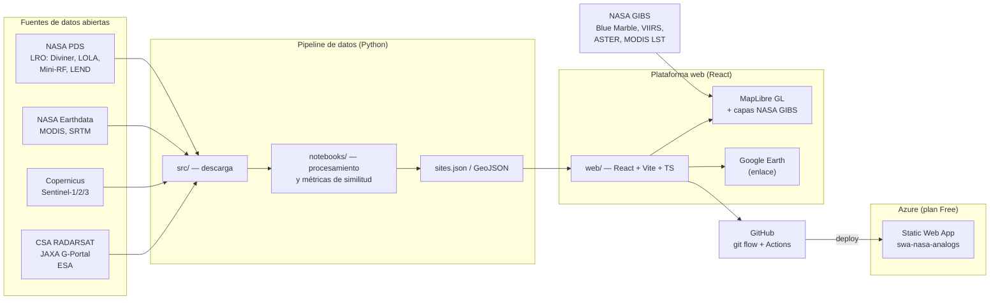
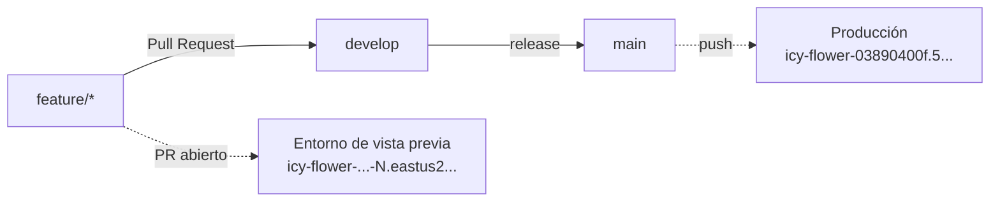

# Arquitectura

## Vista general



## Componentes

### 1. Pipeline de datos (`src/`, `notebooks/`) · *en construcción*
- **Lenguaje:** Python (GDAL/rasterio, numpy, pandas, geopandas).
- **Entrada:** datos planetarios (PDS) y terrestres (Earthdata, Copernicus, CSA, JAXA).
- **Salida:** un archivo de sitios con sus puntajes por dimensión, que la web consume como dato estático.
- **Reglas:**
  - Los datos crudos van en `data/raw/` y los procesados en `data/processed/`. **No se suben a git.**
  - Cada dataset debe tener un script de descarga reproducible.
  - Cada fuente nueva se registra en [RECURSOS.md](../RECURSOS.md).

### 2. Plataforma web (`web/`)

| Aspecto | Elección |
|---|---|
| Framework | React 19 + TypeScript |
| Build | Vite |
| Mapa | **MapLibre GL JS** (código abierto) con proyección de globo 3D |
| Imágenes | **NASA GIBS** (WMTS): Blue Marble, VIIRS NOAA-20 color verdadero, relieve ASTER GDEM, temperatura superficial MODIS, etiquetas de referencia. Sin key ni costo. |
| Lint | oxlint |
| Estado | `useState` y `useMemo` locales (sin librería de estado global) |
| Datos | Por ahora en `web/src/data/sites.ts`; se reemplazará por el archivo generado por el pipeline |

Estructura:
```
web/src/
├── App.tsx          # Layout, filtros, selector de capas y ficha del sitio
├── components/
│   └── SiteMap.tsx  # Mapa MapLibre: globo, capas GIBS, marcadores y popup
├── map/
│   └── gibs.ts      # Definición de capas NASA GIBS y URLs de teselas
├── App.css          # Estilos de la app
├── index.css        # Variables de color (modo claro/oscuro)
└── data/
    ├── types.ts     # Tipos: AnalogSite, Target, Environment, Dimension
    └── sites.ts     # Catálogo de sitios (preliminar)
```

**Modelo de datos (`AnalogSite`):**

| Campo | Tipo | Descripción |
|---|---|---|
| `id` | string | Identificador único |
| `name`, `country` | string | Nombre y país |
| `lat`, `lng` | number | Coordenadas WGS84 |
| `environments` | Environment[] | Tipos de ambiente |
| `targets` | Target[] | `luna` y/o `marte` |
| `analogOf` | string | Lugar o ambiente planetario del que es análogo |
| `dimensions` | Record<Dimension, Level> | Similitud por dimensión (`alta`, `media`, `baja`); pasará a puntaje 0–100 |
| `similarities` | string | En qué se parece |
| `limitations` | string | Dónde deja de valer la analogía |
| `missionUse` | string | Para qué sirve en una misión |
| `wellKnown` | boolean | Si ya es un análogo muy estudiado |

**Variables de entorno:** ninguna. El mapa usa NASA GIBS, que no requiere API key.

> Historial: la primera versión usaba Google Maps, pero se reemplazó porque Google Cloud exige un prepago para activar la facturación (ver [BITACORA.md](BITACORA.md)). El mapa está aislado en `SiteMap.tsx`, así que se podría volver a cambiar sin tocar el resto de la app.

### 3. Infraestructura (`infra/`)

Gestionada **100 % con Terraform**. Ver [infra/README.md](../infra/README.md).

| Recurso | Nombre | Plan |
|---|---|---|
| Resource Group | `rg-nasa-analogs` (eastus2) | — |
| Static Web App | `swa-nasa-analogs` | **Free** |

- **Proveedor:** `hashicorp/azurerm` ~> 5.14.
- **Estado:** local (`infra/terraform.tfstate`, fuera de git). Solo una persona aplica cambios de infraestructura.

### 4. CI/CD (`.github/workflows/deploy-web.yml`)



| Evento | Acción |
|---|---|
| Push a `main` (cambios en `web/`) | Build + despliegue a **producción** |
| PR abierto o actualizado hacia `develop` o `main` | Build + despliegue a un **entorno de vista previa** |
| PR cerrado | Se elimina el entorno de vista previa |

Pasos del job: `npm ci` → `npm run lint` → `npm run build` → `Azure/static-web-apps-deploy@v1` (subida de `web/dist`).

**Secrets de GitHub:**

| Secret | Origen |
|---|---|
| `AZURE_STATIC_WEB_APPS_API_TOKEN` | `terraform output -raw static_web_app_deployment_token` |

### 5. Flujo de trabajo (git flow)

Ver [CONTRIBUTING.md](../CONTRIBUTING.md). Resumen: `feature/*` → PR → `develop` → `release/*` → `main`.

## URLs

| Entorno | URL |
|---|---|
| Producción | https://icy-flower-03890400f.5.azurestaticapps.net |
| Vista previa del PR *N* | `https://icy-flower-03890400f-N.eastus2.5.azurestaticapps.net` |
| Local | http://localhost:5173 |

## Seguridad

- **El frontend no contiene secretos:** NASA GIBS es público y no usa key.
- El token de despliegue de Azure solo existe en el estado de Terraform y en el secret de GitHub. Si se filtra, se regenera en el portal (*Administrar token de implementación → Restablecer*) y se actualiza el secret.
- `terraform.tfvars` y `*.tfstate` están en `.gitignore`.

## Costos

**Regla del proyecto: solo planes gratuitos.** Cualquier servicio de pago se consulta antes de activarlo.

| Servicio | Plan | Límite gratuito | Protección |
|---|---|---|---|
| Azure Static Web Apps | Free | 100 GB/mes de ancho de banda, 3 vistas previas | — |
| NASA GIBS (mapa) | Público | Sin límite de uso publicado | — |
| Google Earth (enlace) | Gratis | — | — |
| GitHub Actions | Repositorio público | Minutos ilimitados | — |
| Estado remoto de Terraform | *No usado* | — | Requeriría un Storage Account (costo mínimo) |
