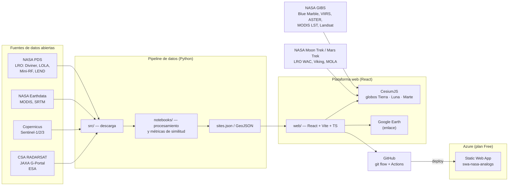
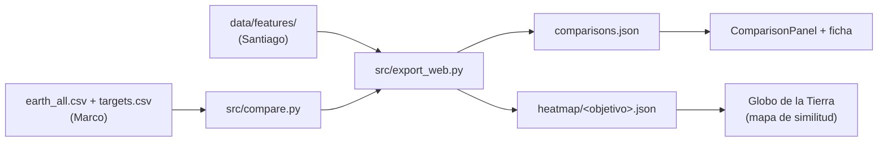
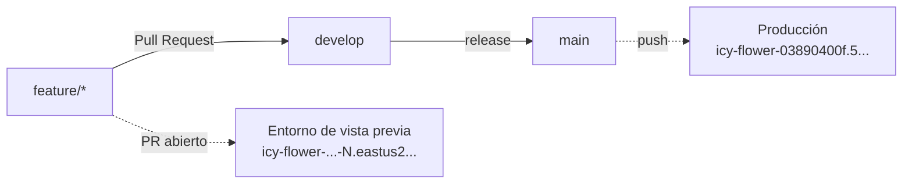

# Arquitectura

## Vista general



## Componentes

### 1. Pipeline de datos (`src/`, `notebooks/`) · *con datos reales*
- **Lenguaje:** Python 3.12 (GDAL/rasterio, numpy, pandas, geopandas, scikit-learn). Entorno: `environment.yml` (conda) o `requirements.txt` (uv/pip).
- **Entrada (Marco):** base de datos global de la Tierra (`data/earth_all.csv`, ~164 000 celdas de 0,05° en 43 regiones, de NASADEM/Copernicus, MODIS, IMERG y ASTER) y sitios de la Luna y Marte (`data/targets.csv`, de LOLA, Diviner, HRSC+MOLA, TES y el Mars Climate Database). Scripts: `download_earth.py`, `build_earth.py`, `build_database.py`, `build_moon_targets.py`, `build_mars_targets.py`, `screen_global.py`. Detalle en [PIPELINE_COMPARADOR.md](PIPELINE_COMPARADOR.md).
- **Entrada (Santiago):** caracterización de 6 sitios de Colombia en ventanas de 10 × 10 km a 200 m (relieve, ambiente con GEE, Sentinel-2, NASA POWER, disponibilidad de EMIT) en `data/features/`, e índice topográfico PAI en `data/results/`. Scripts: `resample.py`, `process_planetary.py`, `extract_features.py`, `similarity.py`, `extract_climate.py`, `search_emit.py`, `download_emit.py`. Detalle en [CONTEXTO_TECNICO_SANTIAGO.md](CONTEXTO_TECNICO_SANTIAGO.md).
- **`src/compare.py`** (Marco): índice de similitud entre celdas de la Tierra y sitios de la Luna/Marte. Escala por tolerancias físicas (`TOLERANCE`), similitud por característica `s = exp(−|d|)`, puntaje `S = exp(−√(Σ w·d² / Σ w))`, mejor y peor característica, y análisis de sensibilidad a los pesos. Tests en `tests/test_compare.py`.
- **`src/export_web.py`**: usa `compare.py` sobre toda la base y genera `web/public/data/comparisons.json` y `web/public/data/heatmap/<objetivo>.json` (contrato en [VISUALIZACION_COMPARACION.md](VISUALIZACION_COMPARACION.md)). Toma las coordenadas del catálogo de `web/src/data/sites.ts`, elige descubrimientos por región y agrega la caracterización de Santiago. Reglas y cómo regenerar: [DATOS_WEB.md](DATOS_WEB.md). Tests en `tests/test_export_web.py`.



- **`src/export_images.py`**: genera las imágenes de cerca de la Tierra (Sentinel-2 de Microsoft Planetary Computer, uniendo teselas de la misma pasada y con escala ampliada en superficies muy claras) en `web/public/images/earth/`, con un `index.json` que cita la escena y la fecha. Ver [DATOS_WEB.md](DATOS_WEB.md#imágenes-de-cerca-de-la-tierra).
- **`src/export_gallery.py`**: descarga la galería curada (`data/gallery_sources.json`, 96 fotos de la NASA para 40 lugares) a `web/public/images/gallery/` y escribe `web/public/data/gallery.json` con el pie de foto, el crédito y la fuente.
- **Salida actual:** **datos reales** (15 objetivos, 17 sitios del catálogo, 50 descubrimientos). Los CSV de muestra (`data/sample_*.csv`) quedan solo para los tests.
- **Reglas:**
  - Los datos crudos van en `data/raw/` y los procesados en `data/processed/`. **No se suben a git.**
  - Cada dataset debe tener un script de descarga reproducible.
  - Cada fuente nueva se registra en [RECURSOS.md](../RECURSOS.md).

### 2. Plataforma web (`web/`)

| Aspecto | Elección |
|---|---|
| Framework | React 19 + TypeScript |
| Build | Vite |
| Globos 3D | **CesiumJS** (Apache 2.0, sin Cesium ion ni token): **un solo globo principal** que se recrea con el elipsoide real del cuerpo elegido (`Ellipsoid.WGS84`, `MOON`, `MARS`). Maneja los polos, necesario para el polo sur lunar. Las miniaturas del panel derecho son visores de detalle sin interacción |
| Tipografía | Inter (texto) y Space Grotesk (títulos), de Google Fonts (gratis) |
| Luna y Marte | **NASA Moon Trek** (LRO WAC, ~100 m/px) y **Mars Trek** (Viking MDIM 2.1 color, ~232 m/px; relieve MOLA, ~463 m/px), teselas geográficas `default028mm` |
| Imagen de detalle (Tierra) | **Sentinel-2 L2A** (10 m/px), recortes pregenerados con Microsoft Planetary Computer (`src/export_images.py`). Respaldo: **NASA GIBS Snapshot API**, con Landsat WELD (30 m/px) o MODIS Terra en sitios polares |
| Imágenes | **NASA GIBS** (WMTS): Blue Marble, VIIRS NOAA-20 color verdadero, relieve ASTER GDEM, temperatura superficial MODIS, etiquetas de referencia. Sin key ni costo. |
| Lint | oxlint |
| Estado | `useState` y `useMemo` locales (sin librería de estado global) |
| Datos | Catálogo curado en `web/src/data/sites.ts` (17 sitios); puntajes, descubrimientos y mapas de similitud en `web/public/data/`, generados por `src/export_web.py` |

Estructura:
```
web/src/
├── App.tsx                  # Barra de navegación, un solo globo con selector Tierra · Luna · Marte, paneles, búsqueda y vistas
├── main.tsx                 # Punto de entrada (envuelve la app en LanguageProvider)
├── theme.ts                 # Colores de identidad validados (Tierra, Luna, Marte) y de similitud
├── components/
│   ├── PlanetGlobe.tsx      # Visor Cesium genérico (globo, vista de detalle o miniatura; giro lento en reposo)
│   ├── SiteCard.tsx         # Ficha del lugar (panel izquierdo) y caracterización de Santiago
│   ├── InsightPanel.tsx     # Panel derecho: miniaturas de terreno con candados e índice de similitud
│   ├── DetailImage.tsx      # Imagen de detalle: snapshot Landsat/MODIS o vista cercana Luna/Marte
│   ├── ImageCompareModal.tsx # Ventana emergente: carrusel de la Tierra a la izquierda y del homólogo a la derecha
│   ├── Carousel.tsx         # Carrusel genérico: flechas, puntos, teclado, deslizamiento, tipo de imagen y crédito
│   ├── PlaceCarousels.tsx   # Carruseles de un lugar: Tierra (Sentinel-2 + fotos) y Luna/Marte (fotos + vista 3D)
│   ├── ComparisonPanel.tsx  # Comparación detallada: puntaje, pesos, valores, ranking, límites
│   ├── MethodView.tsx       # Vista «Método»: fórmula, reglas, fuentes, límites y equipo
│   ├── IntroOverlay.tsx     # Pantalla de bienvenida con las cifras del proyecto
│   ├── GuidedTour.tsx       # Recorrido guiado de 7 pasos
│   └── Icons.tsx            # Iconos SVG en línea (sin librerías)
├── planet/
│   └── bodies.ts            # Configuración por cuerpo: elipsoide, imágenes, alturas de cámara
├── map/
│   ├── gibs.ts              # Capas NASA GIBS de la Tierra y URLs de teselas
│   ├── snapshot.ts          # Imagen de NASA GIBS (Landsat; MODIS por encima de 78°): respaldo
│   └── earthImages.ts       # Imagen de cerca de la Tierra: Sentinel-2 pregenerada o, si falta, la de GIBS
├── i18n/
│   ├── strings.ts           # Textos de la interfaz en español e inglés
│   ├── LanguageContext.tsx  # Proveedor de idioma (navegador, localStorage, ?lang=)
│   ├── context.ts / useLang.ts
├── data/
│   ├── types.ts             # Tipos: AnalogSite, Homologue, Target, Environment, Dimension
│   ├── sites.ts             # Catálogo de 12 sitios con sus homólogos (español)
│   ├── sites.en.ts          # Textos del catálogo en inglés
│   ├── comparisons.ts       # Tipos del JSON, carga y recálculo del puntaje con pesos
│   ├── focus.ts             # Descubrimientos por cuerpo y conversión de un descubrimiento en «sitio»
│   ├── gallery.ts           # Carga de gallery.json e imágenes de cada lugar
│   └── tour.ts              # Pasos del recorrido guiado (ES/EN)
├── App.css                  # Estilos de la app (paneles de vidrio, barra de navegación, versión móvil)
└── index.css                # Variables de color y tipografía (tema oscuro; Inter y Space Grotesk)

web/public/data/comparisons.json   # Generado por src/export_web.py
web/public/data/heatmap/*.json     # Mapa de similitud por objetivo (mismo script)
web/public/images/earth/*.jpg      # Imágenes de cerca de la Tierra (src/export_images.py) + index.json
web/public/images/gallery/         # Galería de fotos de la NASA (src/export_gallery.py)
web/public/data/gallery.json       # Pie de foto, tipo, crédito y fuente de cada foto
```

**Modelo de datos (`AnalogSite`):**

| Campo | Tipo | Descripción |
|---|---|---|
| `id` | string | Identificador único |
| `name`, `country` | string | Nombre y país |
| `lat`, `lng` | number | Coordenadas WGS84 |
| `environments` | Environment[] | Tipos de ambiente |
| `homologues` | Homologue[] | Lugares homólogos en la Luna y/o Marte (`id`, `body`, `name`, `lat`, `lng`, `note`, `approximate?`) |
| `analogOf` | string | Lugar o ambiente planetario del que es análogo |
| `dimensions` | Record<Dimension, Level> | Similitud por dimensión (`alta`, `media`, `baja`); pasará a puntaje 0–100 |
| `similarities` | string | En qué se parece |
| `limitations` | string | Dónde deja de valer la analogía |
| `missionUse` | string | Para qué sirve en una misión |
| `wellKnown` | boolean | Si ya es un análogo muy estudiado |
| `earthImage?` | objeto | Capa y fecha alternativas para la imagen de detalle (sitios polares sin Landsat) |

**Idiomas:** español e inglés. El idioma inicial es el del navegador; se guarda en `localStorage` y se puede forzar con `?lang=es` / `?lang=en`. Para agregar un texto: clave en `i18n/strings.ts` (ambos idiomas) y `t('clave')`.

**Variables de entorno:** ninguna. NASA GIBS y NASA Trek son públicos y no requieren API key.

**Assets de Cesium:** `vite-plugin-static-copy` copia `Workers`, `Assets`, `ThirdParty` y `Widgets` a `dist/cesium/` (con `rename.stripBase: 4`), y `CESIUM_BASE_URL` apunta a `/cesium`.

> Historial: la primera versión usaba Google Maps, pero se reemplazó porque Google Cloud exige un prepago para activar la facturación (ver [BITACORA.md](BITACORA.md)). Después se usó MapLibre, que se cambió por CesiumJS porque la proyección Mercator no muestra los polos (el cráter Shackleton está a −89,7°) y porque permite globos de la Luna y Marte.

### 3. Infraestructura (`infra/`)

Gestionada **100 % con Terraform**. Ver [infra/README.md](../infra/README.md).

| Recurso | Nombre | Plan |
|---|---|---|
| Resource Group | `rg-nasa-analogs` (eastus2) | — |
| Static Web App | `swa-nasa-analogs` | **Free** |

- **Proveedor:** `hashicorp/azurerm` ~> 5.14.
- **Estado:** local (`infra/terraform.tfstate`, fuera de git). Solo una persona aplica cambios de infraestructura.

### 4. CI/CD (`.github/workflows/deploy-web.yml`)



| Evento | Acción |
|---|---|
| Push a `main` (cambios en `web/`) | Build + despliegue a **producción** |
| PR abierto o actualizado hacia `develop` o `main` | Build + despliegue a un **entorno de vista previa** |
| PR cerrado | Se elimina el entorno de vista previa |

Pasos del job: `npm ci` → `npm run lint` → `npm run build` → `Azure/static-web-apps-deploy@v1` (subida de `web/dist`).

**Secrets de GitHub:**

| Secret | Origen |
|---|---|
| `AZURE_STATIC_WEB_APPS_API_TOKEN` | `terraform output -raw static_web_app_deployment_token` |

### 5. Flujo de trabajo (git flow)

Ver [CONTRIBUTING.md](../CONTRIBUTING.md). Resumen: `feature/*` → PR → `develop` → `release/*` → `main`.

## URLs

| Entorno | URL |
|---|---|
| Producción | https://icy-flower-03890400f.5.azurestaticapps.net |
| Vista previa del PR *N* | `https://icy-flower-03890400f-N.eastus2.5.azurestaticapps.net` |
| Local | http://localhost:5173 |

## Seguridad

- **El frontend no contiene secretos:** NASA GIBS y NASA Trek son públicos y no usan key. Las imágenes de Sentinel-2 se sirven desde la propia app. Cesium se usa sin Cesium ion.
- El token de despliegue de Azure solo existe en el estado de Terraform y en el secret de GitHub. Si se filtra, se regenera en el portal (*Administrar token de implementación → Restablecer*) y se actualiza el secret.
- `terraform.tfvars` y `*.tfstate` están en `.gitignore`.

## Costos

**Regla del proyecto: solo planes gratuitos.** Cualquier servicio de pago se consulta antes de activarlo.

| Servicio | Plan | Límite gratuito | Protección |
|---|---|---|---|
| Azure Static Web Apps | Free | 100 GB/mes de ancho de banda, 3 vistas previas | — |
| NASA GIBS (Tierra) | Público | Sin límite de uso publicado | — |
| Microsoft Planetary Computer | Público, sin cuenta | Solo se usa al generar las imágenes, no en la app | — |
| NASA Moon Trek / Mars Trek | Público | Sin límite de uso publicado | — |
| CesiumJS | Código abierto (Apache 2.0) | Sin Cesium ion: costo cero | — |
| Google Earth (enlace) | Gratis | — | — |
| GitHub Actions | Repositorio público | Minutos ilimitados | — |
| Estado remoto de Terraform | *No usado* | — | Requeriría un Storage Account (costo mínimo) |
