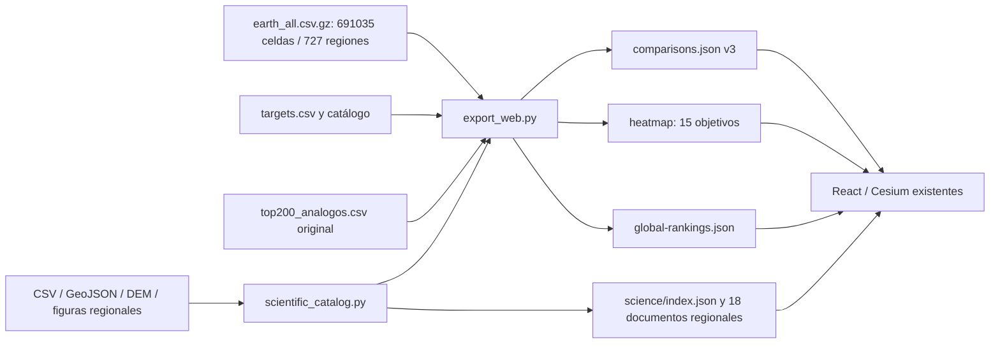

# Datos de la aplicación unificada GeoAnalog

Versión de integración: 2026-11-15. El contrato canónico es `comparisons.json` v3. La base de la interfaz es `origin/main@58313dc`; el comparador y datos ampliados provienen de Marco `e75ecdb`, y la ciencia regional de Santiago de `aaf4ebb`.

## Flujo efectivo



## Qué consume la interfaz

| Archivo | Consumidor y alcance |
|---|---|
| `web/public/data/comparisons.json` | `web/src/data/comparisons.ts`; 274 sitios exportados (16 de catálogo y 258 de descubrimiento), 15 objetivos y puntuaciones web calculadas sobre la base ampliada. Fuente real: `synthetic=false`. |
| `web/public/data/heatmap/*.json` | Mapa de similitud existente: hasta 2.500 celdas por objetivo, sin enviar toda la base al navegador. |
| `web/public/data/global-rankings.json` | `GlobalRankings.tsx`; top 200 original de Marco con claves de navegación hacia los sitios del contrato canónico. |
| `web/public/data/science/index.json` | Índice y procedencia de las 18 ventanas, equipo confirmado y asociaciones geométricas. |
| `web/public/data/science/{earth,moon,mars}/*.json` | `ScientificPanel.tsx`; carga al abrir el panel de cada ventana. Incluye todas las secciones disponibles, calidad, fuentes y PAI. |
| `web/public/data/science/variables.json` | Correspondencia completa y versionada de campos originales, unidades, soporte, fechas, método y compatibilidad. |
| `web/public/data/science/files/data/...` | Copias byte a byte de 85 artefactos originales: tablas, GeoJSON, DEM pequeños, series de clima y figuras. Se descargan bajo demanda. |
| `web/public/data/analogos.json` | Fotografía del contrato histórico de Marco, conservada para referencia; no se entrega a componentes que esperan el contrato v3. |

Las cifras anteriores corresponden al corte de esta integración. El exportador imprime los conteos efectivos cuando cambian los insumos.

## Modelos que coexisten

- **Índice global completo de Marco, 0–1:** conserva el top 100 por cuerpo, sus medias, mejores objetivos, condiciones, separación de 300 km y orden originales. Elevación desactivada y emisividad equivalente con peso 0,5. No se aplican las exclusiones térmicas de la web a esos resultados originales.
- **Puntaje web de dimensiones comparables, 0–1:** fórmula exponencial del comparador y reglas de la interfaz, con exclusiones por cuerpo fuera del rango terrestre. La base ampliada excluye ambas variables térmicas para la Luna; no produce la exclusión marciana de amplitud que tenía la base antigua. La lista de exclusiones real está en cada objetivo.
- **PAI regional, 0–100:** seis variables topográficas, estandarización con seis candidatos colombianos y `100/(1+d)`. Los 72 valores originales se conservan con su precisión. El modo web «Relieve» usa el comparador global restringido, no el PAI.

Reponderar en el navegador solo reordena los sitios exportados. No reconstruye el ranking mundial ni recalcula sensibilidad. La sensibilidad de 100 ejecuciones describe cambios de pesos, no errores instrumentales ni probabilidad de equivalencia física.

## Prioridad regional y asociación planetaria

Las seis fichas colombianas priorizan la investigación de Santiago en el panel científico. Sus celdas globales mantienen los valores de Marco. No se reemplaza una celda de 0,05° por un promedio regional de 10 km.

Las ventanas planetarias se enlazan a objetivos globales solamente si una intersección geométrica del mismo cuerpo es positiva. Dos anillos lunares se superponen parcialmente con las ventanas de Santiago; cinco discos marcianos las contienen. Los restantes estudios se abren desde las doce comparaciones PAI de cada región colombiana. No hay asignación solo por nombre.

La Guajira conserva la advertencia de agua; EMIT, sus coincidencias provisionales; THEMIS, el piloto con banda sin verificar; Phoenix CRISM, sus observaciones no calificadas; y Diviner, la estabilidad modelada de hielo sin afirmación de presencia.

## Imágenes y diseño

Se conservan el globo de Sebastián, capas GIBS/Trek, catálogo, carruseles, recorrido, controles y soporte ES/EN. Las figuras científicas originales se añaden a las fichas. La gráfica Sentinel-2 muestra medias de bandas discretas; no implica espectro continuo ni identificación inequívoca de minerales. Las imágenes satelitales y fotografías ilustran las regiones; no modifican índices.

## Regeneración

```powershell
.\.venv\Scripts\python.exe -B src/export_web.py
.\.venv\Scripts\python.exe -B src/export_science.py
cd web
npm run dev -- --host 127.0.0.1
```

El primer comando publica toda la integración; el segundo es opcional cuando solo cambia ciencia regional. Se utilizan los productos disponibles y no se inician descargas. `src/export_analogos.py` restaura únicamente la fotografía histórica de su contrato desde `data/reference/marco_analogos.json`.

[Contrato y correspondencias](SCIENTIFIC_DATA_CONTRACT.md) · [Mapa completo de variables](SCIENTIFIC_VARIABLE_MAPPING.md) · [Informe de integración](../GEOANALOG_INTEGRATION_REPORT.md).
