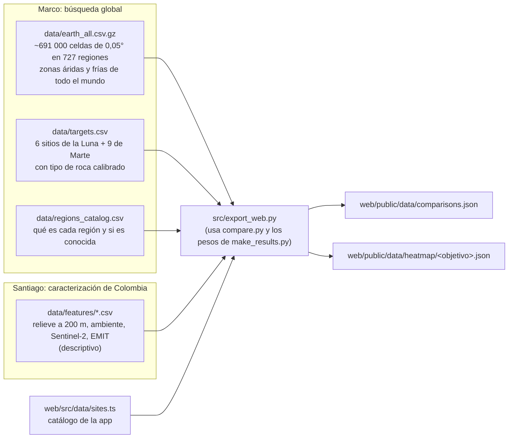

# Datos de la app: de dónde salen y cómo se actualizan

Este documento explica cómo los datos de Marco y de Santiago llegan a la app, qué reglas se aplican en el camino y cómo regenerar todo.

## Flujo



**Regenerar los datos de la app** (tarda unos 12 minutos y usa ~1 GB de memoria; casi todo es la prueba de robustez):

```bash
source .venv/bin/activate
python src/export_web.py
python src/export_images.py --prune --size 768   # imágenes de los lugares nuevos; borra las que sobran
```

Cuando Marco agregue regiones o sitios, basta con volver a correr estos comandos y subir los JSON con un PR.

> `src/export_analogos.py` es el export propio de Marco (`analogos.json`, con composición en óxidos y mapas). La app todavía no lo usa; ver `web/DATOS.md`.

## Qué se publica

| Archivo | Contenido | Tamaño aprox. |
|---|---|---|
| `comparisons.json` | Los sitios del catálogo (celda más cercana, a menos de ~11 km) y los **descubrimientos** (~350), con su resultado frente a cada objetivo: puntaje general, **puntaje por dimensión**, similitud por variable, posición entre todas las celdas de la Tierra y estabilidad. Además, las **listas ordenadas** (`rankings`) de cada cuerpo. Los sitios colombianos traen la caracterización de Santiago | 2,1 MB (≈350 KB comprimido) |
| `heatmap/<objetivo>.json` | Las 2500 mejores celdas de la Tierra para ese objetivo: `[lat, lng, puntaje]` | 55 KB c/u |

## Reglas que aplica `export_web.py`

El puntaje es el de `compare.py` (Marco), sin cambios en la fórmula, con **los mismos pesos que sus resultados** (`make_results.WEIGHTS`: sin elevación y el tipo de roca a 0,5, porque en la Luna y Marte es una estimación calibrada). **Todos los lugares se puntúan igual**: catálogo, caso de estudio de Colombia y descubrimientos. El exportador solo decide qué variables cuentan y qué lugares se muestran:

1. **La elevación no se compara.** Cada cuerpo mide la altura desde un cero distinto (nivel del mar, areoide, esfera de referencia). Se muestra el valor, pero no entra en el puntaje.
2. **Una variable que la Tierra no alcanza se muestra como límite, no como puntaje.** Si el valor típico de un cuerpo (la mediana de sus sitios) queda fuera del rango de todas las celdas de la Tierra por más de una tolerancia, esa variable se apaga para ese cuerpo. Con los datos actuales:
   - **Luna:** temperatura media (50–125 K) y amplitud térmica (108–151 K). En la Tierra van de 214 a 315 K y de 1 a 41 K.
   - **Marte:** amplitud térmica (mediana ~71 K).

   Sin esta regla, para la Luna ganaba siempre el lugar más frío del planeta (el norte de Groenlandia), sin importar el relieve. En la app estas variables aparecen con la etiqueta **"fuera del rango de la Tierra"**.
3. **Listas de lugares (`rankings`).** Para cada cuerpo se toma, en cada región **poco conocida** (`known = no`), la celda con el mejor puntaje frente a cualquiera de sus sitios. Luego se eligen lugares **separados al menos 300 km** (la misma regla de `make_top_analogos.py`, porque la grilla mundial parte el planeta en cuadros de 2° y sin esto la lista se llenaba de cuadros vecinos de Egipto). Se guardan:
   - `general`: los **100 mejores** por puntaje general.
   - Una lista de **25 por dimensión** (`relieve`, `temperatura`, `superficie`, `aridez`). Si muchos lugares empatan en 1,00 (pasa con relieve y superficie, que tienen dos variables), el empate se ordena por el puntaje general.

   Las regiones conocidas (Antártida, Atacama, Islandia, Hawái…) quedan como **control** y no entran en las listas. El fondo en sombra del cráter Shackleton (un sitio de contraste, no de base) no cuenta en las listas de la Luna.
4. **La precipitación es exigente a propósito.** En la Luna y en Marte no llueve, así que Marco definió una tolerancia estricta (escala logarítmica, tolerancia 1): solo los lugares casi sin lluvia se parecen en esta variable (con 20 mm al año, la similitud ya es de 0,05). Por eso los sitios lluviosos, como la Tatacoa, tienen un puntaje completo bajo aunque su relieve se parezca. El botón "Relieve" de la app muestra esa otra mirada.
5. **Estabilidad (análisis de sensibilidad):** en cuántas de 100 variaciones aleatorias de los pesos (±50 %) el lugar sigue entre los 500 mejores de la Tierra. La app marca como **«resultado robusto»** los que lo logran en al menos el 80 %.
6. **Puntaje por dimensión.** Con la misma fórmula, pero solo con las variables de cada dimensión:

   | Dimensión | Variables |
   |---|---|
   | Relieve | pendiente, rugosidad |
   | Temperatura | temperatura media, amplitud térmica |
   | Superficie y roca | albedo, tipo de roca (emisividad) |
   | Aridez | precipitación, vegetación |

   Si una dimensión no tiene ninguna variable comparable (la temperatura en la Luna, por la regla 2), vale `null` y la app dice «no comparable». Así un lugar puede ser **el mejor análogo de relieve** aunque su puntaje general sea bajo (la Tatacoa: relieve 76, aridez 0).

**Nombres:** `src/region_names.py` da nombre en español e inglés a cada región. Los cuadros de la grilla mundial (`egypt_22n_032e`) se llaman como su país y la app muestra sus coordenadas.

## Qué muestra la app

La **respuesta principal es la búsqueda global de Marco**. Los sitios de Santiago son un **caso de estudio de Colombia**, puntuado igual que todo lo demás.

- **Barra de navegación:**
  - **Descubrir** (vista inicial): los 100 lugares poco estudiados más parecidos a la Luna o a Marte, con miniatura de Sentinel-2, coordenadas, su mejor sitio y la etiqueta «resultado robusto». Pestañas **General · Relieve · Temperatura · Superficie y roca · Aridez** y filtro por país. Los lugares de la lista se ven en el globo. Al hacer clic, el globo vuela al lugar y se enciende el mapa de similitud.
  - **Análogos:** el catálogo curado y, debajo, el **caso de estudio de Colombia** (los 6 sitios de Santiago), ordenados por el puntaje general o por una dimensión («Ordenar por»).
- **Un solo globo** con los botones Tierra · Luna · Marte. Con un lugar elegido, el globo vuela a su homólogo en el cuerpo que se pulse. Los cuerpos sin homólogo quedan bloqueados.
- **Panel derecho, índice de similitud:**
  - el puntaje del lugar frente a su homólogo, o frente al **objetivo más parecido** de ese cuerpo si el homólogo no está en la base (la misma regla en la lista, el panel y el análisis);
  - su posición entre todas las celdas de la Tierra y su estabilidad;
  - las barras **por dimensión** y los valores reales de cada variable;
  - las variables "fuera del rango de la Tierra".
- **Comparación detallada** (sección Análisis):
  - Botones **"Comparar por: Todo · Relieve · Temperatura · Superficie y roca · Aridez"**, las mismas dimensiones del resto de la app, que recalculan el puntaje en el navegador con la misma fórmula.
  - La posición del sitio entre todas las celdas de la Tierra (por ejemplo, "#709 de 691 035").
- **Ranking:** un lugar por región poco estudiada, más los análogos conocidos como control. Al hacer clic en un nombre, el globo de la Tierra vuela a ese lugar.
- **Mapa de similitud:** el botón "Ver en el globo dónde más se parece la Tierra" pinta en el globo las 2500 mejores celdas para el objetivo elegido. Usa un solo tono, y la opacidad y el tamaño crecen con el puntaje.
- **Ficha de los sitios colombianos:** la caracterización de Santiago (relieve a 200 m, temperatura superficial, lluvia, vegetación e índices de Sentinel-2). **Es descriptiva: no entra en el puntaje.** Su índice PAI ya no se muestra, para que haya un solo sistema de puntajes.

## Imágenes de cerca de la Tierra

Las imágenes de la ficha, de las miniaturas y de la ventana para comparar son recortes de unos 22 km de lado alrededor de cada lugar. **Son ilustrativas: no entran en el puntaje.**

| Prioridad | Fuente | Resolución | Cuándo se usa |
|---|---|---|---|
| 1 | **Sentinel-2 L2A** (Microsoft Planetary Computer) | 10 m | Siempre que haya una escena útil: catálogo y descubrimientos |
| 2 | NASA GIBS en vivo: Landsat WELD, o MODIS por encima de 78° o en sitios con `earthImage` | 30 m / 250 m | Si el lugar no tiene imagen generada o la imagen no carga |

**Cómo elige la escena `export_images.py`:**
1. Busca escenas de 2021–2025 con menos de 20 % de nubes. Por encima de 60° de latitud solo acepta las de **verano** (julio–agosto en el norte, diciembre–febrero en el sur), para que el suelo no salga cubierto de nieve.
2. Agrupa las teselas por **pasada del satélite**. Si el recorte cae en el borde entre dos teselas, las une (tienen la misma fecha y empatan sin costura).
3. Renderiza el producto de color verdadero (`visual`). Si más del 25 % de los píxeles salen **saturados** (arena, sal o hielo muy claros), vuelve a renderizar desde las bandas B04, B03 y B02 con una escala de 1000 a 9000. Los valores L2A llevan un desplazamiento de +1000. Hoy eso pasa en 43 de las 73 imágenes. El campo `stretch` del índice indica cuál se usó.
4. Descarta los recortes con más de un 2 % de píxeles vacíos y prueba la siguiente pasada.

Se probó Landsat Collection 2 como segunda fuente, pero el Planetary Computer devolvió error 500 al renderizar sus recortes (2026-11-15), así que no se usa.

**Generarlas** (solo faltantes; la primera vez tarda unos 15–25 minutos):

```bash
source .venv/bin/activate
python src/export_images.py                 # todas las que falten
python src/export_images.py --only tatacoa  # un lugar
python src/export_images.py --force         # rehacer todo
python src/export_images.py --redo-saturated  # rehacer las que salieron quemadas
python src/export_gallery.py                # galería de fotos (solo faltantes)
```

- **Qué genera:** `web/public/images/earth/<id>.jpg` (1024 × 1024 los primeros 73, 768 × 768 los de la búsqueda mundial con `--size 768`) y `index.json`, con la escena, la fecha, la nubosidad, la resolución y el crédito de cada imagen. La app muestra esos datos en el pie de cada imagen.
- **Descubrimientos nuevos:** después de correr `export_web.py`, corre `export_images.py --prune --size 768`: genera las que faltan y borra las de lugares que ya no están.
- **Control de calidad:** el script descarta las escenas cuyo recorte tiene más de un 2 % de píxeles vacíos (bordes de la escena) y prueba la siguiente.
- **Limitación:** la nubosidad que se filtra es la de toda la escena (unos 110 km). Puede quedar alguna nube local en el recorte. Si una imagen no convence, se rehace con `--only <id> --force --max-cloud 5`.

## Galería de fotos (carruseles)

La ventana para comparar y la sección Análisis muestran **carruseles de fotos reales**: a la izquierda la Tierra y a la derecha la Luna o Marte. **Son ilustrativas: no entran en el puntaje.**

- **Tierra:** primero el recorte de Sentinel-2 del punto exacto y después fotos de campo de la NASA (por ejemplo, rovers de prueba en Haughton o un dron en Death Valley), fotos de astronautas desde la Estación Espacial e imágenes del satélite Terra.
- **Luna y Marte:** fotos de los rovers y módulos de aterrizaje (Perseverance, Curiosity, Spirit, Opportunity, Phoenix, Viking, InSight, Apolo 11), imágenes orbitales (HiRISE, LRO) y visualizaciones del LRO para el polo sur. La última imagen siempre es la vista 3D interactiva.
- **Cada foto lleva una etiqueta** con su tipo ("Desde el rover", "Desde órbita", "Visualización con datos del LRO", "Foto de campo", "Desde la Estación Espacial"…), su crédito, su fecha y un enlace a la fuente.
- **Límite que se muestra con honestidad:** solo hay fotos desde el suelo donde aterrizó una misión. El polo sur lunar, Medusae Fossae, Eberswalde, Terra Sirenum y Arsia Mons solo tienen imágenes orbitales.
- **Descubrimientos:** sus fotos son de la **región** (por ejemplo, el macizo del Tibesti), no del punto exacto, y la app lo dice sobre la imagen. Las regiones sin fotos verificadas muestran solo Sentinel-2.

**Cómo está hecha:**
1. `data/gallery_sources.json` es la **lista curada a mano**: 96 imágenes para 40 lugares, cada una con un pie de foto en español e inglés. Antes de incluir una foto se leyó su descripción en la NASA para confirmar qué lugar muestra. Así se descartaron, por ejemplo, una foto del salar de Coipasa titulada como Uyuni y una de la parte peruana de Atacama.
2. `python src/export_gallery.py` descarga las imágenes de la [NASA Image and Video Library](https://images.nasa.gov) y del [Scientific Visualization Studio](https://svs.gsfc.nasa.gov). Luego recorta los bordes negros y las panorámicas extremas, las reduce a 1600 px como máximo y escribe `web/public/data/gallery.json` con el crédito de cada misión (campo `secondary_creator` de la NASA). Las imágenes quedan en `web/public/images/gallery/` (~25 MB).
3. **Para agregar una foto:** búscala en images.nasa.gov, revisa su descripción, agrega su `nasa_id` con `kind`, `es` y `en` al JSON y corre `python src/export_gallery.py`. Solo descarga lo que falta.

Las claves de `gallery_sources.json` son los id de los objetivos (`jezero`, `shackleton`…), los id de los sitios del catálogo (`haughton-crater`…) y `region:<región>` para los descubrimientos. Un test (`tests/test_export_gallery.py`) comprueba que todo objetivo de la Luna y Marte tenga fotos.

## Pendientes conocidos

| Pendiente | Quién | Detalle |
|---|---|---|
| Lava Beds no tiene datos | Marco | Está fuera de las regiones de `regions_catalog.csv` (Timanfaya ya entró con la búsqueda mundial) |
| Regiones en países excluidos | Marco | La grilla mundial omite China, Rusia, Medio Oriente y Afganistán, pero siguen regiones nombradas de antes (Tíbet, Taklamakán, Gobi, Lut, Rub al-Jali, Kamchatka…). Decidir si se quitan |
| Homólogos de Colombia | Santiago | Los homólogos de `sites.ts` salieron del PAI. Si el homólogo no está en la base (Tatacoa → Medusae Fossae), la app compara con el objetivo más parecido |
| Lluvia en latitudes altas | Marco | Comparación con ERA5-Land en 2023 (Earth Engine, 6 celdas por región): IMERG da **0 mm en las 4 regiones de la Antártida** (ERA5-Land: 23–94 mm), probablemente porque falta el dato y se guarda como 0, y **20 mm en el norte de Groenlandia frente a 137 mm** (×7). Entre 60° S y 60° N los dos coinciden en orden de magnitud. Propuesta: usar ERA5-Land por encima de 60° y no guardar como 0 lo que falta |
| La Guajira | Santiago | Su ventana puede incluir mar: está marcada como provisional en la ficha |
| Sitios lunares de Artemis de Santiago | Marco + Santiago | Connecting Ridge, Peak near Shackleton, Leibnitz Beta y Malapert solo tienen relieve. Falta la temperatura de Diviner para sumarlos a `targets.csv` |
| Mineralogía EMIT | Santiago | Hay escenas, pero falta la descarga y el procesamiento. La ficha lo muestra como "pendiente" |
