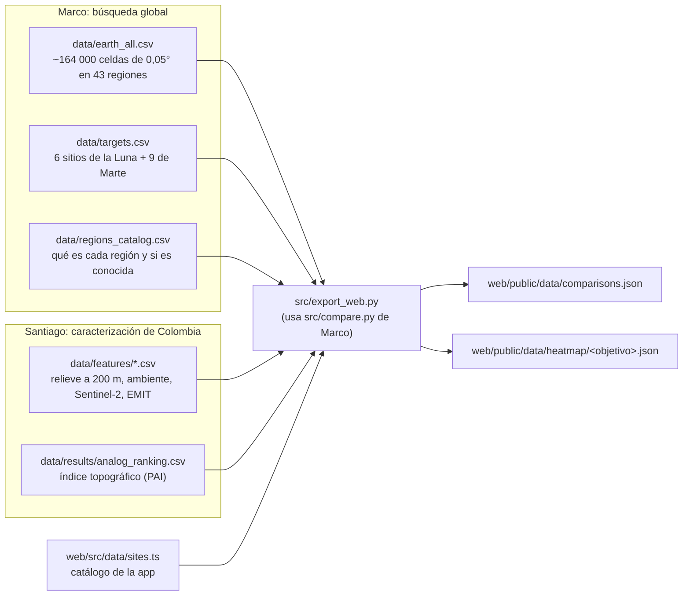

# Datos de la app: de dónde salen y cómo se actualizan

Este documento explica cómo los datos de Marco y de Santiago llegan a la app, qué reglas se aplican en el camino y cómo regenerar todo.

## Flujo



**Regenerar los datos de la app** (tarda unos 2 minutos):

```bash
source .venv/bin/activate
python src/export_web.py
```

Cuando Marco agregue regiones o sitios, basta con volver a correr este comando y subir los JSON con un PR.

## Qué se publica

| Archivo | Contenido | Tamaño aprox. |
|---|---|---|
| `comparisons.json` | Los sitios del catálogo (celda más cercana, a menos de ~11 km) y los **descubrimientos**, con su resultado frente a cada objetivo: puntaje, similitud por variable, posición entre todas las celdas de la Tierra y estabilidad. Los sitios colombianos traen además la caracterización de Santiago | 300 KB |
| `heatmap/<objetivo>.json` | Las 2500 mejores celdas de la Tierra para ese objetivo: `[lat, lng, puntaje]` | 55 KB c/u |

## Reglas que aplica `export_web.py`

El puntaje es el de `compare.py` (Marco), sin cambios en la fórmula. El exportador solo decide qué variables cuentan y qué lugares se muestran:

1. **La elevación no se compara.** Cada cuerpo mide la altura desde un cero distinto (nivel del mar, areoide, esfera de referencia). Se muestra el valor, pero no entra en el puntaje.
2. **Una variable que la Tierra no alcanza se muestra como límite, no como puntaje.** Si el valor típico de un cuerpo (la mediana de sus sitios) queda fuera del rango de todas las celdas de la Tierra por más de una tolerancia, esa variable se apaga para ese cuerpo. Con los datos actuales:
   - **Luna:** temperatura media (50–125 K) y amplitud térmica (108–151 K). En la Tierra van de 214 a 315 K y de 1 a 41 K.
   - **Marte:** amplitud térmica (mediana ~71 K).

   Sin esta regla, para la Luna ganaba siempre el lugar más frío del planeta (el norte de Groenlandia), sin importar el relieve. En la app estas variables aparecen con la etiqueta **"fuera del rango de la Tierra"**.
3. **Descubrimientos por región.** Para cada objetivo se toma la mejor celda de cada región **poco conocida** (`known = no`) y se guardan las 6 mejores regiones. Así una sola región no llena toda la lista. Las regiones conocidas (Antártida, Atacama, Islandia, Hawái…) quedan como **control**: el método debe ponerlas arriba, y lo hace.
4. **Estabilidad:** en cuántas de 100 variaciones aleatorias de los pesos (±50 %) el lugar sigue entre los 500 mejores de la Tierra.

## Qué muestra la app

- **Comparación detallada:**
  - Botones **"Comparar por: Todo · Relieve · Superficie · Clima y agua"**, que recalculan el puntaje en el navegador con la misma fórmula. Sirven para mostrar las dos miradas del equipo: el puntaje completo y el solo topográfico, como el PAI de Santiago.
  - La posición del sitio entre todas las celdas de la Tierra (por ejemplo, "#709 de 163 999").
- **Ranking:** un lugar por región poco estudiada, más los análogos conocidos como control. Al hacer clic en un nombre, el globo de la Tierra vuela a ese lugar.
- **Mapa de similitud:** el botón "Ver en el globo dónde más se parece la Tierra" pinta en el globo las 2500 mejores celdas para el objetivo elegido. Usa un solo tono, y la opacidad y el tamaño crecen con el puntaje.
- **Ficha de los sitios colombianos:** la caracterización de Santiago (relieve a 200 m, temperatura superficial, lluvia, vegetación, índices de Sentinel-2 y su índice topográfico). **Es descriptiva: no entra en el puntaje.**

## Pendientes conocidos

| Pendiente | Quién | Detalle |
|---|---|---|
| Timanfaya y Lava Beds no tienen datos | Marco | Están fuera de las regiones de `regions_catalog.csv`. Basta con agregar una región que las contenga |
| Resolución del relieve | Marco + Santiago | La Tierra usa ~90 m y Marte 200 m. Conviene llevar todo a 200 m (ver la discusión en la BITÁCORA) |
| Peso de la precipitación | Marco | Con la tolerancia actual (escala logarítmica, 1), 20 mm al año ya dan una similitud de 0,05 en esa variable. Esto favorece mucho los desiertos hiperáridos. Revisar si es la intención |
| Lluvia en latitudes altas | Marco | IMERG es menos confiable por encima de 60°. El norte de Groenlandia sale como gran análogo de Marte en parte por eso |
| La Guajira | Santiago | Su ventana puede incluir mar: está marcada como provisional en la ficha |
| Sitios lunares de Artemis de Santiago | Marco + Santiago | Connecting Ridge, Peak near Shackleton, Leibnitz Beta y Malapert solo tienen relieve. Falta la temperatura de Diviner para sumarlos a `targets.csv` |
| Mineralogía EMIT | Santiago | Hay escenas, pero falta la descarga y el procesamiento. La ficha lo muestra como "pendiente" |
