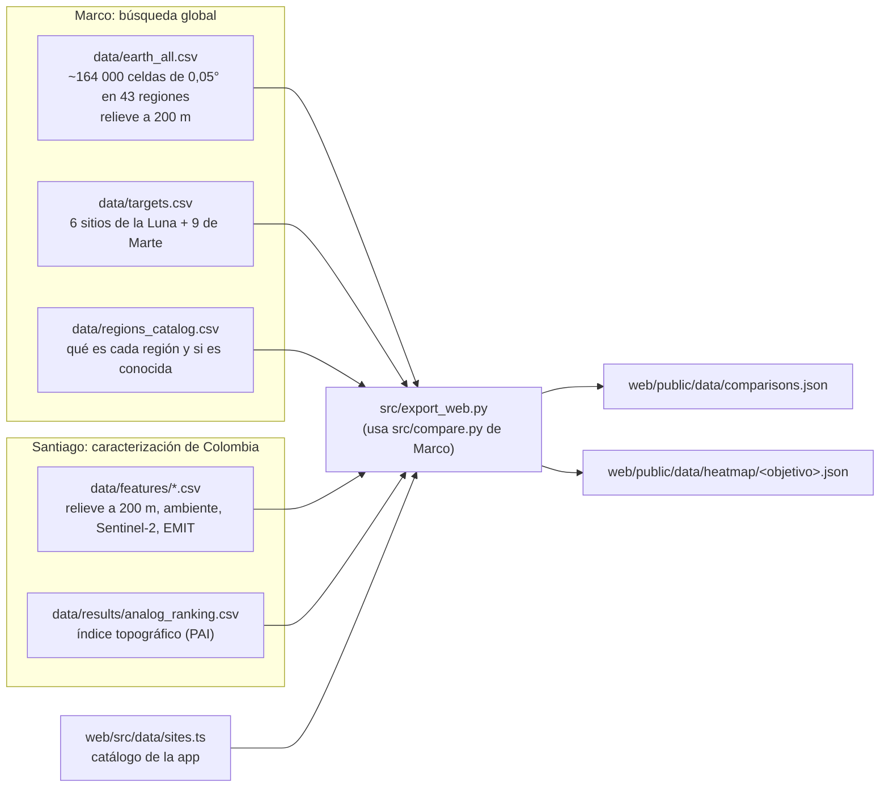

# Datos de la app: de dónde salen y cómo se actualizan

Este documento explica cómo los datos de Marco y de Santiago llegan a la app, qué reglas se aplican en el camino y cómo regenerar todo.

## Flujo



**Regenerar los datos de la app** (tarda unos 2 minutos):

```bash
source .venv/bin/activate
python src/export_web.py
```

Cuando Marco agregue regiones o sitios, basta con volver a correr este comando y subir los JSON con un PR.

## Qué se publica

| Archivo | Contenido | Tamaño aprox. |
|---|---|---|
| `comparisons.json` | Los sitios del catálogo (celda más cercana, a menos de ~11 km) y los **descubrimientos**, con su resultado frente a cada objetivo: puntaje, similitud por variable, posición entre todas las celdas de la Tierra y estabilidad. Los sitios colombianos traen además la caracterización de Santiago | 300 KB |
| `heatmap/<objetivo>.json` | Las 2500 mejores celdas de la Tierra para ese objetivo: `[lat, lng, puntaje]` | 55 KB c/u |

## Reglas que aplica `export_web.py`

El puntaje es el de `compare.py` (Marco), sin cambios en la fórmula. El exportador solo decide qué variables cuentan y qué lugares se muestran:

1. **La elevación no se compara.** Cada cuerpo mide la altura desde un cero distinto (nivel del mar, areoide, esfera de referencia). Se muestra el valor, pero no entra en el puntaje.
2. **Una variable que la Tierra no alcanza se muestra como límite, no como puntaje.** Si el valor típico de un cuerpo (la mediana de sus sitios) queda fuera del rango de todas las celdas de la Tierra por más de una tolerancia, esa variable se apaga para ese cuerpo. Con los datos actuales:
   - **Luna:** temperatura media (50–125 K) y amplitud térmica (108–151 K). En la Tierra van de 214 a 315 K y de 1 a 41 K.
   - **Marte:** amplitud térmica (mediana ~71 K).

   Sin esta regla, para la Luna ganaba siempre el lugar más frío del planeta (el norte de Groenlandia), sin importar el relieve. En la app estas variables aparecen con la etiqueta **"fuera del rango de la Tierra"**.
3. **Descubrimientos por región.** Para cada objetivo se toma la mejor celda de cada región **poco conocida** (`known = no`) y se guardan las 6 mejores regiones. Así una sola región no llena toda la lista. Las regiones conocidas (Antártida, Atacama, Islandia, Hawái…) quedan como **control**: el método debe ponerlas arriba, y lo hace.
4. **La precipitación es exigente a propósito.** En la Luna y en Marte no llueve, así que Marco definió una tolerancia estricta (escala logarítmica, tolerancia 1): solo los lugares casi sin lluvia se parecen en esta variable (con 20 mm al año, la similitud ya es de 0,05). Por eso los sitios lluviosos, como la Tatacoa, tienen un puntaje completo bajo aunque su relieve se parezca. El botón "Relieve" de la app muestra esa otra mirada.
5. **Estabilidad:** en cuántas de 100 variaciones aleatorias de los pesos (±50 %) el lugar sigue entre los 500 mejores de la Tierra.

## Qué muestra la app

La **respuesta principal es la búsqueda global de Marco**. Los sitios de Santiago son un **caso de estudio de Colombia** comparado por relieve.

- **Barra de navegación:**
  - **Descubrir** (vista inicial): el mejor lugar de cada región poco conocida para la Luna o para Marte. Al hacer clic, el globo vuela al lugar y se enciende el mapa de similitud.
  - **Análogos:** el catálogo curado y, debajo, el **caso de estudio de Colombia** (los 6 sitios de Santiago).
- **Un solo globo** con los botones Tierra · Luna · Marte. Con un lugar elegido, el globo vuela a su homólogo en el cuerpo que se pulse. Los cuerpos sin homólogo quedan bloqueados.
- **Panel derecho, índice de similitud:**
  - el puntaje del lugar frente a su homólogo, o frente al primer objetivo con datos de ese cuerpo si el homólogo no está en la base;
  - su posición entre todas las celdas de la Tierra y su estabilidad;
  - las barras por variable, ordenadas de mayor a menor;
  - las variables "fuera del rango de la Tierra".
- **Sitios del caso de estudio:** su homólogo es el objetivo con mejor índice topográfico (PAI) de Santiago **entre los que ya están en la base de datos**. Si su mejor parecido absoluto todavía no está en la base (por ejemplo, Connecting Ridge), el texto lo dice. La ficha y el panel aclaran que la similitud es solo de relieve y que con el puntaje completo quedan lejos.
- **Comparación detallada** (sección Análisis):
  - Botones **"Comparar por: Todo · Relieve · Superficie · Clima y agua"**, que recalculan el puntaje en el navegador con la misma fórmula. Sirven para mostrar las dos miradas del equipo: el puntaje completo y el solo topográfico, como el PAI de Santiago.
  - La posición del sitio entre todas las celdas de la Tierra (por ejemplo, "#709 de 163 999").
- **Ranking:** un lugar por región poco estudiada, más los análogos conocidos como control. Al hacer clic en un nombre, el globo de la Tierra vuela a ese lugar.
- **Mapa de similitud:** el botón "Ver en el globo dónde más se parece la Tierra" pinta en el globo las 2500 mejores celdas para el objetivo elegido. Usa un solo tono, y la opacidad y el tamaño crecen con el puntaje.
- **Ficha de los sitios colombianos:** la caracterización de Santiago (relieve a 200 m, temperatura superficial, lluvia, vegetación, índices de Sentinel-2 y su índice topográfico). **Es descriptiva: no entra en el puntaje.**

## Imágenes de cerca de la Tierra

Las imágenes de la ficha, de las miniaturas y de la ventana para comparar son recortes de unos 22 km de lado alrededor de cada lugar. **Son ilustrativas: no entran en el puntaje.**

| Prioridad | Fuente | Resolución | Cuándo se usa |
|---|---|---|---|
| 1 | **Sentinel-2 L2A** (Microsoft Planetary Computer) | 10 m | Siempre que haya una escena útil. Hoy la tienen los **73 lugares** (catálogo y descubrimientos) |
| 2 | NASA GIBS en vivo: Landsat WELD, o MODIS por encima de 78° o en sitios con `earthImage` | 30 m / 250 m | Si el lugar no tiene imagen generada o la imagen no carga |

**Cómo elige la escena `export_images.py`:**
1. Busca escenas de 2021–2025 con menos de 20 % de nubes. Por encima de 60° de latitud solo acepta las de **verano** (julio–agosto en el norte, diciembre–febrero en el sur), para que el suelo no salga cubierto de nieve.
2. Agrupa las teselas por **pasada del satélite**. Si el recorte cae en el borde entre dos teselas, las une (tienen la misma fecha y empatan sin costura).
3. Renderiza el producto de color verdadero (`visual`). Si más del 25 % de los píxeles salen **saturados** (arena, sal o hielo muy claros), vuelve a renderizar desde las bandas B04, B03 y B02 con una escala de 1000 a 9000. Los valores L2A llevan un desplazamiento de +1000. Hoy eso pasa en 43 de las 73 imágenes. El campo `stretch` del índice indica cuál se usó.
4. Descarta los recortes con más de un 2 % de píxeles vacíos y prueba la siguiente pasada.

Se probó Landsat Collection 2 como segunda fuente, pero el Planetary Computer devolvió error 500 al renderizar sus recortes (2026-11-15), así que no se usa.

**Generarlas** (solo faltantes; la primera vez tarda unos 15–25 minutos):

```bash
source .venv/bin/activate
python src/export_images.py                 # todas las que falten
python src/export_images.py --only tatacoa  # un lugar
python src/export_images.py --force         # rehacer todo
python src/export_images.py --redo-saturated  # rehacer las que salieron quemadas
```

- **Qué genera:** `web/public/images/earth/<id>.jpg` (1024 × 1024, ~200–400 KB) y `index.json`, con la escena, la fecha, la nubosidad, la resolución y el crédito de cada imagen. La app muestra esos datos en el pie de cada imagen.
- **Descubrimientos nuevos:** después de correr `export_web.py`, vuelve a correr `export_images.py` para generar sus imágenes.
- **Control de calidad:** el script descarta las escenas cuyo recorte tiene más de un 2 % de píxeles vacíos (bordes de la escena) y prueba la siguiente.
- **Limitación:** la nubosidad que se filtra es la de toda la escena (unos 110 km). Puede quedar alguna nube local en el recorte. Si una imagen no convence, se rehace con `--only <id> --force --max-cloud 5`.

## Pendientes conocidos

| Pendiente | Quién | Detalle |
|---|---|---|
| Timanfaya y Lava Beds no tienen datos | Marco | Están fuera de las regiones de `regions_catalog.csv`. Basta con agregar una región que las contenga |
| Lluvia en latitudes altas | Marco | Comparación con ERA5-Land en 2023 (Earth Engine, 6 celdas por región): IMERG da **0 mm en las 4 regiones de la Antártida** (ERA5-Land: 23–94 mm), probablemente porque falta el dato y se guarda como 0, y **20 mm en el norte de Groenlandia frente a 137 mm** (×7). Entre 60° S y 60° N los dos coinciden en orden de magnitud. Propuesta: usar ERA5-Land por encima de 60° y no guardar como 0 lo que falta |
| La Guajira | Santiago | Su ventana puede incluir mar: está marcada como provisional en la ficha |
| Sitios lunares de Artemis de Santiago | Marco + Santiago | Connecting Ridge, Peak near Shackleton, Leibnitz Beta y Malapert solo tienen relieve. Falta la temperatura de Diviner para sumarlos a `targets.csv` |
| Mineralogía EMIT | Santiago | Hay escenas, pero falta la descarga y el procesamiento. La ficha lo muestra como "pendiente" |
